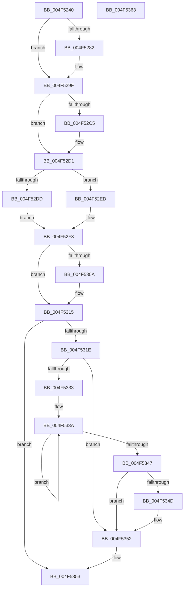

# KeThawExecution

- RVA: `0x004F5240`–`0x004F5364` (길이 `292` bytes)
- VA: `0x00000001404F5240`
- 실행 섹션: `.text`
- PDB 이름 있음: `예`; PDB Function 태그: `아니요`
- unwind 정보 RVA: `0x00060BC4`
- 디코드: `71`개 명령, `292/292` bytes 표시
- 미해석 바이트: `0` (있으면 어셈블리에 `.byte`로 보존)

> 이 문서는 커널 이미지의 기계어와 PDB 기호를 분석해 생성했습니다. 4번과 5번은 함수 원형과 자료형을 바이너리 사용 방식에서 추정한 C 해석이며 원본 소스 복구 결과는 아닙니다.

## 1. Dependencies

- 직접 호출 지점: **8**; 고유 호출 대상: **7**
- 직접 호출자로 확인된 함수: **2**
- RIP 상대 이미지 참조: **11**

### Outgoing calls
- `0x004F5274` → [guard_dispatch_icall](../6B/guard_dispatch_icall_function_006BAAD0.md) (function, `0x006BAAD0`)
- `0x004F5284` → [KeQueryPerformanceCounter](../37/KeQueryPerformanceCounter_function_0037E7E0.md) (function, `0x0037E7E0`)
- `0x004F52A1` → [KiSendThawExecution](../4E/KiSendThawExecution_function_004E2800.md) (function, `0x004E2800`)
- `0x004F52BB` → [KxReleaseSpinLock](../20/KxReleaseSpinLock_function_00206670.md) (function, `0x00206670`)
- `0x004F52CC` → [KxReleaseSpinLock](../20/KxReleaseSpinLock_function_00206670.md) (function, `0x00206670`)
- `0x004F52FC` → [KiEndDebugAccumulation](KiEndDebugAccumulation_function_004F5370.md) (function, `0x004F5370`)
- `0x004F5310` → [KiLowerIrqlProcessIrqlFlags](KiLowerIrqlProcessIrqlFlags_function_004F5698.md) (function, `0x004F5698`)
- `0x004F534D` → [KiRemoveSystemWorkPriorityKick](../26/KiRemoveSystemWorkPriorityKick_function_002631D0.md) (function, `0x002631D0`)

### Direct callers
- [ExpWaitForBootDevices](../65/ExpWaitForBootDevices_function_00657D90.md) at `0x00657E47`
- [KdExitDebugger](../../pagekd/B8/KdExitDebugger_function_00B85008.md) at `0x00B850D7`

### Static image references
- `0x004F524F` → RVA `0x00F231EC` (`.data`; read)
- `0x004F5258` → RVA `0x00E664AC` (`.data`; read)
- `0x004F5261` → RVA `0x00E00998` (`.data`; read)
- `0x004F5279` → RVA `0x00F0BD23` (`.data`; read)
- `0x004F5289` → RVA `0x00FC5008` (`ALMOSTRO`; read)
- `0x004F5297` → RVA `0x00E668A0` (`.data`; read/write)
- `0x004F52A6` → RVA `0x00F10DEC` (`.data`; read)
- `0x004F52AD` → RVA `0x00FCF2C0` (`CACHEALI`; read)
- `0x004F52B4` → RVA `0x00F231EC` (`.data`; read/write)
- `0x004F52C5` → RVA `0x00FCF280` (`CACHEALI`; read)
- `0x004F5301` → RVA `0x00FC6D20` (`ALMOSTRO`; read)

## 2. Other-region calls and transfers

- 다른 실행 섹션으로 향하는 call: **0**
- 별도 외부 분기/꼬리 이동을 확인하지 못했습니다.

## 3. Assembly (complete function range)

```asm
004F5240  48 89 5C 24 08                  mov qword ptr [rsp + 8], rbx
004F5245  48 89 74 24 10                  mov qword ptr [rsp + 0x10], rsi
004F524A  57                              push rdi
004F524B  48 83 EC 20                     sub rsp, 0x20
004F524F  8B 05 97 DF A2 00               mov eax, dword ptr [rip + 0xa2df97]
004F5255  40 8A F1                        mov sil, cl
004F5258  0F B6 15 4D 12 97 00            movzx edx, byte ptr [rip + 0x97124d]
004F525F  A8 08                           test al, 8
004F5261  48 8B 05 30 B7 90 00            mov rax, qword ptr [rip + 0x90b730]
004F5268  BF 00 00 00 00                  mov edi, 0
004F526D  0F 44 FA                        cmove edi, edx
004F5270  33 D2                           xor edx, edx
004F5272  33 C9                           xor ecx, ecx
004F5274  E8 57 58 1C 00                  call 0x1406baad0
004F5279  80 3D A3 6A A1 00 00            cmp byte ptr [rip + 0xa16aa3], 0
004F5280  75 1D                           jne 0x1404f529f
004F5282  33 C9                           xor ecx, ecx
004F5284  E8 57 95 E8 FF                  call 0x14037e7e0
004F5289  48 8B 0D 78 FD AC 00            mov rcx, qword ptr [rip + 0xacfd78]
004F5290  48 89 81 50 03 00 00            mov qword ptr [rcx + 0x350], rax
004F5297  48 83 25 01 16 97 00 00         and qword ptr [rip + 0x971601], 0
004F529F  B1 01                           mov cl, 1
004F52A1  E8 5A D5 FE FF                  call 0x1404e2800
004F52A6  0F B6 1D 3F BB A1 00            movzx ebx, byte ptr [rip + 0xa1bb3f]
004F52AD  48 8D 0D 0C A0 AD 00            lea rcx, [rip + 0xada00c]
004F52B4  83 25 31 DF A2 00 00            and dword ptr [rip + 0xa2df31], 0
004F52BB  E8 B0 13 D1 FF                  call 0x140206670
004F52C0  40 84 FF                        test dil, dil
004F52C3  74 0C                           je 0x1404f52d1
004F52C5  48 8D 0D B4 9F AD 00            lea rcx, [rip + 0xad9fb4]
004F52CC  E8 9F 13 D1 FF                  call 0x140206670
004F52D1  0F 20 E1                        mov rcx, cr4
004F52D4  48 F7 C1 80 00 02 00            test rcx, 0x20080
004F52DB  74 10                           je 0x1404f52ed
004F52DD  48 8B C1                        mov rax, rcx
004F52E0  48 0F BA F8 07                  btc rax, 7
004F52E5  0F 22 E0                        mov cr4, rax
004F52E8  0F 22 E1                        mov cr4, rcx
004F52EB  EB 06                           jmp 0x1404f52f3
004F52ED  0F 20 D8                        mov rax, cr3
004F52F0  0F 22 D8                        mov cr3, rax
004F52F3  65 48 8B 0C 25 20 00 00 00      mov rcx, qword ptr gs:[0x20]
004F52FC  E8 6F 00 00 00                  call 0x1404f5370
004F5301  83 3D 18 1A AD 00 00            cmp dword ptr [rip + 0xad1a18], 0
004F5308  74 0B                           je 0x1404f5315
004F530A  44 0F 20 C1                     mov rcx, cr8
004F530E  8A D3                           mov dl, bl
004F5310  E8 83 03 00 00                  call 0x1404f5698
004F5315  44 0F 22 C3                     mov cr8, rbx
004F5319  40 84 F6                        test sil, sil
004F531C  74 35                           je 0x1404f5353
004F531E  65 48 8B 0C 25 20 00 00 00      mov rcx, qword ptr gs:[0x20]
004F5327  4C 8B 81 B8 8E 00 00            mov r8, qword ptr [rcx + 0x8eb8]
004F532E  4D 85 C0                        test r8, r8
004F5331  74 1F                           je 0x1404f5352
004F5333  41 0F 0D 08                     prefetchw byte ptr [r8]
004F5337  41 8B 00                        mov eax, dword ptr [r8]
004F533A  8B D0                           mov edx, eax
004F533C  0F BA F2 15                     btr edx, 0x15
004F5340  F0 41 0F B1 10                  lock cmpxchg dword ptr [r8], edx
004F5345  75 F3                           jne 0x1404f533a
004F5347  0F BA E0 15                     bt eax, 0x15
004F534B  73 05                           jae 0x1404f5352
004F534D  E8 7E DE D6 FF                  call 0x1402631d0
004F5352  FB                              sti
004F5353  48 8B 5C 24 30                  mov rbx, qword ptr [rsp + 0x30]
004F5358  48 8B 74 24 38                  mov rsi, qword ptr [rsp + 0x38]
004F535D  48 83 C4 20                     add rsp, 0x20
004F5361  5F                              pop rdi
004F5362  C3                              ret
004F5363  CC                              int3
```

## 4. C-style interpretation (structured pseudocode)

```c
__int64 __fastcall KeThawExecution(int a1)
{
    __int64 result;
    __int64 v_rdi;
    __int64 v_rsp;
    unsigned __int64 v_stack_p10;
    unsigned __int64 v_stack_p8;

    v_stack_p8 = v_rbx;
    v_stack_p10 = v_rsi;
    v_rsp = (v_rsp) - (32);
    v_rdi = 0;
    if ((((unsigned __int8)((unsigned int)(*(unsigned int *)(v_rip + 10674071)))) & (8)) == 0) { v_rdi = (unsigned int)(*(unsigned __int8 *)(v_rip + 9900621)); }
    a2 = 0;
    a1 = 0;
    result = guard_dispatch_icall(a1, a2, a3, a4);
    if ((*(unsigned __int8 *)(v_rip + 10578595)) == 0) {
        a1 = 0;
        result = KeQueryPerformanceCounter(a1, a2, a3, a4);
        a1 = *(unsigned __int64 *)(v_rip + 11337080);
        *(unsigned __int64 *)(a1 + 848) = result;
    }
    result = KiSendThawExecution(1, a2, a3, a4);
    result = KxReleaseSpinLock(v_rip + 11378700, a2, a3, a4);
    if ((unsigned __int8)(v_rdi) != 0) {
        a1 = v_rip + 11378612;
        result = KxReleaseSpinLock(a1, a2, a3, a4);
    }
    if (((v_cr4) & (0x20080ULL)) == 0) goto loc_004F52ED;
    goto loc_004F52F3;
loc_004F52ED:
loc_004F52F3:
    result = KiEndDebugAccumulation(*(unsigned __int64 *)(gs_base + (0 + 32)), a2, a3, a4);
    if ((*(unsigned int *)(v_rip + 11344408)) != 0) {
        a1 = v_cr8;
        a2 = (unsigned __int8)(*(unsigned __int8 *)(v_rip + 10599231));
        result = KiLowerIrqlProcessIrqlFlags(a1, a2, a3, a4);
    }
    if ((unsigned __int8)((unsigned __int8)(a1)) == 0) goto loc_004F5353;
    if (*(unsigned __int64 *)(*(unsigned __int64 *)(gs_base + (0 + 32)) + 36536) == 0) goto loc_004F5352;
loc_004F533A:
    if (*(unsigned __int64 *)(*(unsigned __int64 *)(gs_base + (0 + 32)) + 36536) != 0) goto loc_004F533A;
    result = (unsigned int)(*(unsigned int *)(*(unsigned __int64 *)(*(unsigned __int64 *)(gs_base + (0 + 32)) + 36536)));
    if (!(condition_is_above_or_equal)) {
        result = KiRemoveSystemWorkPriorityKick(*(unsigned __int64 *)(gs_base + (0 + 32)), (unsigned int)((unsigned int)((unsigned int)(*(unsigned int *)(*(unsigned __int64 *)(*(unsigned __int64 *)(gs_base + (0 + 32)) + 36536))))), *(unsigned __int64 *)(*(unsigned __int64 *)(gs_base + (0 + 32)) + 36536), a4);
    }
loc_004F5353:
    v_rsp = (v_rsp) + (32);
    return result;
}
```

## 5. (Beta) C Style

```c
int64_t KeThawExecution(int32_t Arg1)
{
    int64_t result;
    int64_t local_rdi;
    int64_t local_rsp;
    uint64_t v_stack_p10;
    uint64_t v_stack_p8;

    v_stack_p8 = local_rbx;
    v_stack_p10 = local_rsi;
    local_rsp = (local_rsp) - (32);
    local_rdi = 0;
    if ((((uint8_t)((uint32_t)(*(uint32_t *)(v_rip + 0xA2DF97)))) & (8)) == 0) { local_rdi = (uint32_t)(*(uint8_t *)(v_rip + 0x97124D)); }
    a2 = 0;
    Arg1 = 0;
    result = guard_dispatch_icall(Arg1, a2, a3, a4);
    if ((*(uint8_t *)(v_rip + 0xA16AA3)) == 0) {
        Arg1 = 0;
        result = KeQueryPerformanceCounter(Arg1, a2, a3, a4);
        Arg1 = *(uint64_t *)(v_rip + 0xACFD78);
        *(uint64_t *)(Arg1 + 0x350) = result;
    }
    result = KiSendThawExecution(1, a2, a3, a4);
    result = KxReleaseSpinLock(v_rip + 11378700, a2, a3, a4);
    if ((uint8_t)(local_rdi) != 0) {
        Arg1 = v_rip + 11378612;
        result = KxReleaseSpinLock(Arg1, a2, a3, a4);
    }
    if (((v_cr4) & (0x20080ULL)) == 0) goto loc_004F52ED;
    goto loc_004F52F3;
loc_004F52ED:
loc_004F52F3:
    result = KiEndDebugAccumulation(*(uint64_t *)(gs_base + (0 + 0x20)), a2, a3, a4);
    if ((*(uint32_t *)(v_rip + 0xAD1A18)) != 0) {
        Arg1 = v_cr8;
        a2 = (uint8_t)(*(uint8_t *)(v_rip + 0xA1BB3F));
        result = KiLowerIrqlProcessIrqlFlags(Arg1, a2, a3, a4);
    }
    if ((uint8_t)((uint8_t)(Arg1)) == 0) goto loc_004F5353;
    if (*(uint64_t *)(*(uint64_t *)(gs_base + (0 + 0x20)) + 0x8EB8) == 0) goto loc_004F5352;
loc_004F533A:
    if (*(uint64_t *)(*(uint64_t *)(gs_base + (0 + 0x20)) + 0x8EB8) != 0) goto loc_004F533A;
    result = (uint32_t)(*(uint32_t *)(*(uint64_t *)(*(uint64_t *)(gs_base + (0 + 0x20)) + 0x8EB8)));
    if (!(condition_is_above_or_equal)) {
        result = KiRemoveSystemWorkPriorityKick(*(uint64_t *)(gs_base + (0 + 0x20)), (uint32_t)((uint32_t)((uint32_t)(*(uint32_t *)(*(uint64_t *)(*(uint64_t *)(gs_base + (0 + 0x20)) + 0x8EB8))))), *(uint64_t *)(*(uint64_t *)(gs_base + (0 + 0x20)) + 0x8EB8), a4);
    }
loc_004F5353:
    local_rsp = (local_rsp) + (32);
    return result;
}
```

## 6. Execution-region graph

[열기: 2D/3D 그래프와 함수 탐색 컨트롤 패널](../../../control-panel.html?section=text&rva=0x004F5240&view=graph)

- 2D 그래프는 위에서 아래로 흐르고, 3D 그래프는 빈 공간을 드래그해 회전합니다. Shift+드래그는 이동, 휠은 확대·축소, 함수 노드 선택은 대상 보고서 이동입니다.

### Static fallback


