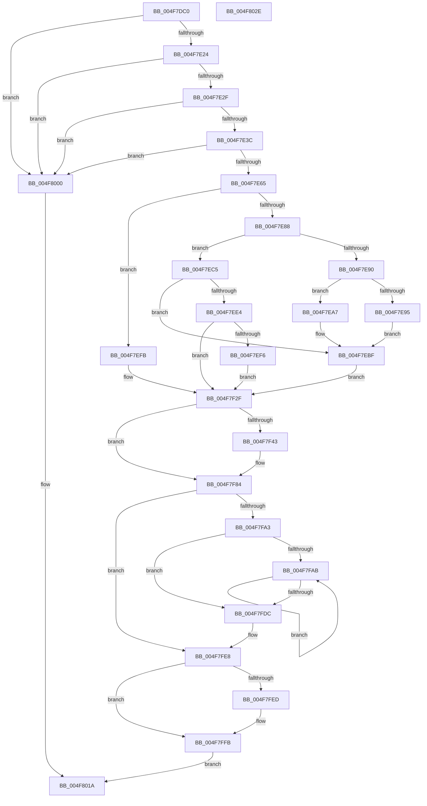

# KiApplyForegroundBoostThread

- RVA: `0x004F7DC0`–`0x004F802F` (길이 `623` bytes)
- VA: `0x00000001404F7DC0`
- 실행 섹션: `.text`
- PDB 이름 있음: `예`; PDB Function 태그: `아니요`
- unwind 정보 RVA: `0x000BE9B4`
- 디코드: `176`개 명령, `623/623` bytes 표시
- 미해석 바이트: `0` (있으면 어셈블리에 `.byte`로 보존)

> 이 문서는 커널 이미지의 기계어와 PDB 기호를 분석해 생성했습니다. 4번과 5번은 함수 원형과 자료형을 바이너리 사용 방식에서 추정한 C 해석이며 원본 소스 복구 결과는 아닙니다.

## 1. Dependencies

- 직접 호출 지점: **19**; 고유 호출 대상: **15**
- 직접 호출자로 확인된 함수: **1**
- RIP 상대 이미지 참조: **0**

### Outgoing calls
- `0x004F7E05` → [KiAcquireThreadStateLockForWrite](../30/KiAcquireThreadStateLockForWrite_function_0030E8C0.md) (function, `0x0030E8C0`)
- `0x004F7E3F` → [KiSetForegroundBoost](../3C/KiSetForegroundBoost_function_003C343C.md) (function, `0x003C343C`)
- `0x004F7E4C` → [KiComputeThreadPriority](../3C/KiComputeThreadPriority_function_003C45F4.md) (function, `0x003C45F4`)
- `0x004F7E9C` → [KiUpdateThreadPriority](../25/KiUpdateThreadPriority_function_00257810.md) (function, `0x00257810`)
- `0x004F7EB3` → [KiUpdateThreadPriority](../25/KiUpdateThreadPriority_function_00257810.md) (function, `0x00257810`)
- `0x004F7EDA` → [KiUpdateThreadPriority](../25/KiUpdateThreadPriority_function_00257810.md) (function, `0x00257810`)
- `0x004F7F06` → [KiRemoveThreadFromAnyReadyQueue](../20/KiRemoveThreadFromAnyReadyQueue_function_002015E4.md) (function, `0x002015E4`)
- `0x004F7F18` → [KiUpdateThreadPriority](../25/KiUpdateThreadPriority_function_00257810.md) (function, `0x00257810`)
- `0x004F7F2A` → [KiPrepareReadyThreadForRescheduling](../39/KiPrepareReadyThreadForRescheduling_function_00397F2C.md) (function, `0x00397F2C`)
- `0x004F7F34` → [KiUpdateSharedReadyQueueAffinityThread](../2C/KiUpdateSharedReadyQueueAffinityThread_function_002CE470.md) (function, `0x002CE470`)
- `0x004F7F54` → [KiStartRescheduleContext](../30/KiStartRescheduleContext_function_0030C6B0.md) (function, `0x0030C6B0`)
- `0x004F7F5F` → [KiFindRescheduleContextEntryForPrcb](../35/KiFindRescheduleContextEntryForPrcb_function_00353060.md) (function, `0x00353060`)
- `0x004F7F6B` → [KiSearchForNewThreadsForRescheduleContext](../25/KiSearchForNewThreadsForRescheduleContext_function_00258620.md) (function, `0x00258620`)
- `0x004F7F7C` → [KiCommitRescheduleContext](../30/KiCommitRescheduleContext_function_0030CF20.md) (function, `0x0030CF20`)
- `0x004F7F98` → [KiReleaseThreadStateLock](../21/KiReleaseThreadStateLock_function_00217910.md) (function, `0x00217910`)
- `0x004F7FCC` → [KiCompleteRescheduleContextEntry](../35/KiCompleteRescheduleContextEntry_function_00356330.md) (function, `0x00356330`)
- `0x004F7FE3` → [KiFlushSoftwareInterruptBatch](../25/KiFlushSoftwareInterruptBatch_function_00252200.md) (function, `0x00252200`)
- `0x004F7FF6` → [KiHvEnlightenedGuestPriorityKick](../44/KiHvEnlightenedGuestPriorityKick_function_00443880.md) (function, `0x00443880`)
- `0x004F8015` → [KiReleaseThreadStateLock](../21/KiReleaseThreadStateLock_function_00217910.md) (function, `0x00217910`)

### Direct callers
- [KiProcessPendingForegroundBoosts](../4C/KiProcessPendingForegroundBoosts_function_004C5A80.md) at `0x004C5BC7`

### Static image references
- 디코드된 RIP-relative 메모리 참조가 없습니다.

## 2. Other-region calls and transfers

- 다른 실행 섹션으로 향하는 call: **0**
- 별도 외부 분기/꼬리 이동을 확인하지 못했습니다.

## 3. Assembly (complete function range)

```asm
004F7DC0  48 89 54 24 10                  mov qword ptr [rsp + 0x10], rdx
004F7DC5  55                              push rbp
004F7DC6  53                              push rbx
004F7DC7  56                              push rsi
004F7DC8  57                              push rdi
004F7DC9  41 54                           push r12
004F7DCB  41 55                           push r13
004F7DCD  41 56                           push r14
004F7DCF  41 57                           push r15
004F7DD1  48 8B EC                        mov rbp, rsp
004F7DD4  48 83 EC 68                     sub rsp, 0x68
004F7DD8  33 FF                           xor edi, edi
004F7DDA  48 8D 45 E0                     lea rax, [rbp - 0x20]
004F7DDE  0F 57 C0                        xorps xmm0, xmm0
004F7DE1  48 89 7D 60                     mov qword ptr [rbp + 0x60], rdi
004F7DE5  4C 8D 4D C8                     lea r9, [rbp - 0x38]
004F7DE9  48 89 7D C8                     mov qword ptr [rbp - 0x38], rdi
004F7DED  4C 8D 45 D0                     lea r8, [rbp - 0x30]
004F7DF1  48 89 7D D0                     mov qword ptr [rbp - 0x30], rdi
004F7DF5  48 8D 55 60                     lea rdx, [rbp + 0x60]
004F7DF9  48 89 44 24 20                  mov qword ptr [rsp + 0x20], rax
004F7DFE  0F 11 45 E0                     movups xmmword ptr [rbp - 0x20], xmm0
004F7E02  48 8B F1                        mov rsi, rcx
004F7E05  E8 B6 6A E1 FF                  call 0x14030e8c0
004F7E0A  0F B6 D8                        movzx ebx, al
004F7E0D  48 8B 86 20 02 00 00            mov rax, qword ptr [rsi + 0x220]
004F7E14  8B 80 88 00 00 00               mov eax, dword ptr [rax + 0x88]
004F7E1A  0F BA E0 0D                     bt eax, 0xd
004F7E1E  0F 83 DC 01 00 00               jae 0x1404f8000
004F7E24  8B 46 78                        mov eax, dword ptr [rsi + 0x78]
004F7E27  A8 08                           test al, 8
004F7E29  0F 85 D1 01 00 00               jne 0x1404f8000
004F7E2F  40 38 BE C3 00 00 00            cmp byte ptr [rsi + 0xc3], dil
004F7E36  0F 8E C4 01 00 00               jle 0x1404f8000
004F7E3C  48 8B CE                        mov rcx, rsi
004F7E3F  E8 F8 B5 EC FF                  call 0x1403c343c
004F7E44  45 33 C0                        xor r8d, r8d
004F7E47  33 D2                           xor edx, edx
004F7E49  48 8B CE                        mov rcx, rsi
004F7E4C  E8 A3 C7 EC FF                  call 0x1403c45f4
004F7E51  44 0F BE 8E C3 00 00 00         movsx r9d, byte ptr [rsi + 0xc3]
004F7E59  44 8B F8                        mov r15d, eax
004F7E5C  41 3B C1                        cmp eax, r9d
004F7E5F  0F 8E 9B 01 00 00               jle 0x1404f8000
004F7E65  65 48 8B 04 25 20 00 00 00      mov rax, qword ptr gs:[0x20]
004F7E6E  44 8B E7                        mov r12d, edi
004F7E71  48 89 45 D8                     mov qword ptr [rbp - 0x28], rax
004F7E75  44 8B EF                        mov r13d, edi
004F7E78  40 88 7D 58                     mov byte ptr [rbp + 0x58], dil
004F7E7C  4C 8B C6                        mov r8, rsi
004F7E7F  40 88 7D 48                     mov byte ptr [rbp + 0x48], dil
004F7E83  83 EB 01                        sub ebx, 1
004F7E86  74 73                           je 0x1404f7efb
004F7E88  45 8B CF                        mov r9d, r15d
004F7E8B  83 EB 01                        sub ebx, 1
004F7E8E  74 35                           je 0x1404f7ec5
004F7E90  83 FB 01                        cmp ebx, 1
004F7E93  74 12                           je 0x1404f7ea7
004F7E95  33 C9                           xor ecx, ecx
004F7E97  40 88 7C 24 20                  mov byte ptr [rsp + 0x20], dil
004F7E9C  E8 6F F9 D5 FF                  call 0x140257810
004F7EA1  4C 8B 75 60                     mov r14, qword ptr [rbp + 0x60]
004F7EA5  EB 18                           jmp 0x1404f7ebf
004F7EA7  4C 8B 75 60                     mov r14, qword ptr [rbp + 0x60]
004F7EAB  49 8B CE                        mov rcx, r14
004F7EAE  C6 44 24 20 01                  mov byte ptr [rsp + 0x20], 1
004F7EB3  E8 58 F9 D5 FF                  call 0x140257810
004F7EB8  45 8B E7                        mov r12d, r15d
004F7EBB  40 88 7D 48                     mov byte ptr [rbp + 0x48], dil
004F7EBF  48 8B 5D 50                     mov rbx, qword ptr [rbp + 0x50]
004F7EC3  EB 6A                           jmp 0x1404f7f2f
004F7EC5  4C 8B 75 60                     mov r14, qword ptr [rbp + 0x60]
004F7EC9  49 8B CE                        mov rcx, r14
004F7ECC  49 8B 5E 10                     mov rbx, qword ptr [r14 + 0x10]
004F7ED0  48 85 DB                        test rbx, rbx
004F7ED3  0F 94 C0                        sete al
004F7ED6  88 44 24 20                     mov byte ptr [rsp + 0x20], al
004F7EDA  E8 31 F9 D5 FF                  call 0x140257810
004F7EDF  48 85 DB                        test rbx, rbx
004F7EE2  75 DB                           jne 0x1404f7ebf
004F7EE4  8A 86 84 01 00 00               mov al, byte ptr [rsi + 0x184]
004F7EEA  4C 8B 75 60                     mov r14, qword ptr [rbp + 0x60]
004F7EEE  48 8B 5D 50                     mov rbx, qword ptr [rbp + 0x50]
004F7EF2  3C 02                           cmp al, 2
004F7EF4  75 39                           jne 0x1404f7f2f
004F7EF6  45 8B E7                        mov r12d, r15d
004F7EF9  EB 34                           jmp 0x1404f7f2f
004F7EFB  4C 8B 75 60                     mov r14, qword ptr [rbp + 0x60]
004F7EFF  48 8B 55 C8                     mov rdx, qword ptr [rbp - 0x38]
004F7F03  49 8B CE                        mov rcx, r14
004F7F06  E8 D9 96 D0 FF                  call 0x1402015e4
004F7F0B  45 8B CF                        mov r9d, r15d
004F7F0E  40 88 7C 24 20                  mov byte ptr [rsp + 0x20], dil
004F7F13  4C 8B C6                        mov r8, rsi
004F7F16  33 C9                           xor ecx, ecx
004F7F18  E8 F3 F8 D5 FF                  call 0x140257810
004F7F1D  48 8B 5D 50                     mov rbx, qword ptr [rbp + 0x50]
004F7F21  41 8B D7                        mov edx, r15d
004F7F24  4C 8B C3                        mov r8, rbx
004F7F27  48 8B CE                        mov rcx, rsi
004F7F2A  E8 FD FF E9 FF                  call 0x140397f2c
004F7F2F  48 8B D6                        mov rdx, rsi
004F7F32  33 C9                           xor ecx, ecx
004F7F34  E8 37 65 DD FF                  call 0x1402ce470
004F7F39  48 8B 75 D8                     mov rsi, qword ptr [rbp - 0x28]
004F7F3D  40 38 7D 48                     cmp byte ptr [rbp + 0x48], dil
004F7F41  74 41                           je 0x1404f7f84
004F7F43  4C 8B AE E8 37 00 00            mov r13, qword ptr [rsi + 0x37e8]
004F7F4A  48 8D 55 D0                     lea rdx, [rbp - 0x30]
004F7F4E  49 8B CD                        mov rcx, r13
004F7F51  45 33 C0                        xor r8d, r8d
004F7F54  E8 57 47 E1 FF                  call 0x14030c6b0
004F7F59  49 8B D6                        mov rdx, r14
004F7F5C  49 8B CD                        mov rcx, r13
004F7F5F  E8 FC B0 E5 FF                  call 0x140353060
004F7F64  48 8B D3                        mov rdx, rbx
004F7F67  80 48 22 02                     or byte ptr [rax + 0x22], 2
004F7F6B  E8 B0 06 D6 FF                  call 0x140258620
004F7F70  4C 8B CB                        mov r9, rbx
004F7F73  45 33 C0                        xor r8d, r8d
004F7F76  48 8B D6                        mov rdx, rsi
004F7F79  49 8B CD                        mov rcx, r13
004F7F7C  E8 9F 4F E1 FF                  call 0x14030cf20
004F7F81  88 45 58                        mov byte ptr [rbp + 0x58], al
004F7F84  4C 8B 4D C8                     mov r9, qword ptr [rbp - 0x38]
004F7F88  48 8D 45 E0                     lea rax, [rbp - 0x20]
004F7F8C  4C 8D 45 D0                     lea r8, [rbp - 0x30]
004F7F90  48 89 44 24 20                  mov qword ptr [rsp + 0x20], rax
004F7F95  49 8B D6                        mov rdx, r14
004F7F98  E8 73 F9 D1 FF                  call 0x140217910
004F7F9D  40 38 7D 58                     cmp byte ptr [rbp + 0x58], dil
004F7FA1  74 45                           je 0x1404f7fe8
004F7FA3  8B DF                           mov ebx, edi
004F7FA5  41 38 7D 00                     cmp byte ptr [r13], dil
004F7FA9  76 31                           jbe 0x1404f7fdc
004F7FAB  8B C3                           mov eax, ebx
004F7FAD  45 33 C9                        xor r9d, r9d
004F7FB0  45 33 C0                        xor r8d, r8d
004F7FB3  48 8B D6                        mov rdx, rsi
004F7FB6  48 8D 0C 85 02 00 00 00         lea rcx, [rax*4 + 2]
004F7FBE  48 03 C8                        add rcx, rax
004F7FC1  48 8D 0C CD 00 00 00 00         lea rcx, [rcx*8]
004F7FC9  49 03 CD                        add rcx, r13
004F7FCC  E8 5F E3 E5 FF                  call 0x140356330
004F7FD1  41 0F B6 45 00                  movzx eax, byte ptr [r13]
004F7FD6  FF C3                           inc ebx
004F7FD8  3B D8                           cmp ebx, eax
004F7FDA  72 CF                           jb 0x1404f7fab
004F7FDC  48 8D 8E D8 35 00 00            lea rcx, [rsi + 0x35d8]
004F7FE3  E8 18 A2 D5 FF                  call 0x140252200
004F7FE8  45 85 E4                        test r12d, r12d
004F7FEB  7E 0E                           jle 0x1404f7ffb
004F7FED  45 8B C4                        mov r8d, r12d
004F7FF0  49 8B D6                        mov rdx, r14
004F7FF3  48 8B CE                        mov rcx, rsi
004F7FF6  E8 85 B8 F4 FF                  call 0x140443880
004F7FFB  40 B7 01                        mov dil, 1
004F7FFE  EB 1A                           jmp 0x1404f801a
004F8000  4C 8B 4D C8                     mov r9, qword ptr [rbp - 0x38]
004F8004  48 8D 45 E0                     lea rax, [rbp - 0x20]
004F8008  48 8B 55 60                     mov rdx, qword ptr [rbp + 0x60]
004F800C  4C 8D 45 D0                     lea r8, [rbp - 0x30]
004F8010  48 89 44 24 20                  mov qword ptr [rsp + 0x20], rax
004F8015  E8 F6 F8 D1 FF                  call 0x140217910
004F801A  40 8A C7                        mov al, dil
004F801D  48 83 C4 68                     add rsp, 0x68
004F8021  41 5F                           pop r15
004F8023  41 5E                           pop r14
004F8025  41 5D                           pop r13
004F8027  41 5C                           pop r12
004F8029  5F                              pop rdi
004F802A  5E                              pop rsi
004F802B  5B                              pop rbx
004F802C  5D                              pop rbp
004F802D  C3                              ret
004F802E  CC                              int3
```

## 4. C-style interpretation (structured pseudocode)

```c
__int64 __fastcall KiApplyForegroundBoostThread(__int64 a1, __int64 a2)
{
    __int64 result;
    __int64 v_r13;
    __int64 v_rbx;
    __int64 v_rdi;
    __int64 v_rsp;
    unsigned __int64 v_stack_m60;
    unsigned __int64 v_stack_m68;
    unsigned __int64 v_stack_m70;
    unsigned __int64 v_stack_m78;
    unsigned __int64 v_stack_m88;
    unsigned __int64 v_stack_p10;
    unsigned __int8 v_stack_p18;
    unsigned __int64 v_stack_p20;
    unsigned __int8 v_stack_p8;

    v_stack_p10 = a2;
    v_rsp = (v_rsp) - (104);
    v_rdi = 0;
    v_stack_p20 = 0;
    v_stack_m78 = 0;
    v_stack_m70 = 0;
    v_stack_m88 = v_stack_m60;
    v_stack_m60 = v_xmm0;
    result = KiAcquireThreadStateLockForWrite(a1, v_stack_p20, v_stack_m70, v_stack_m78);
    if (condition_is_above_or_equal) goto loc_004F8000;
    if ((((unsigned __int8)((unsigned int)(*(unsigned int *)(a1 + 120)))) & (8)) != 0) goto loc_004F8000;
    if ((*(unsigned __int8 *)(a1 + 195)) <= 0) goto loc_004F8000;
    result = KiSetForegroundBoost(a1, v_stack_p20, v_stack_m70, v_stack_m78);
    a3 = 0;
    a2 = 0;
    result = KiComputeThreadPriority(a1, a2, a3, v_stack_m78);
    if (((unsigned int)(result)) <= ((unsigned int)((__int8)(*(unsigned __int8 *)(a1 + 195))))) goto loc_004F8000;
    v_stack_m68 = *(unsigned __int64 *)(gs_base + (0 + 32));
    v_stack_p18 = 0;
    v_stack_p8 = 0;
    v_rbx = (unsigned int)(((unsigned __int8)(result)) - (1));
    if (condition_is_equal) goto loc_004F7EFB;
    v_rbx = (unsigned int)((v_rbx) - (1));
    if (condition_is_equal) goto loc_004F7EC5;
    if (((unsigned int)(v_rbx)) == 1) goto loc_004F7EA7;
    a1 = 0;
    v_stack_m88 = 0;
    result = KiUpdateThreadPriority(a1, a2, a1, (unsigned int)((unsigned int)((unsigned int)((unsigned int)(result)))));
    goto loc_004F7EBF;
loc_004F7EA7:
    v_stack_m88 = 1;
    result = KiUpdateThreadPriority(v_stack_p20, a2, a1, (unsigned int)((unsigned int)((unsigned int)((unsigned int)(result)))));
    v_stack_p8 = 0;
loc_004F7EBF:
    goto loc_004F7F2F;
loc_004F7EC5:
    result = (*(unsigned __int64 *)(v_stack_p20 + 16) == 0) ? 1 : 0;
    v_stack_m88 = (unsigned __int8)(result);
    result = KiUpdateThreadPriority(v_stack_p20, a2, a1, (unsigned int)((unsigned int)((unsigned int)((unsigned int)(result)))));
    if (*(unsigned __int64 *)(v_stack_p20 + 16) != 0) goto loc_004F7EBF;
    if (((unsigned __int8)(*(unsigned __int8 *)(a1 + 388))) != 2) goto loc_004F7F2F;
    goto loc_004F7F2F;
loc_004F7EFB:
    result = KiRemoveThreadFromAnyReadyQueue(v_stack_p20, v_stack_m78, a1, (unsigned int)((unsigned int)((unsigned int)((unsigned int)(result)))));
    v_stack_m88 = 0;
    a1 = 0;
    result = KiUpdateThreadPriority(a1, v_stack_m78, 0, (unsigned int)((unsigned int)((unsigned int)((unsigned int)(result)))));
    result = KiPrepareReadyThreadForRescheduling(0, (unsigned int)((unsigned int)((unsigned int)((unsigned int)(result)))), v_stack_p10, (unsigned int)((unsigned int)((unsigned int)((unsigned int)(result)))));
loc_004F7F2F:
    a1 = 0;
    result = KiUpdateSharedReadyQueueAffinityThread(a1, 0, v_stack_p10, (unsigned int)((unsigned int)((unsigned int)((unsigned int)(result)))));
    v_r13 = 0;
    if (v_stack_p8 != 0) {
        v_r13 = *(unsigned __int64 *)(v_stack_m68 + 14312);
        a2 = v_stack_m70;
        a1 = v_r13;
        a3 = 0;
        result = KiStartRescheduleContext(a1, a2, a3, (unsigned int)((unsigned int)((unsigned int)((unsigned int)(result)))));
        a2 = v_stack_p20;
        a1 = v_r13;
        result = KiFindRescheduleContextEntryForPrcb(a1, a2, a3, (unsigned int)((unsigned int)((unsigned int)((unsigned int)(result)))));
        a2 = v_stack_p10;
        result = KiSearchForNewThreadsForRescheduleContext(a1, a2, a3, (unsigned int)((unsigned int)((unsigned int)((unsigned int)(result)))));
        a4 = v_stack_p10;
        a3 = 0;
        a2 = v_stack_m68;
        a1 = v_r13;
        result = KiCommitRescheduleContext(a1, a2, a3, a4);
        v_stack_p18 = (unsigned __int8)(result);
    }
    v_stack_m88 = v_stack_m60;
    result = KiReleaseThreadStateLock(a1, v_stack_p20, v_stack_m70, v_stack_m78);
    if (v_stack_p18 == 0) goto loc_004F7FE8;
    if ((*(unsigned __int8 *)(v_r13)) <= 0) goto loc_004F7FDC;
loc_004F7FAB:
    a4 = 0;
    a3 = 0;
    a1 = (0 * 4 + 2) + (0);
    a1 = (a1 * 8) + (v_r13);
    result = KiCompleteRescheduleContextEntry(a1, v_stack_m68, a3, a4);
    v_rbx = (unsigned int)((0) + 1);
    if (((unsigned int)(v_rbx)) < ((unsigned int)(*(unsigned __int8 *)(v_r13)))) goto loc_004F7FAB;
loc_004F7FDC:
    result = KiFlushSoftwareInterruptBatch(v_stack_m68 + 13784, v_stack_m68, a3, a4);
loc_004F7FE8:
    if (!(condition_is_less_or_equal)) {
        a3 = (unsigned int)((unsigned int)((unsigned int)((unsigned int)((unsigned int)(result)))));
        a2 = v_stack_p20;
        a1 = v_stack_m68;
        result = KiHvEnlightenedGuestPriorityKick(a1, a2, a3, a4);
    }
    goto loc_004F801A;
loc_004F8000:
    v_stack_m88 = v_stack_m60;
    result = KiReleaseThreadStateLock(a1, v_stack_p20, v_stack_m70, v_stack_m78);
loc_004F801A:
    v_rsp = (v_rsp) + (104);
    return 1;
}
```

## 5. (Beta) C Style

```c
int64_t KiApplyForegroundBoostThread(void *Arg1, int64_t Arg2)
{
    uint8_t *arg1 = (uint8_t *)Arg1;

    int64_t result;
    int64_t local_r13;
    int64_t local_rbx;
    int64_t local_rdi;
    int64_t local_rsp;
    uint64_t v_stack_m60;
    uint64_t v_stack_m68;
    uint64_t v_stack_m70;
    uint64_t v_stack_m78;
    uint64_t v_stack_m88;
    uint64_t v_stack_p10;
    uint8_t v_stack_p18;
    uint64_t v_stack_p20;
    uint8_t v_stack_p8;

    v_stack_p10 = Arg2;
    local_rsp = (local_rsp) - (104);
    local_rdi = 0;
    v_stack_p20 = 0;
    v_stack_m78 = 0;
    v_stack_m70 = 0;
    v_stack_m88 = v_stack_m60;
    v_stack_m60 = v_xmm0;
    result = KiAcquireThreadStateLockForWrite(Arg1, v_stack_p20, v_stack_m70, v_stack_m78);
    if (condition_is_above_or_equal) goto loc_004F8000;
    if ((((uint8_t)((uint32_t)(*(uint32_t *)(arg1 + 0x78)))) & (8)) != 0) goto loc_004F8000;
    if ((*(uint8_t *)(arg1 + 0xC3)) <= 0) goto loc_004F8000;
    result = KiSetForegroundBoost(Arg1, v_stack_p20, v_stack_m70, v_stack_m78);
    a3 = 0;
    Arg2 = 0;
    result = KiComputeThreadPriority(Arg1, Arg2, a3, v_stack_m78);
    if (((uint32_t)(result)) <= ((uint32_t)((int8_t)(*(uint8_t *)(arg1 + 0xC3))))) goto loc_004F8000;
    v_stack_m68 = *(uint64_t *)(gs_base + (0 + 0x20));
    v_stack_p18 = 0;
    v_stack_p8 = 0;
    local_rbx = (uint32_t)(((uint8_t)(result)) - (1));
    if (condition_is_equal) goto loc_004F7EFB;
    local_rbx = (uint32_t)((local_rbx) - (1));
    if (condition_is_equal) goto loc_004F7EC5;
    if (((uint32_t)(local_rbx)) == 1) goto loc_004F7EA7;
    Arg1 = 0;
    v_stack_m88 = 0;
    result = KiUpdateThreadPriority(Arg1, Arg2, Arg1, (uint32_t)((uint32_t)((uint32_t)((uint32_t)(result)))));
    goto loc_004F7EBF;
loc_004F7EA7:
    v_stack_m88 = 1;
    result = KiUpdateThreadPriority(v_stack_p20, Arg2, Arg1, (uint32_t)((uint32_t)((uint32_t)((uint32_t)(result)))));
    v_stack_p8 = 0;
loc_004F7EBF:
    goto loc_004F7F2F;
loc_004F7EC5:
    result = (*(uint64_t *)(v_stack_p20 + 0x10) == 0) ? 1 : 0;
    v_stack_m88 = (uint8_t)(result);
    result = KiUpdateThreadPriority(v_stack_p20, Arg2, Arg1, (uint32_t)((uint32_t)((uint32_t)((uint32_t)(result)))));
    if (*(uint64_t *)(v_stack_p20 + 0x10) != 0) goto loc_004F7EBF;
    if (((uint8_t)(*(uint8_t *)(arg1 + 0x184))) != 2) goto loc_004F7F2F;
    goto loc_004F7F2F;
loc_004F7EFB:
    result = KiRemoveThreadFromAnyReadyQueue(v_stack_p20, v_stack_m78, Arg1, (uint32_t)((uint32_t)((uint32_t)((uint32_t)(result)))));
    v_stack_m88 = 0;
    Arg1 = 0;
    result = KiUpdateThreadPriority(Arg1, v_stack_m78, 0, (uint32_t)((uint32_t)((uint32_t)((uint32_t)(result)))));
    result = KiPrepareReadyThreadForRescheduling(0, (uint32_t)((uint32_t)((uint32_t)((uint32_t)(result)))), v_stack_p10, (uint32_t)((uint32_t)((uint32_t)((uint32_t)(result)))));
loc_004F7F2F:
    Arg1 = 0;
    result = KiUpdateSharedReadyQueueAffinityThread(Arg1, 0, v_stack_p10, (uint32_t)((uint32_t)((uint32_t)((uint32_t)(result)))));
    local_r13 = 0;
    if (v_stack_p8 != 0) {
        local_r13 = *(uint64_t *)(v_stack_m68 + 0x37E8);
        Arg2 = v_stack_m70;
        Arg1 = local_r13;
        a3 = 0;
        result = KiStartRescheduleContext(Arg1, Arg2, a3, (uint32_t)((uint32_t)((uint32_t)((uint32_t)(result)))));
        Arg2 = v_stack_p20;
        Arg1 = local_r13;
        result = KiFindRescheduleContextEntryForPrcb(Arg1, Arg2, a3, (uint32_t)((uint32_t)((uint32_t)((uint32_t)(result)))));
        Arg2 = v_stack_p10;
        result = KiSearchForNewThreadsForRescheduleContext(Arg1, Arg2, a3, (uint32_t)((uint32_t)((uint32_t)((uint32_t)(result)))));
        a4 = v_stack_p10;
        a3 = 0;
        Arg2 = v_stack_m68;
        Arg1 = local_r13;
        result = KiCommitRescheduleContext(Arg1, Arg2, a3, a4);
        v_stack_p18 = (uint8_t)(result);
    }
    v_stack_m88 = v_stack_m60;
    result = KiReleaseThreadStateLock(Arg1, v_stack_p20, v_stack_m70, v_stack_m78);
    if (v_stack_p18 == 0) goto loc_004F7FE8;
    if ((*(uint8_t *)(local_r13)) <= 0) goto loc_004F7FDC;
loc_004F7FAB:
    a4 = 0;
    a3 = 0;
    Arg1 = (0 * 4 + 2) + (0);
    Arg1 = (Arg1 * 8) + (local_r13);
    result = KiCompleteRescheduleContextEntry(Arg1, v_stack_m68, a3, a4);
    local_rbx = (uint32_t)((0) + 1);
    if (((uint32_t)(local_rbx)) < ((uint32_t)(*(uint8_t *)(local_r13)))) goto loc_004F7FAB;
loc_004F7FDC:
    result = KiFlushSoftwareInterruptBatch(v_stack_m68 + 13784, v_stack_m68, a3, a4);
loc_004F7FE8:
    if (!(condition_is_less_or_equal)) {
        a3 = (uint32_t)((uint32_t)((uint32_t)((uint32_t)((uint32_t)(result)))));
        Arg2 = v_stack_p20;
        Arg1 = v_stack_m68;
        result = KiHvEnlightenedGuestPriorityKick(Arg1, Arg2, a3, a4);
    }
    goto loc_004F801A;
loc_004F8000:
    v_stack_m88 = v_stack_m60;
    result = KiReleaseThreadStateLock(Arg1, v_stack_p20, v_stack_m70, v_stack_m78);
loc_004F801A:
    local_rsp = (local_rsp) + (104);
    return 1;
}
```

### 관측된 메모리 오프셋

구조체 형식이 확인되지 않은 접근은 인자 기준의 오프셋으로만 기록했습니다.

| 기준 인자 | 오프셋 표현 | 폭 (bit) | 접근 |
|---|---:|---:|---|
| `Arg1` | `+ 0x78` | `32` | `R` |
| `Arg1` | `+ 0xC3` | `8` | `R` |
| `Arg1` | `+ 0x184` | `8` | `R` |
| `Arg1` | `+ 0x220` | `64` | `R` |

## 6. Execution-region graph

[열기: 2D/3D 그래프와 함수 탐색 컨트롤 패널](../../../control-panel.html?section=text&rva=0x004F7DC0&view=graph)

- 2D 그래프는 위에서 아래로 흐르고, 3D 그래프는 빈 공간을 드래그해 회전합니다. Shift+드래그는 이동, 휠은 확대·축소, 함수 노드 선택은 대상 보고서 이동입니다.

### Static fallback


