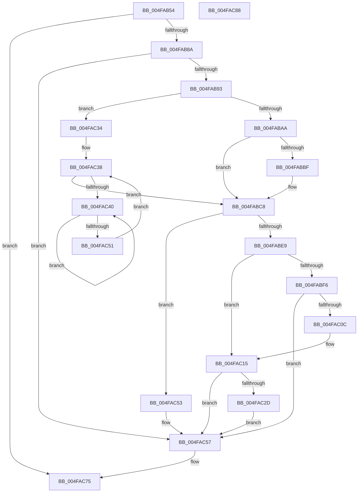

# KiArmForceParkDutyCyclingForLocalReadyQueue

- RVA: `0x004FAB54`–`0x004FAC89` (길이 `309` bytes)
- VA: `0x00000001404FAB54`
- 실행 섹션: `.text`
- PDB 이름 있음: `예`; PDB Function 태그: `아니요`
- unwind 정보 RVA: `0x000BF99C`
- 디코드: `80`개 명령, `309/309` bytes 표시
- 미해석 바이트: `0` (있으면 어셈블리에 `.byte`로 보존)

> 이 문서는 커널 이미지의 기계어와 PDB 기호를 분석해 생성했습니다. 4번과 5번은 함수 원형과 자료형을 바이너리 사용 방식에서 추정한 C 해석이며 원본 소스 복구 결과는 아닙니다.

## 1. Dependencies

- 직접 호출 지점: **5**; 고유 호출 대상: **5**
- 직접 호출자로 확인된 함수: **2**
- RIP 상대 이미지 참조: **1**

### Outgoing calls
- `0x004FABC3` → [KxWaitForLockOwnerShip](../25/KxWaitForLockOwnerShip_function_00257EB0.md) (function, `0x00257EB0`)
- `0x004FAC10` → [KxWaitForLockChainValid](../21/KxWaitForLockChainValid_function_00217AA0.md) (function, `0x00217AA0`)
- `0x004FAC2D` → [KeWakeAddressAll](../21/KeWakeAddressAll_function_00217C20.md) (function, `0x00217C20`)
- `0x004FAC44` → [KeYieldProcessorEx](../3F/KeYieldProcessorEx_function_003FBD00.md) (function, `0x003FBD00`)
- `0x004FAC70` → [KeInsertQueueDpc](../20/KeInsertQueueDpc_function_00207C50.md) (function, `0x00207C50`)

### Direct callers
- [sub_00218B2B](../21/Unknown_function_00218B2B.md) at `0x00218DC6`
- [KiUpdateLocalReadyQueueStatisticsOnInsertion](../4A/KiUpdateLocalReadyQueueStatisticsOnInsertion_function_004A9290.md) at `0x004A9317`

### Static image references
- `0x004FAB93` → RVA `0x00FC6B38` (`ALMOSTRO`; read)

## 2. Other-region calls and transfers

- 다른 실행 섹션으로 향하는 call: **0**
- 별도 외부 분기/꼬리 이동을 확인하지 못했습니다.

## 3. Assembly (complete function range)

```asm
004FAB54  48 89 5C 24 10                  mov qword ptr [rsp + 0x10], rbx
004FAB59  48 89 74 24 18                  mov qword ptr [rsp + 0x18], rsi
004FAB5E  55                              push rbp
004FAB5F  57                              push rdi
004FAB60  41 56                           push r14
004FAB62  48 8B EC                        mov rbp, rsp
004FAB65  48 83 EC 30                     sub rsp, 0x30
004FAB69  48 8B B9 F0 86 00 00            mov rdi, qword ptr [rcx + 0x86f0]
004FAB70  45 33 F6                        xor r14d, r14d
004FAB73  48 8B 99 48 8E 00 00            mov rbx, qword ptr [rcx + 0x8e48]
004FAB7A  48 8B F1                        mov rsi, rcx
004FAB7D  44 39 B7 50 01 00 00            cmp dword ptr [rdi + 0x150], r14d
004FAB84  0F 85 EB 00 00 00               jne 0x1404fac75
004FAB8A  48 85 DB                        test rbx, rbx
004FAB8D  0F 84 C4 00 00 00               je 0x1404fac57
004FAB93  F7 05 9B BF AC 00 00 00 20 00   test dword ptr [rip + 0xacbf9b], 0x200000
004FAB9D  0F 57 C0                        xorps xmm0, xmm0
004FABA0  0F 11 45 F0                     movups xmmword ptr [rbp - 0x10], xmm0
004FABA4  0F 84 8A 00 00 00               je 0x1404fac34
004FABAA  48 89 5D F8                     mov qword ptr [rbp - 8], rbx
004FABAE  48 8D 55 F0                     lea rdx, [rbp - 0x10]
004FABB2  4C 89 75 F0                     mov qword ptr [rbp - 0x10], r14
004FABB6  90                              nop
004FABB7  48 87 13                        xchg qword ptr [rbx], rdx
004FABBA  48 85 D2                        test rdx, rdx
004FABBD  74 09                           je 0x1404fabc8
004FABBF  48 8D 4D F0                     lea rcx, [rbp - 0x10]
004FABC3  E8 E8 D2 D5 FF                  call 0x140257eb0
004FABC8  48 8B 8E C8 00 00 00            mov rcx, qword ptr [rsi + 0xc8]
004FABCF  48 0B 8B E8 06 00 00            or rcx, qword ptr [rbx + 0x6e8]
004FABD6  F7 05 58 BF AC 00 00 00 20 00   test dword ptr [rip + 0xacbf58], 0x200000
004FABE0  48 89 8B E8 06 00 00            mov qword ptr [rbx + 0x6e8], rcx
004FABE7  74 6A                           je 0x1404fac53
004FABE9  0F 0D 4D F0                     prefetchw byte ptr [rbp - 0x10]
004FABED  48 8B 45 F0                     mov rax, qword ptr [rbp - 0x10]
004FABF1  48 85 C0                        test rax, rax
004FABF4  75 1F                           jne 0x1404fac15
004FABF6  48 8B 4D F8                     mov rcx, qword ptr [rbp - 8]
004FABFA  48 8D 45 F0                     lea rax, [rbp - 0x10]
004FABFE  F0 4C 0F B1 31                  lock cmpxchg qword ptr [rcx], r14
004FAC03  48 8D 4D F0                     lea rcx, [rbp - 0x10]
004FAC07  48 3B C1                        cmp rax, rcx
004FAC0A  74 4B                           je 0x1404fac57
004FAC0C  48 8D 4D F0                     lea rcx, [rbp - 0x10]
004FAC10  E8 8B CE D1 FF                  call 0x140217aa0
004FAC15  48 8D 48 08                     lea rcx, [rax + 8]
004FAC19  4C 89 75 F0                     mov qword ptr [rbp - 0x10], r14
004FAC1D  48 8B 55 F8                     mov rdx, qword ptr [rbp - 8]
004FAC21  48 8B C2                        mov rax, rdx
004FAC24  48 87 01                        xchg qword ptr [rcx], rax
004FAC27  32 C2                           xor al, dl
004FAC29  A8 04                           test al, 4
004FAC2B  74 2A                           je 0x1404fac57
004FAC2D  E8 EE CF D1 FF                  call 0x140217c20
004FAC32  EB 23                           jmp 0x1404fac57
004FAC34  44 89 75 20                     mov dword ptr [rbp + 0x20], r14d
004FAC38  F0 48 0F BA 2B 00               lock bts qword ptr [rbx], 0
004FAC3E  73 88                           jae 0x1404fabc8
004FAC40  48 8D 4D 20                     lea rcx, [rbp + 0x20]
004FAC44  E8 B7 10 F0 FF                  call 0x1403fbd00
004FAC49  48 8B 03                        mov rax, qword ptr [rbx]
004FAC4C  48 85 C0                        test rax, rax
004FAC4F  75 EF                           jne 0x1404fac40
004FAC51  EB E5                           jmp 0x1404fac38
004FAC53  F0 4C 21 33                     lock and qword ptr [rbx], r14
004FAC57  B8 01 00 00 00                  mov eax, 1
004FAC5C  45 33 C0                        xor r8d, r8d
004FAC5F  33 D2                           xor edx, edx
004FAC61  89 87 50 01 00 00               mov dword ptr [rdi + 0x150], eax
004FAC67  48 8B CF                        mov rcx, rdi
004FAC6A  89 87 54 01 00 00               mov dword ptr [rdi + 0x154], eax
004FAC70  E8 DB CF D0 FF                  call 0x140207c50
004FAC75  48 8B 5C 24 58                  mov rbx, qword ptr [rsp + 0x58]
004FAC7A  48 8B 74 24 60                  mov rsi, qword ptr [rsp + 0x60]
004FAC7F  48 83 C4 30                     add rsp, 0x30
004FAC83  41 5E                           pop r14
004FAC85  5F                              pop rdi
004FAC86  5D                              pop rbp
004FAC87  C3                              ret
004FAC88  CC                              int3
```

## 4. C-style interpretation (structured pseudocode)

```c
__int64 __fastcall KiArmForceParkDutyCyclingForLocalReadyQueue(__int64 a1, __int64 a2, int a3)
{
    __int64 result;
    __int64 v_r14;
    __int64 v_rsp;
    unsigned __int64 v_stack_m20;
    unsigned __int64 v_stack_m28;
    unsigned __int64 v_stack_p10;
    unsigned __int64 v_stack_p18;
    unsigned int v_stack_p8;

    v_stack_p10 = v_rbx;
    v_stack_p18 = v_rsi;
    v_rsp = (v_rsp) - (48);
    v_r14 = 0;
    if ((*(unsigned int *)(*(unsigned __int64 *)(a1 + 34544) + 336)) != 0) goto loc_004FAC75;
    if (*(unsigned __int64 *)(a1 + 36424) == 0) goto loc_004FAC57;
    v_stack_m28 = v_xmm0;
    if (((*(unsigned int *)(v_rip + 11321243)) & (0x200000ULL)) == 0) goto loc_004FAC34;
    v_stack_m20 = *(unsigned __int64 *)(a1 + 36424);
    v_stack_m28 = 0;
    if (v_stack_m28 != 0) {
        a1 = v_stack_m28;
        result = KxWaitForLockOwnerShip(a1, v_stack_m28, a3, a4);
    }
    a1 = (*(unsigned __int64 *)(a1 + 200)) | (*(unsigned __int64 *)(*(unsigned __int64 *)(a1 + 36424) + 1768));
    *(unsigned __int64 *)(*(unsigned __int64 *)(a1 + 36424) + 1768) = a1;
    if (((*(unsigned int *)(v_rip + 11321176)) & (0x200000ULL)) == 0) goto loc_004FAC53;
    if (v_stack_m28 != 0) goto loc_004FAC15;
    if (v_stack_m28 == v_stack_m28) goto loc_004FAC57;
    result = KxWaitForLockChainValid(v_stack_m28, v_stack_m28, a3, a4);
loc_004FAC15:
    v_stack_m28 = 0;
    result = (unsigned __int8)((v_stack_m20) ^ ((unsigned __int8)(v_stack_m20)));
    if ((((unsigned __int8)(result)) & (4)) == 0) goto loc_004FAC57;
    result = KeWakeAddressAll(result + 8, v_stack_m20, a3, a4);
    goto loc_004FAC57;
loc_004FAC34:
    v_stack_p8 = 0;
loc_004FAC38:
    if (condition_is_above_or_equal) goto loc_004FABC8;
loc_004FAC40:
    result = KeYieldProcessorEx(v_stack_p8, v_stack_m20, a3, a4);
    if (*(unsigned __int64 *)(*(unsigned __int64 *)(a1 + 36424)) != 0) goto loc_004FAC40;
    goto loc_004FAC38;
loc_004FAC53:
loc_004FAC57:
    a3 = 0;
    a2 = 0;
    *(unsigned int *)(*(unsigned __int64 *)(a1 + 34544) + 336) = 1;
    *(unsigned int *)(*(unsigned __int64 *)(a1 + 34544) + 340) = 1;
    result = KeInsertQueueDpc(*(unsigned __int64 *)(a1 + 34544), a2, a3, a4);
loc_004FAC75:
    v_rsp = (v_rsp) + (48);
    return result;
}
```

## 5. (Beta) C Style

```c
int64_t KiArmForceParkDutyCyclingForLocalReadyQueue(void *Arg1, int64_t Arg2, int32_t Arg3)
{
    uint8_t *arg1 = (uint8_t *)Arg1;

    int64_t result;
    int64_t local_r14;
    int64_t local_rsp;
    uint64_t v_stack_m20;
    uint64_t v_stack_m28;
    uint64_t v_stack_p10;
    uint64_t v_stack_p18;
    uint32_t v_stack_p8;

    v_stack_p10 = local_rbx;
    v_stack_p18 = local_rsi;
    local_rsp = (local_rsp) - (48);
    local_r14 = 0;
    if ((*(uint32_t *)(*(uint64_t *)(arg1 + 0x86F0) + 0x150)) != 0) goto loc_004FAC75;
    if (*(uint64_t *)(arg1 + 0x8E48) == 0) goto loc_004FAC57;
    v_stack_m28 = v_xmm0;
    if (((*(uint32_t *)(v_rip + 0xACBF9B)) & (0x200000ULL)) == 0) goto loc_004FAC34;
    v_stack_m20 = *(uint64_t *)(arg1 + 0x8E48);
    v_stack_m28 = 0;
    if (v_stack_m28 != 0) {
        Arg1 = v_stack_m28;
        result = KxWaitForLockOwnerShip(Arg1, v_stack_m28, Arg3, a4);
    }
    Arg1 = (*(uint64_t *)(arg1 + 0xC8)) | (*(uint64_t *)(*(uint64_t *)(arg1 + 0x8E48) + 0x6E8));
    *(void **)(*(uint64_t *)(arg1 + 0x8E48) + 0x6E8) = Arg1;
    if (((*(uint32_t *)(v_rip + 0xACBF58)) & (0x200000ULL)) == 0) goto loc_004FAC53;
    if (v_stack_m28 != 0) goto loc_004FAC15;
    if (v_stack_m28 == v_stack_m28) goto loc_004FAC57;
    result = KxWaitForLockChainValid(v_stack_m28, v_stack_m28, Arg3, a4);
loc_004FAC15:
    v_stack_m28 = 0;
    result = (uint8_t)((v_stack_m20) ^ ((uint8_t)(v_stack_m20)));
    if ((((uint8_t)(result)) & (4)) == 0) goto loc_004FAC57;
    result = KeWakeAddressAll(result + 8, v_stack_m20, Arg3, a4);
    goto loc_004FAC57;
loc_004FAC34:
    v_stack_p8 = 0;
loc_004FAC38:
    if (condition_is_above_or_equal) goto loc_004FABC8;
loc_004FAC40:
    result = KeYieldProcessorEx(v_stack_p8, v_stack_m20, Arg3, a4);
    if (*(uint64_t *)(*(uint64_t *)(arg1 + 0x8E48)) != 0) goto loc_004FAC40;
    goto loc_004FAC38;
loc_004FAC53:
loc_004FAC57:
    Arg3 = 0;
    Arg2 = 0;
    *(uint32_t *)(*(uint64_t *)(arg1 + 0x86F0) + 0x150) = 1;
    *(uint32_t *)(*(uint64_t *)(arg1 + 0x86F0) + 0x154) = 1;
    result = KeInsertQueueDpc(*(uint64_t *)(arg1 + 0x86F0), Arg2, Arg3, a4);
loc_004FAC75:
    local_rsp = (local_rsp) + (48);
    return result;
}
```

### 관측된 메모리 오프셋

구조체 형식이 확인되지 않은 접근은 인자 기준의 오프셋으로만 기록했습니다.

| 기준 인자 | 오프셋 표현 | 폭 (bit) | 접근 |
|---|---:|---:|---|
| `Arg1` | `+ 0xC8` | `64` | `R` |
| `Arg1` | `+ 0x86F0` | `64` | `R` |
| `Arg1` | `+ 0x8E48` | `64` | `R` |

## 6. Execution-region graph

[열기: 2D/3D 그래프와 함수 탐색 컨트롤 패널](../../../control-panel.html?section=text&rva=0x004FAB54&view=graph)

- 2D 그래프는 위에서 아래로 흐르고, 3D 그래프는 빈 공간을 드래그해 회전합니다. Shift+드래그는 이동, 휠은 확대·축소, 함수 노드 선택은 대상 보고서 이동입니다.

### Static fallback


