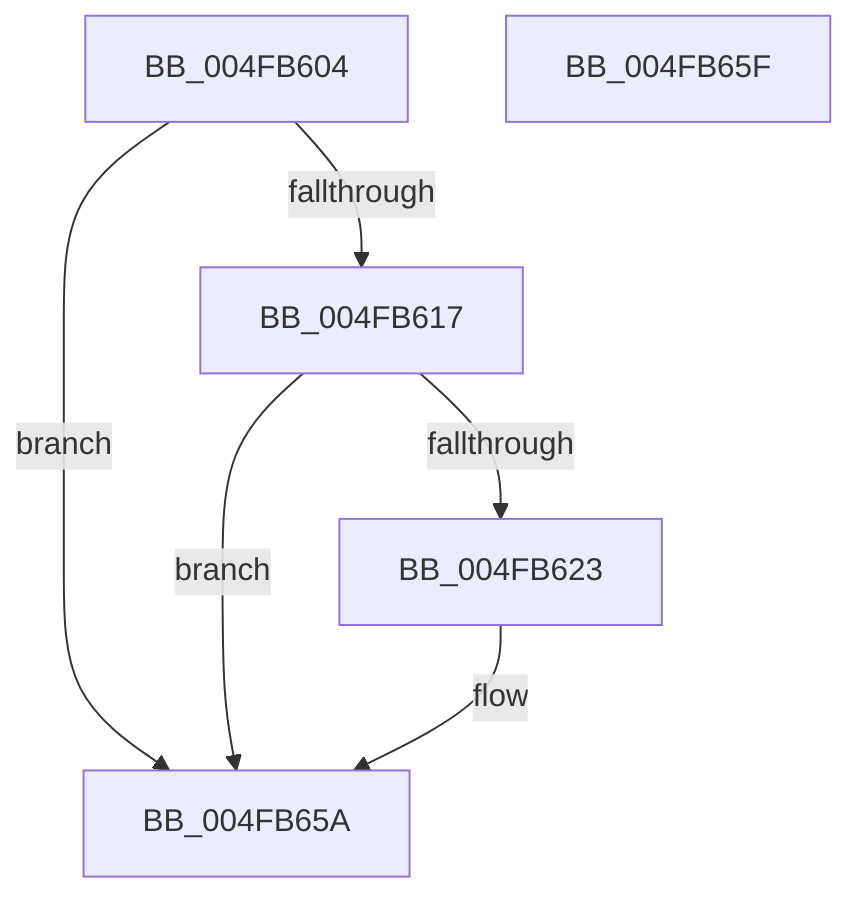

# KiArmForceParkDutyCyclingForSharedReadyQueue

- RVA: `0x004FB604`–`0x004FB660` (길이 `92` bytes)
- VA: `0x00000001404FB604`
- 실행 섹션: `.text`
- PDB 이름 있음: `예`; PDB Function 태그: `아니요`
- unwind 정보 RVA: `0x0005C788`
- 디코드: `22`개 명령, `92/92` bytes 표시
- 미해석 바이트: `0` (있으면 어셈블리에 `.byte`로 보존)

> 이 문서는 커널 이미지의 기계어와 PDB 기호를 분석해 생성했습니다. 4번과 5번은 함수 원형과 자료형을 바이너리 사용 방식에서 추정한 C 해석이며 원본 소스 복구 결과는 아닙니다.

## 1. Dependencies

- 직접 호출 지점: **2**; 고유 호출 대상: **2**
- 직접 호출자로 확인된 함수: **3**
- RIP 상대 이미지 참조: **0**

### Outgoing calls
- `0x004FB60E` → [KiShouldSearchSharedReadyQueue](../43/KiShouldSearchSharedReadyQueue_function_0043C910.md) (function, `0x0043C910`)
- `0x004FB655` → [KeInsertQueueDpc](../20/KeInsertQueueDpc_function_00207C50.md) (function, `0x00207C50`)

### Direct callers
- [sub_00218B2B](../21/Unknown_function_00218B2B.md) at `0x00218E08`
- [KiQueueReadyThread](../21/KiQueueReadyThread_function_0021C7B0.md) at `0x0021CFFC`
- [sub_002546EC](../25/Unknown_function_002546EC.md) at `0x00254A5C`

### Static image references
- 디코드된 RIP-relative 메모리 참조가 없습니다.

## 2. Other-region calls and transfers

- 다른 실행 섹션으로 향하는 call: **0**
- 별도 외부 분기/꼬리 이동을 확인하지 못했습니다.

## 3. Assembly (complete function range)

```asm
004FB604  48 83 EC 28                     sub rsp, 0x28
004FB608  4C 8B D2                        mov r10, rdx
004FB60B  4C 8B D9                        mov r11, rcx
004FB60E  E8 FD 12 F4 FF                  call 0x14043c910
004FB613  84 C0                           test al, al
004FB615  74 43                           je 0x1404fb65a
004FB617  49 8B 82 E8 06 00 00            mov rax, qword ptr [r10 + 0x6e8]
004FB61E  48 85 C0                        test rax, rax
004FB621  75 37                           jne 0x1404fb65a
004FB623  49 8B 8B C8 00 00 00            mov rcx, qword ptr [r11 + 0xc8]
004FB62A  B8 01 00 00 00                  mov eax, 1
004FB62F  49 0B 8A E8 06 00 00            or rcx, qword ptr [r10 + 0x6e8]
004FB636  45 33 C0                        xor r8d, r8d
004FB639  49 89 8A E8 06 00 00            mov qword ptr [r10 + 0x6e8], rcx
004FB640  33 D2                           xor edx, edx
004FB642  49 8B 8B F0 86 00 00            mov rcx, qword ptr [r11 + 0x86f0]
004FB649  89 81 50 01 00 00               mov dword ptr [rcx + 0x150], eax
004FB64F  89 81 54 01 00 00               mov dword ptr [rcx + 0x154], eax
004FB655  E8 F6 C5 D0 FF                  call 0x140207c50
004FB65A  48 83 C4 28                     add rsp, 0x28
004FB65E  C3                              ret
004FB65F  CC                              int3
```

## 4. C-style interpretation (structured pseudocode)

```c
__int64 __fastcall KiArmForceParkDutyCyclingForSharedReadyQueue(__int64 a1, __int64 a2, int a3)
{
    __int64 result;
    __int64 v_rsp;

    v_rsp = (v_rsp) - (40);
    result = KiShouldSearchSharedReadyQueue(a1, a2, a3, a4);
    if ((unsigned __int8)(result) == 0) goto loc_004FB65A;
    result = *(unsigned __int64 *)(a2 + 1768);
    if (*(unsigned __int64 *)(a2 + 1768) == 0) {
        a1 = *(unsigned __int64 *)(a1 + 200);
        result = 1;
        a1 = (a1) | (*(unsigned __int64 *)(a2 + 1768));
        a3 = 0;
        *(unsigned __int64 *)(a2 + 1768) = a1;
        a2 = 0;
        a1 = *(unsigned __int64 *)(a1 + 34544);
        *(unsigned int *)(a1 + 336) = (unsigned int)(result);
        *(unsigned int *)(a1 + 340) = (unsigned int)(result);
        result = KeInsertQueueDpc(a1, a2, a3, a4);
    }
    v_rsp = (v_rsp) + (40);
    return result;
}
```

## 5. (Beta) C Style

```c
int64_t KiArmForceParkDutyCyclingForSharedReadyQueue(int64_t Arg1, int64_t Arg2, int32_t Arg3)
{
    int64_t result;
    int64_t local_rsp;

    local_rsp = (local_rsp) - (40);
    result = KiShouldSearchSharedReadyQueue(Arg1, Arg2, Arg3, a4);
    if ((uint8_t)(result) == 0) goto loc_004FB65A;
    result = *(uint64_t *)(Arg2 + 0x6E8);
    if (*(uint64_t *)(Arg2 + 0x6E8) == 0) {
        Arg1 = *(uint64_t *)(Arg1 + 0xC8);
        result = 1;
        Arg1 = (Arg1) | (*(uint64_t *)(Arg2 + 0x6E8));
        Arg3 = 0;
        *(uint64_t *)(Arg2 + 0x6E8) = Arg1;
        Arg2 = 0;
        Arg1 = *(uint64_t *)(Arg1 + 0x86F0);
        *(uint32_t *)(Arg1 + 0x150) = (uint32_t)(result);
        *(uint32_t *)(Arg1 + 0x154) = (uint32_t)(result);
        result = KeInsertQueueDpc(Arg1, Arg2, Arg3, a4);
    }
    local_rsp = (local_rsp) + (40);
    return result;
}
```

## 6. Execution-region graph

[열기: 2D/3D 그래프와 함수 탐색 컨트롤 패널](../../../control-panel.html?section=text&rva=0x004FB604&view=graph)

- 2D 그래프는 위에서 아래로 흐르고, 3D 그래프는 빈 공간을 드래그해 회전합니다. Shift+드래그는 이동, 휠은 확대·축소, 함수 노드 선택은 대상 보고서 이동입니다.

### Static fallback


