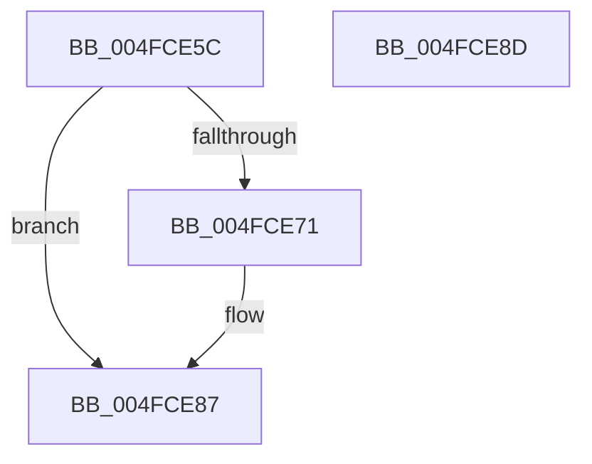

# KiAvailableCpusSubscriptionQueueWorkItem

- RVA: `0x004FCE5C`–`0x004FCE8E` (길이 `50` bytes)
- VA: `0x00000001404FCE5C`
- 실행 섹션: `.text`
- PDB 이름 있음: `예`; PDB Function 태그: `아니요`
- unwind 정보 RVA: `0x0005CF00`
- 디코드: `16`개 명령, `50/50` bytes 표시
- 미해석 바이트: `0` (있으면 어셈블리에 `.byte`로 보존)

> 이 문서는 커널 이미지의 기계어와 PDB 기호를 분석해 생성했습니다. 4번과 5번은 함수 원형과 자료형을 바이너리 사용 방식에서 추정한 C 해석이며 원본 소스 복구 결과는 아닙니다.

## 1. Dependencies

- 직접 호출 지점: **2**; 고유 호출 대상: **2**
- 직접 호출자로 확인된 함수: **5**
- RIP 상대 이미지 참조: **0**

### Outgoing calls
- `0x004FCE75` → [ExAcquireRundownProtection](../21/ExAcquireRundownProtection_function_00216620.md) (function, `0x00216620`)
- `0x004FCE82` → [ExQueueWorkItem](../2F/ExQueueWorkItem_function_002F9520.md) (function, `0x002F9520`)

### Direct callers
- [KiNotifyAvailableCpusChangeProcess](KiNotifyAvailableCpusChangeProcess_function_004FCE30.md) at `0x004FCE48`
- [KiAvailableCpusPartitionWorkItemCallback](../5B/KiAvailableCpusPartitionWorkItemCallback_function_005B9990.md) at `0x005B9A20`
- [KiNotifyAvailableCpusChangeCpuPartition](../5B/KiNotifyAvailableCpusChangeCpuPartition_function_005B9AD8.md) at `0x005B9AF0`
- [KeRegisterAvailableCpusChangeNotification](../../page/74/KeRegisterAvailableCpusChangeNotification_function_00745D7C.md) at `0x00745F7F`
- [KiAvailableCpusProcessWorkItemCallback](../../page/74/KiAvailableCpusProcessWorkItemCallback_function_00746140.md) at `0x007461A2`

### Static image references
- 디코드된 RIP-relative 메모리 참조가 없습니다.

## 2. Other-region calls and transfers

- 다른 실행 섹션으로 향하는 call: **0**
- 별도 외부 분기/꼬리 이동을 확인하지 못했습니다.

## 3. Assembly (complete function range)

```asm
004FCE5C  40 53                           push rbx
004FCE5E  48 83 EC 20                     sub rsp, 0x20
004FCE62  B8 03 00 00 00                  mov eax, 3
004FCE67  48 8B D9                        mov rbx, rcx
004FCE6A  87 41 28                        xchg dword ptr [rcx + 0x28], eax
004FCE6D  A8 01                           test al, 1
004FCE6F  75 16                           jne 0x1404fce87
004FCE71  48 83 C1 20                     add rcx, 0x20
004FCE75  E8 A6 97 D1 FF                  call 0x140216620
004FCE7A  BA 04 00 00 00                  mov edx, 4
004FCE7F  48 8B CB                        mov rcx, rbx
004FCE82  E8 99 C6 DF FF                  call 0x1402f9520
004FCE87  48 83 C4 20                     add rsp, 0x20
004FCE8B  5B                              pop rbx
004FCE8C  C3                              ret
004FCE8D  CC                              int3
```

## 4. C-style interpretation (structured pseudocode)

```c
__int64 __fastcall KiAvailableCpusSubscriptionQueueWorkItem(__int64 a1)
{
    __int64 result;
    __int64 v_rsp;

    v_rsp = (v_rsp) - (32);
    result = 3;
    if (((3) & (1)) == 0) {
        a1 = (a1) + (32);
        result = ExAcquireRundownProtection(a1, a2, a3, a4);
        a2 = 4;
        a1 = a1;
        result = ExQueueWorkItem(a1, a2, a3, a4);
    }
    v_rsp = (v_rsp) + (32);
    return result;
}
```

## 5. (Beta) C Style

```c
int64_t KiAvailableCpusSubscriptionQueueWorkItem(void *Arg1)
{
    uint8_t *arg1 = (uint8_t *)Arg1;

    int64_t result;
    int64_t local_rsp;

    local_rsp = (local_rsp) - (32);
    result = 3;
    if (((3) & (1)) == 0) {
        Arg1 = (Arg1) + (32);
        result = ExAcquireRundownProtection(Arg1, a2, a3, a4);
        a2 = 4;
        Arg1 = Arg1;
        result = ExQueueWorkItem(Arg1, a2, a3, a4);
    }
    local_rsp = (local_rsp) + (32);
    return result;
}
```

### 관측된 메모리 오프셋

구조체 형식이 확인되지 않은 접근은 인자 기준의 오프셋으로만 기록했습니다.

| 기준 인자 | 오프셋 표현 | 폭 (bit) | 접근 |
|---|---:|---:|---|
| `Arg1` | `+ 0x28` | `32` | `R/W` |

## 6. Execution-region graph

[열기: 2D/3D 그래프와 함수 탐색 컨트롤 패널](../../../control-panel.html?section=text&rva=0x004FCE5C&view=graph)

- 2D 그래프는 위에서 아래로 흐르고, 3D 그래프는 빈 공간을 드래그해 회전합니다. Shift+드래그는 이동, 휠은 확대·축소, 함수 노드 선택은 대상 보고서 이동입니다.

### Static fallback


