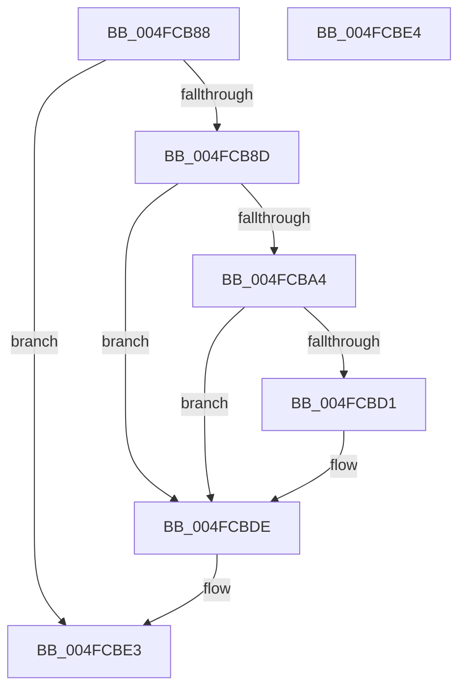

# KiCpuPartitionCheckDpcEnqueue

- RVA: `0x004FCB88`–`0x004FCBE5` (길이 `93` bytes)
- VA: `0x00000001404FCB88`
- 실행 섹션: `.text`
- PDB 이름 있음: `예`; PDB Function 태그: `아니요`
- unwind 정보 RVA: `0x000805BC`
- 디코드: `29`개 명령, `93/93` bytes 표시
- 미해석 바이트: `0` (있으면 어셈블리에 `.byte`로 보존)

> 이 문서는 커널 이미지의 기계어와 PDB 기호를 분석해 생성했습니다. 4번과 5번은 함수 원형과 자료형을 바이너리 사용 방식에서 추정한 C 해석이며 원본 소스 복구 결과는 아닙니다.

## 1. Dependencies

- 직접 호출 지점: **3**; 고유 호출 대상: **2**
- 직접 호출자로 확인된 함수: **1**
- RIP 상대 이미지 참조: **1**

### Outgoing calls
- `0x004FCBB1` → [KiCheckPrcbAffinityEx](../43/KiCheckPrcbAffinityEx_function_004366A0.md) (function, `0x004366A0`)
- `0x004FCBC2` → [KiCheckPrcbAffinityEx](../43/KiCheckPrcbAffinityEx_function_004366A0.md) (function, `0x004366A0`)
- `0x004FCBD9` → [EtwTraceCpuPartitionDpcSchedulingViolation](../64/EtwTraceCpuPartitionDpcSchedulingViolation_function_0064F7E8.md) (function, `0x0064F7E8`)

### Direct callers
- [sub_00207D3E](../20/Unknown_function_00207D3E.md) at `0x00208373`

### Static image references
- `0x004FCBA4` → RVA `0x00FC6C20` (`ALMOSTRO`; read)

## 2. Other-region calls and transfers

- 다른 실행 섹션으로 향하는 call: **0**
- 별도 외부 분기/꼬리 이동을 확인하지 못했습니다.

## 3. Assembly (complete function range)

```asm
004FCB88  4C 3B C2                        cmp r8, rdx
004FCB8B  74 56                           je 0x1404fcbe3
004FCB8D  53                              push rbx
004FCB8E  48 83 EC 20                     sub rsp, 0x20
004FCB92  49 8D 80 60 83 00 00            lea rax, [r8 + 0x8360]
004FCB99  4D 8B D8                        mov r11, r8
004FCB9C  48 8B D9                        mov rbx, rcx
004FCB9F  48 3B C8                        cmp rcx, rax
004FCBA2  74 3A                           je 0x1404fcbde
004FCBA4  48 8B 05 75 A0 AC 00            mov rax, qword ptr [rip + 0xaca075]
004FCBAB  4C 8B 10                        mov r10, qword ptr [rax]
004FCBAE  49 8B CA                        mov rcx, r10
004FCBB1  E8 EA 9A F3 FF                  call 0x1404366a0
004FCBB6  84 C0                           test al, al
004FCBB8  49 8B D3                        mov rdx, r11
004FCBBB  49 8B CA                        mov rcx, r10
004FCBBE  41 0F 94 C0                     sete r8b
004FCBC2  E8 D9 9A F3 FF                  call 0x1404366a0
004FCBC7  84 C0                           test al, al
004FCBC9  0F 94 C0                        sete al
004FCBCC  44 3A C0                        cmp r8b, al
004FCBCF  74 0D                           je 0x1404fcbde
004FCBD1  41 8B 53 24                     mov edx, dword ptr [r11 + 0x24]
004FCBD5  48 8B 4B 18                     mov rcx, qword ptr [rbx + 0x18]
004FCBD9  E8 0A 2C 15 00                  call 0x14064f7e8
004FCBDE  48 83 C4 20                     add rsp, 0x20
004FCBE2  5B                              pop rbx
004FCBE3  C3                              ret
004FCBE4  CC                              int3
```

## 4. C-style interpretation (structured pseudocode)

```c
__int64 __fastcall KiCpuPartitionCheckDpcEnqueue(__int64 a1, __int64 a2, __int64 a3)
{
    __int64 result;
    __int64 v_rsp;

    if (a3 == a2) goto loc_004FCBE3;
    v_rsp = (v_rsp) - (32);
    if (a1 == (a3 + 33632)) goto loc_004FCBDE;
    result = KiCheckPrcbAffinityEx(*(unsigned __int64 *)(*(unsigned __int64 *)(v_rip + 11313269)), a2, a3, a4);
    a3 = ((unsigned __int8)(result) == 0) ? 1 : 0;
    result = KiCheckPrcbAffinityEx(*(unsigned __int64 *)(*(unsigned __int64 *)(v_rip + 11313269)), a3, a3, a4);
    result = ((unsigned __int8)(result) == 0) ? 1 : 0;
    if (((unsigned __int8)(a3)) != ((unsigned __int8)(result))) {
        a2 = *(unsigned int *)(a3 + 36);
        a1 = *(unsigned __int64 *)(a1 + 24);
        result = EtwTraceCpuPartitionDpcSchedulingViolation(a1, a2, a3, a4);
    }
    v_rsp = (v_rsp) + (32);
loc_004FCBE3:
    return result;
}
```

## 5. (Beta) C Style

```c
int64_t KiCpuPartitionCheckDpcEnqueue(void *Arg1, int64_t Arg2, int64_t Arg3)
{
    uint8_t *arg1 = (uint8_t *)Arg1;

    int64_t result;
    int64_t local_rsp;

    if (Arg3 == Arg2) goto loc_004FCBE3;
    local_rsp = (local_rsp) - (32);
    if (Arg1 == (Arg3 + 33632)) goto loc_004FCBDE;
    result = KiCheckPrcbAffinityEx(*(uint64_t *)(*(uint64_t *)(v_rip + 0xACA075)), Arg2, Arg3, a4);
    Arg3 = ((uint8_t)(result) == 0) ? 1 : 0;
    result = KiCheckPrcbAffinityEx(*(uint64_t *)(*(uint64_t *)(v_rip + 0xACA075)), Arg3, Arg3, a4);
    result = ((uint8_t)(result) == 0) ? 1 : 0;
    if (((uint8_t)(Arg3)) != ((uint8_t)(result))) {
        Arg2 = *(uint32_t *)(Arg3 + 0x24);
        Arg1 = *(uint64_t *)(arg1 + 0x18);
        result = EtwTraceCpuPartitionDpcSchedulingViolation(Arg1, Arg2, Arg3, a4);
    }
    local_rsp = (local_rsp) + (32);
loc_004FCBE3:
    return result;
}
```

### 관측된 메모리 오프셋

구조체 형식이 확인되지 않은 접근은 인자 기준의 오프셋으로만 기록했습니다.

| 기준 인자 | 오프셋 표현 | 폭 (bit) | 접근 |
|---|---:|---:|---|
| `Arg1` | `+ 0x18` | `64` | `R` |

## 6. Execution-region graph

[열기: 2D/3D 그래프와 함수 탐색 컨트롤 패널](../../../control-panel.html?section=text&rva=0x004FCB88&view=graph)

- 2D 그래프는 위에서 아래로 흐르고, 3D 그래프는 빈 공간을 드래그해 회전합니다. Shift+드래그는 이동, 휠은 확대·축소, 함수 노드 선택은 대상 보고서 이동입니다.

### Static fallback


