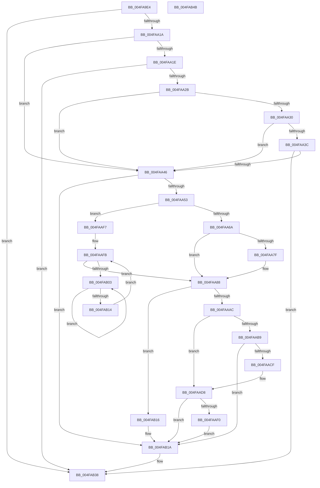

# KiDisarmForceParkDutyCyclingIfNecessary

- RVA: `0x004FA9E4`–`0x004FAB4C` (길이 `360` bytes)
- VA: `0x00000001404FA9E4`
- 실행 섹션: `.text`
- PDB 이름 있음: `예`; PDB Function 태그: `아니요`
- unwind 정보 RVA: `0x000BF99C`
- 디코드: `93`개 명령, `360/360` bytes 표시
- 미해석 바이트: `0` (있으면 어셈블리에 `.byte`로 보존)

> 이 문서는 커널 이미지의 기계어와 PDB 기호를 분석해 생성했습니다. 4번과 5번은 함수 원형과 자료형을 바이너리 사용 방식에서 추정한 C 해석이며 원본 소스 복구 결과는 아닙니다.

## 1. Dependencies

- 직접 호출 지점: **6**; 고유 호출 대상: **6**
- 직접 호출자로 확인된 함수: **2**
- RIP 상대 이미지 참조: **1**

### Outgoing calls
- `0x004FAA33` → [KiShouldSearchSharedReadyQueue](../43/KiShouldSearchSharedReadyQueue_function_0043C910.md) (function, `0x0043C910`)
- `0x004FAA83` → [KxWaitForLockOwnerShip](../25/KxWaitForLockOwnerShip_function_00257EB0.md) (function, `0x00257EB0`)
- `0x004FAAD3` → [KxWaitForLockChainValid](../21/KxWaitForLockChainValid_function_00217AA0.md) (function, `0x00217AA0`)
- `0x004FAAF0` → [KeWakeAddressAll](../21/KeWakeAddressAll_function_00217C20.md) (function, `0x00217C20`)
- `0x004FAB07` → [KeYieldProcessorEx](../3F/KeYieldProcessorEx_function_003FBD00.md) (function, `0x003FBD00`)
- `0x004FAB33` → [KeInsertQueueDpc](../20/KeInsertQueueDpc_function_00207C50.md) (function, `0x00207C50`)

### Direct callers
- [KeTransitionProcessorParkState](../35/KeTransitionProcessorParkState_function_003527EC.md) at `0x00352A6D`
- [KiSearchForNewThread](../35/KiSearchForNewThread_function_00355C98.md) at `0x00355EA4`

### Static image references
- `0x004FAA53` → RVA `0x00FC6B38` (`ALMOSTRO`; read)

## 2. Other-region calls and transfers

- 다른 실행 섹션으로 향하는 call: **0**
- 별도 외부 분기/꼬리 이동을 확인하지 못했습니다.

## 3. Assembly (complete function range)

```asm
004FA9E4  48 89 5C 24 10                  mov qword ptr [rsp + 0x10], rbx
004FA9E9  48 89 74 24 18                  mov qword ptr [rsp + 0x18], rsi
004FA9EE  55                              push rbp
004FA9EF  57                              push rdi
004FA9F0  41 56                           push r14
004FA9F2  48 8B EC                        mov rbp, rsp
004FA9F5  48 83 EC 30                     sub rsp, 0x30
004FA9F9  48 8B B1 F0 86 00 00            mov rsi, qword ptr [rcx + 0x86f0]
004FAA00  45 33 F6                        xor r14d, r14d
004FAA03  48 8B 99 48 8E 00 00            mov rbx, qword ptr [rcx + 0x8e48]
004FAA0A  48 8B F9                        mov rdi, rcx
004FAA0D  44 39 B6 50 01 00 00            cmp dword ptr [rsi + 0x150], r14d
004FAA14  0F 84 1E 01 00 00               je 0x1404fab38
004FAA1A  84 D2                           test dl, dl
004FAA1C  75 28                           jne 0x1404faa46
004FAA1E  44 39 B1 D8 83 00 00            cmp dword ptr [rcx + 0x83d8], r14d
004FAA25  0F 85 0D 01 00 00               jne 0x1404fab38
004FAA2B  48 85 DB                        test rbx, rbx
004FAA2E  74 16                           je 0x1404faa46
004FAA30  48 8B D3                        mov rdx, rbx
004FAA33  E8 D8 1E F4 FF                  call 0x14043c910
004FAA38  84 C0                           test al, al
004FAA3A  74 0A                           je 0x1404faa46
004FAA3C  44 39 73 08                     cmp dword ptr [rbx + 8], r14d
004FAA40  0F 85 F2 00 00 00               jne 0x1404fab38
004FAA46  80 4F 23 20                     or byte ptr [rdi + 0x23], 0x20
004FAA4A  48 85 DB                        test rbx, rbx
004FAA4D  0F 84 C7 00 00 00               je 0x1404fab1a
004FAA53  F7 05 DB C0 AC 00 00 00 20 00   test dword ptr [rip + 0xacc0db], 0x200000
004FAA5D  0F 57 C0                        xorps xmm0, xmm0
004FAA60  0F 11 45 F0                     movups xmmword ptr [rbp - 0x10], xmm0
004FAA64  0F 84 8D 00 00 00               je 0x1404faaf7
004FAA6A  48 89 5D F8                     mov qword ptr [rbp - 8], rbx
004FAA6E  48 8D 55 F0                     lea rdx, [rbp - 0x10]
004FAA72  4C 89 75 F0                     mov qword ptr [rbp - 0x10], r14
004FAA76  90                              nop
004FAA77  48 87 13                        xchg qword ptr [rbx], rdx
004FAA7A  48 85 D2                        test rdx, rdx
004FAA7D  74 09                           je 0x1404faa88
004FAA7F  48 8D 4D F0                     lea rcx, [rbp - 0x10]
004FAA83  E8 28 D4 D5 FF                  call 0x140257eb0
004FAA88  48 8B 87 C8 00 00 00            mov rax, qword ptr [rdi + 0xc8]
004FAA8F  48 F7 D0                        not rax
004FAA92  48 23 83 E8 06 00 00            and rax, qword ptr [rbx + 0x6e8]
004FAA99  F7 05 95 C0 AC 00 00 00 20 00   test dword ptr [rip + 0xacc095], 0x200000
004FAAA3  48 89 83 E8 06 00 00            mov qword ptr [rbx + 0x6e8], rax
004FAAAA  74 6A                           je 0x1404fab16
004FAAAC  0F 0D 4D F0                     prefetchw byte ptr [rbp - 0x10]
004FAAB0  48 8B 45 F0                     mov rax, qword ptr [rbp - 0x10]
004FAAB4  48 85 C0                        test rax, rax
004FAAB7  75 1F                           jne 0x1404faad8
004FAAB9  48 8B 4D F8                     mov rcx, qword ptr [rbp - 8]
004FAABD  48 8D 45 F0                     lea rax, [rbp - 0x10]
004FAAC1  F0 4C 0F B1 31                  lock cmpxchg qword ptr [rcx], r14
004FAAC6  48 8D 4D F0                     lea rcx, [rbp - 0x10]
004FAACA  48 3B C1                        cmp rax, rcx
004FAACD  74 4B                           je 0x1404fab1a
004FAACF  48 8D 4D F0                     lea rcx, [rbp - 0x10]
004FAAD3  E8 C8 CF D1 FF                  call 0x140217aa0
004FAAD8  48 8D 48 08                     lea rcx, [rax + 8]
004FAADC  4C 89 75 F0                     mov qword ptr [rbp - 0x10], r14
004FAAE0  48 8B 55 F8                     mov rdx, qword ptr [rbp - 8]
004FAAE4  48 8B C2                        mov rax, rdx
004FAAE7  48 87 01                        xchg qword ptr [rcx], rax
004FAAEA  32 C2                           xor al, dl
004FAAEC  A8 04                           test al, 4
004FAAEE  74 2A                           je 0x1404fab1a
004FAAF0  E8 2B D1 D1 FF                  call 0x140217c20
004FAAF5  EB 23                           jmp 0x1404fab1a
004FAAF7  44 89 75 20                     mov dword ptr [rbp + 0x20], r14d
004FAAFB  F0 48 0F BA 2B 00               lock bts qword ptr [rbx], 0
004FAB01  73 85                           jae 0x1404faa88
004FAB03  48 8D 4D 20                     lea rcx, [rbp + 0x20]
004FAB07  E8 F4 11 F0 FF                  call 0x1403fbd00
004FAB0C  48 8B 03                        mov rax, qword ptr [rbx]
004FAB0F  48 85 C0                        test rax, rax
004FAB12  75 EF                           jne 0x1404fab03
004FAB14  EB E5                           jmp 0x1404faafb
004FAB16  F0 4C 21 33                     lock and qword ptr [rbx], r14
004FAB1A  45 33 C0                        xor r8d, r8d
004FAB1D  44 89 B6 50 01 00 00            mov dword ptr [rsi + 0x150], r14d
004FAB24  33 D2                           xor edx, edx
004FAB26  C7 86 54 01 00 00 04 00 00 00   mov dword ptr [rsi + 0x154], 4
004FAB30  48 8B CE                        mov rcx, rsi
004FAB33  E8 18 D1 D0 FF                  call 0x140207c50
004FAB38  48 8B 5C 24 58                  mov rbx, qword ptr [rsp + 0x58]
004FAB3D  48 8B 74 24 60                  mov rsi, qword ptr [rsp + 0x60]
004FAB42  48 83 C4 30                     add rsp, 0x30
004FAB46  41 5E                           pop r14
004FAB48  5F                              pop rdi
004FAB49  5D                              pop rbp
004FAB4A  C3                              ret
004FAB4B  CC                              int3
```

## 4. C-style interpretation (structured pseudocode)

```c
__int64 __fastcall KiDisarmForceParkDutyCyclingIfNecessary(__int64 a1, unsigned __int8 a2, int a3)
{
    __int64 result;
    __int64 v_r14;
    __int64 v_rsp;
    unsigned __int64 v_stack_m20;
    unsigned __int64 v_stack_m28;
    unsigned __int64 v_stack_p10;
    unsigned __int64 v_stack_p18;
    unsigned int v_stack_p8;

    v_stack_p10 = v_rbx;
    v_stack_p18 = v_rsi;
    v_rsp = (v_rsp) - (48);
    v_r14 = 0;
    if ((*(unsigned int *)(*(unsigned __int64 *)(a1 + 34544) + 336)) == 0) goto loc_004FAB38;
    if (a2 != 0) goto loc_004FAA46;
    if ((*(unsigned int *)(a1 + 33752)) != 0) goto loc_004FAB38;
    if (*(unsigned __int64 *)(a1 + 36424) == 0) goto loc_004FAA46;
    result = KiShouldSearchSharedReadyQueue(a1, *(unsigned __int64 *)(a1 + 36424), a3, a4);
    if ((unsigned __int8)(result) == 0) goto loc_004FAA46;
    if ((*(unsigned int *)(*(unsigned __int64 *)(a1 + 36424) + 8)) != 0) goto loc_004FAB38;
loc_004FAA46:
    if (*(unsigned __int64 *)(a1 + 36424) == 0) goto loc_004FAB1A;
    v_stack_m28 = v_xmm0;
    if (((*(unsigned int *)(v_rip + 11321563)) & (0x200000ULL)) == 0) goto loc_004FAAF7;
    v_stack_m20 = *(unsigned __int64 *)(a1 + 36424);
    v_stack_m28 = 0;
    if (v_stack_m28 != 0) {
        a1 = v_stack_m28;
        result = KxWaitForLockOwnerShip(a1, v_stack_m28, a3, a4);
    }
    result = ~(*(unsigned __int64 *)(a1 + 200));
    result = (result) & (*(unsigned __int64 *)(*(unsigned __int64 *)(a1 + 36424) + 1768));
    *(unsigned __int64 *)(*(unsigned __int64 *)(a1 + 36424) + 1768) = result;
    if (((*(unsigned int *)(v_rip + 11321493)) & (0x200000ULL)) == 0) goto loc_004FAB16;
    if (v_stack_m28 != 0) goto loc_004FAAD8;
    if (v_stack_m28 == v_stack_m28) goto loc_004FAB1A;
    result = KxWaitForLockChainValid(v_stack_m28, v_stack_m28, a3, a4);
loc_004FAAD8:
    v_stack_m28 = 0;
    result = (unsigned __int8)((v_stack_m20) ^ ((unsigned __int8)(v_stack_m20)));
    if ((((unsigned __int8)(result)) & (4)) == 0) goto loc_004FAB1A;
    result = KeWakeAddressAll(result + 8, v_stack_m20, a3, a4);
    goto loc_004FAB1A;
loc_004FAAF7:
    v_stack_p8 = 0;
loc_004FAAFB:
    if (condition_is_above_or_equal) goto loc_004FAA88;
loc_004FAB03:
    result = KeYieldProcessorEx(v_stack_p8, v_stack_m20, a3, a4);
    if (*(unsigned __int64 *)(*(unsigned __int64 *)(a1 + 36424)) != 0) goto loc_004FAB03;
    goto loc_004FAAFB;
loc_004FAB16:
loc_004FAB1A:
    a3 = 0;
    *(unsigned int *)(*(unsigned __int64 *)(a1 + 34544) + 336) = 0;
    a2 = 0;
    *(unsigned int *)(*(unsigned __int64 *)(a1 + 34544) + 340) = 4;
    result = KeInsertQueueDpc(*(unsigned __int64 *)(a1 + 34544), a2, a3, a4);
loc_004FAB38:
    v_rsp = (v_rsp) + (48);
    return result;
}
```

## 5. (Beta) C Style

```c
int64_t KiDisarmForceParkDutyCyclingIfNecessary(void *Arg1, uint8_t Arg2, int32_t Arg3)
{
    uint8_t *arg1 = (uint8_t *)Arg1;

    int64_t result;
    int64_t local_r14;
    int64_t local_rsp;
    uint64_t v_stack_m20;
    uint64_t v_stack_m28;
    uint64_t v_stack_p10;
    uint64_t v_stack_p18;
    uint32_t v_stack_p8;

    v_stack_p10 = local_rbx;
    v_stack_p18 = local_rsi;
    local_rsp = (local_rsp) - (48);
    local_r14 = 0;
    if ((*(uint32_t *)(*(uint64_t *)(arg1 + 0x86F0) + 0x150)) == 0) goto loc_004FAB38;
    if (Arg2 != 0) goto loc_004FAA46;
    if ((*(uint32_t *)(arg1 + 0x83D8)) != 0) goto loc_004FAB38;
    if (*(uint64_t *)(arg1 + 0x8E48) == 0) goto loc_004FAA46;
    result = KiShouldSearchSharedReadyQueue(Arg1, *(uint64_t *)(arg1 + 0x8E48), Arg3, a4);
    if ((uint8_t)(result) == 0) goto loc_004FAA46;
    if ((*(uint32_t *)(*(uint64_t *)(arg1 + 0x8E48) + 0x8)) != 0) goto loc_004FAB38;
loc_004FAA46:
    if (*(uint64_t *)(arg1 + 0x8E48) == 0) goto loc_004FAB1A;
    v_stack_m28 = v_xmm0;
    if (((*(uint32_t *)(v_rip + 0xACC0DB)) & (0x200000ULL)) == 0) goto loc_004FAAF7;
    v_stack_m20 = *(uint64_t *)(arg1 + 0x8E48);
    v_stack_m28 = 0;
    if (v_stack_m28 != 0) {
        Arg1 = v_stack_m28;
        result = KxWaitForLockOwnerShip(Arg1, v_stack_m28, Arg3, a4);
    }
    result = ~(*(uint64_t *)(arg1 + 0xC8));
    result = (result) & (*(uint64_t *)(*(uint64_t *)(arg1 + 0x8E48) + 0x6E8));
    *(uint64_t *)(*(uint64_t *)(arg1 + 0x8E48) + 0x6E8) = result;
    if (((*(uint32_t *)(v_rip + 0xACC095)) & (0x200000ULL)) == 0) goto loc_004FAB16;
    if (v_stack_m28 != 0) goto loc_004FAAD8;
    if (v_stack_m28 == v_stack_m28) goto loc_004FAB1A;
    result = KxWaitForLockChainValid(v_stack_m28, v_stack_m28, Arg3, a4);
loc_004FAAD8:
    v_stack_m28 = 0;
    result = (uint8_t)((v_stack_m20) ^ ((uint8_t)(v_stack_m20)));
    if ((((uint8_t)(result)) & (4)) == 0) goto loc_004FAB1A;
    result = KeWakeAddressAll(result + 8, v_stack_m20, Arg3, a4);
    goto loc_004FAB1A;
loc_004FAAF7:
    v_stack_p8 = 0;
loc_004FAAFB:
    if (condition_is_above_or_equal) goto loc_004FAA88;
loc_004FAB03:
    result = KeYieldProcessorEx(v_stack_p8, v_stack_m20, Arg3, a4);
    if (*(uint64_t *)(*(uint64_t *)(arg1 + 0x8E48)) != 0) goto loc_004FAB03;
    goto loc_004FAAFB;
loc_004FAB16:
loc_004FAB1A:
    Arg3 = 0;
    *(uint32_t *)(*(uint64_t *)(arg1 + 0x86F0) + 0x150) = 0;
    Arg2 = 0;
    *(uint32_t *)(*(uint64_t *)(arg1 + 0x86F0) + 0x154) = 4;
    result = KeInsertQueueDpc(*(uint64_t *)(arg1 + 0x86F0), Arg2, Arg3, a4);
loc_004FAB38:
    local_rsp = (local_rsp) + (48);
    return result;
}
```

### 관측된 메모리 오프셋

구조체 형식이 확인되지 않은 접근은 인자 기준의 오프셋으로만 기록했습니다.

| 기준 인자 | 오프셋 표현 | 폭 (bit) | 접근 |
|---|---:|---:|---|
| `Arg1` | `+ 0x23` | `8` | `R/W` |
| `Arg1` | `+ 0xC8` | `64` | `R` |
| `Arg1` | `+ 0x83D8` | `32` | `R` |
| `Arg1` | `+ 0x86F0` | `64` | `R` |
| `Arg1` | `+ 0x8E48` | `64` | `R` |

## 6. Execution-region graph

[열기: 2D/3D 그래프와 함수 탐색 컨트롤 패널](../../../control-panel.html?section=text&rva=0x004FA9E4&view=graph)

- 2D 그래프는 위에서 아래로 흐르고, 3D 그래프는 빈 공간을 드래그해 회전합니다. Shift+드래그는 이동, 휠은 확대·축소, 함수 노드 선택은 대상 보고서 이동입니다.

### Static fallback


