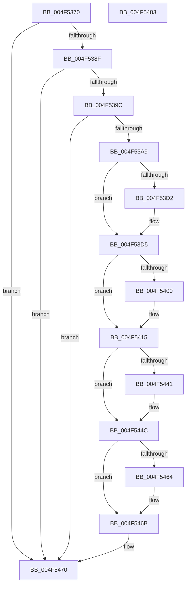

# KiEndDebugAccumulation

- RVA: `0x004F5370`–`0x004F5484` (길이 `276` bytes)
- VA: `0x00000001404F5370`
- 실행 섹션: `.text`
- PDB 이름 있음: `예`; PDB Function 태그: `아니요`
- unwind 정보 RVA: `0x000B8D7C`
- 디코드: `69`개 명령, `276/276` bytes 표시
- 미해석 바이트: `0` (있으면 어셈블리에 `.byte`로 보존)

> 이 문서는 커널 이미지의 기계어와 PDB 기호를 분석해 생성했습니다. 4번과 5번은 함수 원형과 자료형을 바이너리 사용 방식에서 추정한 C 해석이며 원본 소스 복구 결과는 아닙니다.

## 1. Dependencies

- 직접 호출 지점: **4**; 고유 호출 대상: **4**
- 직접 호출자로 확인된 함수: **2**
- RIP 상대 이미지 참조: **2**

### Outgoing calls
- `0x004F53B0` → [KeQueryPerformanceCounter](../37/KeQueryPerformanceCounter_function_0037E7E0.md) (function, `0x0037E7E0`)
- `0x004F5410` → [KiAccumulateTicksFromCycles](../3D/KiAccumulateTicksFromCycles_function_003D36F0.md) (function, `0x003D36F0`)
- `0x004F5447` → [KiAccumulateProcessorCycleStats](../3E/KiAccumulateProcessorCycleStats_function_003EF840.md) (function, `0x003EF840`)
- `0x004F5466` → [KiBeginCounterAccumulation](../49/KiBeginCounterAccumulation_function_0049D3F0.md) (function, `0x0049D3F0`)

### Direct callers
- [KeThawExecution](KeThawExecution_function_004F5240.md) at `0x004F52FC`
- [KiFreezeTargetExecution](../5C/KiFreezeTargetExecution_function_005C30A0.md) at `0x005C32B2`

### Static image references
- `0x004F539C` → RVA `0x00F0BD23` (`.data`; read)
- `0x004F53F7` → RVA `0x00FC6A95` (`ALMOSTRO`; read)

## 2. Other-region calls and transfers

- 다른 실행 섹션으로 향하는 call: **0**
- 별도 외부 분기/꼬리 이동을 확인하지 못했습니다.

## 3. Assembly (complete function range)

```asm
004F5370  48 89 5C 24 10                  mov qword ptr [rsp + 0x10], rbx
004F5375  48 89 6C 24 18                  mov qword ptr [rsp + 0x18], rbp
004F537A  56                              push rsi
004F537B  57                              push rdi
004F537C  41 56                           push r14
004F537E  48 83 EC 30                     sub rsp, 0x30
004F5382  80 79 20 00                     cmp byte ptr [rcx + 0x20], 0
004F5386  48 8B D9                        mov rbx, rcx
004F5389  0F 85 E1 00 00 00               jne 0x1404f5470
004F538F  80 B9 DC 86 00 00 00            cmp byte ptr [rcx + 0x86dc], 0
004F5396  0F 84 D4 00 00 00               je 0x1404f5470
004F539C  80 3D 80 69 A1 00 00            cmp byte ptr [rip + 0xa16980], 0
004F53A3  0F 85 C7 00 00 00               jne 0x1404f5470
004F53A9  C6 41 20 01                     mov byte ptr [rcx + 0x20], 1
004F53AD  33 C9                           xor ecx, ecx
004F53AF  90                              nop
004F53B0  E8 2B 94 E8 FF                  call 0x14037e7e0
004F53B5  8A 8B AC 00 00 00               mov cl, byte ptr [rbx + 0xac]
004F53BB  48 8B F8                        mov rdi, rax
004F53BE  48 83 64 24 50 00               and qword ptr [rsp + 0x50], 0
004F53C4  48 8B D7                        mov rdx, rdi
004F53C7  48 8B 83 B0 00 00 00            mov rax, qword ptr [rbx + 0xb0]
004F53CE  84 C9                           test cl, cl
004F53D0  74 03                           je 0x1404f53d5
004F53D2  48 D3 E2                        shl rdx, cl
004F53D5  4C 8B 83 F8 86 00 00            mov r8, qword ptr [rbx + 0x86f8]
004F53DC  4C 8B F7                        mov r14, rdi
004F53DF  48 F7 E2                        mul rdx
004F53E2  4D 2B F0                        sub r14, r8
004F53E5  48 8B F2                        mov rsi, rdx
004F53E8  48 89 54 24 50                  mov qword ptr [rsp + 0x50], rdx
004F53ED  48 2B B3 80 86 00 00            sub rsi, qword ptr [rbx + 0x8680]
004F53F4  48 8B EA                        mov rbp, rdx
004F53F7  80 3D 97 16 AD 00 00            cmp byte ptr [rip + 0xad1697], 0
004F53FE  74 15                           je 0x1404f5415
004F5400  4C 8B CF                        mov r9, rdi
004F5403  C7 44 24 20 03 00 00 00         mov dword ptr [rsp + 0x20], 3
004F540B  33 D2                           xor edx, edx
004F540D  48 8B CB                        mov rcx, rbx
004F5410  E8 DB E2 ED FF                  call 0x1403d36f0
004F5415  48 8B 8B 00 87 00 00            mov rcx, qword ptr [rbx + 0x8700]
004F541C  48 8B 43 08                     mov rax, qword ptr [rbx + 8]
004F5420  49 03 CE                        add rcx, r14
004F5423  48 89 8B 00 87 00 00            mov qword ptr [rbx + 0x8700], rcx
004F542A  48 8B 8B 78 87 00 00            mov rcx, qword ptr [rbx + 0x8778]
004F5431  48 03 CE                        add rcx, rsi
004F5434  48 89 8B 78 87 00 00            mov qword ptr [rbx + 0x8778], rcx
004F543B  F6 40 02 20                     test byte ptr [rax + 2], 0x20
004F543F  74 0B                           je 0x1404f544c
004F5441  48 8B D6                        mov rdx, rsi
004F5444  48 8B CB                        mov rcx, rbx
004F5447  E8 F4 A3 EF FF                  call 0x1403ef840
004F544C  48 89 BB F8 86 00 00            mov qword ptr [rbx + 0x86f8], rdi
004F5453  48 89 AB 80 86 00 00            mov qword ptr [rbx + 0x8680], rbp
004F545A  48 8B 4B 08                     mov rcx, qword ptr [rbx + 8]
004F545E  F6 41 02 02                     test byte ptr [rcx + 2], 2
004F5462  74 07                           je 0x1404f546b
004F5464  33 D2                           xor edx, edx
004F5466  E8 85 7F FA FF                  call 0x14049d3f0
004F546B  90                              nop
004F546C  C6 43 20 00                     mov byte ptr [rbx + 0x20], 0
004F5470  48 8B 5C 24 58                  mov rbx, qword ptr [rsp + 0x58]
004F5475  48 8B 6C 24 60                  mov rbp, qword ptr [rsp + 0x60]
004F547A  48 83 C4 30                     add rsp, 0x30
004F547E  41 5E                           pop r14
004F5480  5F                              pop rdi
004F5481  5E                              pop rsi
004F5482  C3                              ret
004F5483  CC                              int3
```

## 4. C-style interpretation (structured pseudocode)

```c
__int64 __fastcall KiEndDebugAccumulation(__int64 a1)
{
    __int64 result;
    __int64 v_r14;
    __int64 v_rsi;
    __int64 v_rsp;
    unsigned int v_stack_m28;
    unsigned __int64 v_stack_p10;
    unsigned __int64 v_stack_p18;
    unsigned __int64 v_stack_p8;

    v_stack_p10 = v_rbx;
    v_stack_p18 = v_rbp;
    v_rsp = (v_rsp) - (48);
    if ((*(unsigned __int8 *)(a1 + 32)) != 0) goto loc_004F5470;
    if ((*(unsigned __int8 *)(a1 + 34524)) == 0) goto loc_004F5470;
    if ((*(unsigned __int8 *)(v_rip + 10578304)) != 0) goto loc_004F5470;
    *(unsigned __int8 *)(a1 + 32) = 1;
    a1 = 0;
    result = KeQueryPerformanceCounter(a1, a2, a3, a4);
    if ((unsigned __int8)(*(unsigned __int8 *)(a1 + 172)) != 0) {
        a2 = (result) << ((unsigned __int8)(*(unsigned __int8 *)(a1 + 172)));
    }
    v_r14 = (result) - (*(unsigned __int64 *)(a1 + 34552));
    v_stack_p8 = a2;
    v_rsi = (a2) - (*(unsigned __int64 *)(a1 + 34432));
    result = *(unsigned __int64 *)(a1 + 176);
    if ((*(unsigned __int8 *)(v_rip + 11343511)) != 0) {
        a4 = result;
        v_stack_m28 = 3;
        a2 = 0;
        a1 = 0;
        result = KiAccumulateTicksFromCycles(a1, a2, *(unsigned __int64 *)(a1 + 34552), a4);
    }
    a1 = (*(unsigned __int64 *)(a1 + 34560)) + (v_r14);
    *(unsigned __int64 *)(a1 + 34560) = a1;
    a1 = (*(unsigned __int64 *)(a1 + 34680)) + (v_rsi);
    *(unsigned __int64 *)(a1 + 34680) = a1;
    result = *(unsigned __int64 *)(a1 + 8);
    if (((*(unsigned __int8 *)(*(unsigned __int64 *)(a1 + 8) + 2)) & (32)) != 0) {
        a2 = v_rsi;
        a1 = a1;
        result = KiAccumulateProcessorCycleStats(a1, a2, *(unsigned __int64 *)(a1 + 34552), a4);
    }
    *(unsigned __int64 *)(a1 + 34552) = result;
    *(unsigned __int64 *)(a1 + 34432) = a2;
    if (((*(unsigned __int8 *)(*(unsigned __int64 *)(a1 + 8) + 2)) & (2)) != 0) {
        a2 = 0;
        result = KiBeginCounterAccumulation(*(unsigned __int64 *)(a1 + 8), a2, *(unsigned __int64 *)(a1 + 34552), a4);
    }
    *(unsigned __int8 *)(a1 + 32) = 0;
loc_004F5470:
    v_rsp = (v_rsp) + (48);
    return result;
}
```

## 5. (Beta) C Style

```c
int64_t KiEndDebugAccumulation(void *Arg1)
{
    uint8_t *arg1 = (uint8_t *)Arg1;

    int64_t result;
    int64_t local_r14;
    int64_t local_rsi;
    int64_t local_rsp;
    uint32_t v_stack_m28;
    uint64_t v_stack_p10;
    uint64_t v_stack_p18;
    uint64_t v_stack_p8;

    v_stack_p10 = local_rbx;
    v_stack_p18 = local_rbp;
    local_rsp = (local_rsp) - (48);
    if ((*(uint8_t *)(arg1 + 0x20)) != 0) goto loc_004F5470;
    if ((*(uint8_t *)(arg1 + 0x86DC)) == 0) goto loc_004F5470;
    if ((*(uint8_t *)(v_rip + 0xA16980)) != 0) goto loc_004F5470;
    *(uint8_t *)(arg1 + 0x20) = 1;
    Arg1 = 0;
    result = KeQueryPerformanceCounter(Arg1, a2, a3, a4);
    if ((uint8_t)(*(uint8_t *)(arg1 + 0xAC)) != 0) {
        a2 = (result) << ((uint8_t)(*(uint8_t *)(arg1 + 0xAC)));
    }
    local_r14 = (result) - (*(uint64_t *)(arg1 + 0x86F8));
    v_stack_p8 = a2;
    local_rsi = (a2) - (*(uint64_t *)(arg1 + 0x8680));
    result = *(uint64_t *)(arg1 + 0xB0);
    if ((*(uint8_t *)(v_rip + 0xAD1697)) != 0) {
        a4 = result;
        v_stack_m28 = 3;
        a2 = 0;
        Arg1 = 0;
        result = KiAccumulateTicksFromCycles(Arg1, a2, *(uint64_t *)(arg1 + 0x86F8), a4);
    }
    Arg1 = (*(uint64_t *)(arg1 + 0x8700)) + (local_r14);
    *(void **)(arg1 + 0x8700) = Arg1;
    Arg1 = (*(uint64_t *)(arg1 + 0x8778)) + (local_rsi);
    *(void **)(arg1 + 0x8778) = Arg1;
    result = *(uint64_t *)(arg1 + 0x8);
    if (((*(uint8_t *)(*(uint64_t *)(arg1 + 0x8) + 0x2)) & (32)) != 0) {
        a2 = local_rsi;
        Arg1 = Arg1;
        result = KiAccumulateProcessorCycleStats(Arg1, a2, *(uint64_t *)(arg1 + 0x86F8), a4);
    }
    *(uint64_t *)(arg1 + 0x86F8) = result;
    *(uint64_t *)(arg1 + 0x8680) = a2;
    if (((*(uint8_t *)(*(uint64_t *)(arg1 + 0x8) + 0x2)) & (2)) != 0) {
        a2 = 0;
        result = KiBeginCounterAccumulation(*(uint64_t *)(arg1 + 0x8), a2, *(uint64_t *)(arg1 + 0x86F8), a4);
    }
    *(uint8_t *)(arg1 + 0x20) = 0;
loc_004F5470:
    local_rsp = (local_rsp) + (48);
    return result;
}
```

### 관측된 메모리 오프셋

구조체 형식이 확인되지 않은 접근은 인자 기준의 오프셋으로만 기록했습니다.

| 기준 인자 | 오프셋 표현 | 폭 (bit) | 접근 |
|---|---:|---:|---|
| `Arg1` | `+ 0x8` | `64` | `R` |
| `Arg1` | `+ 0x20` | `8` | `R` |
| `Arg1` | `+ 0x20` | `8` | `W` |
| `Arg1` | `+ 0xAC` | `8` | `R` |
| `Arg1` | `+ 0xB0` | `64` | `R` |
| `Arg1` | `+ 0x8680` | `64` | `R` |
| `Arg1` | `+ 0x8680` | `64` | `W` |
| `Arg1` | `+ 0x86DC` | `8` | `R` |
| `Arg1` | `+ 0x86F8` | `64` | `R` |
| `Arg1` | `+ 0x86F8` | `64` | `W` |
| `Arg1` | `+ 0x8700` | `64` | `R` |
| `Arg1` | `+ 0x8700` | `64` | `W` |
| `Arg1` | `+ 0x8778` | `64` | `R` |
| `Arg1` | `+ 0x8778` | `64` | `W` |

## 6. Execution-region graph

[열기: 2D/3D 그래프와 함수 탐색 컨트롤 패널](../../../control-panel.html?section=text&rva=0x004F5370&view=graph)

- 2D 그래프는 위에서 아래로 흐르고, 3D 그래프는 빈 공간을 드래그해 회전합니다. Shift+드래그는 이동, 휠은 확대·축소, 함수 노드 선택은 대상 보고서 이동입니다.

### Static fallback


