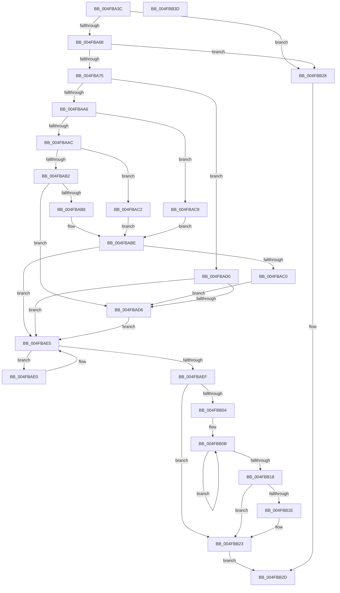

# KiHaltOnAddress

- RVA: `0x004FBA3C`–`0x004FBB3E` (길이 `258` bytes)
- VA: `0x00000001404FBA3C`
- 실행 섹션: `.text`
- PDB 이름 있음: `예`; PDB Function 태그: `아니요`
- unwind 정보 RVA: `0x000718AC`
- 디코드: `75`개 명령, `258/258` bytes 표시
- 미해석 바이트: `0` (있으면 어셈블리에 `.byte`로 보존)

> 이 문서는 커널 이미지의 기계어와 PDB 기호를 분석해 생성했습니다. 4번과 5번은 함수 원형과 자료형을 바이너리 사용 방식에서 추정한 C 해석이며 원본 소스 복구 결과는 아닙니다.

## 1. Dependencies

- 직접 호출 지점: **4**; 고유 호출 대상: **4**
- 직접 호출자로 확인된 함수: **19**
- RIP 상대 이미지 참조: **1**

### Outgoing calls
- `0x004FBA9B` → [KiAddHaltBlockToWaitList](../5B/KiAddHaltBlockToWaitList_function_005BB948.md) (function, `0x005BB948`)
- `0x004FBAD9` → [KiWakeAddressAll](../45/KiWakeAddressAll_function_0045B334.md) (function, `0x0045B334`)
- `0x004FBAE0` → [HalProcessorIdle](../6A/HalProcessorIdle_function_006AC7C0.md) (function, `0x006AC7C0`)
- `0x004FBB1E` → [KiRemoveSystemWorkPriorityKick](../26/KiRemoveSystemWorkPriorityKick_function_002631D0.md) (function, `0x002631D0`)

### Direct callers
- [MiUpdatePageThresholdsDpc](../3B/MiUpdatePageThresholdsDpc_function_003BD050.md) at `0x003BD14E`
- [MiUpdatePageThresholdsDpc](../3B/MiUpdatePageThresholdsDpc_function_003BD050.md) at `0x003BD23B`
- [KeHaltOnAddress](../4B/KeHaltOnAddress_function_004BD8DC.md) at `0x004BD8E0`
- [MiWritePteHighLevelIsr](../4C/MiWritePteHighLevelIsr_function_004C2FC0.md) at `0x004C31FE`
- [MiWritePteHighLevelIsr](../4C/MiWritePteHighLevelIsr_function_004C2FC0.md) at `0x004C32C3`
- [MiWritePteHighLevelIsr](../4C/MiWritePteHighLevelIsr_function_004C2FC0.md) at `0x004C33B8`
- [MiWritePteHighLevelIsr](../4C/MiWritePteHighLevelIsr_function_004C2FC0.md) at `0x004C34FD`
- [MiWritePteHighLevelIsr](../4C/MiWritePteHighLevelIsr_function_004C2FC0.md) at `0x004C35BF`
- [MiWritePteHighLevelIsr](../4C/MiWritePteHighLevelIsr_function_004C2FC0.md) at `0x004C369F`
- [KiOptimizeSpecCtrlSettingsWorker](../5B/KiOptimizeSpecCtrlSettingsWorker_function_005BF5A0.md) at `0x005BF8B1`
- [KiOptimizeSpecCtrlSettingsWorker](../5B/KiOptimizeSpecCtrlSettingsWorker_function_005BF5A0.md) at `0x005BFD38`
- [KiOptimizeSpecCtrlSettingsWorker](../5B/KiOptimizeSpecCtrlSettingsWorker_function_005BF5A0.md) at `0x005C02DC`
- [ExpLimitInsertDpc](../65/ExpLimitInsertDpc_function_00656BF0.md) at `0x00656D1C`
- [ExpLimitInsertDpc](../65/ExpLimitInsertDpc_function_00656BF0.md) at `0x00656DDF`
- [ExpLimitInsertDpc](../65/ExpLimitInsertDpc_function_00656BF0.md) at `0x00656EBA`
- [ExpAeThresholdInitWorker](../65/ExpAeThresholdInitWorker_function_0065D680.md) at `0x0065D776`
- [MiFreeUnusedPfnPagesDpc](../67/MiFreeUnusedPfnPagesDpc_function_00672150.md) at `0x00672232`
- [MiFreeUnusedPfnPagesDpc](../67/MiFreeUnusedPfnPagesDpc_function_00672150.md) at `0x0067231F`
- [MiMakeIoRangePermanentDpc](../67/MiMakeIoRangePermanentDpc_function_0067C540.md) at `0x0067C62B`
- [MiMakeIoRangePermanentDpc](../67/MiMakeIoRangePermanentDpc_function_0067C540.md) at `0x0067C718`
- [MiReapplyImportOptimizationWorker](../68/MiReapplyImportOptimizationWorker_function_00682720.md) at `0x006829AA`
- [MiDbgCopyMemoryTarget](../68/MiDbgCopyMemoryTarget_function_00684E70.md) at `0x0068504F`
- [MiDbgCopyMemoryTarget](../68/MiDbgCopyMemoryTarget_function_00684E70.md) at `0x0068513C`
- [MiChangeSlabIdentitiesDpc](../68/MiChangeSlabIdentitiesDpc_function_0068CF10.md) at `0x0068D018`
- [MiChangeSlabIdentitiesDpc](../68/MiChangeSlabIdentitiesDpc_function_0068CF10.md) at `0x0068D105`
- [MiSpecialPurposeMemoryCacheUpdateDpc](../69/MiSpecialPurposeMemoryCacheUpdateDpc_function_00695240.md) at `0x0069537B`
- [MiSpecialPurposeMemoryCacheUpdateDpc](../69/MiSpecialPurposeMemoryCacheUpdateDpc_function_00695240.md) at `0x00695474`
- [MiDpcGangTarget](../69/MiDpcGangTarget_function_00697E60.md) at `0x0069800A`
- [MiDpcGangTarget](../69/MiDpcGangTarget_function_00697E60.md) at `0x0069812C`
- [sub_006D6E06](../6D/Unknown_function_006D6E06.md) at `0x006D6E2B`
- [sub_006D6E06](../6D/Unknown_function_006D6E06.md) at `0x006D6E72`
- [sub_006EF7B6](../6E/Unknown_function_006EF7B6.md) at `0x006EF7DE`
- [sub_006EFA4E](../6E/Unknown_function_006EFA4E.md) at `0x006EFA73`
- [sub_006EFA4E](../6E/Unknown_function_006EFA4E.md) at `0x006EFAB6`
- [sub_006F0E0E](../6F/Unknown_function_006F0E0E.md) at `0x006F0E34`
- [sub_006F0E0E](../6F/Unknown_function_006F0E0E.md) at `0x006F0E7B`
- [sub_006F5584](../6F/Unknown_function_006F5584.md) at `0x006F55A7`
- [sub_006F5584](../6F/Unknown_function_006F5584.md) at `0x006F5616`
- [sub_006F5584](../6F/Unknown_function_006F5584.md) at `0x006F5661`
- [sub_006F60F8](../6F/Unknown_function_006F60F8.md) at `0x006F6306`
- [sub_006F60F8](../6F/Unknown_function_006F60F8.md) at `0x006F634F`

### Static image references
- `0x004FBA82` → RVA `0x00F21B20` (`.data`; read)

## 2. Other-region calls and transfers

- 다른 실행 섹션으로 향하는 call: **0**
- 별도 외부 분기/꼬리 이동을 확인하지 못했습니다.

## 3. Assembly (complete function range)

```asm
004FBA3C  4C 8B DC                        mov r11, rsp
004FBA3F  49 89 5B 08                     mov qword ptr [r11 + 8], rbx
004FBA43  49 89 73 10                     mov qword ptr [r11 + 0x10], rsi
004FBA47  57                              push rdi
004FBA48  48 83 EC 40                     sub rsp, 0x40
004FBA4C  83 64 24 3C 00                  and dword ptr [rsp + 0x3c], 0
004FBA51  49 8D 40 FF                     lea rax, [r8 - 1]
004FBA55  49 8B D8                        mov rbx, r8
004FBA58  48 8B F2                        mov rsi, rdx
004FBA5B  48 8B F9                        mov rdi, rcx
004FBA5E  48 83 F8 07                     cmp rax, 7
004FBA62  0F 87 C0 00 00 00               ja 0x1404fbb28
004FBA68  49 8D 40 FF                     lea rax, [r8 - 1]
004FBA6C  48 85 C3                        test rbx, rax
004FBA6F  0F 85 B3 00 00 00               jne 0x1404fbb28
004FBA75  49 83 63 E8 00                  and qword ptr [r11 - 0x18], 0
004FBA7A  49 8D 53 D8                     lea rdx, [r11 - 0x28]
004FBA7E  49 89 4B D8                     mov qword ptr [r11 - 0x28], rcx
004FBA82  48 8D 0D 97 60 A2 00            lea rcx, [rip + 0xa26097]
004FBA89  83 64 24 38 00                  and dword ptr [rsp + 0x38], 0
004FBA8E  65 48 8B 04 25 20 00 00 00      mov rax, qword ptr gs:[0x20]
004FBA97  49 89 43 E0                     mov qword ptr [r11 - 0x20], rax
004FBA9B  E8 A8 FE 0B 00                  call 0x1405bb948
004FBAA0  48 83 EB 01                     sub rbx, 1
004FBAA4  74 2A                           je 0x1404fbad0
004FBAA6  48 83 EB 01                     sub rbx, 1
004FBAAA  74 1C                           je 0x1404fbac8
004FBAAC  48 83 EB 02                     sub rbx, 2
004FBAB0  74 10                           je 0x1404fbac2
004FBAB2  48 83 FB 04                     cmp rbx, 4
004FBAB6  75 1E                           jne 0x1404fbad6
004FBAB8  48 8B 07                        mov rax, qword ptr [rdi]
004FBABB  48 3B 06                        cmp rax, qword ptr [rsi]
004FBABE  74 25                           je 0x1404fbae5
004FBAC0  EB 14                           jmp 0x1404fbad6
004FBAC2  8B 07                           mov eax, dword ptr [rdi]
004FBAC4  3B 06                           cmp eax, dword ptr [rsi]
004FBAC6  EB F6                           jmp 0x1404fbabe
004FBAC8  0F B7 07                        movzx eax, word ptr [rdi]
004FBACB  66 3B 06                        cmp ax, word ptr [rsi]
004FBACE  EB EE                           jmp 0x1404fbabe
004FBAD0  8A 07                           mov al, byte ptr [rdi]
004FBAD2  3A 06                           cmp al, byte ptr [rsi]
004FBAD4  74 0F                           je 0x1404fbae5
004FBAD6  48 8B CF                        mov rcx, rdi
004FBAD9  E8 56 F8 F5 FF                  call 0x14045b334
004FBADE  EB 05                           jmp 0x1404fbae5
004FBAE0  E8 DB 0C 1B 00                  call 0x1406ac7c0
004FBAE5  FA                              cli
004FBAE6  8B 44 24 38                     mov eax, dword ptr [rsp + 0x38]
004FBAEA  83 F8 01                        cmp eax, 1
004FBAED  75 F1                           jne 0x1404fbae0
004FBAEF  65 48 8B 0C 25 20 00 00 00      mov rcx, qword ptr gs:[0x20]
004FBAF8  4C 8B 81 B8 8E 00 00            mov r8, qword ptr [rcx + 0x8eb8]
004FBAFF  4D 85 C0                        test r8, r8
004FBB02  74 1F                           je 0x1404fbb23
004FBB04  41 0F 0D 08                     prefetchw byte ptr [r8]
004FBB08  41 8B 00                        mov eax, dword ptr [r8]
004FBB0B  8B D0                           mov edx, eax
004FBB0D  0F BA F2 15                     btr edx, 0x15
004FBB11  F0 41 0F B1 10                  lock cmpxchg dword ptr [r8], edx
004FBB16  75 F3                           jne 0x1404fbb0b
004FBB18  0F BA E0 15                     bt eax, 0x15
004FBB1C  73 05                           jae 0x1404fbb23
004FBB1E  E8 AD 76 D6 FF                  call 0x1402631d0
004FBB23  FB                              sti
004FBB24  33 C0                           xor eax, eax
004FBB26  EB 05                           jmp 0x1404fbb2d
004FBB28  B8 0D 00 00 C0                  mov eax, 0xc000000d
004FBB2D  48 8B 5C 24 50                  mov rbx, qword ptr [rsp + 0x50]
004FBB32  48 8B 74 24 58                  mov rsi, qword ptr [rsp + 0x58]
004FBB37  48 83 C4 40                     add rsp, 0x40
004FBB3B  5F                              pop rdi
004FBB3C  C3                              ret
004FBB3D  CC                              int3
```

## 4. C-style interpretation (structured pseudocode)

```c
__int64 __fastcall KiHaltOnAddress(__int64 a1, __int64 a2, __int64 a3)
{
    __int64 result;
    __int64 v_rbx;
    __int64 v_rsp;
    unsigned int v_stack_m10;
    unsigned int v_stack_mC;
    unsigned __int64 v_stack_p10;
    unsigned __int64 v_stack_p8;

    *(unsigned __int64 *)(v_rsp + 8) = v_rbx;
    *(unsigned __int64 *)(v_rsp + 16) = v_rsi;
    v_rsp = (v_rsp) - (64);
    if ((a3 - 1) > 7) goto loc_004FBB28;
    if (((a3) & (a3 - 1)) != 0) goto loc_004FBB28;
    *(unsigned __int64 *)(v_rsp - 40) = a1;
    *(unsigned __int64 *)(v_rsp - 32) = *(unsigned __int64 *)(gs_base + (0 + 32));
    result = KiAddHaltBlockToWaitList(v_rip + 10641559, v_rsp - 40, a3, a4);
    v_rbx = (a3) - (1);
    if (condition_is_equal) goto loc_004FBAD0;
    v_rbx = (v_rbx) - (1);
    if (condition_is_equal) goto loc_004FBAC8;
    v_rbx = (v_rbx) - (2);
    if (condition_is_equal) goto loc_004FBAC2;
    if (v_rbx != 4) goto loc_004FBAD6;
loc_004FBABE:
    if ((*(unsigned __int64 *)(a1)) == (*(unsigned __int64 *)(a2))) goto loc_004FBAE5;
    goto loc_004FBAD6;
loc_004FBAC2:
    goto loc_004FBABE;
loc_004FBAC8:
    goto loc_004FBABE;
loc_004FBAD0:
    if (((unsigned __int8)(*(unsigned __int8 *)(a1))) == (*(unsigned __int8 *)(a2))) goto loc_004FBAE5;
loc_004FBAD6:
    result = KiWakeAddressAll(a1, v_rsp - 40, a3, a4);
    goto loc_004FBAE5;
loc_004FBAE0:
    result = HalProcessorIdle(a1, v_rsp - 40, a3, a4);
loc_004FBAE5:
    if (((unsigned int)((unsigned int)(v_stack_m10))) != 1) goto loc_004FBAE0;
    if (*(unsigned __int64 *)(*(unsigned __int64 *)(gs_base + (0 + 32)) + 36536) == 0) goto loc_004FBB23;
loc_004FBB0B:
    if (*(unsigned __int64 *)(*(unsigned __int64 *)(gs_base + (0 + 32)) + 36536) != 0) goto loc_004FBB0B;
    result = (unsigned int)(*(unsigned int *)(*(unsigned __int64 *)(*(unsigned __int64 *)(gs_base + (0 + 32)) + 36536)));
    if (!(condition_is_above_or_equal)) {
        result = KiRemoveSystemWorkPriorityKick(*(unsigned __int64 *)(gs_base + (0 + 32)), (unsigned int)((unsigned int)((unsigned int)(*(unsigned int *)(*(unsigned __int64 *)(*(unsigned __int64 *)(gs_base + (0 + 32)) + 36536))))), *(unsigned __int64 *)(*(unsigned __int64 *)(gs_base + (0 + 32)) + 36536), a4);
    }
    result = 0;
    goto loc_004FBB2D;
loc_004FBB28:
loc_004FBB2D:
    v_rsp = (v_rsp) + (64);
    return (unsigned int)(0xC000000DULL);
}
```

## 5. (Beta) C Style

```c
int64_t KiHaltOnAddress(void *Arg1, void *Arg2, void *Arg3)
{
    uint8_t *arg1 = (uint8_t *)Arg1;
    uint8_t *arg2 = (uint8_t *)Arg2;
    uint8_t *arg3 = (uint8_t *)Arg3;

    int64_t result;
    int64_t local_rbx;
    int64_t local_rsp;
    uint32_t v_stack_m10;
    uint32_t v_stack_mC;
    uint64_t v_stack_p10;
    uint64_t v_stack_p8;

    *(uint64_t *)(local_rsp + 0x8) = local_rbx;
    *(uint64_t *)(local_rsp + 0x10) = local_rsi;
    local_rsp = (local_rsp) - (64);
    if ((Arg3 - 1) > 7) goto loc_004FBB28;
    if (((Arg3) & (Arg3 - 1)) != 0) goto loc_004FBB28;
    *(void **)(local_rsp - 0x28) = Arg1;
    *(uint64_t *)(local_rsp - 0x20) = *(uint64_t *)(gs_base + (0 + 0x20));
    result = KiAddHaltBlockToWaitList(v_rip + 10641559, local_rsp - 40, Arg3, a4);
    local_rbx = (Arg3) - (1);
    if (condition_is_equal) goto loc_004FBAD0;
    local_rbx = (local_rbx) - (1);
    if (condition_is_equal) goto loc_004FBAC8;
    local_rbx = (local_rbx) - (2);
    if (condition_is_equal) goto loc_004FBAC2;
    if (local_rbx != 4) goto loc_004FBAD6;
loc_004FBABE:
    if ((*(uint64_t *)(arg1)) == (*(uint64_t *)(arg2))) goto loc_004FBAE5;
    goto loc_004FBAD6;
loc_004FBAC2:
    goto loc_004FBABE;
loc_004FBAC8:
    goto loc_004FBABE;
loc_004FBAD0:
    if (((uint8_t)(*(uint8_t *)(arg1))) == (*(uint8_t *)(arg2))) goto loc_004FBAE5;
loc_004FBAD6:
    result = KiWakeAddressAll(Arg1, local_rsp - 40, Arg3, a4);
    goto loc_004FBAE5;
loc_004FBAE0:
    result = HalProcessorIdle(Arg1, local_rsp - 40, Arg3, a4);
loc_004FBAE5:
    if (((uint32_t)((uint32_t)(v_stack_m10))) != 1) goto loc_004FBAE0;
    if (*(uint64_t *)(*(uint64_t *)(gs_base + (0 + 0x20)) + 0x8EB8) == 0) goto loc_004FBB23;
loc_004FBB0B:
    if (*(uint64_t *)(*(uint64_t *)(gs_base + (0 + 0x20)) + 0x8EB8) != 0) goto loc_004FBB0B;
    result = (uint32_t)(*(uint32_t *)(*(uint64_t *)(*(uint64_t *)(gs_base + (0 + 0x20)) + 0x8EB8)));
    if (!(condition_is_above_or_equal)) {
        result = KiRemoveSystemWorkPriorityKick(*(uint64_t *)(gs_base + (0 + 0x20)), (uint32_t)((uint32_t)((uint32_t)(*(uint32_t *)(*(uint64_t *)(*(uint64_t *)(gs_base + (0 + 0x20)) + 0x8EB8))))), *(uint64_t *)(*(uint64_t *)(gs_base + (0 + 0x20)) + 0x8EB8), a4);
    }
    result = 0;
    goto loc_004FBB2D;
loc_004FBB28:
loc_004FBB2D:
    local_rsp = (local_rsp) + (64);
    return (uint32_t)(0xC000000DULL);
}
```

### 관측된 메모리 오프셋

구조체 형식이 확인되지 않은 접근은 인자 기준의 오프셋으로만 기록했습니다.

| 기준 인자 | 오프셋 표현 | 폭 (bit) | 접근 |
|---|---:|---:|---|
| `Arg1` | `+ 0x0` | `8` | `R` |
| `Arg1` | `+ 0x0` | `16` | `R` |
| `Arg1` | `+ 0x0` | `32` | `R` |
| `Arg1` | `+ 0x0` | `64` | `R` |
| `Arg2` | `+ 0x0` | `8` | `R` |
| `Arg2` | `+ 0x0` | `16` | `R` |
| `Arg2` | `+ 0x0` | `32` | `R` |
| `Arg2` | `+ 0x0` | `64` | `R` |
| `Arg3` | `- 0x1` | `64` | `R` |

## 6. Execution-region graph

[열기: 2D/3D 그래프와 함수 탐색 컨트롤 패널](../../../control-panel.html?section=text&rva=0x004FBA3C&view=graph)

- 2D 그래프는 위에서 아래로 흐르고, 3D 그래프는 빈 공간을 드래그해 회전합니다. Shift+드래그는 이동, 휠은 확대·축소, 함수 노드 선택은 대상 보고서 이동입니다.

### Static fallback


