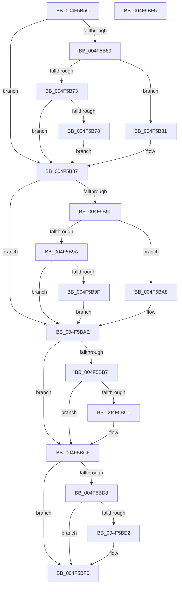

# KiInitializeAntiStarvationPolicies

- RVA: `0x004F5B5C`–`0x004F5BF6` (길이 `154` bytes)
- VA: `0x00000001404F5B5C`
- 실행 섹션: `.text`
- PDB 이름 있음: `예`; PDB Function 태그: `아니요`
- unwind 정보 RVA: `0x0005C788`
- 디코드: `44`개 명령, `154/154` bytes 표시
- 미해석 바이트: `0` (있으면 어셈블리에 `.byte`로 보존)

> 이 문서는 커널 이미지의 기계어와 PDB 기호를 분석해 생성했습니다. 4번과 5번은 함수 원형과 자료형을 바이너리 사용 방식에서 추정한 C 해석이며 원본 소스 복구 결과는 아닙니다.

## 1. Dependencies

- 직접 호출 지점: **8**; 고유 호출 대상: **8**
- 직접 호출자로 확인된 함수: **1**
- RIP 상대 이미지 참조: **6**

### Outgoing calls
- `0x004F5B60` → [Feature_AntiStarvationScanPeriodVariable__private_IsEnabledDeviceUsageNoInline](Feature_AntiStarvationScanPeriodVariable__private_IsEnabledDeviceUsageNoInline_function_004F5C34.md) (function, `0x004F5C34`)
- `0x004F5B69` → [Feature_AntiStarvationScanPeriodVariable__private_GetVariant](../5B/Feature_AntiStarvationScanPeriodVariable__private_GetVariant_function_005B603C.md) (function, `0x005B603C`)
- `0x004F5B87` → [Feature_AntiStarvationReadyPeriodVariable__private_IsEnabledDeviceUsageNoInline](Feature_AntiStarvationReadyPeriodVariable__private_IsEnabledDeviceUsageNoInline_function_004F5C6C.md) (function, `0x004F5C6C`)
- `0x004F5B90` → [Feature_AntiStarvationReadyPeriodVariable__private_GetVariant](../5B/Feature_AntiStarvationReadyPeriodVariable__private_GetVariant_function_005B5FFC.md) (function, `0x005B5FFC`)
- `0x004F5BAE` → [Feature_AntiStarvationThreadScanCountVariable__private_IsEnabledDeviceUsageNoInline](Feature_AntiStarvationThreadScanCountVariable__private_IsEnabledDeviceUsageNoInline_function_004F5CA4.md) (function, `0x004F5CA4`)
- `0x004F5BB7` → [Feature_AntiStarvationThreadScanCountVariable__private_GetVariant](../5B/Feature_AntiStarvationThreadScanCountVariable__private_GetVariant_function_005B60BC.md) (function, `0x005B60BC`)
- `0x004F5BCF` → [Feature_AntiStarvationThreadBoostCountVariable__private_IsEnabledDeviceUsageNoInline](Feature_AntiStarvationThreadBoostCountVariable__private_IsEnabledDeviceUsageNoInline_function_004F5BFC.md) (function, `0x004F5BFC`)
- `0x004F5BD8` → [Feature_AntiStarvationThreadBoostCountVariable__private_GetVariant](../5B/Feature_AntiStarvationThreadBoostCountVariable__private_GetVariant_function_005B607C.md) (function, `0x005B607C`)

### Direct callers
- [KeInitSystem](../../init/C7/KeInitSystem_function_00C71660.md) at `0x00C7177D`

### Static image references
- `0x004F5B78` → RVA `0x00FC51C4` (`ALMOSTRO`; read/write)
- `0x004F5B9F` → RVA `0x00FC51C0` (`ALMOSTRO`; read/write)
- `0x004F5BC1` → RVA `0x00FC511C` (`ALMOSTRO`; read)
- `0x004F5BC9` → RVA `0x00FC511C` (`ALMOSTRO`; write)
- `0x004F5BE2` → RVA `0x00FC52A4` (`ALMOSTRO`; read)
- `0x004F5BEA` → RVA `0x00FC52A4` (`ALMOSTRO`; write)

## 2. Other-region calls and transfers

- 다른 실행 섹션으로 향하는 call: **0**
- 별도 외부 분기/꼬리 이동을 확인하지 못했습니다.

## 3. Assembly (complete function range)

```asm
004F5B5C  48 83 EC 28                     sub rsp, 0x28
004F5B60  E8 CF 00 00 00                  call 0x1404f5c34
004F5B65  85 C0                           test eax, eax
004F5B67  74 1E                           je 0x1404f5b87
004F5B69  E8 CE 04 0C 00                  call 0x1405b603c
004F5B6E  83 E8 01                        sub eax, 1
004F5B71  74 0E                           je 0x1404f5b81
004F5B73  83 F8 01                        cmp eax, 1
004F5B76  75 0F                           jne 0x1404f5b87
004F5B78  C1 2D 45 F6 AC 00 02            shr dword ptr [rip + 0xacf645], 2
004F5B7F  EB 06                           jmp 0x1404f5b87
004F5B81  D1 2D 3D F6 AC 00               shr dword ptr [rip + 0xacf63d], 1
004F5B87  E8 E0 00 00 00                  call 0x1404f5c6c
004F5B8C  85 C0                           test eax, eax
004F5B8E  74 1E                           je 0x1404f5bae
004F5B90  E8 67 04 0C 00                  call 0x1405b5ffc
004F5B95  83 E8 01                        sub eax, 1
004F5B98  74 0E                           je 0x1404f5ba8
004F5B9A  83 F8 01                        cmp eax, 1
004F5B9D  75 0F                           jne 0x1404f5bae
004F5B9F  C1 2D 1A F6 AC 00 02            shr dword ptr [rip + 0xacf61a], 2
004F5BA6  EB 06                           jmp 0x1404f5bae
004F5BA8  D1 2D 12 F6 AC 00               shr dword ptr [rip + 0xacf612], 1
004F5BAE  E8 F1 00 00 00                  call 0x1404f5ca4
004F5BB3  85 C0                           test eax, eax
004F5BB5  74 18                           je 0x1404f5bcf
004F5BB7  E8 00 05 0C 00                  call 0x1405b60bc
004F5BBC  83 F8 01                        cmp eax, 1
004F5BBF  75 0E                           jne 0x1404f5bcf
004F5BC1  8B 05 55 F5 AC 00               mov eax, dword ptr [rip + 0xacf555]
004F5BC7  03 C0                           add eax, eax
004F5BC9  89 05 4D F5 AC 00               mov dword ptr [rip + 0xacf54d], eax
004F5BCF  E8 28 00 00 00                  call 0x1404f5bfc
004F5BD4  85 C0                           test eax, eax
004F5BD6  74 18                           je 0x1404f5bf0
004F5BD8  E8 9F 04 0C 00                  call 0x1405b607c
004F5BDD  83 F8 01                        cmp eax, 1
004F5BE0  75 0E                           jne 0x1404f5bf0
004F5BE2  8B 05 BC F6 AC 00               mov eax, dword ptr [rip + 0xacf6bc]
004F5BE8  03 C0                           add eax, eax
004F5BEA  89 05 B4 F6 AC 00               mov dword ptr [rip + 0xacf6b4], eax
004F5BF0  48 83 C4 28                     add rsp, 0x28
004F5BF4  C3                              ret
004F5BF5  CC                              int3
```

## 4. C-style interpretation (structured pseudocode)

```c
__int64 __fastcall KiInitializeAntiStarvationPolicies(void)
{
    __int64 result;
    __int64 v_rsp;

    v_rsp = (v_rsp) - (40);
    result = Feature_AntiStarvationScanPeriodVariable__private_IsEnabledDeviceUsageNoInline(a1, a2, a3, a4);
    if ((unsigned int)(result) == 0) goto loc_004F5B87;
    result = Feature_AntiStarvationScanPeriodVariable__private_GetVariant(a1, a2, a3, a4);
    result = (unsigned int)((result) - (1));
    if (condition_is_equal) goto loc_004F5B81;
    if (((unsigned int)(result)) != 1) goto loc_004F5B87;
    goto loc_004F5B87;
loc_004F5B81:
loc_004F5B87:
    result = Feature_AntiStarvationReadyPeriodVariable__private_IsEnabledDeviceUsageNoInline(a1, a2, a3, a4);
    if ((unsigned int)(result) == 0) goto loc_004F5BAE;
    result = Feature_AntiStarvationReadyPeriodVariable__private_GetVariant(a1, a2, a3, a4);
    result = (unsigned int)((result) - (1));
    if (condition_is_equal) goto loc_004F5BA8;
    if (((unsigned int)(result)) != 1) goto loc_004F5BAE;
    goto loc_004F5BAE;
loc_004F5BA8:
loc_004F5BAE:
    result = Feature_AntiStarvationThreadScanCountVariable__private_IsEnabledDeviceUsageNoInline(a1, a2, a3, a4);
    if ((unsigned int)(result) == 0) goto loc_004F5BCF;
    result = Feature_AntiStarvationThreadScanCountVariable__private_GetVariant(a1, a2, a3, a4);
    if (((unsigned int)(result)) == 1) {
        result = *(unsigned int *)(v_rip + 11334997);
        result = (unsigned int)((result) + ((unsigned int)(result)));
        *(unsigned int *)(v_rip + 11334989) = (unsigned int)(result);
    }
    result = Feature_AntiStarvationThreadBoostCountVariable__private_IsEnabledDeviceUsageNoInline(a1, a2, a3, a4);
    if ((unsigned int)(result) == 0) goto loc_004F5BF0;
    result = Feature_AntiStarvationThreadBoostCountVariable__private_GetVariant(a1, a2, a3, a4);
    if (((unsigned int)(result)) == 1) {
        result = *(unsigned int *)(v_rip + 11335356);
        result = (unsigned int)((result) + ((unsigned int)(result)));
        *(unsigned int *)(v_rip + 11335348) = (unsigned int)(result);
    }
    v_rsp = (v_rsp) + (40);
    return result;
}
```

## 5. (Beta) C Style

```c
void KiInitializeAntiStarvationPolicies(void)
{
    int64_t result;
    int64_t local_rsp;

    local_rsp = (local_rsp) - (40);
    result = Feature_AntiStarvationScanPeriodVariable__private_IsEnabledDeviceUsageNoInline(a1, a2, a3, a4);
    if ((uint32_t)(result) == 0) goto loc_004F5B87;
    result = Feature_AntiStarvationScanPeriodVariable__private_GetVariant(a1, a2, a3, a4);
    result = (uint32_t)((result) - (1));
    if (condition_is_equal) goto loc_004F5B81;
    if (((uint32_t)(result)) != 1) goto loc_004F5B87;
    goto loc_004F5B87;
loc_004F5B81:
loc_004F5B87:
    result = Feature_AntiStarvationReadyPeriodVariable__private_IsEnabledDeviceUsageNoInline(a1, a2, a3, a4);
    if ((uint32_t)(result) == 0) goto loc_004F5BAE;
    result = Feature_AntiStarvationReadyPeriodVariable__private_GetVariant(a1, a2, a3, a4);
    result = (uint32_t)((result) - (1));
    if (condition_is_equal) goto loc_004F5BA8;
    if (((uint32_t)(result)) != 1) goto loc_004F5BAE;
    goto loc_004F5BAE;
loc_004F5BA8:
loc_004F5BAE:
    result = Feature_AntiStarvationThreadScanCountVariable__private_IsEnabledDeviceUsageNoInline(a1, a2, a3, a4);
    if ((uint32_t)(result) == 0) goto loc_004F5BCF;
    result = Feature_AntiStarvationThreadScanCountVariable__private_GetVariant(a1, a2, a3, a4);
    if (((uint32_t)(result)) == 1) {
        result = *(uint32_t *)(v_rip + 0xACF555);
        result = (uint32_t)((result) + ((uint32_t)(result)));
        *(uint32_t *)(v_rip + 0xACF54D) = (uint32_t)(result);
    }
    result = Feature_AntiStarvationThreadBoostCountVariable__private_IsEnabledDeviceUsageNoInline(a1, a2, a3, a4);
    if ((uint32_t)(result) == 0) goto loc_004F5BF0;
    result = Feature_AntiStarvationThreadBoostCountVariable__private_GetVariant(a1, a2, a3, a4);
    if (((uint32_t)(result)) == 1) {
        result = *(uint32_t *)(v_rip + 0xACF6BC);
        result = (uint32_t)((result) + ((uint32_t)(result)));
        *(uint32_t *)(v_rip + 0xACF6B4) = (uint32_t)(result);
    }
    local_rsp = (local_rsp) + (40);
    return result;
}
```

## 6. Execution-region graph

[열기: 2D/3D 그래프와 함수 탐색 컨트롤 패널](../../../control-panel.html?section=text&rva=0x004F5B5C&view=graph)

- 2D 그래프는 위에서 아래로 흐르고, 3D 그래프는 빈 공간을 드래그해 회전합니다. Shift+드래그는 이동, 휠은 확대·축소, 함수 노드 선택은 대상 보고서 이동입니다.

### Static fallback


