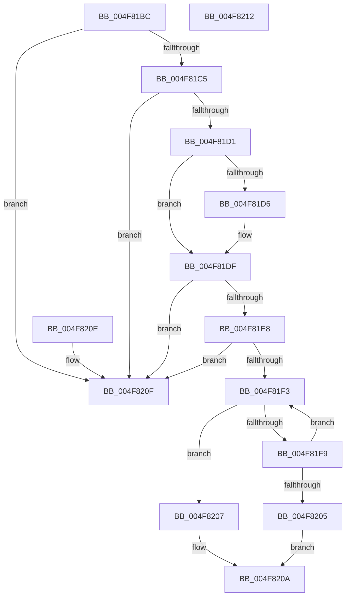

# KiIsThreadRankBiased

- RVA: `0x004F81BC`–`0x004F8213` (길이 `87` bytes)
- VA: `0x00000001404F81BC`
- 실행 섹션: `.text`
- PDB 이름 있음: `예`; PDB Function 태그: `아니요`
- unwind 정보 RVA: `0x000DB714`
- 디코드: `28`개 명령, `87/87` bytes 표시
- 미해석 바이트: `0` (있으면 어셈블리에 `.byte`로 보존)

> 이 문서는 커널 이미지의 기계어와 PDB 기호를 분석해 생성했습니다. 4번과 5번은 함수 원형과 자료형을 바이너리 사용 방식에서 추정한 C 해석이며 원본 소스 복구 결과는 아닙니다.

## 1. Dependencies

- 직접 호출 지점: **0**; 고유 호출 대상: **0**
- 직접 호출자로 확인된 함수: **2**
- RIP 상대 이미지 참조: **0**

### Outgoing calls
- 직접 디코드된 call 명령이 없습니다.

### Direct callers
- [sub_002546EC](../25/Unknown_function_002546EC.md) at `0x00254F99`
- [KiSearchForNewThreadsOnTarget](../30/KiSearchForNewThreadsOnTarget_function_0030F500.md) at `0x00310719`
- [KiSearchForNewThreadsOnTarget](../30/KiSearchForNewThreadsOnTarget_function_0030F500.md) at `0x0031105D`
- [KiSearchForNewThreadsOnTarget](../30/KiSearchForNewThreadsOnTarget_function_0030F500.md) at `0x00311258`

### Static image references
- 디코드된 RIP-relative 메모리 참조가 없습니다.

## 2. Other-region calls and transfers

- 다른 실행 섹션으로 향하는 call: **0**
- 별도 외부 분기/꼬리 이동을 확인하지 못했습니다.

## 3. Assembly (complete function range)

```asm
004F81BC  80 B9 C3 00 00 00 10            cmp byte ptr [rcx + 0xc3], 0x10
004F81C3  7D 4A                           jge 0x1404f820f
004F81C5  48 8B 41 68                     mov rax, qword ptr [rcx + 0x68]
004F81C9  45 33 C0                        xor r8d, r8d
004F81CC  48 85 C0                        test rax, rax
004F81CF  74 3E                           je 0x1404f820f
004F81D1  48 85 D2                        test rdx, rdx
004F81D4  75 09                           jne 0x1404f81df
004F81D6  65 48 8B 14 25 20 00 00 00      mov rdx, qword ptr gs:[0x20]
004F81DF  48 8B 41 68                     mov rax, qword ptr [rcx + 0x68]
004F81E3  48 85 C0                        test rax, rax
004F81E6  74 27                           je 0x1404f820f
004F81E8  8B 8A D8 00 00 00               mov ecx, dword ptr [rdx + 0xd8]
004F81EE  48 03 C8                        add rcx, rax
004F81F1  74 1C                           je 0x1404f820f
004F81F3  F6 41 70 08                     test byte ptr [rcx + 0x70], 8
004F81F7  75 0E                           jne 0x1404f8207
004F81F9  48 8B 89 A0 01 00 00            mov rcx, qword ptr [rcx + 0x1a0]
004F8200  48 85 C9                        test rcx, rcx
004F8203  75 EE                           jne 0x1404f81f3
004F8205  EB 03                           jmp 0x1404f820a
004F8207  41 B0 01                        mov r8b, 1
004F820A  41 8A C0                        mov al, r8b
004F820D  C3                              ret
004F820E  CC                              int3
004F820F  32 C0                           xor al, al
004F8211  C3                              ret
004F8212  CC                              int3
```

## 4. C-style interpretation (structured pseudocode)

```c
__int64 __fastcall KiIsThreadRankBiased(__int64 a1, __int64 a2, int a3)
{
    __int64 result;

    if ((*(unsigned __int8 *)(a1 + 195)) >= 16) goto loc_004F820F;
    a3 = 0;
    if (*(unsigned __int64 *)(a1 + 104) == 0) goto loc_004F820F;
    if (a2 == 0) {
        a2 = *(unsigned __int64 *)(gs_base + (0 + 32));
    }
    if (*(unsigned __int64 *)(a1 + 104) == 0) goto loc_004F820F;
    a1 = ((unsigned int)(*(unsigned int *)(a2 + 216))) + (*(unsigned __int64 *)(a1 + 104));
    if (condition_is_equal) goto loc_004F820F;
loc_004F81F3:
    if (((*(unsigned __int8 *)(a1 + 112)) & (8)) != 0) goto loc_004F8207;
    if (*(unsigned __int64 *)(a1 + 416) != 0) goto loc_004F81F3;
    goto loc_004F820A;
loc_004F8207:
loc_004F820A:
    return 1;
loc_004F820F:
    result = 0;
    return result;
}
```

## 5. (Beta) C Style

```c
int64_t KiIsThreadRankBiased(void *Arg1, int64_t Arg2, int32_t Arg3)
{
    uint8_t *arg1 = (uint8_t *)Arg1;

    int64_t result;

    if ((*(uint8_t *)(arg1 + 0xC3)) >= 16) goto loc_004F820F;
    Arg3 = 0;
    if (*(uint64_t *)(arg1 + 0x68) == 0) goto loc_004F820F;
    if (Arg2 == 0) {
        Arg2 = *(uint64_t *)(gs_base + (0 + 0x20));
    }
    if (*(uint64_t *)(arg1 + 0x68) == 0) goto loc_004F820F;
    Arg1 = ((uint32_t)(*(uint32_t *)(Arg2 + 0xD8))) + (*(uint64_t *)(arg1 + 0x68));
    if (condition_is_equal) goto loc_004F820F;
loc_004F81F3:
    if (((*(uint8_t *)(arg1 + 0x70)) & (8)) != 0) goto loc_004F8207;
    if (*(uint64_t *)(arg1 + 0x1A0) != 0) goto loc_004F81F3;
    goto loc_004F820A;
loc_004F8207:
loc_004F820A:
    return 1;
loc_004F820F:
    result = 0;
    return result;
}
```

### 관측된 메모리 오프셋

구조체 형식이 확인되지 않은 접근은 인자 기준의 오프셋으로만 기록했습니다.

| 기준 인자 | 오프셋 표현 | 폭 (bit) | 접근 |
|---|---:|---:|---|
| `Arg1` | `+ 0x68` | `64` | `R` |
| `Arg1` | `+ 0xC3` | `8` | `R` |

## 6. Execution-region graph

[열기: 2D/3D 그래프와 함수 탐색 컨트롤 패널](../../../control-panel.html?section=text&rva=0x004F81BC&view=graph)

- 2D 그래프는 위에서 아래로 흐르고, 3D 그래프는 빈 공간을 드래그해 회전합니다. Shift+드래그는 이동, 휠은 확대·축소, 함수 노드 선택은 대상 보고서 이동입니다.

### Static fallback


