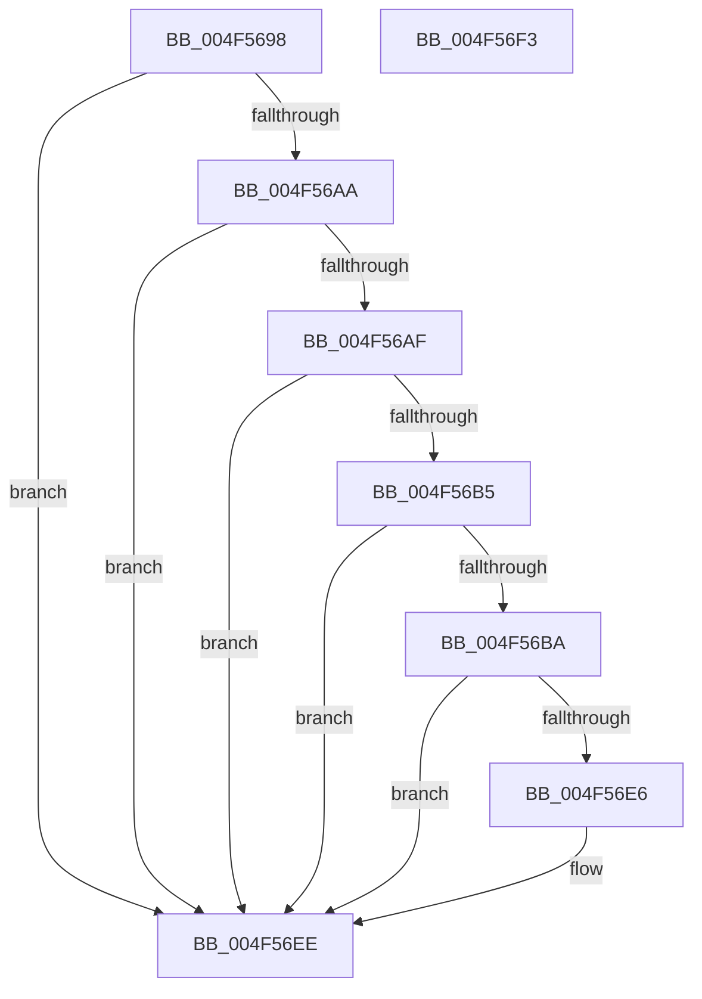

# KiLowerIrqlProcessIrqlFlags

- RVA: `0x004F5698`–`0x004F56F4` (길이 `92` bytes)
- VA: `0x00000001404F5698`
- 실행 섹션: `.text`
- PDB 이름 있음: `예`; PDB Function 태그: `아니요`
- unwind 정보 RVA: `0x0005C788`
- 디코드: `27`개 명령, `92/92` bytes 표시
- 미해석 바이트: `0` (있으면 어셈블리에 `.byte`로 보존)

> 이 문서는 커널 이미지의 기계어와 PDB 기호를 분석해 생성했습니다. 4번과 5번은 함수 원형과 자료형을 바이너리 사용 방식에서 추정한 C 해석이며 원본 소스 복구 결과는 아닙니다.

## 1. Dependencies

- 직접 호출 지점: **1**; 고유 호출 대상: **1**
- 직접 호출자로 확인된 함수: **854**
- RIP 상대 이미지 참조: **1**

### Outgoing calls
- `0x004F56E9` → [KiRemoveSystemWorkPriorityKick](../26/KiRemoveSystemWorkPriorityKick_function_002631D0.md) (function, `0x002631D0`)

### Direct callers
- [KiHandleDeferredPreemption](../20/KiHandleDeferredPreemption_function_00202ECC.md) at `0x00202FBC`
- [KiHandleDeferredPreemption](../20/KiHandleDeferredPreemption_function_00202ECC.md) at `0x0020318A`
- [sub_00204878](../20/Unknown_function_00204878.md) at `0x00204880`
- [sub_00206865](../20/Unknown_function_00206865.md) at `0x0020698F`
- [sub_00206E35](../20/Unknown_function_00206E35.md) at `0x00206EC0`
- [sub_00206E35](../20/Unknown_function_00206E35.md) at `0x00206FB8`
- [sub_00207257](../20/Unknown_function_00207257.md) at `0x0020725F`
- [sub_002073F4](../20/Unknown_function_002073F4.md) at `0x0020745A`
- [IopQueueThreadIrp](../20/IopQueueThreadIrp_function_002075C0.md) at `0x0020767B`
- [sub_00207BC1](../20/Unknown_function_00207BC1.md) at `0x00207BF7`
- [sub_00207D3E](../20/Unknown_function_00207D3E.md) at `0x00207E1F`
- [sub_0020959D](../20/Unknown_function_0020959D.md) at `0x00209718`
- [sub_0020959D](../20/Unknown_function_0020959D.md) at `0x002097EA`
- [sub_002099FA](../20/Unknown_function_002099FA.md) at `0x00209A96`
- [sub_002099FA](../20/Unknown_function_002099FA.md) at `0x00209CE0`
- [KeYieldExecution](../20/KeYieldExecution_function_00209FA0.md) at `0x0020A1DF`
- [IoRemoveIoCompletion](../20/IoRemoveIoCompletion_function_0020B580.md) at `0x0020B8F7`
- [sub_0020BDAA](../20/Unknown_function_0020BDAA.md) at `0x0020BF2D`
- [sub_0020BDAA](../20/Unknown_function_0020BDAA.md) at `0x0020C14E`
- [sub_0020C222](../20/Unknown_function_0020C222.md) at `0x0020C295`
- [sub_0020C2D4](../20/Unknown_function_0020C2D4.md) at `0x0020C3F1`
- [sub_0020C2D4](../20/Unknown_function_0020C2D4.md) at `0x0020C672`
- [sub_0020D1EC](../20/Unknown_function_0020D1EC.md) at `0x0020D39D`
- [sub_0020D5AD](../20/Unknown_function_0020D5AD.md) at `0x0020D664`
- [KeWaitForSingleObject](../20/KeWaitForSingleObject_function_0020E6B0.md) at `0x0020E96B`
- [KeWaitForSingleObject](../20/KeWaitForSingleObject_function_0020E6B0.md) at `0x0020EC05`
- [KeWaitForSingleObject](../20/KeWaitForSingleObject_function_0020E6B0.md) at `0x0020EDA8`
- [KeWaitForSingleObject](../20/KeWaitForSingleObject_function_0020E6B0.md) at `0x0020F114`
- [KeWaitForSingleObject](../20/KeWaitForSingleObject_function_0020E6B0.md) at `0x0020F246`
- [KeWaitForSingleObject](../20/KeWaitForSingleObject_function_0020E6B0.md) at `0x0020F5C0`
- [ExpFreeOwnerEntry](../20/ExpFreeOwnerEntry_function_0020F740.md) at `0x0020F941`
- [sub_00210801](../21/Unknown_function_00210801.md) at `0x002108DE`
- [ExpAcquireFastResourceSharedSlow](../21/ExpAcquireFastResourceSharedSlow_function_00211260.md) at `0x0021168C`
- [ExpAcquireFastResourceSharedSlow](../21/ExpAcquireFastResourceSharedSlow_function_00211260.md) at `0x002116F5`
- [ExpAcquireFastResourceSharedSlow](../21/ExpAcquireFastResourceSharedSlow_function_00211260.md) at `0x002119D4`
- [ExpAcquireResourceSharedLite](../21/ExpAcquireResourceSharedLite_function_00212040.md) at `0x00212276`
- [ExpAcquireResourceSharedLite](../21/ExpAcquireResourceSharedLite_function_00212040.md) at `0x0021264F`
- [ExpAcquireResourceSharedLite](../21/ExpAcquireResourceSharedLite_function_00212040.md) at `0x002128E5`
- [ExpAcquireResourceSharedLite](../21/ExpAcquireResourceSharedLite_function_00212040.md) at `0x00213231`
- [ExEnterPriorityRegionAndAcquireResourceShared](../21/ExEnterPriorityRegionAndAcquireResourceShared_function_00213870.md) at `0x00213A07`
- [ExEnterPriorityRegionAndAcquireResourceShared](../21/ExEnterPriorityRegionAndAcquireResourceShared_function_00213870.md) at `0x00213A92`
- [sub_00213F4F](../21/Unknown_function_00213F4F.md) at `0x002142C1`
- [sub_002142F9](../21/Unknown_function_002142F9.md) at `0x00214357`
- [sub_002142F9](../21/Unknown_function_002142F9.md) at `0x00214920`
- [sub_002142F9](../21/Unknown_function_002142F9.md) at `0x002149A2`
- [sub_002142F9](../21/Unknown_function_002142F9.md) at `0x00214A9A`
- [sub_002142F9](../21/Unknown_function_002142F9.md) at `0x00214B45`
- [sub_002142F9](../21/Unknown_function_002142F9.md) at `0x00214CF4`
- [sub_002142F9](../21/Unknown_function_002142F9.md) at `0x00214D58`
- [sub_00214E58](../21/Unknown_function_00214E58.md) at `0x00214FED`
- [sub_00215166](../21/Unknown_function_00215166.md) at `0x0021530C`
- [sub_00215166](../21/Unknown_function_00215166.md) at `0x002157D5`
- [sub_00215E53](../21/Unknown_function_00215E53.md) at `0x00215E85`
- [sub_00215F5C](../21/Unknown_function_00215F5C.md) at `0x002160A6`
- [IoBoostThreadIoPriority](../21/IoBoostThreadIoPriority_function_00216110.md) at `0x002161C9`
- [sub_00216952](../21/Unknown_function_00216952.md) at `0x00216A76`
- [sub_00216B4F](../21/Unknown_function_00216B4F.md) at `0x00216CCC`
- [sub_002174A7](../21/Unknown_function_002174A7.md) at `0x002174BD`
- [sub_002175E7](../21/Unknown_function_002175E7.md) at `0x002176D0`
- [sub_00217F67](../21/Unknown_function_00217F67.md) at `0x00217F7D`
- [sub_002180B5](../21/Unknown_function_002180B5.md) at `0x0021819F`
- [KiAttachProcess](../21/KiAttachProcess_function_002182D0.md) at `0x00218479`
- [sub_002187BE](../21/Unknown_function_002187BE.md) at `0x002187C6`
- [sub_002188FB](../21/Unknown_function_002188FB.md) at `0x002189DF`
- [KiAbConvertWaiterToOwnerEntry](../21/KiAbConvertWaiterToOwnerEntry_function_00219430.md) at `0x0021971A`
- [KiComputeGroupSchedulingRank](../21/KiComputeGroupSchedulingRank_function_0021EB84.md) at `0x0021ED5C`
- [sub_0021F053](../21/Unknown_function_0021F053.md) at `0x0021F05B`
- [KiExitThreadWait](../22/KiExitThreadWait_function_00220200.md) at `0x00220253`
- [sub_002203EB](../22/Unknown_function_002203EB.md) at `0x00220456`
- [KiFastExitThreadWait](../22/KiFastExitThreadWait_function_00220BB0.md) at `0x00220C2C`
- [KiFastExitThreadWait](../22/KiFastExitThreadWait_function_00220BB0.md) at `0x00220E59`
- [MiReleaseArbitraryPage](../22/MiReleaseArbitraryPage_function_0022A28C.md) at `0x0022A310`
- [MiIncrementCombinedPte](../22/MiIncrementCombinedPte_function_0022B248.md) at `0x0022B2AF`
- [PsRemoveVirtualizedTimer](../23/PsRemoveVirtualizedTimer_function_00230B5C.md) at `0x00230C03`
- [NtCancelTimer](../23/NtCancelTimer_function_00230D90.md) at `0x00230EB9`
- [ExpSetTimerObject](../23/ExpSetTimerObject_function_00231730.md) at `0x00231D67`
- [sub_00232835](../23/Unknown_function_00232835.md) at `0x00232963`
- [ExpUpdateTimerConfigurationWorker](../23/ExpUpdateTimerConfigurationWorker_function_00235410.md) at `0x0023558E`
- [ExpUpdateTimerConfigurationWorker](../23/ExpUpdateTimerConfigurationWorker_function_00235410.md) at `0x002355CC`
- [sub_00235EB4](../23/Unknown_function_00235EB4.md) at `0x00236073`
- [sub_002361D4](../23/Unknown_function_002361D4.md) at `0x002362C4`
- [HalpPCIReleaseConfigSpaceLock](../23/HalpPCIReleaseConfigSpaceLock_function_002362D8.md) at `0x0023630B`
- [sub_00238945](../23/Unknown_function_00238945.md) at `0x00238A3A`
- [MiAgeTrimListsTail](../23/MiAgeTrimListsTail_function_00239E90.md) at `0x00239F61`
- [MiQueuePinDriverAddressLog](../23/MiQueuePinDriverAddressLog_function_0023ADA4.md) at `0x0023AF62`
- [MiReferenceIoPages](../23/MiReferenceIoPages_function_0023C804.md) at `0x0023CF28`
- [MiReferenceIoPages](../23/MiReferenceIoPages_function_0023C804.md) at `0x0023CF72`
- [MiWalkVaRange](../24/MiWalkVaRange_function_00243BF0.md) at `0x00244629`
- [sub_002463DF](../24/Unknown_function_002463DF.md) at `0x0024643C`
- [MiReleaseSpinLockExclusive](../24/MiReleaseSpinLockExclusive_function_002482C0.md) at `0x002482ED`
- [KeResetEvent](../24/KeResetEvent_function_00248350.md) at `0x002483A3`
- [sub_00249850](../24/Unknown_function_00249850.md) at `0x00249A8E`
- [sub_00249C6B](../24/Unknown_function_00249C6B.md) at `0x00249E43`
- [sub_0024A15A](../24/Unknown_function_0024A15A.md) at `0x0024A1D8`
- [MiUnlockMdlWritePages](../24/MiUnlockMdlWritePages_function_0024A7C0.md) at `0x0024A8B5`
- [MiUnlockMdlWritePages](../24/MiUnlockMdlWritePages_function_0024A7C0.md) at `0x0024A913`
- [PopPepProcessEvent](../24/PopPepProcessEvent_function_0024B930.md) at `0x0024C0E5`
- [PopPepProcessEvent](../24/PopPepProcessEvent_function_0024B930.md) at `0x0024C3CB`
- [PopPepReleaseActivityLink](../24/PopPepReleaseActivityLink_function_0024CC90.md) at `0x0024CCF7`
- [sub_0024D8F3](../24/Unknown_function_0024D8F3.md) at `0x0024D98A`
- [sub_0024DB56](../24/Unknown_function_0024DB56.md) at `0x0024DC15`
- [sub_0024E38F](../24/Unknown_function_0024E38F.md) at `0x0024E4E2`
- [sub_0024EAB1](../24/Unknown_function_0024EAB1.md) at `0x0024EC07`
- [IopCompleteIrpInFileObjectList](../24/IopCompleteIrpInFileObjectList_function_0024F330.md) at `0x0024F79A`
- [KiCheckForThreadDispatch](../25/KiCheckForThreadDispatch_function_00250648.md) at `0x00250695`
- [KiCheckForThreadDispatch](../25/KiCheckForThreadDispatch_function_00250648.md) at `0x002506BE`
- [sub_00250F85](../25/Unknown_function_00250F85.md) at `0x002510B4`
- [sub_00250F85](../25/Unknown_function_00250F85.md) at `0x0025110F`
- [sub_00250F85](../25/Unknown_function_00250F85.md) at `0x00251179`
- [sub_00251225](../25/Unknown_function_00251225.md) at `0x0025134C`
- [sub_00251225](../25/Unknown_function_00251225.md) at `0x002513A6`
- [sub_00251225](../25/Unknown_function_00251225.md) at `0x00251409`
- [FsRtlReleaseHeaderMutex](../25/FsRtlReleaseHeaderMutex_function_002516C0.md) at `0x002517EB`
- [ExReleaseFastMutex](../25/ExReleaseFastMutex_function_002519C0.md) at `0x00251AC4`
- [sub_00251D54](../25/Unknown_function_00251D54.md) at `0x00251D78`
- [sub_00251DA5](../25/Unknown_function_00251DA5.md) at `0x00251DAD`
- [sub_00251E24](../25/Unknown_function_00251E24.md) at `0x00251EC9`
- [sub_00257BCA](../25/Unknown_function_00257BCA.md) at `0x00257C6F`
- [sub_0025D903](../25/Unknown_function_0025D903.md) at `0x0025DC37`
- [sub_0025D903](../25/Unknown_function_0025D903.md) at `0x0025DD59`
- [sub_0025D903](../25/Unknown_function_0025D903.md) at `0x0025E29B`
- [sub_0025D903](../25/Unknown_function_0025D903.md) at `0x0025E325`
- [sub_0025D903](../25/Unknown_function_0025D903.md) at `0x0025E58B`
- [sub_0025EB5D](../25/Unknown_function_0025EB5D.md) at `0x0025EDF5`
- [sub_0025FB5C](../25/Unknown_function_0025FB5C.md) at `0x0025FD7D`
- [sub_0025FB5C](../25/Unknown_function_0025FB5C.md) at `0x0025FE92`
- [sub_00260301](../26/Unknown_function_00260301.md) at `0x00260322`
- [sub_00260366](../26/Unknown_function_00260366.md) at `0x00260554`
- [sub_00260366](../26/Unknown_function_00260366.md) at `0x002605E1`
- [sub_00261078](../26/Unknown_function_00261078.md) at `0x002610A5`
- [sub_00261078](../26/Unknown_function_00261078.md) at `0x002610F9`
- [ExReleaseFastResource](../26/ExReleaseFastResource_function_002613D0.md) at `0x0026180C`
- [sub_00261DFE](../26/Unknown_function_00261DFE.md) at `0x00261F7A`
- [KiAbEntryRemoveFromTree](../26/KiAbEntryRemoveFromTree_function_00262410.md) at `0x002626AC`
- [sub_00262D5A](../26/Unknown_function_00262D5A.md) at `0x00262EF1`
- [sub_00264063](../26/Unknown_function_00264063.md) at `0x002640D7`
- [sub_00264587](../26/Unknown_function_00264587.md) at `0x0026474C`
- [ExfTryToWakePushLock](../26/ExfTryToWakePushLock_function_00265DD0.md) at `0x00265EAE`
- [SMKM_STORE_MGR&lt;SM_TRAITS&gt;::SmCompressCtxWorkerThread](../26/SMKM_STORE_MGR_SM_TRAITS_SmCompressCtxWorkerThread_function_00267D20.md) at `0x00267F05`
- [SMKM_STORE_MGR&lt;SM_TRAITS&gt;::SmCompressCtxWorkerThread](../26/SMKM_STORE_MGR_SM_TRAITS_SmCompressCtxWorkerThread_function_00267D20.md) at `0x0026800C`
- [SMKM_STORE_MGR&lt;SM_TRAITS&gt;::SmCompressCtxCompleteEntry](../26/SMKM_STORE_MGR_SM_TRAITS_SmCompressCtxCompleteEntry_function_002685C0.md) at `0x002686F0`
- [ExProtectPoolEx](../26/ExProtectPoolEx_function_002695D8.md) at `0x002696F0`
- [ExProtectPoolEx](../26/ExProtectPoolEx_function_002695D8.md) at `0x00269757`
- [PopIrpWorker](../26/PopIrpWorker_function_0026D410.md) at `0x0026D864`
- [IopCheckVpbMounted](../27/IopCheckVpbMounted_function_00270540.md) at `0x0027065F`
- [IopCheckVpbMounted](../27/IopCheckVpbMounted_function_00270540.md) at `0x00270712`
- [IopDecrementDeviceObjectRef](../27/IopDecrementDeviceObjectRef_function_00270970.md) at `0x00270AC7`
- [sub_002725EC](../27/Unknown_function_002725EC.md) at `0x002725F4`
- [IoGetDeviceAttachmentBaseRef](../27/IoGetDeviceAttachmentBaseRef_function_00272710.md) at `0x00272767`
- [IoGetDeviceAttachmentBaseRefWithTag](../27/IoGetDeviceAttachmentBaseRefWithTag_function_00272788.md) at `0x002727E8`
- [sub_00272850](../27/Unknown_function_00272850.md) at `0x0027288E`
- [CcGetVacbMiss](../27/CcGetVacbMiss_function_00272900.md) at `0x00272A92`
- [CcGetVacbMiss](../27/CcGetVacbMiss_function_00272900.md) at `0x00272F7D`
- [IoGetAttachedDeviceReferenceWithTag](../27/IoGetAttachedDeviceReferenceWithTag_function_00273B84.md) at `0x00273BE6`
- [sub_00273F95](../27/Unknown_function_00273F95.md) at `0x002741BA`
- [sub_00273F95](../27/Unknown_function_00273F95.md) at `0x002742DD`
- [sub_0027475D](../27/Unknown_function_0027475D.md) at `0x002749A0`
- [sub_0027475D](../27/Unknown_function_0027475D.md) at `0x00274A29`
- [sub_0027475D](../27/Unknown_function_0027475D.md) at `0x00275493`
- [sub_0027475D](../27/Unknown_function_0027475D.md) at `0x002754E9`
- [sub_0027D792](../27/Unknown_function_0027D792.md) at `0x0027D7C7`
- [MiFastReadLeafPte](../27/MiFastReadLeafPte_function_0027E9A0.md) at `0x0027EA36`
- [MiFastReadLeafPte](../27/MiFastReadLeafPte_function_0027E9A0.md) at `0x0027EA9E`
- [MiUnlockWorkingSetExclusive](../27/MiUnlockWorkingSetExclusive_function_0027EC70.md) at `0x0027ED65`
- [MiReleasePageFileInfo](../28/MiReleasePageFileInfo_function_00283FD0.md) at `0x002842D0`
- [MiLockPageAndSetDirty](../28/MiLockPageAndSetDirty_function_002857A0.md) at `0x0028596B`
- [MiCheckControlArea](../28/MiCheckControlArea_function_002861B0.md) at `0x00286370`
- [MiChargeCommit](../28/MiChargeCommit_function_00286EB0.md) at `0x002871D4`
- [MiGetPage](../28/MiGetPage_function_002884C0.md) at `0x00288FE2`
- [MiGetPage](../28/MiGetPage_function_002884C0.md) at `0x002895B0`
- [MiGetPerfectFreeOrZeroPage](../28/MiGetPerfectFreeOrZeroPage_function_002898E0.md) at `0x00289A93`
- [MiGetPerfectFreeOrZeroPage](../28/MiGetPerfectFreeOrZeroPage_function_002898E0.md) at `0x00289B51`
- [MiGetPerfectColorHeadPage](../28/MiGetPerfectColorHeadPage_function_00289CA8.md) at `0x00289DB9`
- [MiGetPerfectColorHeadPage](../28/MiGetPerfectColorHeadPage_function_00289CA8.md) at `0x00289E01`
- [MiGetPerfectColorHeadPage](../28/MiGetPerfectColorHeadPage_function_00289CA8.md) at `0x0028A00A`
- [MiSlistGetFreePage](../28/MiSlistGetFreePage_function_0028A170.md) at `0x0028A2B6`
- [MiSlistGetFreePage](../28/MiSlistGetFreePage_function_0028A170.md) at `0x0028A3AE`
- [MiDemoteLocalLargePage](../28/MiDemoteLocalLargePage_function_0028A4F0.md) at `0x0028A755`
- [MiDemoteLocalLargePage](../28/MiDemoteLocalLargePage_function_0028A4F0.md) at `0x0028A898`
- [MiTradeTransitionPage](../28/MiTradeTransitionPage_function_0028B9AC.md) at `0x0028BA46`
- [MiTradeTransitionPage](../28/MiTradeTransitionPage_function_0028B9AC.md) at `0x0028BC6F`
- [MiTradePage](../28/MiTradePage_function_0028D160.md) at `0x0028D399`
- [sub_0028E3BA](../28/Unknown_function_0028E3BA.md) at `0x0028E4D9`
- [sub_0028E4EC](../28/Unknown_function_0028E4EC.md) at `0x0028E503`
- [sub_0028E4EC](../28/Unknown_function_0028E4EC.md) at `0x0028E541`
- [sub_0028E4EC](../28/Unknown_function_0028E4EC.md) at `0x0028E6C4`
- [sub_0028F27B](../28/Unknown_function_0028F27B.md) at `0x0028F283`
- [sub_0028F4C4](../28/Unknown_function_0028F4C4.md) at `0x0028F4F0`
- [MiUpdateSystemProtoPtesTree](../29/MiUpdateSystemProtoPtesTree_function_00295F0C.md) at `0x00296046`
- [MiSetVadDeleted](../29/MiSetVadDeleted_function_00296E00.md) at `0x00296ECB`
- [MiUnlockVadTree](../29/MiUnlockVadTree_function_00297020.md) at `0x002970A3`
- [MiDecrementModifiedWriteCount](../29/MiDecrementModifiedWriteCount_function_00298184.md) at `0x002981DA`
- [MiRemoveViewsFromSectionWithPfn](../29/MiRemoveViewsFromSectionWithPfn_function_002986D4.md) at `0x00298840`
- [MiDecrementSubsection](../29/MiDecrementSubsection_function_00298D68.md) at `0x00298DEA`
- [MiIssueAsynchronousFlush](../29/MiIssueAsynchronousFlush_function_00299898.md) at `0x00299A89`
- [MiIssueAsynchronousFlush](../29/MiIssueAsynchronousFlush_function_00299898.md) at `0x00299B2B`
- [MiIssueAsynchronousFlush](../29/MiIssueAsynchronousFlush_function_00299898.md) at `0x00299BA6`
- [IopfCompleteRequest](../29/IopfCompleteRequest_function_0029B5F8.md) at `0x0029BC16`
- [MmIsFileObjectAPagingFile](../29/MmIsFileObjectAPagingFile_function_0029BDAC.md) at `0x0029BE54`
- [sub_0029BFC9](../29/Unknown_function_0029BFC9.md) at `0x0029C070`
- [sub_0029C55D](../29/Unknown_function_0029C55D.md) at `0x0029C597`
- [NtSetInformationFile](../29/NtSetInformationFile_function_0029C5E0.md) at `0x0029CDED`
- [sub_0029D652](../29/Unknown_function_0029D652.md) at `0x0029D65A`
- [IopWaitForSynchronousIo](../29/IopWaitForSynchronousIo_function_0029D6D0.md) at `0x0029D7A0`
- [MmUnlockPages](../29/MmUnlockPages_function_0029EEE0.md) at `0x0029F04F`
- [MmUnlockPages](../29/MmUnlockPages_function_0029EEE0.md) at `0x0029F13E`
- [KiOutSwapKernelStacks](../29/KiOutSwapKernelStacks_function_0029F628.md) at `0x0029F777`
- [MmGrowKernelStackEx](../2A/MmGrowKernelStackEx_function_002A04E0.md) at `0x002A067C`
- [sub_002A1645](../2A/Unknown_function_002A1645.md) at `0x002A16F3`
- [MmFreeIndependentPages](../2A/MmFreeIndependentPages_function_002A2510.md) at `0x002A266A`
- [MmFreeIndependentPages](../2A/MmFreeIndependentPages_function_002A2510.md) at `0x002A26C1`
- [MiLockAndDecrementShareCount](../2A/MiLockAndDecrementShareCount_function_002A2854.md) at `0x002A28E1`
- [ExpUnblockPushLock](../2A/ExpUnblockPushLock_function_002A40FC.md) at `0x002A419F`
- [MiDereferenceControlAreaPfnList](../2A/MiDereferenceControlAreaPfnList_function_002A45E8.md) at `0x002A4690`
- [MiMarkMdlComplete](../2A/MiMarkMdlComplete_function_002A75D0.md) at `0x002A76C2`
- [MiMarkMdlComplete](../2A/MiMarkMdlComplete_function_002A75D0.md) at `0x002A7737`
- [MiFreeLargePages](../2A/MiFreeLargePages_function_002A99D0.md) at `0x002A9E6F`
- [MiReturnPfnReferenceCount](../2A/MiReturnPfnReferenceCount_function_002AA824.md) at `0x002AA860`
- [MiDereferenceIoPages](../2A/MiDereferenceIoPages_function_002AB1B0.md) at `0x002AB52C`
- [MiLookupIoPageNode](../2A/MiLookupIoPageNode_function_002AC5C8.md) at `0x002AC6FC`
- [MiUnlockIoPfnTree](../2A/MiUnlockIoPfnTree_function_002AC7F8.md) at `0x002AC874`
- [MiFindLastSubsection](../2A/MiFindLastSubsection_function_002ACF20.md) at `0x002ACF88`
- [MiReturnPteMappingSet](../2B/MiReturnPteMappingSet_function_002B2600.md) at `0x002B263A`
- [MiLockStealUserVm](../2B/MiLockStealUserVm_function_002B3EDC.md) at `0x002B403E`
- [MiStoreWriteModifiedPages](../2B/MiStoreWriteModifiedPages_function_002B46C4.md) at `0x002B4A6E`
- [MiStoreWriteModifiedPages](../2B/MiStoreWriteModifiedPages_function_002B46C4.md) at `0x002B4C08`
- [MiStoreWriteModifiedPages](../2B/MiStoreWriteModifiedPages_function_002B46C4.md) at `0x002B4DF8`
- [MiStoreWriteModifiedPages](../2B/MiStoreWriteModifiedPages_function_002B46C4.md) at `0x002B4F7C`
- [MiFinishHardFault](../2B/MiFinishHardFault_function_002B6F10.md) at `0x002B7546`
- [MiFinishHardFault](../2B/MiFinishHardFault_function_002B6F10.md) at `0x002B777A`
- [MiLockProtoPoolPage](../2B/MiLockProtoPoolPage_function_002B8B80.md) at `0x002B8E80`
- [MiLockProtoPoolPage](../2B/MiLockProtoPoolPage_function_002B8B80.md) at `0x002B9064`
- [MiReferencePfBackedSection](../2B/MiReferencePfBackedSection_function_002B9B70.md) at `0x002B9BFA`
- [MiReferencePfBackedSection](../2B/MiReferencePfBackedSection_function_002B9B70.md) at `0x002B9CD9`
- [MmDoesFileHaveUserWritableReferences](../2B/MmDoesFileHaveUserWritableReferences_function_002BB690.md) at `0x002BB6F5`
- [MmDoesFileHaveUserWritableReferences](../2B/MmDoesFileHaveUserWritableReferences_function_002BB690.md) at `0x002BB76B`
- [MiComputeFlushRange](../2B/MiComputeFlushRange_function_002BB8D0.md) at `0x002BB930`
- [sub_002BBACF](../2B/Unknown_function_002BBACF.md) at `0x002BBB5D`
- [sub_002BBFFC](../2B/Unknown_function_002BBFFC.md) at `0x002BC032`
- [MiReferenceControlArea](../2B/MiReferenceControlArea_function_002BC198.md) at `0x002BC2D8`
- [MiReferenceControlArea](../2B/MiReferenceControlArea_function_002BC198.md) at `0x002BC348`
- [PopFxDispatchPluginWorkOnce](../2B/PopFxDispatchPluginWorkOnce_function_002BC69C.md) at `0x002BC7ED`
- [PopFxDisableWorkOrderWatchdog](../2B/PopFxDisableWorkOrderWatchdog_function_002BC858.md) at `0x002BC8E0`
- [MiLockSectionControlArea](../2B/MiLockSectionControlArea_function_002BC930.md) at `0x002BCA32`
- [PopPepWork](../2B/PopPepWork_function_002BCBC0.md) at `0x002BCE4C`
- [PopFxEnableWorkOrderWatchdog](../2B/PopFxEnableWorkOrderWatchdog_function_002BD268.md) at `0x002BD38A`
- [sub_002BD41B](../2B/Unknown_function_002BD41B.md) at `0x002BD616`
- [sub_002BD95A](../2B/Unknown_function_002BD95A.md) at `0x002BDC05`
- [MiReferenceExistingControlArea](../2B/MiReferenceExistingControlArea_function_002BDE64.md) at `0x002BDF4A`
- [MmDisableModifiedWriteOfSection](../2B/MmDisableModifiedWriteOfSection_function_002BE290.md) at `0x002BE2E5`
- [sub_002BE540](../2B/Unknown_function_002BE540.md) at `0x002BE56D`
- [PopFxUpdateComponentAccountingEnhanced](../2B/PopFxUpdateComponentAccountingEnhanced_function_002BE924.md) at `0x002BE97B`
- [PopFxActivateComponentDependents](../2B/PopFxActivateComponentDependents_function_002BE9F0.md) at `0x002BEB24`
- [PopFxActivateComponentDependents](../2B/PopFxActivateComponentDependents_function_002BE9F0.md) at `0x002BEBD2`
- [PopPepCompleteComponentIdleStateChangeActivity](../2B/PopPepCompleteComponentIdleStateChangeActivity_function_002BF1B0.md) at `0x002BF2C7`
- [PopPepComponentSetLatency](../2B/PopPepComponentSetLatency_function_002BF3D8.md) at `0x002BF504`
- [PopPepUpdateIdleStateRefCount](../2B/PopPepUpdateIdleStateRefCount_function_002BF930.md) at `0x002BFB86`
- [ExReleaseSpinLockExclusive](../2C/ExReleaseSpinLockExclusive_function_002C0EF0.md) at `0x002C0F18`
- [KiGenericCallDpcInitiatorDpc](../2C/KiGenericCallDpcInitiatorDpc_function_002C83E0.md) at `0x002C843B`
- [PspIumReplenishPartitionPages](../2C/PspIumReplenishPartitionPages_function_002C8710.md) at `0x002C87D2`
- [PspIumReplenishPartitionPages](../2C/PspIumReplenishPartitionPages_function_002C8710.md) at `0x002C8858`
- [MiStartDpcGang](../2C/MiStartDpcGang_function_002C8C34.md) at `0x002C8D8F`
- [MiInitializeMdlBatchPages](../2C/MiInitializeMdlBatchPages_function_002C90E4.md) at `0x002C926C`
- [MiInitializeMdlBatchPages](../2C/MiInitializeMdlBatchPages_function_002C90E4.md) at `0x002C92DC`
- [KeGenericCallDpcEx](../2C/KeGenericCallDpcEx_function_002C99F4.md) at `0x002C9B24`
- [KiGenericCallDpcInitiatorWorker](../2C/KiGenericCallDpcInitiatorWorker_function_002C9B60.md) at `0x002C9BAA`
- [MiInitializeZeroGroup](../2C/MiInitializeZeroGroup_function_002CA00C.md) at `0x002CA239`
- [KiBeginThreadWait](../2C/KiBeginThreadWait_function_002CA8E0.md) at `0x002CA9C6`
- [KiBeginThreadWait](../2C/KiBeginThreadWait_function_002CA8E0.md) at `0x002CAA9D`
- [KeSetUserGroupAffinityThread](../2C/KeSetUserGroupAffinityThread_function_002CD1C4.md) at `0x002CD375`
- [KeFlushProcessWriteBuffers](../2C/KeFlushProcessWriteBuffers_function_002CE4FC.md) at `0x002CE61B`
- [KiReleaseProcessLockShared](../2C/KiReleaseProcessLockShared_function_002CE7FC.md) at `0x002CE82B`
- [PpmIdleExecuteTransition](../2D/PpmIdleExecuteTransition_function_002D0A1C.md) at `0x002D0ED6`
- [HalpReleaseHighLevelLock](../2D/HalpReleaseHighLevelLock_function_002D1C58.md) at `0x002D1C75`
- [HalpMaskInterrupt](../2D/HalpMaskInterrupt_function_002D1DB0.md) at `0x002D1E7C`
- [HalpUnmaskInterrupt](../2D/HalpUnmaskInterrupt_function_002D1EE0.md) at `0x002D1FDB`
- [HalpFindSecondaryIcEntry](../2D/HalpFindSecondaryIcEntry_function_002D219C.md) at `0x002D21EC`
- [HalpVpptAcknowledgeInterrupt](../2D/HalpVpptAcknowledgeInterrupt_function_002D2230.md) at `0x002D22B1`
- [KiConfigureCpuSetSchedulingInformation](../2D/KiConfigureCpuSetSchedulingInformation_function_002D2E1C.md) at `0x002D2F72`
- [KiDisconnectInterruptCommon](../2D/KiDisconnectInterruptCommon_function_002D36A8.md) at `0x002D37CF`
- [KiConnectInterrupt](../2D/KiConnectInterrupt_function_002D3F58.md) at `0x002D40EE`
- [KeMaskInterrupt](../2D/KeMaskInterrupt_function_002D42FC.md) at `0x002D439D`
- [KeMaskInterrupt](../2D/KeMaskInterrupt_function_002D42FC.md) at `0x002D4499`
- [KeUpdateSoftParkRankList](../2D/KeUpdateSoftParkRankList_function_002D5998.md) at `0x002D5B4A`
- [KeIntSteerPeriodic](../2D/KeIntSteerPeriodic_function_002D6D04.md) at `0x002D6E6B`
- [sub_002D95B2](../2D/Unknown_function_002D95B2.md) at `0x002D95BA`
- [PopFxActivateComponentDependencies](../2D/PopFxActivateComponentDependencies_function_002D9B10.md) at `0x002D9BAF`
- [MiEmptyDecayClusterTimers](../2D/MiEmptyDecayClusterTimers_function_002DAB50.md) at `0x002DAC38`
- [MiEmptyDecayClusterTimers](../2D/MiEmptyDecayClusterTimers_function_002DAB50.md) at `0x002DAC76`
- [MiEmptyDecayClusterTimers](../2D/MiEmptyDecayClusterTimers_function_002DAB50.md) at `0x002DAD12`
- [MiFreeSlabEntries](../2D/MiFreeSlabEntries_function_002DAFC0.md) at `0x002DB184`
- [MiSignalLargePageRebuild](../2D/MiSignalLargePageRebuild_function_002DB4C8.md) at `0x002DB584`
- [MiLogPeriodicTelemetry](../2D/MiLogPeriodicTelemetry_function_002DB750.md) at `0x002DBD14`
- [MiFreePageFileHashPfns](../2D/MiFreePageFileHashPfns_function_002DBEF8.md) at `0x002DBFBF`
- [MiFreePageFileHashPfns](../2D/MiFreePageFileHashPfns_function_002DBEF8.md) at `0x002DC06A`
- [MiManageUltraSpacePageTable](../2D/MiManageUltraSpacePageTable_function_002DCAF0.md) at `0x002DCEEB`
- [PoGetPerfStateAndParkingInfo](../2D/PoGetPerfStateAndParkingInfo_function_002DD484.md) at `0x002DD68C`
- [PoGetIdleTimes](../2D/PoGetIdleTimes_function_002DF570.md) at `0x002DF6BC`
- [EtwpUnlockBufferList](../2D/EtwpUnlockBufferList_function_002DFC28.md) at `0x002DFC98`
- [sub_002E087E](../2E/Unknown_function_002E087E.md) at `0x002E0A07`
- [sub_002E0B15](../2E/Unknown_function_002E0B15.md) at `0x002E0D77`
- [RtlpHpReleaseQueuedLockExclusive](../2E/RtlpHpReleaseQueuedLockExclusive_function_002E2A70.md) at `0x002E2B41`
- [KiCheckForKernelApcDelivery](../2E/KiCheckForKernelApcDelivery_function_002E2C80.md) at `0x002E2CC1`
- [sub_002E3191](../2E/Unknown_function_002E3191.md) at `0x002E3258`
- [RtlpHpTryAcquireQueuedLockExclusive](../2E/RtlpHpTryAcquireQueuedLockExclusive_function_002EB23C.md) at `0x002EB2EC`
- [ExpAddTagForBigPages](../2E/ExpAddTagForBigPages_function_002EF570.md) at `0x002EF6DC`
- [ExpAddTagForBigPages](../2E/ExpAddTagForBigPages_function_002EF570.md) at `0x002EF82E`
- [RtlpCSparseBitmapPageDecommit](../2E/RtlpCSparseBitmapPageDecommit_function_002EFAD4.md) at `0x002EFDB6`
- [sub_002F0082](../2F/Unknown_function_002F0082.md) at `0x002F0101`
- [sub_002F0454](../2F/Unknown_function_002F0454.md) at `0x002F05A1`
- [RtlSparseArrayElementAllocate](../2F/RtlSparseArrayElementAllocate_function_002F09C8.md) at `0x002F0A58`
- [RtlCSparseBitmapBitmaskWrite](../2F/RtlCSparseBitmapBitmaskWrite_function_002F0A8C.md) at `0x002F0B60`
- [ExReleaseSpinLockShared](../2F/ExReleaseSpinLockShared_function_002F0EF0.md) at `0x002F0F1C`
- [MmUnlockLoadedModuleListShared](../2F/MmUnlockLoadedModuleListShared_function_002F2230.md) at `0x002F2269`
- [sub_002F6E32](../2F/Unknown_function_002F6E32.md) at `0x002F7644`
- [EtwpApcPoolThunk](../2F/EtwpApcPoolThunk_function_002FA090.md) at `0x002FA15E`
- [EtwpReserveWithPmcCounters](../2F/EtwpReserveWithPmcCounters_function_002FCED0.md) at `0x002FD015`
- [EtwpReserveWithPmcCounters](../2F/EtwpReserveWithPmcCounters_function_002FCED0.md) at `0x002FD039`
- [KeSetThreadSchedulerAssist](../30/KeSetThreadSchedulerAssist_function_003038F8.md) at `0x00303A9E`
- [KiStopProfileTarget](../30/KiStopProfileTarget_function_00304510.md) at `0x0030459A`
- [KeChangeMemoryAttributes](../30/KeChangeMemoryAttributes_function_00304D08.md) at `0x00304DA9`
- [MiMoveBackgroundZeroThreads](../30/MiMoveBackgroundZeroThreads_function_00305810.md) at `0x00305AA4`
- [HvlDmaMapDeviceLogicalRange](../30/HvlDmaMapDeviceLogicalRange_function_003077D0.md) at `0x00307B61`
- [KeInvalidateRangeAllCaches](../30/KeInvalidateRangeAllCaches_function_00308880.md) at `0x00308901`
- [MiFlushEntireTbDueToAttributeChange](../30/MiFlushEntireTbDueToAttributeChange_function_00308AE0.md) at `0x00308B60`
- [MiFlushEntireTbDueToAttributeChange](../30/MiFlushEntireTbDueToAttributeChange_function_00308AE0.md) at `0x00308BF9`
- [KeInvalidateAllCaches](../30/KeInvalidateAllCaches_function_00308CC0.md) at `0x00308D3F`
- [sub_00308EE4](../30/Unknown_function_00308EE4.md) at `0x00308EF5`
- [KiFlushAddressSpaceTb](../30/KiFlushAddressSpaceTb_function_00308F50.md) at `0x00308FF5`
- [KxFlushEntireTb](../30/KxFlushEntireTb_function_00309094.md) at `0x0030917B`
- [HalpIommuFlushDmaDomain](../30/HalpIommuFlushDmaDomain_function_003093B4.md) at `0x0030941C`
- [KiTransitionSchedulingGroupGeneration](../30/KiTransitionSchedulingGroupGeneration_function_003094C8.md) at `0x00309821`
- [sub_0030EE9F](../30/Unknown_function_0030EE9F.md) at `0x0030EEE4`
- [sub_003120A5](../31/Unknown_function_003120A5.md) at `0x003121A5`
- [sub_00312223](../31/Unknown_function_00312223.md) at `0x0031244E`
- [sub_003126C5](../31/Unknown_function_003126C5.md) at `0x003126FA`
- [sub_003127BF](../31/Unknown_function_003127BF.md) at `0x00312828`
- [HvlpReleaseHypercallPage](../31/HvlpReleaseHypercallPage_function_00313480.md) at `0x003134D8`
- [sub_003143F3](../31/Unknown_function_003143F3.md) at `0x00314530`
- [sub_003145C5](../31/Unknown_function_003145C5.md) at `0x003145F7`
- [sub_00314667](../31/Unknown_function_00314667.md) at `0x003146E8`
- [sub_00314667](../31/Unknown_function_00314667.md) at `0x0031470C`
- [KxFlushNonGlobalTb](../31/KxFlushNonGlobalTb_function_00314E50.md) at `0x00314FB4`
- [MiFreeDeferredCrcPages](../31/MiFreeDeferredCrcPages_function_00315018.md) at `0x0031505C`
- [MiObtainReferencedVadEx](../31/MiObtainReferencedVadEx_function_00316690.md) at `0x00316748`
- [MiReturnLockedVadOrNextVa](../31/MiReturnLockedVadOrNextVa_function_00316980.md) at `0x00316B08`
- [MiReturnLockedVadOrNextVa](../31/MiReturnLockedVadOrNextVa_function_00316980.md) at `0x00316B92`
- [SMKM_STORE&lt;SM_TRAITS&gt;::SmStWorkItemQueue](../31/SMKM_STORE_SM_TRAITS_SmStWorkItemQueue_function_00317A34.md) at `0x00317B72`
- [SMKM_STORE&lt;SM_TRAITS&gt;::SmStWorkItemQueue](../31/SMKM_STORE_SM_TRAITS_SmStWorkItemQueue_function_00317A34.md) at `0x00317C6A`
- [MiDoubleLockMdlPage](../31/MiDoubleLockMdlPage_function_00318324.md) at `0x0031839B`
- [MiCheckProtoPtePageState](../31/MiCheckProtoPtePageState_function_003183E0.md) at `0x00318550`
- [MiFillSystemPtes](../31/MiFillSystemPtes_function_00319850.md) at `0x00319E62`
- [MiFillSystemPtes](../31/MiFillSystemPtes_function_00319850.md) at `0x0031A1CF`
- [MiUnlockPage](../31/MiUnlockPage_function_0031A3E0.md) at `0x0031A40D`
- [sub_0031A46A](../31/Unknown_function_0031A46A.md) at `0x0031A49D`
- [sub_0031A46A](../31/Unknown_function_0031A46A.md) at `0x0031A649`
- [MiActivePageClaimCandidate](../31/MiActivePageClaimCandidate_function_0031BB00.md) at `0x0031C082`
- [sub_0031C992](../31/Unknown_function_0031C992.md) at `0x0031C9C7`
- [sub_0031CA9F](../31/Unknown_function_0031CA9F.md) at `0x0031CAA7`
- [MmSetPfnListInfo](../31/MmSetPfnListInfo_function_0031D61C.md) at `0x0031D7BA`
- [MiConvertLargeActivePageToChain](../31/MiConvertLargeActivePageToChain_function_0031D980.md) at `0x0031DB43`
- [MiConvertLargeActivePageToChain](../31/MiConvertLargeActivePageToChain_function_0031D980.md) at `0x0031DBF1`
- [MiGetLargePage](../31/MiGetLargePage_function_0031E210.md) at `0x0031E471`
- [sub_0031EA17](../31/Unknown_function_0031EA17.md) at `0x0031ED40`
- [MiBackgroundZeroLocalPages](../31/MiBackgroundZeroLocalPages_function_0031EF30.md) at `0x0031F4E3`
- [MiBackgroundZeroLocalPages](../31/MiBackgroundZeroLocalPages_function_0031EF30.md) at `0x0031F53F`
- [sub_0031FB44](../31/Unknown_function_0031FB44.md) at `0x0031FC11`
- [MiLockProtoPoolPageForce](../32/MiLockProtoPoolPageForce_function_00320E10.md) at `0x00321050`
- [MiUpdatePfnForPrefetchByPte](../32/MiUpdatePfnForPrefetchByPte_function_00321210.md) at `0x0032132F`
- [MiUpdatePfnForPrefetchByPte](../32/MiUpdatePfnForPrefetchByPte_function_00321210.md) at `0x00321389`
- [sub_003216DF](../32/Unknown_function_003216DF.md) at `0x003216FB`
- [MiGetUltraMapping](../32/MiGetUltraMapping_function_00323270.md) at `0x0032343F`
- [ExpWaitForSpinLockExclusiveAndAcquire](../32/ExpWaitForSpinLockExclusiveAndAcquire_function_003239A0.md) at `0x003239EA`
- [sub_003242D8](../32/Unknown_function_003242D8.md) at `0x003242FB`
- [MiAddViewsForSection](../32/MiAddViewsForSection_function_00324990.md) at `0x00324B2B`
- [MiAddViewsForSection](../32/MiAddViewsForSection_function_00324990.md) at `0x00324CF3`
- [MiReferenceActiveSubsection](../32/MiReferenceActiveSubsection_function_00325060.md) at `0x003252B1`
- [MiReferenceActiveSubsection](../32/MiReferenceActiveSubsection_function_00325060.md) at `0x0032550A`
- [RtlpHpSegPageRangeCoalesce](../32/RtlpHpSegPageRangeCoalesce_function_00325860.md) at `0x00325A14`
- [MiDeleteSegmentPages](../32/MiDeleteSegmentPages_function_003261D4.md) at `0x00326296`
- [MiReturnPhysicalPoolPages](../32/MiReturnPhysicalPoolPages_function_00328568.md) at `0x003286F8`
- [MiReturnPhysicalPoolPages](../32/MiReturnPhysicalPoolPages_function_00328568.md) at `0x00328741`
- [MiUnlockPoolCommitWs](../32/MiUnlockPoolCommitWs_function_003297DC.md) at `0x00329823`
- [sub_00332714](../33/Unknown_function_00332714.md) at `0x00332773`
- [sub_003329BC](../33/Unknown_function_003329BC.md) at `0x00332A09`
- [MiPurgePartitionStandby](../33/MiPurgePartitionStandby_function_00334460.md) at `0x0033454E`
- [MiPurgePartitionStandby](../33/MiPurgePartitionStandby_function_00334460.md) at `0x003345C0`
- [MiRemoveLowestPriorityStandbyPage](../33/MiRemoveLowestPriorityStandbyPage_function_00334600.md) at `0x00334927`
- [MiReleaseFreshPage](../33/MiReleaseFreshPage_function_00334AE0.md) at `0x00334B1B`
- [sub_0033827F](../33/Unknown_function_0033827F.md) at `0x0033859E`
- [MiAddKernelStackToPrcbCache](../33/MiAddKernelStackToPrcbCache_function_00338710.md) at `0x003388E7`
- [MiAddKernelStackToPrcbCache](../33/MiAddKernelStackToPrcbCache_function_00338710.md) at `0x00338C52`
- [MmDeleteKernelStack](../33/MmDeleteKernelStack_function_0033A960.md) at `0x0033AD3D`
- [MmDeleteKernelStack](../33/MmDeleteKernelStack_function_0033A960.md) at `0x0033B040`
- [sub_003410A7](../34/Unknown_function_003410A7.md) at `0x00341106`
- [sub_00341DB3](../34/Unknown_function_00341DB3.md) at `0x00341F00`
- [sub_00342DB1](../34/Unknown_function_00342DB1.md) at `0x00342DB8`
- [PfpPartitionGetFirst](../34/PfpPartitionGetFirst_function_00342ED0.md) at `0x00342FDC`
- [PfSnGetFileInformation](../34/PfSnGetFileInformation_function_00343210.md) at `0x00343310`
- [PfSnGetFileInformation](../34/PfSnGetFileInformation_function_00343210.md) at `0x003433D3`
- [PfSnTraceGetLogEntry](../34/PfSnTraceGetLogEntry_function_003437A0.md) at `0x00343877`
- [ExpLeaveWorkerFactoryAwayMode](../34/ExpLeaveWorkerFactoryAwayMode_function_00344350.md) at `0x003443F5`
- [KeReleaseSemaphoreEx](../34/KeReleaseSemaphoreEx_function_003468C0.md) at `0x00346B92`
- [MiConvertSmallPageRangeToLarge](../34/MiConvertSmallPageRangeToLarge_function_003484DC.md) at `0x0034863D`
- [MiReleaseSpinLockShared](../34/MiReleaseSpinLockShared_function_00348BF0.md) at `0x00348C21`
- [MiGetSharedProtos](../34/MiGetSharedProtos_function_00348D58.md) at `0x00348DA9`
- [IopFindDiskIoAttribution](../34/IopFindDiskIoAttribution_function_00349670.md) at `0x003496FF`
- [sub_0034CD25](../34/Unknown_function_0034CD25.md) at `0x0034CDE6`
- [sub_0034D16A](../34/Unknown_function_0034D16A.md) at `0x0034D20B`
- [sub_0034DB2A](../34/Unknown_function_0034DB2A.md) at `0x0034DB44`
- [sub_0034FEB1](../34/Unknown_function_0034FEB1.md) at `0x00350055`
- [IopFreeWaitCompletionPacket](../35/IopFreeWaitCompletionPacket_function_00351A50.md) at `0x00351AE7`
- [sub_00352B97](../35/Unknown_function_00352B97.md) at `0x00352C00`
- [sub_00352D10](../35/Unknown_function_00352D10.md) at `0x00352EA7`
- [KiInSwapSingleProcess](../35/KiInSwapSingleProcess_function_00355474.md) at `0x00355610`
- [KiSwapThread](../35/KiSwapThread_function_00355640.md) at `0x003558C9`
- [KiSwapThread](../35/KiSwapThread_function_00355640.md) at `0x00355919`
- [sub_00356086](../35/Unknown_function_00356086.md) at `0x0035621D`
- [sub_00358636](../35/Unknown_function_00358636.md) at `0x0035863E`
- [vDbgPrintExWithPrefixInternalHelper](../35/vDbgPrintExWithPrefixInternalHelper_function_003593C0.md) at `0x00359601`
- [ExAllocateHeapPool](../35/ExAllocateHeapPool_function_0035BA30.md) at `0x0035D1DD`
- [sub_003602E3](../36/Unknown_function_003602E3.md) at `0x00360678`
- [ExpWaitForSpinLockSharedAndAcquire](../36/ExpWaitForSpinLockSharedAndAcquire_function_00362380.md) at `0x003623CA`
- [MiWalkEntireImage](../36/MiWalkEntireImage_function_00365D70.md) at `0x00366345`
- [MiWalkEntireImage](../36/MiWalkEntireImage_function_00365D70.md) at `0x00366718`
- [MiPrivateFixup](../36/MiPrivateFixup_function_003693E8.md) at `0x00369643`
- [MiPrivateFixup](../36/MiPrivateFixup_function_003693E8.md) at `0x003699D6`
- [MiPrefetchPreallocatePages](../36/MiPrefetchPreallocatePages_function_0036B1F0.md) at `0x0036B477`
- [MiGatherPagefilePages](../37/MiGatherPagefilePages_function_00372B08.md) at `0x00372DC7`
- [MiGatherPagefilePages](../37/MiGatherPagefilePages_function_00372B08.md) at `0x00373371`
- [MiUnlockStoreLockedPages](../37/MiUnlockStoreLockedPages_function_003735C0.md) at `0x003736B4`
- [MiUnlockStoreLockedPages](../37/MiUnlockStoreLockedPages_function_003735C0.md) at `0x00373704`
- [MiCreateSlabEntry](../37/MiCreateSlabEntry_function_00374DEC.md) at `0x003751FE`
- [MiGetRepurposedSlabStandbyPage](../37/MiGetRepurposedSlabStandbyPage_function_003755A8.md) at `0x003756C3`
- [MiGetRepurposedSlabStandbyPage](../37/MiGetRepurposedSlabStandbyPage_function_003755A8.md) at `0x00375711`
- [MiFreeSmallPageFromMdl](../37/MiFreeSmallPageFromMdl_function_00375D58.md) at `0x00375ED9`
- [MiFinishLargePageFree](../37/MiFinishLargePageFree_function_00377B94.md) at `0x00377D89`
- [MiReplenishSlabAllocator](../37/MiReplenishSlabAllocator_function_003788E4.md) at `0x00378A6E`
- [MiReferencePageRuns](../37/MiReferencePageRuns_function_00379540.md) at `0x003795C7`
- [MiCoalesceFreeLargePages](../37/MiCoalesceFreeLargePages_function_0037A7B4.md) at `0x0037AA0A`
- [KeQueryTotalCycleTimeThread](../37/KeQueryTotalCycleTimeThread_function_0037EF20.md) at `0x0037F833`
- [MiIssueHardFault](../38/MiIssueHardFault_function_00380074.md) at `0x00380187`
- [sub_0038167C](../38/Unknown_function_0038167C.md) at `0x003817BE`
- [MiComputePageHash](../38/MiComputePageHash_function_00381C20.md) at `0x00381D1A`
- [MiInitializePfnForOtherProcess](../38/MiInitializePfnForOtherProcess_function_00382A20.md) at `0x00382B74`
- [MiReplaceLockedPage](../38/MiReplaceLockedPage_function_0038351C.md) at `0x003836C2`
- [MiSwapNumaStandbyPage](../38/MiSwapNumaStandbyPage_function_00385144.md) at `0x0038567E`
- [MiRepurposeStandbySlabPage](../38/MiRepurposeStandbySlabPage_function_00385780.md) at `0x00385842`
- [MiLockLowestPrioritySecondaryStandbyPage](../38/MiLockLowestPrioritySecondaryStandbyPage_function_00385A2C.md) at `0x00385BA8`
- [MiLockLowestPrioritySecondaryStandbyPage](../38/MiLockLowestPrioritySecondaryStandbyPage_function_00385A2C.md) at `0x00385C32`
- [MiLockLowestPrioritySecondaryStandbyPage](../38/MiLockLowestPrioritySecondaryStandbyPage_function_00385A2C.md) at `0x00385CA6`
- [WmipFindRegEntryByProviderId](../38/WmipFindRegEntryByProviderId_function_00386908.md) at `0x0038696C`
- [KeRcuReadUnlock](../38/KeRcuReadUnlock_function_0038A070.md) at `0x0038A0F0`
- [sub_0038BA93](../38/Unknown_function_0038BA93.md) at `0x0038BB96`
- [FsRtlFastUnlockSingleExclusive](../38/FsRtlFastUnlockSingleExclusive_function_0038C8E0.md) at `0x0038C941`
- [FsRtlFastUnlockSingleExclusive](../38/FsRtlFastUnlockSingleExclusive_function_0038C8E0.md) at `0x0038CAA0`
- [sub_0038CBC6](../38/Unknown_function_0038CBC6.md) at `0x0038CC06`
- [sub_0038CBC6](../38/Unknown_function_0038CBC6.md) at `0x0038CE30`
- [sub_0038CE61](../38/Unknown_function_0038CE61.md) at `0x0038CF98`
- [sub_0038CE61](../38/Unknown_function_0038CE61.md) at `0x0038CFFD`
- [sub_0038D2A1](../38/Unknown_function_0038D2A1.md) at `0x0038D541`
- [sub_0038D5A3](../38/Unknown_function_0038D5A3.md) at `0x0038D5C6`
- [FsRtlPrivateLock](../38/FsRtlPrivateLock_function_0038DF90.md) at `0x0038E4E6`
- [PopIncrementPowerSettingPendingUpdates](../38/PopIncrementPowerSettingPendingUpdates_function_0038FE38.md) at `0x0038FEA7`
- [PopDeepSleepSetDisengageReason](../38/PopDeepSleepSetDisengageReason_function_0038FEC4.md) at `0x0038FF1A`
- [PopDecrementPowerSettingPendingUpdates](../39/PopDecrementPowerSettingPendingUpdates_function_0039007C.md) at `0x003900D8`
- [PopDeepSleepClearDisengageReason](../39/PopDeepSleepClearDisengageReason_function_0039010C.md) at `0x00390179`
- [PopDeepSleepResiliencyPhaseAccountingUpdate](../39/PopDeepSleepResiliencyPhaseAccountingUpdate_function_003901D0.md) at `0x00390235`
- [PsLeavePriorityRegion](../39/PsLeavePriorityRegion_function_00390F00.md) at `0x00390FE6`
- [FsRtlFastCheckLockForWrite](../39/FsRtlFastCheckLockForWrite_function_003910D0.md) at `0x0039114D`
- [ExpUpdateTimerResolution](../39/ExpUpdateTimerResolution_function_003914A0.md) at `0x0039159A`
- [ExpUpdateTimerResolution](../39/ExpUpdateTimerResolution_function_003914A0.md) at `0x00391651`
- [KeUpdatePendingQosRequest](../39/KeUpdatePendingQosRequest_function_003924F4.md) at `0x0039260E`
- [PsBoostThreadIo](../39/PsBoostThreadIo_function_003927C0.md) at `0x003928A7`
- [PsBoostThreadIo](../39/PsBoostThreadIo_function_003927C0.md) at `0x00392997`
- [KeReleaseSpinLock](../39/KeReleaseSpinLock_function_00392BA0.md) at `0x00392BC7`
- [PsBoostThreadIoEx](../39/PsBoostThreadIoEx_function_00392C00.md) at `0x00392CF4`
- [PsBoostThreadIoEx](../39/PsBoostThreadIoEx_function_00392C00.md) at `0x00392DE4`
- [sub_00392FF7](../39/Unknown_function_00392FF7.md) at `0x00392FFF`
- [PspUpdateContainerImpersonation](../39/PspUpdateContainerImpersonation_function_003931EC.md) at `0x0039329E`
- [KeRegisterObjectNotification](../39/KeRegisterObjectNotification_function_00393454.md) at `0x00393525`
- [KeAdjustWobPriority](../39/KeAdjustWobPriority_function_00393570.md) at `0x00393725`
- [sub_00393D34](../39/Unknown_function_00393D34.md) at `0x00393DC7`
- [NtWaitForWorkViaWorkerFactory](../39/NtWaitForWorkViaWorkerFactory_function_00394270.md) at `0x0039472D`
- [NtWaitForWorkViaWorkerFactory](../39/NtWaitForWorkViaWorkerFactory_function_00394270.md) at `0x00394B1A`
- [KiDeregisterObjectWaitBlock](../39/KiDeregisterObjectWaitBlock_function_00394F3C.md) at `0x00394FBC`
- [sub_003951B9](../39/Unknown_function_003951B9.md) at `0x003951E5`
- [sub_00395416](../39/Unknown_function_00395416.md) at `0x0039543B`
- [AlpcpSignal](../39/AlpcpSignal_function_003955E0.md) at `0x0039608D`
- [AlpcpSignal](../39/AlpcpSignal_function_003955E0.md) at `0x003960D9`
- [KeReleaseMutantEx](../39/KeReleaseMutantEx_function_00396850.md) at `0x00396D3D`
- [sub_00397328](../39/Unknown_function_00397328.md) at `0x00397341`
- [ExpTryQueueWorkItem](../39/ExpTryQueueWorkItem_function_0039801C.md) at `0x003981A4`
- [sub_003989EB](../39/Unknown_function_003989EB.md) at `0x00398A0C`
- [KeRevertToUserGroupAffinityThread](../39/KeRevertToUserGroupAffinityThread_function_00398EC0.md) at `0x003990B1`
- [KeClockInterruptNotify](../39/KeClockInterruptNotify_function_0039A970.md) at `0x0039AAEA`
- [KeClockInterruptNotify](../39/KeClockInterruptNotify_function_0039A970.md) at `0x0039AC7B`
- [KeClockInterruptNotify](../39/KeClockInterruptNotify_function_0039A970.md) at `0x0039AE36`
- [KeClockInterruptNotify](../39/KeClockInterruptNotify_function_0039A970.md) at `0x0039AEAB`
- [KeClockInterruptNotify](../39/KeClockInterruptNotify_function_0039A970.md) at `0x0039AF1B`
- [KiUpdateTime](../39/KiUpdateTime_function_0039B530.md) at `0x0039B843`
- [KiUpdateRunTime](../39/KiUpdateRunTime_function_0039BB70.md) at `0x0039BD84`
- [KiUpdateRunTime](../39/KiUpdateRunTime_function_0039BB70.md) at `0x0039BEC5`
- [KiUpdateRunTime](../39/KiUpdateRunTime_function_0039BB70.md) at `0x0039BF1E`
- [sub_0039CA0B](../39/Unknown_function_0039CA0B.md) at `0x0039CB37`
- [KiDpcWatchdogCounterReset](../39/KiDpcWatchdogCounterReset_function_0039D6A0.md) at `0x0039D6F2`
- [KiInterruptDispatchCommon](../39/KiInterruptDispatchCommon_function_0039F3D0.md) at `0x0039F5B2`
- [KiInterruptDispatchCommon](../39/KiInterruptDispatchCommon_function_0039F3D0.md) at `0x0039F67A`
- [KiInvokeInterruptServiceRoutine](../39/KiInvokeInterruptServiceRoutine_function_0039F8E0.md) at `0x0039FAE9`
- [KeDisableTimer2](../39/KeDisableTimer2_function_0039FD58.md) at `0x0039FEF8`
- [KeDisableTimer2](../39/KeDisableTimer2_function_0039FD58.md) at `0x0039FFB8`
- [KeCancelTimer2](../3A/KeCancelTimer2_function_003A01E0.md) at `0x003A0287`
- [KeSetTimer2](../3A/KeSetTimer2_function_003A08E0.md) at `0x003A0D74`
- [KiFinalizeTimer2Disablement](../3A/KiFinalizeTimer2Disablement_function_003A2198.md) at `0x003A229B`
- [MiWalkPagesOnLists](../3B/MiWalkPagesOnLists_function_003B6AA4.md) at `0x003B6BB3`
- [MiWalkPagesOnLists](../3B/MiWalkPagesOnLists_function_003B6AA4.md) at `0x003B6CB5`
- [MiWalkPagesOnLists](../3B/MiWalkPagesOnLists_function_003B6AA4.md) at `0x003B6E1F`
- [MiRebuildLargePages](../3B/MiRebuildLargePages_function_003BA700.md) at `0x003BA803`
- [MiRebuildLargePages](../3B/MiRebuildLargePages_function_003BA700.md) at `0x003BA9C3`
- [MiLogSlabEntryAllocateFailure](../3B/MiLogSlabEntryAllocateFailure_function_003BAA60.md) at `0x003BAB75`
- [MiSlabDemotionLowMemoryConditionUpdate](../3B/MiSlabDemotionLowMemoryConditionUpdate_function_003BB7E0.md) at `0x003BB891`
- [MiRebuildLargePage](../3B/MiRebuildLargePage_function_003BBAEC.md) at `0x003BBE06`
- [MiPruneStandbyPages](../3B/MiPruneStandbyPages_function_003BC0E4.md) at `0x003BC247`
- [MiAllocateEnclavePages](../3B/MiAllocateEnclavePages_function_003BC43C.md) at `0x003BC4E2`
- [MiDereferencePageRuns](../3B/MiDereferencePageRuns_function_003BD388.md) at `0x003BD3EC`
- [ExpAcquireFastResourceExclusiveSlow](../3B/ExpAcquireFastResourceExclusiveSlow_function_003BE2E0.md) at `0x003BE42F`
- [ExpAcquireFastResourceExclusiveSlow](../3B/ExpAcquireFastResourceExclusiveSlow_function_003BE2E0.md) at `0x003BE689`
- [PpmCheckCustomRun](../3B/PpmCheckCustomRun_function_003BEC2C.md) at `0x003BECCF`
- [KiUpdateProcessAvailableCpuState](../3C/KiUpdateProcessAvailableCpuState_function_003C00B4.md) at `0x003C0154`
- [KiGetDeepIdleProcessors](../3C/KiGetDeepIdleProcessors_function_003C0268.md) at `0x003C02AF`
- [KeFlushQueuedDpcs](../3C/KeFlushQueuedDpcs_function_003C0300.md) at `0x003C03C7`
- [KeSetDisableBoostProcess](../3C/KeSetDisableBoostProcess_function_003C18B4.md) at `0x003C195A`
- [KeSetDisableBoostThread](../3C/KeSetDisableBoostThread_function_003C19BC.md) at `0x003C1A14`
- [KiReleaseProcessLockExclusive](../3C/KiReleaseProcessLockExclusive_function_003C2660.md) at `0x003C268B`
- [KeAdjustPriorityFloor](../3C/KeAdjustPriorityFloor_function_003C3574.md) at `0x003C36C5`
- [KeAbProcessBaseIoPriorityChangeInternal](../3C/KeAbProcessBaseIoPriorityChangeInternal_function_003C406C.md) at `0x003C40C8`
- [KeWaitForAlertByThreadId](../3C/KeWaitForAlertByThreadId_function_003C4B14.md) at `0x003C4F1C`
- [KiAbUmPostWait](../3C/KiAbUmPostWait_function_003C4F58.md) at `0x003C504C`
- [KeRemovePriQueue](../3C/KeRemovePriQueue_function_003C5090.md) at `0x003C51B4`
- [KiWaitForAllObjects](../3C/KiWaitForAllObjects_function_003C5800.md) at `0x003C59AD`
- [KiReleaseThreadLockLowerIrql](../3C/KiReleaseThreadLockLowerIrql_function_003C65D0.md) at `0x003C65F1`
- [sub_003C7508](../3C/Unknown_function_003C7508.md) at `0x003C7510`
- [sub_003C79DD](../3C/Unknown_function_003C79DD.md) at `0x003C79F3`
- [KiOutSwapProcesses](../3C/KiOutSwapProcesses_function_003C8038.md) at `0x003C80E1`
- [KiOutSwapProcesses](../3C/KiOutSwapProcesses_function_003C8038.md) at `0x003C816C`
- [sub_003CB529](../3C/Unknown_function_003CB529.md) at `0x003CB598`
- [KyRaiseException](../3D/KyRaiseException_function_003D5E20.md) at `0x003D5FC7`
- [KiInitializeUserApc](../3D/KiInitializeUserApc_function_003D8D38.md) at `0x003D92CD`
- [KeContextFromKframes](../3D/KeContextFromKframes_function_003D9380.md) at `0x003D975B`
- [HalpFreeDmaChannels](../3D/HalpFreeDmaChannels_function_003D9F80.md) at `0x003DA043`
- [HalpFreeDmaChannels](../3D/HalpFreeDmaChannels_function_003D9F80.md) at `0x003DA095`
- [HalpDmaControllerQueryMaxFragments](../3D/HalpDmaControllerQueryMaxFragments_function_003DA0C0.md) at `0x003DA175`
- [HalpAllocateDmaChannels](../3D/HalpAllocateDmaChannels_function_003DA3C8.md) at `0x003DA44E`
- [HalpAllocateAdapterChannel](../3D/HalpAllocateAdapterChannel_function_003DA544.md) at `0x003DA6D8`
- [IoFreeMapRegistersV3](../3D/IoFreeMapRegistersV3_function_003DAAD0.md) at `0x003DAB89`
- [HalpDmaControllerFlushChannel](../3D/HalpDmaControllerFlushChannel_function_003DB25C.md) at `0x003DB33D`
- [HalpDmaControllerProgramChannel](../3D/HalpDmaControllerProgramChannel_function_003DB990.md) at `0x003DBABD`
- [HalpDmaControllerProgramChannel](../3D/HalpDmaControllerProgramChannel_function_003DB990.md) at `0x003DBAE7`
- [HalpDmaFlushBuffer](../3D/HalpDmaFlushBuffer_function_003DC1DC.md) at `0x003DC396`
- [HalAllocateAdapterChannelV2](../3D/HalAllocateAdapterChannelV2_function_003DC714.md) at `0x003DC8AE`
- [HalAllocateAdapterChannelV2](../3D/HalAllocateAdapterChannelV2_function_003DC714.md) at `0x003DC8FC`
- [sub_003DD598](../3D/Unknown_function_003DD598.md) at `0x003DD689`
- [sub_003DD598](../3D/Unknown_function_003DD598.md) at `0x003DD6D8`
- [IoFreeAdapterChannelV2](../3D/IoFreeAdapterChannelV2_function_003DE3B0.md) at `0x003DE510`
- [sub_003DF1DC](../3D/Unknown_function_003DF1DC.md) at `0x003DF1ED`
- [IoFreeMapRegistersV2](../3D/IoFreeMapRegistersV2_function_003DF440.md) at `0x003DF4F9`
- [HalpDmaFreeMapRegisters](../3D/HalpDmaFreeMapRegisters_function_003DF5F4.md) at `0x003DF81E`
- [sub_003E67E6](../3E/Unknown_function_003E67E6.md) at `0x003E68D7`
- [MiUnmapMdlCommon](../3E/MiUnmapMdlCommon_function_003E7DF0.md) at `0x003E820C`
- [MiAllocateContiguousMemory](../3E/MiAllocateContiguousMemory_function_003E9FDC.md) at `0x003EA335`
- [MiAllocateContiguousMemory](../3E/MiAllocateContiguousMemory_function_003E9FDC.md) at `0x003EA615`
- [PspNotifyProcessEffectiveIoLimitChanged](../3E/PspNotifyProcessEffectiveIoLimitChanged_function_003EC9C0.md) at `0x003ECA4F`
- [IopCompleteIoRingEntry](../3E/IopCompleteIoRingEntry_function_003ED2C0.md) at `0x003ED3E0`
- [VfAvlCleanupLockContext](../3E/VfAvlCleanupLockContext_function_003EF56C.md) at `0x003EF5B7`
- [EtwpApplyEventNameFilter](../3F/EtwpApplyEventNameFilter_function_003F10B8.md) at `0x003F1295`
- [EtwpApplyEventNameFilter](../3F/EtwpApplyEventNameFilter_function_003F10B8.md) at `0x003F13F1`
- [EtwpIsEventNameFilterEnabled](../3F/EtwpIsEventNameFilterEnabled_function_003F1414.md) at `0x003F155B`
- [sub_003F41DD](../3F/Unknown_function_003F41DD.md) at `0x003F4267`
- [MiUnmapContiguousMemory](../3F/MiUnmapContiguousMemory_function_003F7908.md) at `0x003F7BF8`
- [PsEnterPriorityRegion](../3F/PsEnterPriorityRegion_function_003F8CD0.md) at `0x003F8DDC`
- [PsEnterPriorityRegion](../3F/PsEnterPriorityRegion_function_003F8CD0.md) at `0x003F8E67`
- [EtwpTraceStackKey](../3F/EtwpTraceStackKey_function_003FC290.md) at `0x003FC621`
- [EtwpTraceStackKey](../3F/EtwpTraceStackKey_function_003FC290.md) at `0x003FC85D`
- [IopCheckDeviceAndDriver](../3F/IopCheckDeviceAndDriver_function_003FCBE0.md) at `0x003FCD4B`
- [KzLowerIrql](../3F/KzLowerIrql_function_003FCF50.md) at `0x003FCF69`
- [sub_003FD3BC](../3F/Unknown_function_003FD3BC.md) at `0x003FD41B`
- [FsRtlPrivateFastUnlockAll](../3F/FsRtlPrivateFastUnlockAll_function_003FD554.md) at `0x003FD5C7`
- [AlpcpQueueIoCompletionPort](../3F/AlpcpQueueIoCompletionPort_function_003FF760.md) at `0x003FF8AD`
- [sub_00401BDF](../40/Unknown_function_00401BDF.md) at `0x00401C44`
- [MiEndingOffsetWithLock](../40/MiEndingOffsetWithLock_function_00404718.md) at `0x004047D8`
- [MiUnlockFlushMdl](../40/MiUnlockFlushMdl_function_00404874.md) at `0x004048F7`
- [MiGatherMappedPages](../40/MiGatherMappedPages_function_00404E80.md) at `0x0040518D`
- [MiGatherMappedPages](../40/MiGatherMappedPages_function_00404E80.md) at `0x004052EA`
- [MiLockTransitionLeafPageEx](../40/MiLockTransitionLeafPageEx_function_00405884.md) at `0x00405B2C`
- [MiFillNoReservationCluster](../40/MiFillNoReservationCluster_function_00405B40.md) at `0x00405C13`
- [sub_0040EBF1](../40/Unknown_function_0040EBF1.md) at `0x0040EBF9`
- [sub_004103AE](../41/Unknown_function_004103AE.md) at `0x004103F6`
- [ExpRemoveTagForBigPages](../41/ExpRemoveTagForBigPages_function_00411980.md) at `0x00411AE6`
- [ExpFastResourceLegacyConvertExclusiveToShared](../41/ExpFastResourceLegacyConvertExclusiveToShared_function_00416000.md) at `0x004160A3`
- [ExpConvertFastResourceExclusiveToShared](../41/ExpConvertFastResourceExclusiveToShared_function_00416110.md) at `0x00416205`
- [ExpReleaseDisownedFastResourceShared](../41/ExpReleaseDisownedFastResourceShared_function_00416338.md) at `0x00416408`
- [ExpReleaseDisownedFastResourceExclusive](../41/ExpReleaseDisownedFastResourceExclusive_function_00416470.md) at `0x0041655A`
- [sub_00418797](../41/Unknown_function_00418797.md) at `0x004187BB`
- [AlpcpLookasidePacketCallbackRoutine](../41/AlpcpLookasidePacketCallbackRoutine_function_00419D50.md) at `0x00419E89`
- [ExGenRandom](../41/ExGenRandom_function_0041B010.md) at `0x0041B0EF`
- [sub_0041B2CF](../41/Unknown_function_0041B2CF.md) at `0x0041B2D7`
- [IopVerifyDeviceObjectOnStack](../41/IopVerifyDeviceObjectOnStack_function_0041B3B0.md) at `0x0041B489`
- [sub_0041C055](../41/Unknown_function_0041C055.md) at `0x0041C074`
- [EtwpApplyStackWalkIdFilter](../41/EtwpApplyStackWalkIdFilter_function_0041C0A8.md) at `0x0041C144`
- [KiContinueEx](../41/KiContinueEx_function_0041C370.md) at `0x0041C505`
- [KeTestAlertThread](../41/KeTestAlertThread_function_0041C590.md) at `0x0041C632`
- [sub_0041DA3D](../41/Unknown_function_0041DA3D.md) at `0x0041DA45`
- [KeQueryBasePriorityThread](../41/KeQueryBasePriorityThread_function_0041E500.md) at `0x0041E5F6`
- [MiDoubleUnlockMdlPage](../41/MiDoubleUnlockMdlPage_function_0041F43C.md) at `0x0041F498`
- [ExpAddResourceToSystemResourceList](../41/ExpAddResourceToSystemResourceList_function_0041FA30.md) at `0x0041FA9A`
- [sub_0041FCD7](../41/Unknown_function_0041FCD7.md) at `0x0041FCDF`
- [sub_004201AA](../42/Unknown_function_004201AA.md) at `0x00420517`
- [MiConvertLargeFreePageToActive](../42/MiConvertLargeFreePageToActive_function_00420974.md) at `0x00420A4F`
- [MiConvertLargeFreePageToActive](../42/MiConvertLargeFreePageToActive_function_00420974.md) at `0x00420ABA`
- [MiConvertActiveLargePageToSmall](../42/MiConvertActiveLargePageToSmall_function_00420AF8.md) at `0x00420BD1`
- [MiConvertActiveLargePageToSmall](../42/MiConvertActiveLargePageToSmall_function_00420AF8.md) at `0x00420C34`
- [sub_00420EFB](../42/Unknown_function_00420EFB.md) at `0x00420F03`
- [KeConfigureHeteroProcessors](../42/KeConfigureHeteroProcessors_function_00427338.md) at `0x00427479`
- [IopInterlockedDecrementUlong](../42/IopInterlockedDecrementUlong_function_004282A0.md) at `0x00428321`
- [MiUpdateOldWorkingSetPagesTail](../42/MiUpdateOldWorkingSetPagesTail_function_00428C00.md) at `0x00428CA6`
- [sub_00428D7A](../42/Unknown_function_00428D7A.md) at `0x00428DEB`
- [VmpFaultEntryInsert](../42/VmpFaultEntryInsert_function_00429558.md) at `0x00429645`
- [VmpFaultEntryRemove](../42/VmpFaultEntryRemove_function_0042969C.md) at `0x00429718`
- [VmpProcessContextUnlockShared](../42/VmpProcessContextUnlockShared_function_00429DFC.md) at `0x00429E19`
- [sub_0042ACC7](../42/Unknown_function_0042ACC7.md) at `0x0042ACE6`
- [IopCloseWaitCompletionPacket](../42/IopCloseWaitCompletionPacket_function_0042F520.md) at `0x0042F590`
- [IopCancelWaitCompletionPacket](../42/IopCancelWaitCompletionPacket_function_0042F614.md) at `0x0042F678`
- [KeRemoveQueueEntry](../42/KeRemoveQueueEntry_function_0042F770.md) at `0x0042F7EE`
- [MiUnlockVadCore](../43/MiUnlockVadCore_function_004311C0.md) at `0x004311E6`
- [MiSetVadFlags](../43/MiSetVadFlags_function_004311FC.md) at `0x00431298`
- [sub_004313E9](../43/Unknown_function_004313E9.md) at `0x0043147A`
- [MiMakeOutswappedPageResident](../43/MiMakeOutswappedPageResident_function_00431AD0.md) at `0x00431CD6`
- [MmUnlockLoadedModuleListExclusive](../43/MmUnlockLoadedModuleListExclusive_function_004322E0.md) at `0x00432304`
- [MiUnmapPageInHyperSpaceWorker](../43/MiUnmapPageInHyperSpaceWorker_function_00432800.md) at `0x00432878`
- [sub_00433766](../43/Unknown_function_00433766.md) at `0x00433884`
- [MiDemoteLargeFreePage](../43/MiDemoteLargeFreePage_function_00435118.md) at `0x004351D6`
- [SMKM_STORE_MGR&lt;SM_TRAITS&gt;::SmAsyncReadQueueWorker](../43/SMKM_STORE_MGR_SM_TRAITS_SmAsyncReadQueueWorker_function_004382D0.md) at `0x004383C3`
- [sub_00438F5D](../43/Unknown_function_00438F5D.md) at `0x00439033`
- [sub_00439094](../43/Unknown_function_00439094.md) at `0x0043909C`
- [MiSetPageZeroInProgress](../43/MiSetPageZeroInProgress_function_0043B980.md) at `0x0043BAA6`
- [MiSetPageZeroInProgress](../43/MiSetPageZeroInProgress_function_0043B980.md) at `0x0043BBA5`
- [PopFxDeactivateComponentDependencies](../43/PopFxDeactivateComponentDependencies_function_0043CF70.md) at `0x0043CFE6`
- [PfSnNameRemove](../43/PfSnNameRemove_function_0043E3C0.md) at `0x0043E463`
- [IopWaitForSynchronousIoEvent](../43/IopWaitForSynchronousIoEvent_function_0043F0F0.md) at `0x0043F1B9`
- [IopDereferenceVpbAndFree](../43/IopDereferenceVpbAndFree_function_0043F474.md) at `0x0043F4F2`
- [KiReleaseCpuPartitionAssignmentLock](../43/KiReleaseCpuPartitionAssignmentLock_function_0043F9C0.md) at `0x0043F9E4`
- [HvlpSlowFlushAddressSpaceTb](../44/HvlpSlowFlushAddressSpaceTb_function_004402C4.md) at `0x0044045B`
- [CcDereferenceVacbArray](../44/CcDereferenceVacbArray_function_004427B0.md) at `0x00442806`
- [sub_00442C79](../44/Unknown_function_00442C79.md) at `0x00442CF6`
- [MiStartingOffsetNeedLock](../44/MiStartingOffsetNeedLock_function_00443964.md) at `0x004439FB`
- [IopIncrementCompletionContextUsageCountAndReadData](../44/IopIncrementCompletionContextUsageCountAndReadData_function_00443C60.md) at `0x00443CD9`
- [EtwpCovSampCaptureApc](../44/EtwpCovSampCaptureApc_function_004440D0.md) at `0x0044413F`
- [MiReleaseControlAreaCharges](../44/MiReleaseControlAreaCharges_function_004444BC.md) at `0x00444586`
- [KiProcessControlProtection](../44/KiProcessControlProtection_function_00444750.md) at `0x00444A2C`
- [sub_004458DF](../44/Unknown_function_004458DF.md) at `0x00445921`
- [KeCleanupThreadState](../44/KeCleanupThreadState_function_0044B518.md) at `0x0044B5A4`
- [ExTryToAcquireFastMutex](../44/ExTryToAcquireFastMutex_function_0044C2E0.md) at `0x0044C367`
- [KeReleaseInterruptSpinLock](../44/KeReleaseInterruptSpinLock_function_0044D7A0.md) at `0x0044D7D0`
- [MiDrainZeroLookasides](../44/MiDrainZeroLookasides_function_0044D818.md) at `0x0044DA7E`
- [KeInitializeMutantEx](../44/KeInitializeMutantEx_function_0044DBA4.md) at `0x0044DCDA`
- [HsaAttachDeviceDomainInternal](../44/HsaAttachDeviceDomainInternal_function_0044DD24.md) at `0x0044DE10`
- [HsaIommuSendCommand](../44/HsaIommuSendCommand_function_0044E1DC.md) at `0x0044E347`
- [ExNotifyWithProcessing](../45/ExNotifyWithProcessing_function_004523F4.md) at `0x004524A3`
- [IopDecrementCompletionContextUsageCount](../45/IopDecrementCompletionContextUsageCount_function_00452678.md) at `0x004526D2`
- [IopCancelApcRequired](../45/IopCancelApcRequired_function_00456BB0.md) at `0x00456C0E`
- [KiInitializeMutant](../45/KiInitializeMutant_function_00456E9C.md) at `0x00456FD2`
- [MiUpdateControlAreaCommitCount](../45/MiUpdateControlAreaCommitCount_function_004588E8.md) at `0x00458990`
- [HalpLbrResumeRecording](../45/HalpLbrResumeRecording_function_00459350.md) at `0x004593B9`
- [MiMirrorPerformBrownWrites](../45/MiMirrorPerformBrownWrites_function_0045C560.md) at `0x0045C9A6`
- [MiMirrorPerformBrownWrites](../45/MiMirrorPerformBrownWrites_function_0045C560.md) at `0x0045CA9C`
- [MiMirrorPerformBrownWrites](../45/MiMirrorPerformBrownWrites_function_0045C560.md) at `0x0045CAE0`
- [MiMirrorPerformBrownWrites](../45/MiMirrorPerformBrownWrites_function_0045C560.md) at `0x0045CBC0`
- [IopReleaseGlobalPassiveInterruptListLock](../45/IopReleaseGlobalPassiveInterruptListLock_function_0045F5F0.md) at `0x0045F614`
- [IopReleasePassiveInterruptBlockLock](../45/IopReleasePassiveInterruptBlockLock_function_0045F62C.md) at `0x0045F64D`
- [IoStartPacket](../45/IoStartPacket_function_0045FC30.md) at `0x0045FCFB`
- [PopSetWatchdog](../46/PopSetWatchdog_function_00460CAC.md) at `0x00460EB5`
- [MiInitializeAllResidentPageBasePfns](../46/MiInitializeAllResidentPageBasePfns_function_00462AF8.md) at `0x00462D2F`
- [KiInSwapProcesses](../46/KiInSwapProcesses_function_00463218.md) at `0x004632F4`
- [EtwpApplyLevelKwFilter](../46/EtwpApplyLevelKwFilter_function_00464740.md) at `0x004647BE`
- [MiDeleteProcessShadow](../46/MiDeleteProcessShadow_function_00465BF8.md) at `0x00465E55`
- [MiDeleteTopLevelPage](../46/MiDeleteTopLevelPage_function_00465E7C.md) at `0x00465F17`
- [PspJobIoRateQueryHistory](../46/PspJobIoRateQueryHistory_function_0046640C.md) at `0x004664B2`
- [KiDispatchCallout](../46/KiDispatchCallout_function_00468CE0.md) at `0x00468E4A`
- [IvtIommuWaitCommand](../46/IvtIommuWaitCommand_function_0046A594.md) at `0x0046A687`
- [IvtIommuSendCommand](../46/IvtIommuSendCommand_function_0046A6E4.md) at `0x0046A83C`
- [KiAcquireReleaseThreadLock](../46/KiAcquireReleaseThreadLock_function_0046B658.md) at `0x0046B6B1`
- [KeSetProcessSchedulingGroup](../46/KeSetProcessSchedulingGroup_function_0046E378.md) at `0x0046E415`
- [MiLockAndInsertPageInFreeList](../47/MiLockAndInsertPageInFreeList_function_00470FA8.md) at `0x00471023`
- [KeIpiGenericCall](../47/KeIpiGenericCall_function_00471720.md) at `0x0047183E`
- [KeIpiGenericCall](../47/KeIpiGenericCall_function_00471720.md) at `0x00471867`
- [MiMirrorZeroFreeListsCallback](../47/MiMirrorZeroFreeListsCallback_function_00471DF0.md) at `0x00471FAB`
- [KeRegisterBugCheckReasonCallback](../47/KeRegisterBugCheckReasonCallback_function_004720A0.md) at `0x00472113`
- [MiDrainSystemAccessLog](../47/MiDrainSystemAccessLog_function_00474144.md) at `0x004741F0`
- [ExpFastResourceLegacyRelease](../47/ExpFastResourceLegacyRelease_function_00474224.md) at `0x004742E4`
- [KeAbUserModeEntryFree](../47/KeAbUserModeEntryFree_function_004744D0.md) at `0x00474584`
- [KeUpdateThreadTag](../47/KeUpdateThreadTag_function_00475770.md) at `0x00475955`
- [KeUpdateThreadTag](../47/KeUpdateThreadTag_function_00475770.md) at `0x00475BB8`
- [HvlDmaMapDeviceSparsePages](../47/HvlDmaMapDeviceSparsePages_function_0047A390.md) at `0x0047A669`
- [KeQuerySchedulingGroupReadyTime](../47/KeQuerySchedulingGroupReadyTime_function_0047A9E4.md) at `0x0047AA7C`
- [KiFlushQueuedDpcsWorker](../48/KiFlushQueuedDpcsWorker_function_00482100.md) at `0x00482163`
- [PopCheckForIdleness](../48/PopCheckForIdleness_function_00482530.md) at `0x00482595`
- [RtlCSparseBitmapLeaveLockingRegion](../48/RtlCSparseBitmapLeaveLockingRegion_function_00482DD0.md) at `0x00482DF2`
- [HvlDmaUnmapDeviceSparsePages](../48/HvlDmaUnmapDeviceSparsePages_function_004844C0.md) at `0x00484758`
- [HalpCmciInitializeErrorPacket](../48/HalpCmciInitializeErrorPacket_function_00487010.md) at `0x004870BD`
- [HalpCmciInitProcessor](../48/HalpCmciInitProcessor_function_004875E4.md) at `0x00487668`
- [VmpProcessContextUnlockExclusive](../48/VmpProcessContextUnlockExclusive_function_004894C8.md) at `0x004894E5`
- [PpmCapturePerformanceDistribution](../48/PpmCapturePerformanceDistribution_function_00489C88.md) at `0x00489D7D`
- [MiPurgeSlabEntries](../48/MiPurgeSlabEntries_function_0048D258.md) at `0x0048D3A5`
- [MiPurgeSlabEntries](../48/MiPurgeSlabEntries_function_0048D258.md) at `0x0048D3DB`
- [PspSystemThreadStartup](../49/PspSystemThreadStartup_function_004932C0.md) at `0x004932E5`
- [MiDeleteShadowStackPtes](../49/MiDeleteShadowStackPtes_function_00493AE4.md) at `0x00493DCF`
- [KeQueryUserAffinityThread](../49/KeQueryUserAffinityThread_function_00496234.md) at `0x004962B1`
- [KeSynchronizeAddressPolicy](../49/KeSynchronizeAddressPolicy_function_00498358.md) at `0x004984A6`
- [KeQueryTimerDueTime](../49/KeQueryTimerDueTime_function_00499CC0.md) at `0x00499D10`
- [KeQueryOwnerMutant](../49/KeQueryOwnerMutant_function_0049A720.md) at `0x0049A77C`
- [VslIumEfiRuntimeService](../49/VslIumEfiRuntimeService_function_0049C0C0.md) at `0x0049C189`
- [IopQueueInvalidateBusRelationsRequest](../49/IopQueueInvalidateBusRelationsRequest_function_0049E28C.md) at `0x0049E3B4`
- [KeQueryBootTimeValues](../49/KeQueryBootTimeValues_function_0049F444.md) at `0x0049F4AB`
- [SMKM_STORE_MGR&lt;SM_TRAITS&gt;::SmCompressCtxQueueEntries](../4A/SMKM_STORE_MGR_SM_TRAITS_SmCompressCtxQueueEntries_function_004A11CC.md) at `0x004A1248`
- [KeRetryOutswapProcess](../4A/KeRetryOutswapProcess_function_004A2E20.md) at `0x004A2E75`
- [HvlLpWriteMultipleMsr](../4A/HvlLpWriteMultipleMsr_function_004A35E0.md) at `0x004A377B`
- [KiStartProfileTarget](../4A/KiStartProfileTarget_function_004A53F0.md) at `0x004A5465`
- [MiFinalizeImageHeaderPage](../4A/MiFinalizeImageHeaderPage_function_004A89A8.md) at `0x004A8A6E`
- [HalConfigureAdapterChannel](../4A/HalConfigureAdapterChannel_function_004AB140.md) at `0x004AB1EA`
- [KeDeregisterBugCheckReasonCallback](../4A/KeDeregisterBugCheckReasonCallback_function_004AB240.md) at `0x004AB2CD`
- [MiChangePageAttributeLargeFreeZeroPage](../4A/MiChangePageAttributeLargeFreeZeroPage_function_004ACC10.md) at `0x004ACCEC`
- [MiBuildForkPageTable](../4A/MiBuildForkPageTable_function_004ACF5C.md) at `0x004AD1D0`
- [KeSynchronizeSecurityDomain](../4B/KeSynchronizeSecurityDomain_function_004B0FE0.md) at `0x004B10FE`
- [BgpFwReleaseLock](../4B/BgpFwReleaseLock_function_004B357C.md) at `0x004B35C0`
- [HvlLpReadMultipleMsr](../4B/HvlLpReadMultipleMsr_function_004BC3B0.md) at `0x004BC621`
- [HvlLpReadMultipleMsr](../4B/HvlLpReadMultipleMsr_function_004BC3B0.md) at `0x004BC656`
- [HalpDmaControllerReadDmaCounter](../4B/HalpDmaControllerReadDmaCounter_function_004BF470.md) at `0x004BF51F`
- [HalpGrowMapBufferWorker](../4C/HalpGrowMapBufferWorker_function_004C09B0.md) at `0x004C0A57`
- [MiWritePteHighLevelIsr](../4C/MiWritePteHighLevelIsr_function_004C2FC0.md) at `0x004C3708`
- [HalpAllocatePmcCounterSetEx](../4C/HalpAllocatePmcCounterSetEx_function_004C5E70.md) at `0x004C619C`
- [ExWakeTimersPause](../4C/ExWakeTimersPause_function_004C6EB4.md) at `0x004C6F7C`
- [KeRegisterBugCheckCallback](../4C/KeRegisterBugCheckCallback_function_004C8530.md) at `0x004C8608`
- [HvlpSetPowerProperty](../4C/HvlpSetPowerProperty_function_004C9124.md) at `0x004C928C`
- [MiPurgeZeroListHead](../4C/MiPurgeZeroListHead_function_004CE464.md) at `0x004CE5A6`
- [MiPurgeZeroListHead](../4C/MiPurgeZeroListHead_function_004CE464.md) at `0x004CE5F8`
- [PopDeviceConstraintsEnforced](../4C/PopDeviceConstraintsEnforced_function_004CF710.md) at `0x004CF770`
- [KeSetSystemMultipleGroupAffinityThread](../4D/KeSetSystemMultipleGroupAffinityThread_function_004D0C88.md) at `0x004D0F2D`
- [MiMapMdlWithLargePages](../4D/MiMapMdlWithLargePages_function_004D10B8.md) at `0x004D13CF`
- [KiRestoreClockTickRate](../4D/KiRestoreClockTickRate_function_004D2780.md) at `0x004D2836`
- [MiDecrementLargeSubsections](../4D/MiDecrementLargeSubsections_function_004D2BE0.md) at `0x004D2C96`
- [VslRegisterLogPages](../4D/VslRegisterLogPages_function_004D32F0.md) at `0x004D33CF`
- [MiArePageContentsZero](../4D/MiArePageContentsZero_function_004D4278.md) at `0x004D438F`
- [MiArePageContentsZero](../4D/MiArePageContentsZero_function_004D4278.md) at `0x004D43CE`
- [PpmInstallFeedbackCounters](../4D/PpmInstallFeedbackCounters_function_004D477C.md) at `0x004D490B`
- [PoNotifySystemTimeSet](../4D/PoNotifySystemTimeSet_function_004D4F7C.md) at `0x004D5070`
- [MiDeleteSubsectionLargePages](../4D/MiDeleteSubsectionLargePages_function_004D51E0.md) at `0x004D5401`
- [MiDeleteSubsectionLargePages](../4D/MiDeleteSubsectionLargePages_function_004D51E0.md) at `0x004D5455`
- [PpmSetSimulatedIdle](../4D/PpmSetSimulatedIdle_function_004D74C0.md) at `0x004D75A8`
- [KeRaiseUserException](../4D/KeRaiseUserException_function_004D7750.md) at `0x004D77FE`
- [KeCheckForTimer](../4D/KeCheckForTimer_function_004D870C.md) at `0x004D8850`
- [PpmClearSimulatedIdle](../4D/PpmClearSimulatedIdle_function_004D8C9C.md) at `0x004D8D71`
- [MiWaitForAsynchronousFlushes](../4D/MiWaitForAsynchronousFlushes_function_004D8FC0.md) at `0x004D9022`
- [MiWaitForAsynchronousFlushes](../4D/MiWaitForAsynchronousFlushes_function_004D8FC0.md) at `0x004D909C`
- [MiUnlockHugePfn](../4D/MiUnlockHugePfn_function_004D90E4.md) at `0x004D9137`
- [KdPowerTransitionEx](../4D/KdPowerTransitionEx_function_004D9150.md) at `0x004D92B4`
- [MiSplitDirectMapPage](../4D/MiSplitDirectMapPage_function_004DAAA0.md) at `0x004DAD8A`
- [PspSetPicoThreadDescriptorBase](../4D/PspSetPicoThreadDescriptorBase_function_004DB050.md) at `0x004DB0CA`
- [MiIdealClusterPage](../4D/MiIdealClusterPage_function_004DB964.md) at `0x004DBE09`
- [MiIdealClusterPage](../4D/MiIdealClusterPage_function_004DB964.md) at `0x004DBEDF`
- [IvtAllocateContextTable](../4D/IvtAllocateContextTable_function_004DE0D4.md) at `0x004DE1F6`
- [IvtAllocateContextTable](../4D/IvtAllocateContextTable_function_004DE0D4.md) at `0x004DE245`
- [KiRcuCheckQuiescentForIdle](../4D/KiRcuCheckQuiescentForIdle_function_004DF6FC.md) at `0x004DF760`
- [IopCopyCompleteReadIrp](../4E/IopCopyCompleteReadIrp_function_004E83F0.md) at `0x004E84F5`
- [KeSuspendThread](../4E/KeSuspendThread_function_004E8B9C.md) at `0x004E8C48`
- [ExpCheckForWorker](../4E/ExpCheckForWorker_function_004EC8FC.md) at `0x004ECA5A`
- [KeThawExecution](KeThawExecution_function_004F5240.md) at `0x004F5310`
- [KiReleaseCpuPartitionLock](KiReleaseCpuPartitionLock_function_004F54FC.md) at `0x004F551D`
- [MiFlushFileOnlyDeleteChain](MiFlushFileOnlyDeleteChain_function_004F5534.md) at `0x004F5592`
- [MiFlushFileOnlyDeleteChain](MiFlushFileOnlyDeleteChain_function_004F5534.md) at `0x004F5672`
- [KiResumeClockTimer](KiResumeClockTimer_function_004F6420.md) at `0x004F653B`
- [HvlSetQpcBias](HvlSetQpcBias_function_004F8EF0.md) at `0x004F907E`
- [MiFreeModifiedReservations](MiFreeModifiedReservations_function_004FA318.md) at `0x004FA440`
- [MiRemoveFaultNode](MiRemoveFaultNode_function_004FC440.md) at `0x004FC4EE`
- [HalpCmciHandler](../54/HalpCmciHandler_function_00545168.md) at `0x0054529D`
- [HalpCmciHandler](../54/HalpCmciHandler_function_00545168.md) at `0x005452C8`
- [HalpReboot](../54/HalpReboot_function_00546870.md) at `0x0054692A`
- [HalpFreePmcCounterSet](../54/HalpFreePmcCounterSet_function_00547310.md) at `0x00547414`
- [HalpPmuReservedResourcesProcessorCallback](../54/HalpPmuReservedResourcesProcessorCallback_function_00547608.md) at `0x0054774C`
- [HalpTimerSwitchToNormalClock](../54/HalpTimerSwitchToNormalClock_function_00548814.md) at `0x005488B2`
- [HalpIommuCreateDevice](../54/HalpIommuCreateDevice_function_0054ED60.md) at `0x0054EF63`
- [HalpIommuCreateDevice](../54/HalpIommuCreateDevice_function_0054ED60.md) at `0x0054F01D`
- [HalpIommuCreateDevice](../54/HalpIommuCreateDevice_function_0054ED60.md) at `0x0054F2B8`
- [HalpIommuDeleteDevice](../54/HalpIommuDeleteDevice_function_0054F368.md) at `0x0054F452`
- [HalpDmaZeroMapBuffers](../55/HalpDmaZeroMapBuffers_function_005511EC.md) at `0x00551325`
- [HalpAddAdapterToSystemList](../55/HalpAddAdapterToSystemList_function_00553FE0.md) at `0x00554068`
- [HalpDmaControllerCancelTransfer](../55/HalpDmaControllerCancelTransfer_function_00554090.md) at `0x00554164`
- [HalpDmaControllerValidateRequestLineBinding](../55/HalpDmaControllerValidateRequestLineBinding_function_00554274.md) at `0x00554312`
- [HalpDmaRemoveAdapterFromChannelQueue](../55/HalpDmaRemoveAdapterFromChannelQueue_function_00554374.md) at `0x00554432`
- [HalpFindAdapterByRequestLine](../55/HalpFindAdapterByRequestLine_function_00554460.md) at `0x005544E3`
- [EmonMarkCountersReserved](../55/EmonMarkCountersReserved_function_0055D600.md) at `0x0055D81C`
- [EmonReleaseReservedCounters](../55/EmonReleaseReservedCounters_function_0055F050.md) at `0x0055F187`
- [HalpReadWriteWheaPhysicalMemory](../56/HalpReadWriteWheaPhysicalMemory_function_005648B0.md) at `0x00564A05`
- [IommuBeginDeviceReset](../56/IommuBeginDeviceReset_function_00564A60.md) at `0x00564B51`
- [IommuDevicePowerChange](../56/IommuDevicePowerChange_function_00564DB0.md) at `0x00564E1F`
- [IommuDisableDevicePasid](../56/IommuDisableDevicePasid_function_00564E80.md) at `0x005650F0`
- [IommuEnableDevicePasid](../56/IommuEnableDevicePasid_function_00565150.md) at `0x005653C4`
- [IommuFinalizeDeviceReset](../56/IommuFinalizeDeviceReset_function_005653F0.md) at `0x0056554F`
- [IommuFlushAllPasid](../56/IommuFlushAllPasid_function_005655C0.md) at `0x00565674`
- [IommuFlushTb](../56/IommuFlushTb_function_005656B0.md) at `0x0056577E`
- [IommuProcessPageRequestQueue](../56/IommuProcessPageRequestQueue_function_00565BA0.md) at `0x00565D82`
- [IommuSetAddressSpace](../56/IommuSetAddressSpace_function_00566060.md) at `0x005661C9`
- [IommupMapDeviceInternal](../56/IommupMapDeviceInternal_function_00566478.md) at `0x0056679A`
- [IommupUnmapDeviceInternal](../56/IommupUnmapDeviceInternal_function_005667D8.md) at `0x0056693C`
- [IommuDomainAttachDevice](../56/IommuDomainAttachDevice_function_00567960.md) at `0x00567AFE`
- [IommuDomainAttachDeviceEx](../56/IommuDomainAttachDeviceEx_function_00567B60.md) at `0x00567D1B`
- [IommuDomainDetachDevice](../56/IommuDomainDetachDevice_function_00567D40.md) at `0x00567E05`
- [IommuSetDeviceFaultReporting](../56/IommuSetDeviceFaultReporting_function_00568540.md) at `0x005685F6`
- [IommupFindAndPopCachedDevice](../56/IommupFindAndPopCachedDevice_function_005688DC.md) at `0x0056898E`
- [HaliAcpiSleep](../56/HaliAcpiSleep_function_0056AD60.md) at `0x0056B2DC`
- [HalpLbrConfigureProcessor](../56/HalpLbrConfigureProcessor_function_0056B400.md) at `0x0056B667`
- [IvtAllocateScalableModePasidTables](../56/IvtAllocateScalableModePasidTables_function_0056E8DC.md) at `0x0056EBED`
- [IvtAttachDeviceDomainInternal](../56/IvtAttachDeviceDomainInternal_function_0056ED90.md) at `0x0056EEF2`
- [IvtAttachDeviceDomainInternal](../56/IvtAttachDeviceDomainInternal_function_0056ED90.md) at `0x0056F05F`
- [IvtConfigureAts](../56/IvtConfigureAts_function_0056F1F0.md) at `0x0056F343`
- [IvtDrainSvmPageRequests](../56/IvtDrainSvmPageRequests_function_0056F4B0.md) at `0x0056F5D1`
- [IvtFreeScalableModePasidTables](../56/IvtFreeScalableModePasidTables_function_0056F980.md) at `0x0056FA34`
- [IvtHandleInterrupt](../56/IvtHandleInterrupt_function_0056FF00.md) at `0x005701C1`
- [IvtLegacyAllocateScalableModePasidTables](../57/IvtLegacyAllocateScalableModePasidTables_function_00570B20.md) at `0x00570DBC`
- [IvtLegacyAttachDeviceDomainInternal](../57/IvtLegacyAttachDeviceDomainInternal_function_00570EDC.md) at `0x00570FF4`
- [IvtLegacyAttachDeviceDomainInternal](../57/IvtLegacyAttachDeviceDomainInternal_function_00570EDC.md) at `0x00571159`
- [IvtLegacyConfigureAts](../57/IvtLegacyConfigureAts_function_00571270.md) at `0x0057131A`
- [IvtLegacySetDevicePasidTable](../57/IvtLegacySetDevicePasidTable_function_00571EE0.md) at `0x00571F81`
- [IvtSetDevicePasidTable](../57/IvtSetDevicePasidTable_function_005724D0.md) at `0x005725B8`
- [HsaAllocatePasidTables](../57/HsaAllocatePasidTables_function_005735DC.md) at `0x00573719`
- [HsaFreePasidTables](../57/HsaFreePasidTables_function_0057401C.md) at `0x005740B0`
- [HsaUpdateRemappingTableInDeviceTableEntry](../57/HsaUpdateRemappingTableInDeviceTableEntry_function_005751DC.md) at `0x005752CB`
- [VslRequestSecureKernelDebuggerBreakIn](../58/VslRequestSecureKernelDebuggerBreakIn_function_0058F380.md) at `0x0058F401`
- [BvgaReleaseLock](../59/BvgaReleaseLock_function_00591690.md) at `0x005916BD`
- [IopDisassociateThreadIrp](../59/IopDisassociateThreadIrp_function_0059708C.md) at `0x00597116`
- [IopDisassociateThreadIrp](../59/IopDisassociateThreadIrp_function_0059708C.md) at `0x005971EC`
- [IopLiveDumpUncorralProcessors](../59/IopLiveDumpUncorralProcessors_function_0059F4E0.md) at `0x0059F584`
- [KdDisableDebuggerWithLock](../5B/KdDisableDebuggerWithLock_function_005B0918.md) at `0x005B09B0`
- [KdDisableDebuggerWithLock](../5B/KdDisableDebuggerWithLock_function_005B0918.md) at `0x005B0A15`
- [KdEnableDebuggerWithLock](../5B/KdEnableDebuggerWithLock_function_005B0A7C.md) at `0x005B0B07`
- [KdEnableDebuggerWithLock](../5B/KdEnableDebuggerWithLock_function_005B0A7C.md) at `0x005B0BB4`
- [KdReleaseDebuggerLock](../5B/KdReleaseDebuggerLock_function_005B0BE0.md) at `0x005B0C04`
- [KdSetDbgPrintBufferSize](../5B/KdSetDbgPrintBufferSize_function_005B0F54.md) at `0x005B101E`
- [KdSetDbgPrintBufferSize](../5B/KdSetDbgPrintBufferSize_function_005B0F54.md) at `0x005B1136`
- [KeAllocateProcessorProfileStructures](../5B/KeAllocateProcessorProfileStructures_function_005B14B0.md) at `0x005B1527`
- [KeAllocateProcessorProfileStructures](../5B/KeAllocateProcessorProfileStructures_function_005B14B0.md) at `0x005B1640`
- [KeProcessorProfileControlArea](../5B/KeProcessorProfileControlArea_function_005B184C.md) at `0x005B1936`
- [KeQueryWakeSource](../5B/KeQueryWakeSource_function_005B19AC.md) at `0x005B1AB3`
- [KiEnumerateNmiSxCallback](../5B/KiEnumerateNmiSxCallback_function_005B1E48.md) at `0x005B1EE7`
- [KiResetProcessorTraceBuffer](../5B/KiResetProcessorTraceBuffer_function_005B21B0.md) at `0x005B222A`
- [KeRegisterObjectDpc](../5B/KeRegisterObjectDpc_function_005B2544.md) at `0x005B2627`
- [KeDeregisterBugCheckCallback](../5B/KeDeregisterBugCheckCallback_function_005B37D0.md) at `0x005B3851`
- [KeUpdateDpcWatchdogConfiguration](../5B/KeUpdateDpcWatchdogConfiguration_function_005B5A34.md) at `0x005B5BB3`
- [KiAssignCooperativeIdleSearchContexts](../5B/KiAssignCooperativeIdleSearchContexts_function_005B7088.md) at `0x005B733A`
- [KiAssignSubNodeSharedReadyQueues](../5B/KiAssignSubNodeSharedReadyQueues_function_005B737C.md) at `0x005B75FD`
- [KiCompleteBootProcessorContextInitialization](../5B/KiCompleteBootProcessorContextInitialization_function_005B7634.md) at `0x005B77AB`
- [KiConfigureCooperativeIdleSearchTargets](../5B/KiConfigureCooperativeIdleSearchTargets_function_005B79D4.md) at `0x005B7A6D`
- [KiSetProcessorDpcLimits](../5B/KiSetProcessorDpcLimits_function_005B8510.md) at `0x005B8617`
- [KzSetIrqlUnsafe](../5B/KzSetIrqlUnsafe_function_005B8AE0.md) at `0x005B8B1F`
- [KeAlertResumeThread](../5B/KeAlertResumeThread_function_005B8E60.md) at `0x005B8EB2`
- [KeQueryTotalSuspendCountThread](../5B/KeQueryTotalSuspendCountThread_function_005B8EF8.md) at `0x005B8F62`
- [KeSuspendThreadOld](../5B/KeSuspendThreadOld_function_005B9000.md) at `0x005B90D0`
- [KiUpdateSystemAvailableCpuState](../5B/KiUpdateSystemAvailableCpuState_function_005B9B04.md) at `0x005B9B74`
- [KxEnableOptionalXStateFeatures](../5B/KxEnableOptionalXStateFeatures_function_005BA164.md) at `0x005BA1DB`
- [KxEnableOptionalXStateFeatures](../5B/KxEnableOptionalXStateFeatures_function_005BA164.md) at `0x005BA258`
- [KePrepareClockTimerForIdle](../5B/KePrepareClockTimerForIdle_function_005BA49C.md) at `0x005BA722`
- [KeResumeClockTimerFromIdle](../5B/KeResumeClockTimerFromIdle_function_005BACC4.md) at `0x005BB0CB`
- [KeResumeClockTimerFromIdle](../5B/KeResumeClockTimerFromIdle_function_005BACC4.md) at `0x005BB285`
- [KeResumeClockTimerSafe](../5B/KeResumeClockTimerSafe_function_005BB334.md) at `0x005BB374`
- [KeSuspendClockTimerSafe](../5B/KeSuspendClockTimerSafe_function_005BB394.md) at `0x005BB421`
- [KiAdjustTimersAfterDripsExit](../5B/KiAdjustTimersAfterDripsExit_function_005BB490.md) at `0x005BB577`
- [KeTryToAcquireQueuedSpinLock](../5B/KeTryToAcquireQueuedSpinLock_function_005BD470.md) at `0x005BD4CD`
- [KeTryToAcquireQueuedSpinLockRaiseToSynch](../5B/KeTryToAcquireQueuedSpinLockRaiseToSynch_function_005BD500.md) at `0x005BD55D`
- [KeConnectInterruptForHal](../5B/KeConnectInterruptForHal_function_005BD890.md) at `0x005BD8E1`
- [KiReleaseSecondarySignalListLock](../5B/KiReleaseSecondarySignalListLock_function_005BDAE8.md) at `0x005BDB0C`
- [KeFlushEntireTb](../5B/KeFlushEntireTb_function_005BDBF0.md) at `0x005BDC82`
- [KeFlushSingleCurrentTb](../5B/KeFlushSingleCurrentTb_function_005BDC9C.md) at `0x005BDE45`
- [KeFlushSingleTb](../5B/KeFlushSingleTb_function_005BDE84.md) at `0x005BDF37`
- [KeFlushSingleTb](../5B/KeFlushSingleTb_function_005BDE84.md) at `0x005BE041`
- [KeEnumerateProcessorDpcs](../5B/KeEnumerateProcessorDpcs_function_005BE1AC.md) at `0x005BE255`
- [KiMaskInterruptDpc](../5B/KiMaskInterruptDpc_function_005BE4B0.md) at `0x005BE4FA`
- [KeFlushRsb](../5B/KeFlushRsb_function_005BE8E4.md) at `0x005BE940`
- [KeOptimizeSpecCtrlSettings](../5B/KeOptimizeSpecCtrlSettings_function_005BE95C.md) at `0x005BE9F9`
- [KiCopyCounters](../5C/KiCopyCounters_function_005C0710.md) at `0x005C07AC`
- [KeCpuPartitionMoveCpus](../5C/KeCpuPartitionMoveCpus_function_005C0B70.md) at `0x005C0DB2`
- [KeSetTagCpuSets](../5C/KeSetTagCpuSets_function_005C11BC.md) at `0x005C1294`
- [KiSrcuNotifyGracePeriodStarted](../5C/KiSrcuNotifyGracePeriodStarted_function_005C265C.md) at `0x005C2758`
- [KiSrcuReadUnlockRemote](../5C/KiSrcuReadUnlockRemote_function_005C2B1C.md) at `0x005C2BD9`
- [KiSrcuReportQuiescent](../5C/KiSrcuReportQuiescent_function_005C2C08.md) at `0x005C2DC5`
- [KiSrcuReportQuiescent](../5C/KiSrcuReportQuiescent_function_005C2C08.md) at `0x005C2DE9`
- [KiFreezeTargetExecution](../5C/KiFreezeTargetExecution_function_005C30A0.md) at `0x005C32DF`
- [KiAdjustUserIsolationDomainThread](../5C/KiAdjustUserIsolationDomainThread_function_005C3B54.md) at `0x005C3F24`
- [KiExecuteSmtIsolationThread](../5C/KiExecuteSmtIsolationThread_function_005C4070.md) at `0x005C419B`
- [KiRequestSchedulerApcThread](../5C/KiRequestSchedulerApcThread_function_005C44E4.md) at `0x005C4561`
- [KiSetVirtualHeteroClockIntervalRequest](../5C/KiSetVirtualHeteroClockIntervalRequest_function_005C45F8.md) at `0x005C466E`
- [KiRequestApcInterruptSynchronously](../5C/KiRequestApcInterruptSynchronously_function_005C47CC.md) at `0x005C4879`
- [KiMonitorCacheErrata](../5C/KiMonitorCacheErrata_function_005C4E90.md) at `0x005C4FAC`
- [KiBugCheckRecoveryCleanupFromCrashDump](../5C/KiBugCheckRecoveryCleanupFromCrashDump_function_005C706C.md) at `0x005C70C8`
- [KiBugCheckRecoveryFreezeProcessorDpc](../5C/KiBugCheckRecoveryFreezeProcessorDpc_function_005C7360.md) at `0x005C73B8`
- [KiStallBugcheckThread](../5C/KiStallBugcheckThread_function_005C7C78.md) at `0x005C7CD6`
- [KiStallBugcheckThread](../5C/KiStallBugcheckThread_function_005C7C78.md) at `0x005C7D37`
- [KiStallBugcheckThread](../5C/KiStallBugcheckThread_function_005C7C78.md) at `0x005C7DEA`
- [KiUpdateBugcheckRecoveryProgress](../5C/KiUpdateBugcheckRecoveryProgress_function_005C7E1C.md) at `0x005C7EE4`
- [KeSetSchedulingGroupCycleNotification](../5C/KeSetSchedulingGroupCycleNotification_function_005C8C24.md) at `0x005C8CEC`
- [KiRegisterProcessorWithCooperativeIdleSearchContext](../5C/KiRegisterProcessorWithCooperativeIdleSearchContext_function_005C8F30.md) at `0x005C8FDA`
- [KiIpiTargetCall](../5C/KiIpiTargetCall_function_005C94B0.md) at `0x005C9592`
- [KxFlushSingleTb](../5C/KxFlushSingleTb_function_005CAE18.md) at `0x005CAF14`
- [PopFireThermalWmiEvent](../5D/PopFireThermalWmiEvent_function_005D5448.md) at `0x005D54AD`
- [SleepstudyHelper_ReleaseComponentLock](../5E/SleepstudyHelper_ReleaseComponentLock_function_005E1FD0.md) at `0x005E2006`
- [DbgpInsertDebugPrintCallback](../5E/DbgpInsertDebugPrintCallback_function_005E5908.md) at `0x005E59C2`
- [DbgpRemoveDebugPrintCallback](../5E/DbgpRemoveDebugPrintCallback_function_005E59E4.md) at `0x005E5ABB`
- [DbgpRemoveDebugPrintCallback](../5E/DbgpRemoveDebugPrintCallback_function_005E59E4.md) at `0x005E5AF2`
- [RtlpReleasePropStoreLockExclusive](../5E/RtlpReleasePropStoreLockExclusive_function_005E857C.md) at `0x005E8599`
- [RtlpReleasePropStoreLockShared](../5E/RtlpReleasePropStoreLockShared_function_005E85B0.md) at `0x005E85CD`
- [ViPtCleanupLockContext](../61/ViPtCleanupLockContext_function_006138FC.md) at `0x00613934`
- [ViLowerIrql](../61/ViLowerIrql_function_00616278.md) at `0x00616298`
- [CarCleanDbLockContext](../61/CarCleanDbLockContext_function_0061B2E4.md) at `0x0061B316`
- [DifReleaseSpinLockFromDpcLevelSafe](../61/DifReleaseSpinLockFromDpcLevelSafe_function_0061BEAC.md) at `0x0061BEFA`
- [DifKeLowerIrqlWrapper](../63/DifKeLowerIrqlWrapper_function_00630810.md) at `0x006308E3`
- [EtwpCoverageRecordAtHighIrql](../65/EtwpCoverageRecordAtHighIrql_function_00651C70.md) at `0x00651D15`
- [ExDeletePoolTagTable](../65/ExDeletePoolTagTable_function_00655F88.md) at `0x00655FF1`
- [ExpFastResourceLegacyIsAcquiredShared](../65/ExpFastResourceLegacyIsAcquiredShared_function_00658C84.md) at `0x00658D0F`
- [ExWakeTimersResume](../65/ExWakeTimersResume_function_00659270.md) at `0x00659328`
- [PrmInvokeHandler](../65/PrmInvokeHandler_function_00659890.md) at `0x0065992C`
- [PrmLockModule](../65/PrmLockModule_function_00659960.md) at `0x006599DF`
- [PrmQueryHandler](../65/PrmQueryHandler_function_00659A10.md) at `0x00659A9A`
- [PrmUnlockModule](../65/PrmUnlockModule_function_00659AD0.md) at `0x00659B4F`
- [ExpReleaseSvmAgentsLock](../65/ExpReleaseSvmAgentsLock_function_0065B4F0.md) at `0x0065B512`
- [ExpShareAddressSpaceWithDevice](../65/ExpShareAddressSpaceWithDevice_function_0065B528.md) at `0x0065B73D`
- [ExpShareAddressSpaceWithDevice](../65/ExpShareAddressSpaceWithDevice_function_0065B528.md) at `0x0065B94C`
- [ExpShareAddressSpaceWithDevice](../65/ExpShareAddressSpaceWithDevice_function_0065B528.md) at `0x0065BA9E`
- [MiEnableNewPfns](../67/MiEnableNewPfns_function_00671DD0.md) at `0x00671F1E`
- [MiInitializeDynamicPfns](../67/MiInitializeDynamicPfns_function_00672BD0.md) at `0x00672D27`
- [MiInitializeDynamicPfns](../67/MiInitializeDynamicPfns_function_00672BD0.md) at `0x0067306F`
- [MiInitializeDynamicPfns](../67/MiInitializeDynamicPfns_function_00672BD0.md) at `0x006730BE`
- [MiMapMdlCommon](../67/MiMapMdlCommon_function_00674524.md) at `0x00674712`
- [MiMapMdlCommon](../67/MiMapMdlCommon_function_00674524.md) at `0x00674A26`
- [MiHugePurgeZeroList](../67/MiHugePurgeZeroList_function_00676124.md) at `0x00676307`
- [MiHugePurgeZeroList](../67/MiHugePurgeZeroList_function_00676124.md) at `0x006763A4`
- [MiSetHugeRangePartitionId](../67/MiSetHugeRangePartitionId_function_006773E4.md) at `0x006774FD`
- [MmTryIdentifyPage](../67/MmTryIdentifyPage_function_00678738.md) at `0x00678814`
- [MiProtectPageListLocks](../67/MiProtectPageListLocks_function_006792B0.md) at `0x006792E8`
- [MiReturnBadPagesToBadList](../67/MiReturnBadPagesToBadList_function_0067A374.md) at `0x0067A45E`
- [MiReturnBadPagesToBadList](../67/MiReturnBadPagesToBadList_function_0067A374.md) at `0x0067A4A1`
- [MiStackTheftFreezeProcessors](../67/MiStackTheftFreezeProcessors_function_0067B274.md) at `0x0067B40C`
- [MiCreateIoPageExclusion](../67/MiCreateIoPageExclusion_function_0067B638.md) at `0x0067B73C`
- [MiGetDanglingExtent](../68/MiGetDanglingExtent_function_006812C4.md) at `0x006813D6`
- [MiReapplyImportOptimizationForDriverVerifier](../68/MiReapplyImportOptimizationForDriverVerifier_function_00682268.md) at `0x0068268C`
- [MiReapplyImportOptimizationWorker](../68/MiReapplyImportOptimizationWorker_function_00682720.md) at `0x00682A50`
- [MiLinkHotPatchToBase](../68/MiLinkHotPatchToBase_function_00683728.md) at `0x006837D5`
- [MiPrepareImagePagesForHotPatch](../68/MiPrepareImagePagesForHotPatch_function_00683800.md) at `0x00683C98`
- [MiUpdatePatchInProgress](../68/MiUpdatePatchInProgress_function_00683E04.md) at `0x00683E81`
- [MmMapDriverTablePage](../68/MmMapDriverTablePage_function_00683EAC.md) at `0x00684124`
- [MiDbgMarkPfnModified](../68/MiDbgMarkPfnModified_function_0068524C.md) at `0x00685322`
- [MiDbgMarkPfnModified](../68/MiDbgMarkPfnModified_function_0068524C.md) at `0x00685439`
- [MiDbgUnTranslatePhysicalAddress](../68/MiDbgUnTranslatePhysicalAddress_function_00685AF8.md) at `0x00685BC6`
- [MiBuildPhysicalPageFreeChain](../68/MiBuildPhysicalPageFreeChain_function_00687C80.md) at `0x00687E9B`
- [MiBuildPhysicalPageFreeChain](../68/MiBuildPhysicalPageFreeChain_function_00687C80.md) at `0x00687F48`
- [MiFillUserPhysicalMdl](../68/MiFillUserPhysicalMdl_function_006887D4.md) at `0x00688957`
- [MiPreparePhysicalPagesMdlForFree](../68/MiPreparePhysicalPagesMdlForFree_function_006890A4.md) at `0x006891E5`
- [MiPreparePhysicalPagesMdlForFree](../68/MiPreparePhysicalPagesMdlForFree_function_006890A4.md) at `0x00689229`
- [MiReferenceIncomingPhysicalPages](../68/MiReferenceIncomingPhysicalPages_function_006892C0.md) at `0x006893B9`
- [MiReferenceIncomingPhysicalPages](../68/MiReferenceIncomingPhysicalPages_function_006892C0.md) at `0x006894F2`
- [MiWritePteHighLevel](../68/MiWritePteHighLevel_function_0068AA08.md) at `0x0068AB29`
- [MiTryUnlinkNodeLargePages](../68/MiTryUnlinkNodeLargePages_function_0068ADA0.md) at `0x0068B015`
- [MiNoPagesLastChance](../68/MiNoPagesLastChance_function_0068B22C.md) at `0x0068B56F`
- [MiUpdateAvailableEvents](../68/MiUpdateAvailableEvents_function_0068BF94.md) at `0x0068BFD5`
- [MiLogNotifyPageHeat](../68/MiLogNotifyPageHeat_function_0068C050.md) at `0x0068C28E`
- [MiReleaseProcessorHugeMappingAtDpc](../68/MiReleaseProcessorHugeMappingAtDpc_function_0068C68C.md) at `0x0068C6C9`
- [MiDeleteSlabEntriesForIdentity](../68/MiDeleteSlabEntriesForIdentity_function_0068DE10.md) at `0x0068DFC0`
- [MiLockUnlockSlabContextsForDefrag](../68/MiLockUnlockSlabContextsForDefrag_function_0068EDA4.md) at `0x0068EE22`
- [MiLogSlabEntriesDemote](../68/MiLogSlabEntriesDemote_function_0068EE4C.md) at `0x0068F133`
- [MiUpdateSlabContextSlabSize](../68/MiUpdateSlabContextSlabSize_function_0068F2A4.md) at `0x0068F36D`
- [MiActOnPartitionNodePages](../68/MiActOnPartitionNodePages_function_0068F7F4.md) at `0x0068FCD7`
- [MiProcessVaContiguityInformation](../69/MiProcessVaContiguityInformation_function_006939C0.md) at `0x00693C57`
- [MiFlushCacheRange](../69/MiFlushCacheRange_function_006954C8.md) at `0x00695538`
- [MiDemotePfnListChain](../69/MiDemotePfnListChain_function_00698B5C.md) at `0x00698D7C`
- [sub_0069B640](../69/Unknown_function_0069B640.md) at `0x0069B973`
- [HvlNotifyPageHeat](../6A/HvlNotifyPageHeat_function_006A7E60.md) at `0x006A80EF`
- [sub_006D73CA](../6D/Unknown_function_006D73CA.md) at `0x006D73E0`
- [sub_006DA7D6](../6D/Unknown_function_006DA7D6.md) at `0x006DA7F4`
- [sub_006DA88A](../6D/Unknown_function_006DA88A.md) at `0x006DA8A9`
- [sub_006E5A5E](../6E/Unknown_function_006E5A5E.md) at `0x006E5B73`
- [sub_006E5A5E](../6E/Unknown_function_006E5A5E.md) at `0x006E5BB6`
- [sub_006E7436](../6E/Unknown_function_006E7436.md) at `0x006E7510`
- [sub_006E798E](../6E/Unknown_function_006E798E.md) at `0x006E7A1B`
- [sub_006E82CE](../6E/Unknown_function_006E82CE.md) at `0x006E84BC`
- [sub_006E983C](../6E/Unknown_function_006E983C.md) at `0x006E9853`
- [sub_006E9AF0](../6E/Unknown_function_006E9AF0.md) at `0x006E9B15`
- [sub_006E9BFE](../6E/Unknown_function_006E9BFE.md) at `0x006E9C9A`
- [sub_006EE4C2](../6E/Unknown_function_006EE4C2.md) at `0x006EE53F`
- [sub_006EED9E](../6E/Unknown_function_006EED9E.md) at `0x006EEE1B`
- [sub_006F5696](../6F/Unknown_function_006F5696.md) at `0x006F56C0`
- [sub_006F5696](../6F/Unknown_function_006F5696.md) at `0x006F572A`
- [sub_006F5696](../6F/Unknown_function_006F5696.md) at `0x006F5797`
- [sub_006FBD3C](../6F/Unknown_function_006FBD3C.md) at `0x006FBE69`
- [CmpPostApcRunDown](../../page/7E/CmpPostApcRunDown_function_007E1F90.md) at `0x007E2118`
- [CmpPostNotify](../../page/86/CmpPostNotify_function_008645D8.md) at `0x0086475C`
- [CmpPostNotify](../../page/86/CmpPostNotify_function_008645D8.md) at `0x0086483C`
- [IopParseDevice](../../page/89/IopParseDevice_function_0089E510.md) at `0x0089FE67`
- [IopParseDevice](../../page/89/IopParseDevice_function_0089E510.md) at `0x008A05AC`
- [NtQueryInformationFile](../../page/8A/NtQueryInformationFile_function_008AD630.md) at `0x008ADE21`
- [NtQueryInformationFile](../../page/8A/NtQueryInformationFile_function_008AD630.md) at `0x008ADF0C`
- [sub_008C7398](../../page/8C/Unknown_function_008C7398.md) at `0x008C73A0`
- [PspUserThreadStartup](../../page/8D/PspUserThreadStartup_function_008D5B10.md) at `0x008D5B2D`
- [IopSynchronousServiceTail](../../page/8E/IopSynchronousServiceTail_function_008EB440.md) at `0x008EB7F1`
- [PspExitThread](../../page/90/PspExitThread_function_00905F60.md) at `0x00905FEB`
- [IoCancelThreadIo](../../page/90/IoCancelThreadIo_function_00906830.md) at `0x00906891`
- [IoCancelThreadIo](../../page/90/IoCancelThreadIo_function_00906830.md) at `0x009068EB`
- [IoCancelThreadIo](../../page/90/IoCancelThreadIo_function_00906830.md) at `0x00906921`
- [CmNotifyRunDown](../../page/90/CmNotifyRunDown_function_00906984.md) at `0x00906A17`
- [NtNotifyChangeMultipleKeys](../../page/9D/NtNotifyChangeMultipleKeys_function_009DC6B0.md) at `0x009DCE12`
- [NtNotifyChangeMultipleKeys](../../page/9D/NtNotifyChangeMultipleKeys_function_009DC6B0.md) at `0x009DD054`
- [NtNotifyChangeMultipleKeys](../../page/9D/NtNotifyChangeMultipleKeys_function_009DC6B0.md) at `0x009DD217`
- [NtCancelIoFile](../../page/9E/NtCancelIoFile_function_009E93E0.md) at `0x009E94CF`
- [NtCancelIoFile](../../page/9E/NtCancelIoFile_function_009E93E0.md) at `0x009E951E`
- [CmpNotifyChangeKey](../../page/A4/CmpNotifyChangeKey_function_00A43C80.md) at `0x00A43ED1`
- [IopCancelAlertedRequest](../../page/A9/IopCancelAlertedRequest_function_00A948F8.md) at `0x00A94943`
- [IopCancelAlertedRequest](../../page/A9/IopCancelAlertedRequest_function_00A948F8.md) at `0x00A94993`
- [PspSecureThreadStartup](../../page/AA/PspSecureThreadStartup_function_00AABDF0.md) at `0x00AABE06`
- [HalpDpOfflineProcessorForReplace](../../pagelk/B5/HalpDpOfflineProcessorForReplace_function_00B5FC20.md) at `0x00B5FCA1`
- [PnprInitiateReplaceOperation](../../pagelk/B6/PnprInitiateReplaceOperation_function_00B64034.md) at `0x00B642ED`
- [KeInitializeClockOtherProcessors](../../pagelk/B6/KeInitializeClockOtherProcessors_function_00B678FC.md) at `0x00B679A8`
- [KiInitializeDynamicProcessorDpc](../../pagelk/B6/KiInitializeDynamicProcessorDpc_function_00B67A30.md) at `0x00B67B78`
- [KiCreateCpuSetForProcessor](../../pagelk/B6/KiCreateCpuSetForProcessor_function_00B681A0.md) at `0x00B682C4`
- [KiInitializeKernel](../../pagelk/B6/KiInitializeKernel_function_00B68D20.md) at `0x00B690B9`
- [KiInitializeKernel](../../pagelk/B6/KiInitializeKernel_function_00B68D20.md) at `0x00B69277`
- [MmDuplicateMemory](../../pagelk/B7/MmDuplicateMemory_function_00B74158.md) at `0x00B744A8`
- [PopInvokeSystemStateHandler](../../pagelk/B7/PopInvokeSystemStateHandler_function_00B76A6C.md) at `0x00B7722C`
- [PopHandleNextState](../../pagelk/B7/PopHandleNextState_function_00B77350.md) at `0x00B773D0`
- [HalpMceInitProcessor](../../pagelk/B7/HalpMceInitProcessor_function_00B7B298.md) at `0x00B7B2F5`
- [ExpAllocatePoolWithQuotaTag](../../poolcode/B8/ExpAllocatePoolWithQuotaTag_function_00B82210.md) at `0x00B825E8`
- [ExpAllocatePoolWithQuotaTag](../../poolcode/B8/ExpAllocatePoolWithQuotaTag_function_00B82210.md) at `0x00B82724`
- [sub_00B830A9](../../poolcode/B8/Unknown_function_00B830A9.md) at `0x00B83436`
- [KdLogDbgPrint](../../pagekd/B8/KdLogDbgPrint_function_00B88C20.md) at `0x00B88DFC`
- [KiComputeNumaCosts](../../init/C3/KiComputeNumaCosts_function_00C37AD4.md) at `0x00C37DBE`
- [KiForceSymbolReferences](../../init/C3/KiForceSymbolReferences_function_00C381DC.md) at `0x00C38264`
- [KiEpfInitialize](../../init/C3/KiEpfInitialize_function_00C39FC0.md) at `0x00C3A0AF`
- [ExpAeThresholdInitialization](../../init/C5/ExpAeThresholdInitialization_function_00C54A0C.md) at `0x00C54A9E`
- [MiUpdateBootHpatPagesInUse](../../init/C6/MiUpdateBootHpatPagesInUse_function_00C67548.md) at `0x00C676DE`
- [MiCreateKernelHalSlabRange](../../init/C6/MiCreateKernelHalSlabRange_function_00C69C80.md) at `0x00C69D9D`
- [MiMeasureDemandCoalesceTimeBounds](../../init/C6/MiMeasureDemandCoalesceTimeBounds_function_00C6A4FC.md) at `0x00C6A66D`
- [MiInitializeCacheFlushing](../../init/C6/MiInitializeCacheFlushing_function_00C6ACF8.md) at `0x00C6AFDB`
- [KeInitializeClock](../../init/C7/KeInitializeClock_function_00C70C30.md) at `0x00C71054`
- [MiFreeBootDriverPages](../../init/C7/MiFreeBootDriverPages_function_00C7695C.md) at `0x00C76B55`

### Static image references
- `0x004F569C` → RVA `0x00FC6D20` (`ALMOSTRO`; read)

## 2. Other-region calls and transfers

- 다른 실행 섹션으로 향하는 call: **0**
- 별도 외부 분기/꼬리 이동을 확인하지 못했습니다.

## 3. Assembly (complete function range)

```asm
004F5698  48 83 EC 28                     sub rsp, 0x28
004F569C  8B 05 7E 16 AD 00               mov eax, dword ptr [rip + 0xad167e]
004F56A2  44 0F B6 CA                     movzx r9d, dl
004F56A6  A8 01                           test al, 1
004F56A8  74 44                           je 0x1404f56ee
004F56AA  80 F9 0F                        cmp cl, 0xf
004F56AD  77 3F                           ja 0x1404f56ee
004F56AF  41 80 F9 0F                     cmp r9b, 0xf
004F56B3  77 39                           ja 0x1404f56ee
004F56B5  80 F9 02                        cmp cl, 2
004F56B8  72 34                           jb 0x1404f56ee
004F56BA  65 4C 8B 14 25 20 00 00 00      mov r10, qword ptr gs:[0x20]
004F56C3  41 8D 49 01                     lea ecx, [r9 + 1]
004F56C7  48 83 C8 FF                     or rax, 0xffffffffffffffff
004F56CB  48 D3 E0                        shl rax, cl
004F56CE  0F B7 C0                        movzx eax, ax
004F56D1  4D 8B 82 B8 8E 00 00            mov r8, qword ptr [r10 + 0x8eb8]
004F56D8  F7 D0                           not eax
004F56DA  41 8B 50 14                     mov edx, dword ptr [r8 + 0x14]
004F56DE  23 D0                           and edx, eax
004F56E0  41 89 50 14                     mov dword ptr [r8 + 0x14], edx
004F56E4  75 08                           jne 0x1404f56ee
004F56E6  49 8B CA                        mov rcx, r10
004F56E9  E8 E2 DA D6 FF                  call 0x1402631d0
004F56EE  48 83 C4 28                     add rsp, 0x28
004F56F2  C3                              ret
004F56F3  CC                              int3
```

## 4. C-style interpretation (structured pseudocode)

```c
__int64 __fastcall KiLowerIrqlProcessIrqlFlags(unsigned __int8 a1, unsigned __int8 a2)
{
    __int64 result;
    __int64 v_rsp;

    v_rsp = (v_rsp) - (40);
    if ((((unsigned __int8)((unsigned int)(*(unsigned int *)(v_rip + 11343486)))) & (1)) == 0) goto loc_004F56EE;
    if (a1 > 15) goto loc_004F56EE;
    if (a2 > 15) goto loc_004F56EE;
    if (a1 < 2) goto loc_004F56EE;
    result = ((unsigned int)(*(unsigned int *)(v_rip + 11343486))) | (-1);
    result = (result) << ((unsigned __int8)(a2 + 1));
    result = (unsigned int)(~((unsigned __int16)(result)));
    a2 = (unsigned int)(((unsigned int)(*(unsigned int *)(*(unsigned __int64 *)(*(unsigned __int64 *)(gs_base + (0 + 32)) + 36536) + 20))) & ((unsigned int)(result)));
    *(unsigned int *)(*(unsigned __int64 *)(*(unsigned __int64 *)(gs_base + (0 + 32)) + 36536) + 20) = a2;
    if (!(condition_is_not_equal)) {
        a1 = *(unsigned __int64 *)(gs_base + (0 + 32));
        result = KiRemoveSystemWorkPriorityKick(a1, a2, *(unsigned __int64 *)(*(unsigned __int64 *)(gs_base + (0 + 32)) + 36536), a2);
    }
    v_rsp = (v_rsp) + (40);
    return result;
}
```

## 5. (Beta) C Style

```c
int64_t KiLowerIrqlProcessIrqlFlags(uint8_t Arg1, uint8_t Arg2)
{
    int64_t result;
    int64_t local_rsp;

    local_rsp = (local_rsp) - (40);
    if ((((uint8_t)((uint32_t)(*(uint32_t *)(v_rip + 0xAD167E)))) & (1)) == 0) goto loc_004F56EE;
    if (Arg1 > 15) goto loc_004F56EE;
    if (Arg2 > 15) goto loc_004F56EE;
    if (Arg1 < 2) goto loc_004F56EE;
    result = ((uint32_t)(*(uint32_t *)(v_rip + 0xAD167E))) | (-1);
    result = (result) << ((uint8_t)(Arg2 + 1));
    result = (uint32_t)(~((uint16_t)(result)));
    Arg2 = (uint32_t)(((uint32_t)(*(uint32_t *)(*(uint64_t *)(*(uint64_t *)(gs_base + (0 + 0x20)) + 0x8EB8) + 0x14))) & ((uint32_t)(result)));
    *(uint32_t *)(*(uint64_t *)(*(uint64_t *)(gs_base + (0 + 0x20)) + 0x8EB8) + 0x14) = Arg2;
    if (!(condition_is_not_equal)) {
        Arg1 = *(uint64_t *)(gs_base + (0 + 0x20));
        result = KiRemoveSystemWorkPriorityKick(Arg1, Arg2, *(uint64_t *)(*(uint64_t *)(gs_base + (0 + 0x20)) + 0x8EB8), Arg2);
    }
    local_rsp = (local_rsp) + (40);
    return result;
}
```

## 6. Execution-region graph

[열기: 2D/3D 그래프와 함수 탐색 컨트롤 패널](../../../control-panel.html?section=text&rva=0x004F5698&view=graph)

- 2D 그래프는 위에서 아래로 흐르고, 3D 그래프는 빈 공간을 드래그해 회전합니다. Shift+드래그는 이동, 휠은 확대·축소, 함수 노드 선택은 대상 보고서 이동입니다.

### Static fallback


