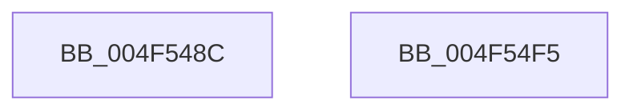

# KiQueryCpuPartitionAffinity

- RVA: `0x004F548C`–`0x004F54F6` (길이 `106` bytes)
- VA: `0x00000001404F548C`
- 실행 섹션: `.text`
- PDB 이름 있음: `예`; PDB Function 태그: `아니요`
- unwind 정보 RVA: `0x00068580`
- 디코드: `28`개 명령, `106/106` bytes 표시
- 미해석 바이트: `0` (있으면 어셈블리에 `.byte`로 보존)

> 이 문서는 커널 이미지의 기계어와 PDB 기호를 분석해 생성했습니다. 4번과 5번은 함수 원형과 자료형을 바이너리 사용 방식에서 추정한 C 해석이며 원본 소스 복구 결과는 아닙니다.

## 1. Dependencies

- 직접 호출 지점: **4**; 고유 호출 대상: **4**
- 직접 호출자로 확인된 함수: **2**
- RIP 상대 이미지 참조: **1**

### Outgoing calls
- `0x004F54B8` → [memset](../6C/memset_function_006C6C40.md) (function, `0x006C6C40`)
- `0x004F54CA` → [KiAcquireCpuPartitionLock](../30/KiAcquireCpuPartitionLock_function_00303374.md) (function, `0x00303374`)
- `0x004F54D9` → [KiCopyAffinityEx](../2C/KiCopyAffinityEx_function_002CE860.md) (function, `0x002CE860`)
- `0x004F54E5` → [KiReleaseCpuPartitionLock](KiReleaseCpuPartitionLock_function_004F54FC.md) (function, `0x004F54FC`)

### Direct callers
- [KiQueryCpuPartitionAffinityProcess](../3C/KiQueryCpuPartitionAffinityProcess_function_003C01A0.md) at `0x003C0235`
- [KiUpdateSystemAvailableCpuState](../5B/KiUpdateSystemAvailableCpuState_function_005B9B04.md) at `0x005B9B3A`

### Static image references
- `0x004F54A3` → RVA `0x00FC6C20` (`ALMOSTRO`; read)

## 2. Other-region calls and transfers

- 다른 실행 섹션으로 향하는 call: **0**
- 별도 외부 분기/꼬리 이동을 확인하지 못했습니다.

## 3. Assembly (complete function range)

```asm
004F548C  48 89 5C 24 10                  mov qword ptr [rsp + 0x10], rbx
004F5491  48 89 4C 24 08                  mov qword ptr [rsp + 8], rcx
004F5496  57                              push rdi
004F5497  48 83 EC 20                     sub rsp, 0x20
004F549B  44 0F B7 02                     movzx r8d, word ptr [rdx]
004F549F  48 8D 4A 08                     lea rcx, [rdx + 8]
004F54A3  48 8B 3D 76 17 AD 00            mov rdi, qword ptr [rip + 0xad1776]
004F54AA  48 8B DA                        mov rbx, rdx
004F54AD  49 C1 E0 03                     shl r8, 3
004F54B1  33 D2                           xor edx, edx
004F54B3  C6 44 24 30 00                  mov byte ptr [rsp + 0x30], 0
004F54B8  E8 83 17 1D 00                  call 0x1406c6c40
004F54BD  48 8D 54 24 30                  lea rdx, [rsp + 0x30]
004F54C2  66 C7 03 01 00                  mov word ptr [rbx], 1
004F54C7  48 8B CF                        mov rcx, rdi
004F54CA  E8 A5 DE E0 FF                  call 0x140303374
004F54CF  4C 8B 07                        mov r8, qword ptr [rdi]
004F54D2  48 8B CB                        mov rcx, rbx
004F54D5  0F B7 53 02                     movzx edx, word ptr [rbx + 2]
004F54D9  E8 82 93 DD FF                  call 0x1402ce860
004F54DE  8A 54 24 30                     mov dl, byte ptr [rsp + 0x30]
004F54E2  48 8B CF                        mov rcx, rdi
004F54E5  E8 12 00 00 00                  call 0x1404f54fc
004F54EA  48 8B 5C 24 38                  mov rbx, qword ptr [rsp + 0x38]
004F54EF  48 83 C4 20                     add rsp, 0x20
004F54F3  5F                              pop rdi
004F54F4  C3                              ret
004F54F5  CC                              int3
```

## 4. C-style interpretation (structured pseudocode)

```c
__int64 __fastcall KiQueryCpuPartitionAffinity(__int64 a1, __int64 a2)
{
    __int64 result;
    __int64 v_rsp;
    unsigned __int64 v_stack_p10;
    unsigned __int64 v_stack_p8;

    v_stack_p10 = v_rbx;
    v_stack_p8 = a1;
    v_rsp = (v_rsp) - (32);
    a3 = (*(unsigned __int16 *)(a2)) << (3);
    a2 = 0;
    v_stack_p8 = 0;
    result = memset(a2 + 8, a2, a3, a4);
    *(unsigned __int16 *)(a2) = 1;
    result = KiAcquireCpuPartitionLock(*(unsigned __int64 *)(v_rip + 11343734), v_stack_p8, a3, a4);
    result = KiCopyAffinityEx(0, *(unsigned __int16 *)(a2 + 2), *(unsigned __int64 *)(*(unsigned __int64 *)(v_rip + 11343734)), a4);
    result = KiReleaseCpuPartitionLock(*(unsigned __int64 *)(v_rip + 11343734), v_stack_p8, *(unsigned __int64 *)(*(unsigned __int64 *)(v_rip + 11343734)), a4);
    v_rsp = (v_rsp) + (32);
    return result;
}
```

## 5. (Beta) C Style

```c
int64_t KiQueryCpuPartitionAffinity(int64_t Arg1, void *Arg2)
{
    uint8_t *arg2 = (uint8_t *)Arg2;

    int64_t result;
    int64_t local_rsp;
    uint64_t v_stack_p10;
    uint64_t v_stack_p8;

    v_stack_p10 = local_rbx;
    v_stack_p8 = Arg1;
    local_rsp = (local_rsp) - (32);
    a3 = (*(uint16_t *)(arg2)) << (3);
    Arg2 = 0;
    v_stack_p8 = 0;
    result = memset(Arg2 + 8, Arg2, a3, a4);
    *(uint16_t *)(arg2) = 1;
    result = KiAcquireCpuPartitionLock(*(uint64_t *)(v_rip + 0xAD1776), v_stack_p8, a3, a4);
    result = KiCopyAffinityEx(0, *(uint16_t *)(arg2 + 0x2), *(uint64_t *)(*(uint64_t *)(v_rip + 0xAD1776)), a4);
    result = KiReleaseCpuPartitionLock(*(uint64_t *)(v_rip + 0xAD1776), v_stack_p8, *(uint64_t *)(*(uint64_t *)(v_rip + 0xAD1776)), a4);
    local_rsp = (local_rsp) + (32);
    return result;
}
```

### 관측된 메모리 오프셋

구조체 형식이 확인되지 않은 접근은 인자 기준의 오프셋으로만 기록했습니다.

| 기준 인자 | 오프셋 표현 | 폭 (bit) | 접근 |
|---|---:|---:|---|
| `Arg2` | `+ 0x0` | `16` | `R` |
| `Arg2` | `+ 0x0` | `16` | `W` |
| `Arg2` | `+ 0x2` | `16` | `R` |
| `Arg2` | `+ 0x8` | `64` | `R` |

## 6. Execution-region graph

[열기: 2D/3D 그래프와 함수 탐색 컨트롤 패널](../../../control-panel.html?section=text&rva=0x004F548C&view=graph)

- 2D 그래프는 위에서 아래로 흐르고, 3D 그래프는 빈 공간을 드래그해 회전합니다. Shift+드래그는 이동, 휠은 확대·축소, 함수 노드 선택은 대상 보고서 이동입니다.

### Static fallback


