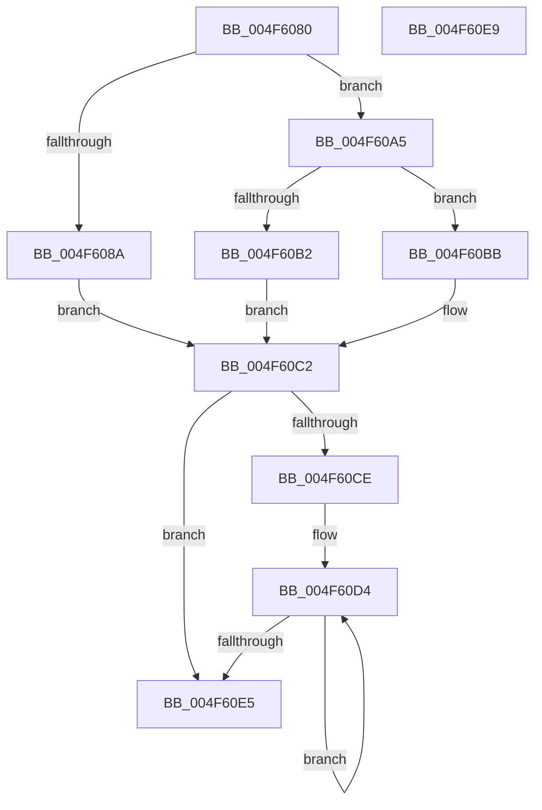

# KiQueryCpuSetsProcessWithLock

- RVA: `0x004F6080`–`0x004F60EA` (길이 `106` bytes)
- VA: `0x00000001404F6080`
- 실행 섹션: `.text`
- PDB 이름 있음: `예`; PDB Function 태그: `아니요`
- unwind 정보 RVA: `0x000DB714`
- 디코드: `30`개 명령, `106/106` bytes 표시
- 미해석 바이트: `0` (있으면 어셈블리에 `.byte`로 보존)

> 이 문서는 커널 이미지의 기계어와 PDB 기호를 분석해 생성했습니다. 4번과 5번은 함수 원형과 자료형을 바이너리 사용 방식에서 추정한 C 해석이며 원본 소스 복구 결과는 아닙니다.

## 1. Dependencies

- 직접 호출 지점: **0**; 고유 호출 대상: **0**
- 직접 호출자로 확인된 함수: **2**
- RIP 상대 이미지 참조: **1**

### Outgoing calls
- 직접 디코드된 call 명령이 없습니다.

### Direct callers
- [KeQueryCpuSetsProcess](../4D/KeQueryCpuSetsProcess_function_004DE068.md) at `0x004DE0A1`
- [KiCpuPartitionCheckAffinitization](../5C/KiCpuPartitionCheckAffinitization_function_005C1420.md) at `0x005C14E1`

### Static image references
- `0x004F60A5` → RVA `0x00FC5014` (`ALMOSTRO`; read)

## 2. Other-region calls and transfers

- 다른 실행 섹션으로 향하는 call: **0**
- 별도 외부 분기/꼬리 이동을 확인하지 못했습니다.

## 3. Assembly (complete function range)

```asm
004F6080  8B 81 FC 05 00 00               mov eax, dword ptr [rcx + 0x5fc]
004F6086  84 C0                           test al, al
004F6088  78 1B                           js 0x1404f60a5
004F608A  41 F7 D9                        neg r9d
004F608D  41 BA 01 00 00 00               mov r10d, 1
004F6093  48 1B C0                        sbb rax, rax
004F6096  48 83 E0 F8                     and rax, 0xfffffffffffffff8
004F609A  48 05 D0 06 00 00               add rax, 0x6d0
004F60A0  48 03 C1                        add rax, rcx
004F60A3  EB 1D                           jmp 0x1404f60c2
004F60A5  44 0F B7 15 67 EF AC 00         movzx r10d, word ptr [rip + 0xacef67]
004F60AD  45 85 C9                        test r9d, r9d
004F60B0  74 09                           je 0x1404f60bb
004F60B2  48 8B 81 C8 06 00 00            mov rax, qword ptr [rcx + 0x6c8]
004F60B9  EB 07                           jmp 0x1404f60c2
004F60BB  48 8B 81 D0 06 00 00            mov rax, qword ptr [rcx + 0x6d0]
004F60C2  45 3B C2                        cmp r8d, r10d
004F60C5  45 0F 43 C2                     cmovae r8d, r10d
004F60C9  45 85 C0                        test r8d, r8d
004F60CC  74 17                           je 0x1404f60e5
004F60CE  48 2B C2                        sub rax, rdx
004F60D1  45 8B C8                        mov r9d, r8d
004F60D4  48 8B 0C 10                     mov rcx, qword ptr [rax + rdx]
004F60D8  48 89 0A                        mov qword ptr [rdx], rcx
004F60DB  48 8D 52 08                     lea rdx, [rdx + 8]
004F60DF  49 83 E9 01                     sub r9, 1
004F60E3  75 EF                           jne 0x1404f60d4
004F60E5  41 8B C2                        mov eax, r10d
004F60E8  C3                              ret
004F60E9  CC                              int3
```

## 4. C-style interpretation (structured pseudocode)

```c
__int64 __fastcall KiQueryCpuSetsProcessWithLock(__int64 a1, __int64 a2, int a3, int a4)
{
    __int64 result;

    if (sign_flag) goto loc_004F60A5;
    a4 = (unsigned int)(-(a4));
    result = ((unsigned int)(*(unsigned int *)(a1 + 1532))) & (-8);
    result = (result) + (0x6D0ULL);
    result = (result) + (a1);
    goto loc_004F60C2;
loc_004F60A5:
    if (a4 == 0) goto loc_004F60BB;
    goto loc_004F60C2;
loc_004F60BB:
loc_004F60C2:
    if (a3 >= ((unsigned int)(*(unsigned __int16 *)(v_rip + 11333479)))) { a3 = (unsigned int)(*(unsigned __int16 *)(v_rip + 11333479)); }
    if (a3 == 0) goto loc_004F60E5;
    result = (*(unsigned __int64 *)(a1 + 1744)) - (a2);
loc_004F60D4:
    *(unsigned __int64 *)(a2) = *(unsigned __int64 *)(result + a2 * 1);
    a4 = ((unsigned int)(a3)) - (1);
    if (condition_is_not_equal) goto loc_004F60D4;
loc_004F60E5:
    return (unsigned int)((unsigned int)(*(unsigned __int16 *)(v_rip + 11333479)));
}
```

## 5. (Beta) C Style

```c
int64_t KiQueryCpuSetsProcessWithLock(void *Arg1, void *Arg2, int32_t Arg3, int32_t Arg4)
{
    uint8_t *arg1 = (uint8_t *)Arg1;
    uint8_t *arg2 = (uint8_t *)Arg2;

    int64_t result;

    if (sign_flag) goto loc_004F60A5;
    Arg4 = (uint32_t)(-(Arg4));
    result = ((uint32_t)(*(uint32_t *)(arg1 + 0x5FC))) & (-8);
    result = (result) + (0x6D0ULL);
    result = (result) + (Arg1);
    goto loc_004F60C2;
loc_004F60A5:
    if (Arg4 == 0) goto loc_004F60BB;
    goto loc_004F60C2;
loc_004F60BB:
loc_004F60C2:
    if (Arg3 >= ((uint32_t)(*(uint16_t *)(v_rip + 0xACEF67)))) { Arg3 = (uint32_t)(*(uint16_t *)(v_rip + 0xACEF67)); }
    if (Arg3 == 0) goto loc_004F60E5;
    result = (*(uint64_t *)(arg1 + 0x6D0)) - (Arg2);
loc_004F60D4:
    *(uint64_t *)(arg2) = *(uint64_t *)(result + arg2 * 1);
    Arg4 = ((uint32_t)(Arg3)) - (1);
    if (condition_is_not_equal) goto loc_004F60D4;
loc_004F60E5:
    return (uint32_t)((uint32_t)(*(uint16_t *)(v_rip + 0xACEF67)));
}
```

### 관측된 메모리 오프셋

구조체 형식이 확인되지 않은 접근은 인자 기준의 오프셋으로만 기록했습니다.

| 기준 인자 | 오프셋 표현 | 폭 (bit) | 접근 |
|---|---:|---:|---|
| `Arg1` | `+ 0x5FC` | `32` | `R` |
| `Arg1` | `+ 0x6C8` | `64` | `R` |
| `Arg1` | `+ 0x6D0` | `64` | `R` |
| `Arg2` | `+ 0x0` | `64` | `W` |
| `Arg2` | `+ 0x8` | `64` | `R` |

## 6. Execution-region graph

[열기: 2D/3D 그래프와 함수 탐색 컨트롤 패널](../../../control-panel.html?section=text&rva=0x004F6080&view=graph)

- 2D 그래프는 위에서 아래로 흐르고, 3D 그래프는 빈 공간을 드래그해 회전합니다. Shift+드래그는 이동, 휠은 확대·축소, 함수 노드 선택은 대상 보고서 이동입니다.

### Static fallback


