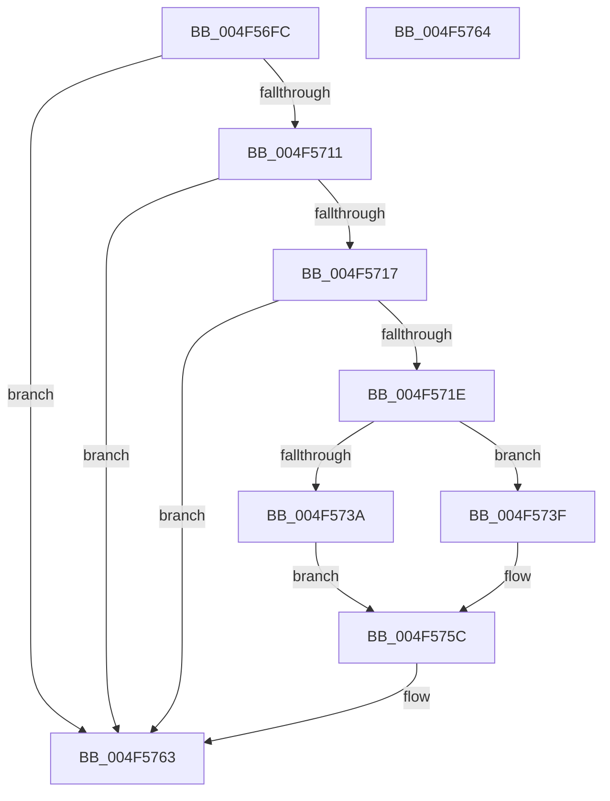

# KiRaiseIrqlProcessIrqlFlags

- RVA: `0x004F56FC`–`0x004F5765` (길이 `105` bytes)
- VA: `0x00000001404F56FC`
- 실행 섹션: `.text`
- PDB 이름 있음: `예`; PDB Function 태그: `아니요`
- unwind 정보 RVA: `0x000DB714`
- 디코드: `31`개 명령, `105/105` bytes 표시
- 미해석 바이트: `0` (있으면 어셈블리에 `.byte`로 보존)

> 이 문서는 커널 이미지의 기계어와 PDB 기호를 분석해 생성했습니다. 4번과 5번은 함수 원형과 자료형을 바이너리 사용 방식에서 추정한 C 해석이며 원본 소스 복구 결과는 아닙니다.

## 1. Dependencies

- 직접 호출 지점: **0**; 고유 호출 대상: **0**
- 직접 호출자로 확인된 함수: **814**
- RIP 상대 이미지 참조: **1**

### Outgoing calls
- 직접 디코드된 call 명령이 없습니다.

### Direct callers
- [KeResumeThread](../20/KeResumeThread_function_00202858.md) at `0x0020291C`
- [KeForceResumeThread](../20/KeForceResumeThread_function_0020292C.md) at `0x002029F4`
- [KeThawMultiProcess](../20/KeThawMultiProcess_function_00202A04.md) at `0x00202B51`
- [KiSchedulerApc](../20/KiSchedulerApc_function_00202BC0.md) at `0x00202DEE`
- [KiHandleDeferredPreemption](../20/KiHandleDeferredPreemption_function_00202ECC.md) at `0x00203108`
- [KeInsertQueueApc](../20/KeInsertQueueApc_function_00203F10.md) at `0x002040F9`
- [sub_00207002](../20/Unknown_function_00207002.md) at `0x00207054`
- [sub_00207070](../20/Unknown_function_00207070.md) at `0x00207077`
- [sub_00207282](../20/Unknown_function_00207282.md) at `0x002072A2`
- [sub_00207480](../20/Unknown_function_00207480.md) at `0x00207492`
- [IopQueueThreadIrp](../20/IopQueueThreadIrp_function_002075C0.md) at `0x00207647`
- [sub_00207C10](../20/Unknown_function_00207C10.md) at `0x00207C17`
- [sub_00207D2E](../20/Unknown_function_00207D2E.md) at `0x00207D35`
- [KeAcquireSpinLockRaiseToDpc](../20/KeAcquireSpinLockRaiseToDpc_function_00208470.md) at `0x002084D7`
- [sub_002092A9](../20/Unknown_function_002092A9.md) at `0x00209409`
- [sub_002098EE](../20/Unknown_function_002098EE.md) at `0x002098F5`
- [sub_002099FA](../20/Unknown_function_002099FA.md) at `0x00209B29`
- [sub_002099FA](../20/Unknown_function_002099FA.md) at `0x00209B37`
- [KeYieldExecution](../20/KeYieldExecution_function_00209FA0.md) at `0x0020A231`
- [IoRemoveIoCompletion](../20/IoRemoveIoCompletion_function_0020B580.md) at `0x0020BA70`
- [sub_0020C20E](../20/Unknown_function_0020C20E.md) at `0x0020C215`
- [sub_0020C2D4](../20/Unknown_function_0020C2D4.md) at `0x0020C789`
- [sub_0020C2D4](../20/Unknown_function_0020C2D4.md) at `0x0020C854`
- [sub_0020C2D4](../20/Unknown_function_0020C2D4.md) at `0x0020CB4F`
- [sub_0020D1EC](../20/Unknown_function_0020D1EC.md) at `0x0020D548`
- [sub_0020D8DF](../20/Unknown_function_0020D8DF.md) at `0x0020D8E6`
- [sub_0020D8DF](../20/Unknown_function_0020D8DF.md) at `0x0020D9B0`
- [sub_0020DFBA](../20/Unknown_function_0020DFBA.md) at `0x0020DFC2`
- [sub_0020E696](../20/Unknown_function_0020E696.md) at `0x0020E69E`
- [KeWaitForSingleObject](../20/KeWaitForSingleObject_function_0020E6B0.md) at `0x0020EC5D`
- [KeWaitForSingleObject](../20/KeWaitForSingleObject_function_0020E6B0.md) at `0x0020EF4D`
- [KeWaitForSingleObject](../20/KeWaitForSingleObject_function_0020E6B0.md) at `0x0020EF63`
- [sub_00210BCA](../21/Unknown_function_00210BCA.md) at `0x00210CC3`
- [ExpAcquireFastResourceSharedSlow](../21/ExpAcquireFastResourceSharedSlow_function_00211260.md) at `0x002115D7`
- [ExpAcquireFastResourceSharedSlow](../21/ExpAcquireFastResourceSharedSlow_function_00211260.md) at `0x00211A64`
- [ExpAcquireResourceSharedLite](../21/ExpAcquireResourceSharedLite_function_00212040.md) at `0x002124B5`
- [ExpAcquireResourceSharedLite](../21/ExpAcquireResourceSharedLite_function_00212040.md) at `0x00213155`
- [ExpAcquireResourceSharedLite](../21/ExpAcquireResourceSharedLite_function_00212040.md) at `0x0021324A`
- [ExEnterPriorityRegionAndAcquireResourceShared](../21/ExEnterPriorityRegionAndAcquireResourceShared_function_00213870.md) at `0x00213AA9`
- [sub_002142F9](../21/Unknown_function_002142F9.md) at `0x00214516`
- [sub_002142F9](../21/Unknown_function_002142F9.md) at `0x002148A8`
- [sub_002142F9](../21/Unknown_function_002142F9.md) at `0x002148B9`
- [sub_002142F9](../21/Unknown_function_002142F9.md) at `0x00214960`
- [sub_002142F9](../21/Unknown_function_002142F9.md) at `0x00214975`
- [sub_002142F9](../21/Unknown_function_002142F9.md) at `0x00214BA2`
- [sub_002142F9](../21/Unknown_function_002142F9.md) at `0x00214C39`
- [sub_002150DC](../21/Unknown_function_002150DC.md) at `0x0021510C`
- [sub_00215166](../21/Unknown_function_00215166.md) at `0x002156CC`
- [sub_00215166](../21/Unknown_function_00215166.md) at `0x002157ED`
- [sub_00215F5C](../21/Unknown_function_00215F5C.md) at `0x00215FFA`
- [sub_00215F5C](../21/Unknown_function_00215F5C.md) at `0x002160C0`
- [sub_00216B16](../21/Unknown_function_00216B16.md) at `0x00216B1E`
- [sub_00216B4F](../21/Unknown_function_00216B4F.md) at `0x00216D98`
- [sub_00216B4F](../21/Unknown_function_00216B4F.md) at `0x00216E3A`
- [sub_002175E7](../21/Unknown_function_002175E7.md) at `0x002175EE`
- [sub_00217761](../21/Unknown_function_00217761.md) at `0x00217776`
- [sub_002180B5](../21/Unknown_function_002180B5.md) at `0x002180BC`
- [sub_00218230](../21/Unknown_function_00218230.md) at `0x00218245`
- [KiAttachProcess](../21/KiAttachProcess_function_002182D0.md) at `0x00218559`
- [sub_002188FB](../21/Unknown_function_002188FB.md) at `0x00218903`
- [sub_00218A6D](../21/Unknown_function_00218A6D.md) at `0x00218A82`
- [KiAbConvertWaiterToOwnerEntry](../21/KiAbConvertWaiterToOwnerEntry_function_00219430.md) at `0x0021985C`
- [KiInsertQueueInternal](../21/KiInsertQueueInternal_function_00219B30.md) at `0x00219D57`
- [sub_0021A01D](../21/Unknown_function_0021A01D.md) at `0x0021A023`
- [KiRetireDpcList](../21/KiRetireDpcList_function_0021A0B0.md) at `0x0021ABAE`
- [KiComputeGroupSchedulingRank](../21/KiComputeGroupSchedulingRank_function_0021EB84.md) at `0x0021ED6F`
- [KeInsertPriQueue](../21/KeInsertPriQueue_function_0021EDD0.md) at `0x0021EF17`
- [sub_0021F072](../21/Unknown_function_0021F072.md) at `0x0021F079`
- [MiIncrementCombinedPte](../22/MiIncrementCombinedPte_function_0022B248.md) at `0x0022B2EB`
- [ExpSetTimerObject](../23/ExpSetTimerObject_function_00231730.md) at `0x002319C2`
- [ExpSetTimerObject](../23/ExpSetTimerObject_function_00231730.md) at `0x00231ED6`
- [sub_002329A3](../23/Unknown_function_002329A3.md) at `0x002329AA`
- [KiSetTimerEx](../23/KiSetTimerEx_function_00232CB0.md) at `0x00232F9C`
- [KeSetTimer](../23/KeSetTimer_function_00233BE0.md) at `0x00233EAE`
- [ExpUpdateTimerConfigurationWorker](../23/ExpUpdateTimerConfigurationWorker_function_00235410.md) at `0x00235607`
- [sub_00235D54](../23/Unknown_function_00235D54.md) at `0x00235D5B`
- [sub_002361D4](../23/Unknown_function_002361D4.md) at `0x0023628F`
- [sub_00238C72](../23/Unknown_function_00238C72.md) at `0x00238C79`
- [MiLockWorkingSetOptimal](../23/MiLockWorkingSetOptimal_function_00238FC0.md) at `0x0023930D`
- [MiLockWorkingSetOptimal](../23/MiLockWorkingSetOptimal_function_00238FC0.md) at `0x00239391`
- [MiQueuePinDriverAddressLog](../23/MiQueuePinDriverAddressLog_function_0023ADA4.md) at `0x0023B0B1`
- [MiReferenceIoPages](../23/MiReferenceIoPages_function_0023C804.md) at `0x0023CDE1`
- [MiReferenceIoPages](../23/MiReferenceIoPages_function_0023C804.md) at `0x0023CF01`
- [MiReferenceIoPages](../23/MiReferenceIoPages_function_0023C804.md) at `0x0023CFB1`
- [KeResetEvent](../24/KeResetEvent_function_00248350.md) at `0x002483CA`
- [sub_00248728](../24/Unknown_function_00248728.md) at `0x00248756`
- [sub_00249B6A](../24/Unknown_function_00249B6A.md) at `0x00249BEB`
- [sub_00249EBD](../24/Unknown_function_00249EBD.md) at `0x00249EC4`
- [sub_0024A15A](../24/Unknown_function_0024A15A.md) at `0x0024A1FE`
- [MiUnlockMdlWritePages](../24/MiUnlockMdlWritePages_function_0024A7C0.md) at `0x0024A8E3`
- [MiUnlockMdlWritePages](../24/MiUnlockMdlWritePages_function_0024A7C0.md) at `0x0024A939`
- [PopPepProcessEvent](../24/PopPepProcessEvent_function_0024B930.md) at `0x0024C547`
- [PopPepProcessEvent](../24/PopPepProcessEvent_function_0024B930.md) at `0x0024C558`
- [sub_0024DC36](../24/Unknown_function_0024DC36.md) at `0x0024DC68`
- [ExAcquireSpinLockShared](../24/ExAcquireSpinLockShared_function_0024DCE0.md) at `0x0024DD59`
- [IoSetIoCompletionEx3](../24/IoSetIoCompletionEx3_function_0024EEE0.md) at `0x0024F258`
- [IopCompleteIrpInFileObjectList](../24/IopCompleteIrpInFileObjectList_function_0024F330.md) at `0x0024F72C`
- [IopCompleteIrpInFileObjectList](../24/IopCompleteIrpInFileObjectList_function_0024F330.md) at `0x0024F73D`
- [IoSetIoCompletionEx](../24/IoSetIoCompletionEx_function_0024FA80.md) at `0x0024FD76`
- [sub_00250185](../25/Unknown_function_00250185.md) at `0x0025018B`
- [ExReleaseFastMutexUnsafe](../25/ExReleaseFastMutexUnsafe_function_002503A0.md) at `0x0025053B`
- [IopReleaseFileObjectLock](../25/IopReleaseFileObjectLock_function_00250A90.md) at `0x00250C26`
- [sub_00251225](../25/Unknown_function_00251225.md) at `0x002513BB`
- [sub_00251225](../25/Unknown_function_00251225.md) at `0x0025147B`
- [sub_002514A5](../25/Unknown_function_002514A5.md) at `0x0025151A`
- [FsRtlReleaseHeaderMutex](../25/FsRtlReleaseHeaderMutex_function_002516C0.md) at `0x002518A0`
- [ExReleaseFastMutex](../25/ExReleaseFastMutex_function_002519C0.md) at `0x00251B79`
- [sub_00257CB9](../25/Unknown_function_00257CB9.md) at `0x00257CC0`
- [sub_0025D903](../25/Unknown_function_0025D903.md) at `0x0025DFE1`
- [sub_0025E5F6](../25/Unknown_function_0025E5F6.md) at `0x0025E8E7`
- [sub_0025E5F6](../25/Unknown_function_0025E5F6.md) at `0x0025EA3C`
- [sub_0025EB5D](../25/Unknown_function_0025EB5D.md) at `0x0025EDC1`
- [sub_00260117](../26/Unknown_function_00260117.md) at `0x0026011F`
- [sub_00260366](../26/Unknown_function_00260366.md) at `0x00260B05`
- [sub_00260366](../26/Unknown_function_00260366.md) at `0x00260C70`
- [sub_00260FEE](../26/Unknown_function_00260FEE.md) at `0x00261071`
- [ExReleaseFastResource](../26/ExReleaseFastResource_function_002613D0.md) at `0x0026184E`
- [ExReleaseFastResource](../26/ExReleaseFastResource_function_002613D0.md) at `0x002619F3`
- [sub_00261DFE](../26/Unknown_function_00261DFE.md) at `0x00261FBB`
- [sub_00261DFE](../26/Unknown_function_00261DFE.md) at `0x00262181`
- [KiAbEntryRemoveFromTree](../26/KiAbEntryRemoveFromTree_function_00262410.md) at `0x00262A17`
- [sub_00262F6E](../26/Unknown_function_00262F6E.md) at `0x00262F76`
- [sub_002630C6](../26/Unknown_function_002630C6.md) at `0x002630DF`
- [sub_00264063](../26/Unknown_function_00264063.md) at `0x002640EF`
- [sub_002647A9](../26/Unknown_function_002647A9.md) at `0x00264814`
- [ExfTryToWakePushLock](../26/ExfTryToWakePushLock_function_00265DD0.md) at `0x00265EDD`
- [PopIrpWorker](../26/PopIrpWorker_function_0026D410.md) at `0x0026D845`
- [sub_0026F901](../26/Unknown_function_0026F901.md) at `0x0026F908`
- [IopCheckVpbMounted](../27/IopCheckVpbMounted_function_00270540.md) at `0x002707DD`
- [IopCheckVpbMounted](../27/IopCheckVpbMounted_function_00270540.md) at `0x002707EF`
- [IopDecrementDeviceObjectRef](../27/IopDecrementDeviceObjectRef_function_00270970.md) at `0x00270B40`
- [CcGetVacbMiss](../27/CcGetVacbMiss_function_00272900.md) at `0x00272E22`
- [IoAcquireCancelSpinLock](../27/IoAcquireCancelSpinLock_function_00273CF0.md) at `0x00273D69`
- [KeAcquireQueuedSpinLock](../27/KeAcquireQueuedSpinLock_function_00273D80.md) at `0x00273E06`
- [sub_0027456F](../27/Unknown_function_0027456F.md) at `0x00274577`
- [sub_0027475D](../27/Unknown_function_0027475D.md) at `0x00274F5D`
- [sub_0027475D](../27/Unknown_function_0027475D.md) at `0x002750EF`
- [KeAcquireInStackQueuedSpinLock](../27/KeAcquireInStackQueuedSpinLock_function_002757A0.md) at `0x0027582D`
- [MiLockVadTree](../27/MiLockVadTree_function_0027C0F0.md) at `0x0027C2A6`
- [sub_0027C341](../27/Unknown_function_0027C341.md) at `0x0027C373`
- [sub_0027CCA5](../27/Unknown_function_0027CCA5.md) at `0x0027CCD0`
- [sub_0027CCDA](../27/Unknown_function_0027CCDA.md) at `0x0027CD00`
- [MiMakeHyperRangeAccessible](../27/MiMakeHyperRangeAccessible_function_0027CE10.md) at `0x0027D117`
- [MiMakeHyperRangeAccessible](../27/MiMakeHyperRangeAccessible_function_0027CE10.md) at `0x0027D146`
- [MiFastReadLeafPte](../27/MiFastReadLeafPte_function_0027E9A0.md) at `0x0027EA61`
- [MiMakeSystemAddressValid](../27/MiMakeSystemAddressValid_function_0027FF70.md) at `0x00280865`
- [MiMakeSystemAddressValid](../27/MiMakeSystemAddressValid_function_0027FF70.md) at `0x002809FA`
- [sub_0028229A](../28/Unknown_function_0028229A.md) at `0x002822A2`
- [sub_00282541](../28/Unknown_function_00282541.md) at `0x0028255A`
- [sub_0028609E](../28/Unknown_function_0028609E.md) at `0x002860A5`
- [sub_00286720](../28/Unknown_function_00286720.md) at `0x00286728`
- [MiGetPage](../28/MiGetPage_function_002884C0.md) at `0x00289407`
- [MiGetPerfectFreeOrZeroPage](../28/MiGetPerfectFreeOrZeroPage_function_002898E0.md) at `0x00289AEA`
- [MiGetPerfectColorHeadPage](../28/MiGetPerfectColorHeadPage_function_00289CA8.md) at `0x00289F69`
- [MiSlistGetFreePage](../28/MiSlistGetFreePage_function_0028A170.md) at `0x0028A332`
- [MiDemoteLocalLargePage](../28/MiDemoteLocalLargePage_function_0028A4F0.md) at `0x0028A702`
- [sub_0028F316](../28/Unknown_function_0028F316.md) at `0x0028F31D`
- [sub_0028F521](../28/Unknown_function_0028F521.md) at `0x0028F549`
- [MiSetVadDeleted](../29/MiSetVadDeleted_function_00296E00.md) at `0x00296F63`
- [MiLockVadCore](../29/MiLockVadCore_function_00297170.md) at `0x002971D4`
- [MiIssueAsynchronousFlush](../29/MiIssueAsynchronousFlush_function_00299898.md) at `0x00299B66`
- [MiIssueAsynchronousFlush](../29/MiIssueAsynchronousFlush_function_00299898.md) at `0x00299B75`
- [MiIssueAsynchronousFlush](../29/MiIssueAsynchronousFlush_function_00299898.md) at `0x00299BEC`
- [IoAsynchronousPageWrite](../29/IoAsynchronousPageWrite_function_00299C08.md) at `0x00299E18`
- [IopfCompleteRequest](../29/IopfCompleteRequest_function_0029B5F8.md) at `0x0029BBE0`
- [MmIsFileObjectAPagingFile](../29/MmIsFileObjectAPagingFile_function_0029BDAC.md) at `0x0029BEBA`
- [NtSetInformationFile](../29/NtSetInformationFile_function_0029C5E0.md) at `0x0029CF3B`
- [sub_0029D673](../29/Unknown_function_0029D673.md) at `0x0029D67A`
- [IopWaitForSynchronousIo](../29/IopWaitForSynchronousIo_function_0029D6D0.md) at `0x0029D7DD`
- [MmUnlockPages](../29/MmUnlockPages_function_0029EEE0.md) at `0x0029F0CC`
- [MmUnlockPages](../29/MmUnlockPages_function_0029EEE0.md) at `0x0029F16D`
- [KiOutSwapKernelStacks](../29/KiOutSwapKernelStacks_function_0029F628.md) at `0x0029F837`
- [MmGrowKernelStackEx](../2A/MmGrowKernelStackEx_function_002A04E0.md) at `0x002A06B0`
- [sub_002A170A](../2A/Unknown_function_002A170A.md) at `0x002A171A`
- [MmFreeIndependentPages](../2A/MmFreeIndependentPages_function_002A2510.md) at `0x002A2759`
- [MmFreeIndependentPages](../2A/MmFreeIndependentPages_function_002A2510.md) at `0x002A2791`
- [ExpUnblockPushLock](../2A/ExpUnblockPushLock_function_002A40FC.md) at `0x002A41E8`
- [MiMarkMdlComplete](../2A/MiMarkMdlComplete_function_002A75D0.md) at `0x002A775C`
- [MiMarkMdlComplete](../2A/MiMarkMdlComplete_function_002A75D0.md) at `0x002A7769`
- [MiFreeLargePages](../2A/MiFreeLargePages_function_002A99D0.md) at `0x002A9D74`
- [MiReturnPfnReferenceCount](../2A/MiReturnPfnReferenceCount_function_002AA824.md) at `0x002AA87C`
- [MiDereferenceIoPages](../2A/MiDereferenceIoPages_function_002AB1B0.md) at `0x002AB57B`
- [MiLookupIoPageNode](../2A/MiLookupIoPageNode_function_002AC5C8.md) at `0x002AC6DD`
- [MiLockIoPfnTree](../2A/MiLockIoPfnTree_function_002AC8A4.md) at `0x002AC935`
- [MiStoreWriteModifiedPages](../2B/MiStoreWriteModifiedPages_function_002B46C4.md) at `0x002B52E1`
- [MiStoreWriteModifiedPages](../2B/MiStoreWriteModifiedPages_function_002B46C4.md) at `0x002B538F`
- [MiFinishHardFault](../2B/MiFinishHardFault_function_002B6F10.md) at `0x002B7586`
- [MiFinishHardFault](../2B/MiFinishHardFault_function_002B6F10.md) at `0x002B7654`
- [MiLockProtoPoolPage](../2B/MiLockProtoPoolPage_function_002B8B80.md) at `0x002B8F95`
- [sub_002BC06C](../2B/Unknown_function_002BC06C.md) at `0x002BC0A5`
- [MiLockSectionControlArea](../2B/MiLockSectionControlArea_function_002BC930.md) at `0x002BCADE`
- [PopPepWork](../2B/PopPepWork_function_002BCBC0.md) at `0x002BCFB1`
- [PopFxActivateComponentDependents](../2B/PopFxActivateComponentDependents_function_002BE9F0.md) at `0x002BEC98`
- [PopPepUpdateIdleStateRefCount](../2B/PopPepUpdateIdleStateRefCount_function_002BF930.md) at `0x002BFBC7`
- [PopPepUpdateIdleStateRefCount](../2B/PopPepUpdateIdleStateRefCount_function_002BF930.md) at `0x002BFBD7`
- [KeSignalGate](../2C/KeSignalGate_function_002C748C.md) at `0x002C7581`
- [KeSetPriorityThread](../2C/KeSetPriorityThread_function_002C76E0.md) at `0x002C7874`
- [KiGenericCallDpcInitiatorDpc](../2C/KiGenericCallDpcInitiatorDpc_function_002C83E0.md) at `0x002C846A`
- [PspIumReplenishPartitionPages](../2C/PspIumReplenishPartitionPages_function_002C8710.md) at `0x002C8829`
- [MiStartDpcGang](../2C/MiStartDpcGang_function_002C8C34.md) at `0x002C8DA7`
- [MiInitializeMdlBatchPages](../2C/MiInitializeMdlBatchPages_function_002C90E4.md) at `0x002C9301`
- [MiInitializeMdlBatchPages](../2C/MiInitializeMdlBatchPages_function_002C90E4.md) at `0x002C9336`
- [KeGenericCallDpcEx](../2C/KeGenericCallDpcEx_function_002C99F4.md) at `0x002C9B3C`
- [KiGenericCallDpcInitiatorWorker](../2C/KiGenericCallDpcInitiatorWorker_function_002C9B60.md) at `0x002C9BCE`
- [MiInitializeZeroGroup](../2C/MiInitializeZeroGroup_function_002CA00C.md) at `0x002CA256`
- [KeWaitForGate](../2C/KeWaitForGate_function_002CA794.md) at `0x002CA844`
- [KiBeginThreadWait](../2C/KiBeginThreadWait_function_002CA8E0.md) at `0x002CAAE2`
- [KeSetUserGroupAffinityThread](../2C/KeSetUserGroupAffinityThread_function_002CD1C4.md) at `0x002CD356`
- [KiSetLegacyAffinityThread](../2C/KiSetLegacyAffinityThread_function_002CDD94.md) at `0x002CDFDD`
- [KeFlushProcessWriteBuffers](../2C/KeFlushProcessWriteBuffers_function_002CE4FC.md) at `0x002CE65E`
- [KeQueryAffinityProcess](../2C/KeQueryAffinityProcess_function_002CE710.md) at `0x002CE7B9`
- [KiAcquireProcessLockShared](../2C/KiAcquireProcessLockShared_function_002CF9A0.md) at `0x002CFA1F`
- [KeSetUserAffinityThread](../2C/KeSetUserAffinityThread_function_002CFA2C.md) at `0x002CFAE7`
- [PpmIdleExecuteTransition](../2D/PpmIdleExecuteTransition_function_002D0A1C.md) at `0x002D0EF6`
- [HalpAcquireHighLevelLock](../2D/HalpAcquireHighLevelLock_function_002D2390.md) at `0x002D23CB`
- [KiConfigureCpuSetSchedulingInformation](../2D/KiConfigureCpuSetSchedulingInformation_function_002D2E1C.md) at `0x002D2FA8`
- [KiDisconnectInterruptCommon](../2D/KiDisconnectInterruptCommon_function_002D36A8.md) at `0x002D387E`
- [KiConnectInterrupt](../2D/KiConnectInterrupt_function_002D3F58.md) at `0x002D41D2`
- [KeMaskInterrupt](../2D/KeMaskInterrupt_function_002D42FC.md) at `0x002D443F`
- [KeUpdateSoftParkRankList](../2D/KeUpdateSoftParkRankList_function_002D5998.md) at `0x002D5B61`
- [sub_002D95CF](../2D/Unknown_function_002D95CF.md) at `0x002D95F4`
- [MiEmptyDecayClusterTimers](../2D/MiEmptyDecayClusterTimers_function_002DAB50.md) at `0x002DAD27`
- [MiEmptyDecayClusterTimers](../2D/MiEmptyDecayClusterTimers_function_002DAB50.md) at `0x002DADFE`
- [MiSignalLargePageRebuild](../2D/MiSignalLargePageRebuild_function_002DB4C8.md) at `0x002DB5B2`
- [MiLogPeriodicTelemetry](../2D/MiLogPeriodicTelemetry_function_002DB750.md) at `0x002DB80A`
- [MiFreePageFileHashPfns](../2D/MiFreePageFileHashPfns_function_002DBEF8.md) at `0x002DC043`
- [MiManageUltraSpacePageTable](../2D/MiManageUltraSpacePageTable_function_002DCAF0.md) at `0x002DCF03`
- [PoGetPerfStateAndParkingInfo](../2D/PoGetPerfStateAndParkingInfo_function_002DD484.md) at `0x002DD711`
- [PoGetIdleTimes](../2D/PoGetIdleTimes_function_002DF570.md) at `0x002DF877`
- [sub_002E0B15](../2E/Unknown_function_002E0B15.md) at `0x002E0F39`
- [sub_002E0B15](../2E/Unknown_function_002E0B15.md) at `0x002E0F4A`
- [KiCheckForKernelApcDelivery](../2E/KiCheckForKernelApcDelivery_function_002E2C80.md) at `0x002E2D67`
- [RtlpHpTryAcquireQueuedLockExclusive](../2E/RtlpHpTryAcquireQueuedLockExclusive_function_002EB23C.md) at `0x002EB2D5`
- [ExpInsertPoolTrackerExpansion](../2E/ExpInsertPoolTrackerExpansion_function_002ECCC0.md) at `0x002ECE0A`
- [ExpAddTagForBigPages](../2E/ExpAddTagForBigPages_function_002EF570.md) at `0x002EF7D2`
- [RtlCSparseBitmapEnterLockingRegion](../2E/RtlCSparseBitmapEnterLockingRegion_function_002EFFD0.md) at `0x002F0013`
- [sub_002F0126](../2F/Unknown_function_002F0126.md) at `0x002F0164`
- [RtlpCSparseBitmapPageCommit](../2F/RtlpCSparseBitmapPageCommit_function_002F0B98.md) at `0x002F0CC6`
- [MmLockLoadedModuleListShared](../2F/MmLockLoadedModuleListShared_function_002F21E4.md) at `0x002F221D`
- [AlpcpSignalAndWait](../2F/AlpcpSignalAndWait_function_002F9620.md) at `0x002F99D4`
- [AlpcpSignalAndWait](../2F/AlpcpSignalAndWait_function_002F9620.md) at `0x002F99E9`
- [EtwpApcPoolThunk](../2F/EtwpApcPoolThunk_function_002FA090.md) at `0x002FA27E`
- [EtwpReserveWithPmcCounters](../2F/EtwpReserveWithPmcCounters_function_002FCED0.md) at `0x002FCFE8`
- [EtwpEnqueueAvailableBuffer](../2F/EtwpEnqueueAvailableBuffer_function_002FE7DC.md) at `0x002FE8F3`
- [KeUpdateThreadCpuSets](../30/KeUpdateThreadCpuSets_function_0030305C.md) at `0x00303087`
- [KiAcquireCpuPartitionLock](../30/KiAcquireCpuPartitionLock_function_00303374.md) at `0x003033A1`
- [HvlpSlowSendSyntheticClusterIpiEx](../30/HvlpSlowSendSyntheticClusterIpiEx_function_003034E0.md) at `0x003035FA`
- [KiStopProfileTarget](../30/KiStopProfileTarget_function_00304510.md) at `0x003045FA`
- [KeChangeMemoryAttributes](../30/KeChangeMemoryAttributes_function_00304D08.md) at `0x00304DCF`
- [MiMoveBackgroundZeroThreads](../30/MiMoveBackgroundZeroThreads_function_00305810.md) at `0x00305A10`
- [KeInvalidateRangeAllCaches](../30/KeInvalidateRangeAllCaches_function_00308880.md) at `0x0030892F`
- [MiFlushEntireTbDueToAttributeChange](../30/MiFlushEntireTbDueToAttributeChange_function_00308AE0.md) at `0x00308C36`
- [KeInvalidateAllCaches](../30/KeInvalidateAllCaches_function_00308CC0.md) at `0x00308D5B`
- [sub_00308F13](../30/Unknown_function_00308F13.md) at `0x00308F1A`
- [KiFlushAddressSpaceTb](../30/KiFlushAddressSpaceTb_function_00308F50.md) at `0x00309015`
- [KxFlushEntireTb](../30/KxFlushEntireTb_function_00309094.md) at `0x00309279`
- [KiTransitionSchedulingGroupGeneration](../30/KiTransitionSchedulingGroupGeneration_function_003094C8.md) at `0x003098F6`
- [sub_0030F189](../30/Unknown_function_0030F189.md) at `0x0030F190`
- [sub_003126C5](../31/Unknown_function_003126C5.md) at `0x0031277A`
- [sub_003126C5](../31/Unknown_function_003126C5.md) at `0x00312797`
- [sub_003126C5](../31/Unknown_function_003126C5.md) at `0x003127A8`
- [sub_003127BF](../31/Unknown_function_003127BF.md) at `0x003128EB`
- [sub_00314592](../31/Unknown_function_00314592.md) at `0x0031459A`
- [sub_00314657](../31/Unknown_function_00314657.md) at `0x0031465D`
- [sub_00314667](../31/Unknown_function_00314667.md) at `0x0031471B`
- [VmpProcessContextLockExclusive](../31/VmpProcessContextLockExclusive_function_003147A4.md) at `0x003147E0`
- [KxFlushNonGlobalTb](../31/KxFlushNonGlobalTb_function_00314E50.md) at `0x00314FFB`
- [MiFreeDeferredCrcPages](../31/MiFreeDeferredCrcPages_function_00315018.md) at `0x003150C5`
- [MiReturnLockedVadOrNextVa](../31/MiReturnLockedVadOrNextVa_function_00316980.md) at `0x00316D28`
- [MiFillSystemPtes](../31/MiFillSystemPtes_function_00319850.md) at `0x0031A306`
- [MiFillSystemPtes](../31/MiFillSystemPtes_function_00319850.md) at `0x0031A313`
- [MiLockPageInline](../31/MiLockPageInline_function_0031A340.md) at `0x0031A3AE`
- [sub_0031A6E4](../31/Unknown_function_0031A6E4.md) at `0x0031A6EC`
- [sub_0031A6F6](../31/Unknown_function_0031A6F6.md) at `0x0031A8D2`
- [sub_0031CA0D](../31/Unknown_function_0031CA0D.md) at `0x0031CA14`
- [MiConvertLargeActivePageToChain](../31/MiConvertLargeActivePageToChain_function_0031D980.md) at `0x0031DBBF`
- [MiConvertLargeActivePageToChain](../31/MiConvertLargeActivePageToChain_function_0031D980.md) at `0x0031DC89`
- [sub_00321696](../32/Unknown_function_00321696.md) at `0x003216B4`
- [sub_00322F50](../32/Unknown_function_00322F50.md) at `0x00322F57`
- [MiGetUltraMapping](../32/MiGetUltraMapping_function_00323270.md) at `0x00323533`
- [ExpWaitForSpinLockExclusiveAndAcquire](../32/ExpWaitForSpinLockExclusiveAndAcquire_function_003239A0.md) at `0x00323A44`
- [sub_003247A5](../32/Unknown_function_003247A5.md) at `0x003247DB`
- [sub_00324927](../32/Unknown_function_00324927.md) at `0x0032494A`
- [MiAddViewsForSection](../32/MiAddViewsForSection_function_00324990.md) at `0x00324D26`
- [MiReferenceActiveSubsection](../32/MiReferenceActiveSubsection_function_00325060.md) at `0x0032558F`
- [MiReturnPhysicalPoolPages](../32/MiReturnPhysicalPoolPages_function_00328568.md) at `0x00328720`
- [MiReturnPhysicalPoolPages](../32/MiReturnPhysicalPoolPages_function_00328568.md) at `0x00328782`
- [MiUserFault](../32/MiUserFault_function_00329840.md) at `0x00329D4C`
- [MiUserFault](../32/MiUserFault_function_00329840.md) at `0x00329EBE`
- [MiMapPageInHyperSpaceWorker](../33/MiMapPageInHyperSpaceWorker_function_00332B10.md) at `0x00332DFE`
- [MiPurgePartitionStandby](../33/MiPurgePartitionStandby_function_00334460.md) at `0x00334589`
- [MiRemoveLowestPriorityStandbyPage](../33/MiRemoveLowestPriorityStandbyPage_function_00334600.md) at `0x00334975`
- [MiReleaseFreshPage](../33/MiReleaseFreshPage_function_00334AE0.md) at `0x00334B39`
- [sub_0033827F](../33/Unknown_function_0033827F.md) at `0x003385E4`
- [MiAddKernelStackToPrcbCache](../33/MiAddKernelStackToPrcbCache_function_00338710.md) at `0x00338B51`
- [MmDeleteKernelStack](../33/MmDeleteKernelStack_function_0033A960.md) at `0x0033ADBF`
- [sub_0033F613](../33/Unknown_function_0033F613.md) at `0x0033F619`
- [CcPinFileData](../33/CcPinFileData_function_0033FB40.md) at `0x00340BA5`
- [sub_00341124](../34/Unknown_function_00341124.md) at `0x0034112B`
- [ExpAcquireSharedStarveExclusive](../34/ExpAcquireSharedStarveExclusive_function_003411C0.md) at `0x0034155F`
- [sub_00341C47](../34/Unknown_function_00341C47.md) at `0x00341C4E`
- [sub_00341DB3](../34/Unknown_function_00341DB3.md) at `0x00341F11`
- [PfpPartitionGetFirst](../34/PfpPartitionGetFirst_function_00342ED0.md) at `0x00343025`
- [sub_00343C8B](../34/Unknown_function_00343C8B.md) at `0x00343C93`
- [sub_00343C9D](../34/Unknown_function_00343C9D.md) at `0x00343CA5`
- [ExpSetResourceOwnerPointerEx](../34/ExpSetResourceOwnerPointerEx_function_00343E20.md) at `0x00344022`
- [ExpLeaveWorkerFactoryAwayMode](../34/ExpLeaveWorkerFactoryAwayMode_function_00344350.md) at `0x00344443`
- [sub_0034453D](../34/Unknown_function_0034453D.md) at `0x0034455E`
- [ExpWorkerFactoryCompletionPacketRoutine](../34/ExpWorkerFactoryCompletionPacketRoutine_function_00344810.md) at `0x003448D1`
- [KeReleaseSemaphoreEx](../34/KeReleaseSemaphoreEx_function_003468C0.md) at `0x00346AE9`
- [MiConvertSmallPageRangeToLarge](../34/MiConvertSmallPageRangeToLarge_function_003484DC.md) at `0x00348669`
- [MiConvertSmallPageRangeToLarge](../34/MiConvertSmallPageRangeToLarge_function_003484DC.md) at `0x00348693`
- [MiGetSharedProtos](../34/MiGetSharedProtos_function_00348D58.md) at `0x00348DD0`
- [IopRecordIoAttribution](../34/IopRecordIoAttribution_function_00349758.md) at `0x0034992D`
- [sub_0034D242](../34/Unknown_function_0034D242.md) at `0x0034D249`
- [sub_0034DBAE](../34/Unknown_function_0034DBAE.md) at `0x0034DBBD`
- [ExpConvertExclusiveToSharedLite](../34/ExpConvertExclusiveToSharedLite_function_0034F7A8.md) at `0x0034F883`
- [KeWakeWaitChain](../34/KeWakeWaitChain_function_0034F8C0.md) at `0x0034FA70`
- [KeTimeOutQueueWaiters](../34/KeTimeOutQueueWaiters_function_0034FB58.md) at `0x0034FC7B`
- [sub_0034FE9B](../34/Unknown_function_0034FE9B.md) at `0x0034FEA2`
- [KeSetEventBoostPriorityEx](../35/KeSetEventBoostPriorityEx_function_00350148.md) at `0x00350273`
- [MiReturnWsToExpansionList](../35/MiReturnWsToExpansionList_function_003504E0.md) at `0x0035060C`
- [NtSetInformationWorkerFactory](../35/NtSetInformationWorkerFactory_function_00350A30.md) at `0x00350DB9`
- [KeRundownQueueEx](../35/KeRundownQueueEx_function_00351508.md) at `0x003515B5`
- [KeDeleteMutant](../35/KeDeleteMutant_function_00351788.md) at `0x00351848`
- [IopFreeWaitCompletionPacket](../35/IopFreeWaitCompletionPacket_function_00351A50.md) at `0x00351C59`
- [KePulseEvent](../35/KePulseEvent_function_00351EF0.md) at `0x00351FEB`
- [KeSetProcess](../35/KeSetProcess_function_003520E8.md) at `0x003521BB`
- [KeTerminateThread](../35/KeTerminateThread_function_00355138.md) at `0x003553E2`
- [sub_00356086](../35/Unknown_function_00356086.md) at `0x00356254`
- [CcCachemapUninitWorkerThread](../35/CcCachemapUninitWorkerThread_function_003569D0.md) at `0x00356B63`
- [CcPostWorkQueueCachemapUninit](../35/CcPostWorkQueueCachemapUninit_function_00356C94.md) at `0x00356D66`
- [sub_00358409](../35/Unknown_function_00358409.md) at `0x0035844F`
- [CcGetDirtyPagesHelper](../35/CcGetDirtyPagesHelper_function_00358D40.md) at `0x0035908B`
- [vDbgPrintExWithPrefixInternalHelper](../35/vDbgPrintExWithPrefixInternalHelper_function_003593C0.md) at `0x00359675`
- [CcFlushCachePostProcessOneRange](../35/CcFlushCachePostProcessOneRange_function_00359710.md) at `0x00359A55`
- [sub_0035A838](../35/Unknown_function_0035A838.md) at `0x0035A83F`
- [ExAllocateHeapPool](../35/ExAllocateHeapPool_function_0035BA30.md) at `0x0035D34C`
- [ExAllocateHeapPool](../35/ExAllocateHeapPool_function_0035BA30.md) at `0x0035D403`
- [ExAllocateHeapPool](../35/ExAllocateHeapPool_function_0035BA30.md) at `0x0035DE65`
- [ExAllocateHeapPool](../35/ExAllocateHeapPool_function_0035BA30.md) at `0x0035E3AE`
- [sub_003602E3](../36/Unknown_function_003602E3.md) at `0x0036080C`
- [sub_003602E3](../36/Unknown_function_003602E3.md) at `0x003608D4`
- [ExpRemovePoolTrackerExpansion](../36/ExpRemovePoolTrackerExpansion_function_00361300.md) at `0x00361449`
- [ExpWaitForSpinLockSharedAndAcquire](../36/ExpWaitForSpinLockSharedAndAcquire_function_00362380.md) at `0x0036242E`
- [MiWalkEntireImage](../36/MiWalkEntireImage_function_00365D70.md) at `0x00366F27`
- [MiPrivateFixup](../36/MiPrivateFixup_function_003693E8.md) at `0x00369907`
- [MiPrefetchPreallocatePages](../36/MiPrefetchPreallocatePages_function_0036B1F0.md) at `0x0036B404`
- [MiGatherPagefilePages](../37/MiGatherPagefilePages_function_00372B08.md) at `0x00373475`
- [MiGatherPagefilePages](../37/MiGatherPagefilePages_function_00372B08.md) at `0x00373593`
- [MiUnlockStoreLockedPages](../37/MiUnlockStoreLockedPages_function_003735C0.md) at `0x00373753`
- [MiUnlockStoreLockedPages](../37/MiUnlockStoreLockedPages_function_003735C0.md) at `0x00373764`
- [MiCreateSlabEntry](../37/MiCreateSlabEntry_function_00374DEC.md) at `0x00375348`
- [MiGetRepurposedSlabStandbyPage](../37/MiGetRepurposedSlabStandbyPage_function_003755A8.md) at `0x0037572A`
- [MiReplenishSlabAllocator](../37/MiReplenishSlabAllocator_function_003788E4.md) at `0x00378AA9`
- [MiCoalesceFreeLargePages](../37/MiCoalesceFreeLargePages_function_0037A7B4.md) at `0x0037AA6F`
- [KeQueryTotalCycleTimeThread](../37/KeQueryTotalCycleTimeThread_function_0037EF20.md) at `0x0037FA31`
- [MiIssueHardFault](../38/MiIssueHardFault_function_00380074.md) at `0x00380760`
- [MiInitializePfnForOtherProcess](../38/MiInitializePfnForOtherProcess_function_00382A20.md) at `0x00382C57`
- [MiRepurposeStandbySlabPage](../38/MiRepurposeStandbySlabPage_function_00385780.md) at `0x00385983`
- [MiLockLowestPrioritySecondaryStandbyPage](../38/MiLockLowestPrioritySecondaryStandbyPage_function_00385A2C.md) at `0x00385BFE`
- [KeRcuReadLock](../38/KeRcuReadLock_function_0038A1A0.md) at `0x0038A235`
- [CcPurgeCacheSection](../38/CcPurgeCacheSection_function_0038B130.md) at `0x0038B34E`
- [sub_0038BBE9](../38/Unknown_function_0038BBE9.md) at `0x0038BBF1`
- [ExpUpdateTimerResolution](../39/ExpUpdateTimerResolution_function_003914A0.md) at `0x0039161D`
- [KeUpdatePendingQosRequest](../39/KeUpdatePendingQosRequest_function_003924F4.md) at `0x00392647`
- [PsBoostThreadIo](../39/PsBoostThreadIo_function_003927C0.md) at `0x00392953`
- [PsBoostThreadIoEx](../39/PsBoostThreadIoEx_function_00392C00.md) at `0x00392DA0`
- [sub_00393045](../39/Unknown_function_00393045.md) at `0x0039304C`
- [KeRegisterObjectNotification](../39/KeRegisterObjectNotification_function_00393454.md) at `0x003934BB`
- [KeAdjustWobPriority](../39/KeAdjustWobPriority_function_00393570.md) at `0x00393616`
- [NtWaitForWorkViaWorkerFactory](../39/NtWaitForWorkViaWorkerFactory_function_00394270.md) at `0x00394C59`
- [NtWaitForWorkViaWorkerFactory](../39/NtWaitForWorkViaWorkerFactory_function_00394270.md) at `0x00394C6A`
- [NtWaitForWorkViaWorkerFactory](../39/NtWaitForWorkViaWorkerFactory_function_00394270.md) at `0x00394C7B`
- [KiDeregisterObjectWaitBlock](../39/KiDeregisterObjectWaitBlock_function_00394F3C.md) at `0x00394FE5`
- [sub_00395404](../39/Unknown_function_00395404.md) at `0x0039540C`
- [sub_003954C8](../39/Unknown_function_003954C8.md) at `0x003954D0`
- [AlpcpSignal](../39/AlpcpSignal_function_003955E0.md) at `0x00395C56`
- [AlpcpSignal](../39/AlpcpSignal_function_003955E0.md) at `0x00395C67`
- [AlpcpSignal](../39/AlpcpSignal_function_003955E0.md) at `0x00395F18`
- [AlpcpSignal](../39/AlpcpSignal_function_003955E0.md) at `0x00395F51`
- [KiAcquireThreadLockRaiseToDpc](../39/KiAcquireThreadLockRaiseToDpc_function_00396280.md) at `0x003962E8`
- [KeReleaseMutantEx](../39/KeReleaseMutantEx_function_00396850.md) at `0x00396BAF`
- [sub_00397288](../39/Unknown_function_00397288.md) at `0x0039728F`
- [AlpcpQueueIoCompletion](../39/AlpcpQueueIoCompletion_function_00397480.md) at `0x00397806`
- [sub_00397BF0](../39/Unknown_function_00397BF0.md) at `0x00397BF6`
- [ExpTryQueueWorkItem](../39/ExpTryQueueWorkItem_function_0039801C.md) at `0x00398080`
- [KeAlertThreadByThreadIdEx](../39/KeAlertThreadByThreadIdEx_function_003984BC.md) at `0x00398538`
- [KiFastReadyThread](../39/KiFastReadyThread_function_00398548.md) at `0x0039860A`
- [sub_003989EB](../39/Unknown_function_003989EB.md) at `0x003989F2`
- [KeReadyThread](../39/KeReadyThread_function_00398AB4.md) at `0x00398B1D`
- [KeGenericProcessorCallback](../39/KeGenericProcessorCallback_function_00398C2C.md) at `0x00398E6E`
- [KeRevertToUserGroupAffinityThread](../39/KeRevertToUserGroupAffinityThread_function_00398EC0.md) at `0x00399037`
- [sub_00399302](../39/Unknown_function_00399302.md) at `0x0039935E`
- [KeClockInterruptNotify](../39/KeClockInterruptNotify_function_0039A970.md) at `0x0039AF38`
- [KeClockInterruptNotify](../39/KeClockInterruptNotify_function_0039A970.md) at `0x0039AF49`
- [KeClockInterruptNotify](../39/KeClockInterruptNotify_function_0039A970.md) at `0x0039AF5A`
- [KeClockInterruptNotify](../39/KeClockInterruptNotify_function_0039A970.md) at `0x0039AF8A`
- [KeClockInterruptNotify](../39/KeClockInterruptNotify_function_0039A970.md) at `0x0039B103`
- [KeClockInterruptNotify](../39/KeClockInterruptNotify_function_0039A970.md) at `0x0039B113`
- [KeClockInterruptNotify](../39/KeClockInterruptNotify_function_0039A970.md) at `0x0039B279`
- [KeClockInterruptNotify](../39/KeClockInterruptNotify_function_0039A970.md) at `0x0039B2AD`
- [KiUpdateTime](../39/KiUpdateTime_function_0039B530.md) at `0x0039B9CA`
- [KiUpdateRunTime](../39/KiUpdateRunTime_function_0039BB70.md) at `0x0039BF99`
- [KiUpdateRunTime](../39/KiUpdateRunTime_function_0039BB70.md) at `0x0039C028`
- [KiUpdateRunTime](../39/KiUpdateRunTime_function_0039BB70.md) at `0x0039C0A0`
- [sub_0039CA0B](../39/Unknown_function_0039CA0B.md) at `0x0039CCA3`
- [KiDpcWatchdogCounterReset](../39/KiDpcWatchdogCounterReset_function_0039D6A0.md) at `0x0039D70E`
- [KiInterruptDispatchCommon](../39/KiInterruptDispatchCommon_function_0039F3D0.md) at `0x0039F718`
- [KiInterruptDispatchCommon](../39/KiInterruptDispatchCommon_function_0039F3D0.md) at `0x0039F737`
- [KiInterruptDispatchCommon](../39/KiInterruptDispatchCommon_function_0039F3D0.md) at `0x0039F746`
- [KiInterruptDispatchCommon](../39/KiInterruptDispatchCommon_function_0039F3D0.md) at `0x0039F778`
- [KiInvokeInterruptServiceRoutine](../39/KiInvokeInterruptServiceRoutine_function_0039F8E0.md) at `0x0039FA98`
- [KeDisableTimer2](../39/KeDisableTimer2_function_0039FD58.md) at `0x0039FF9E`
- [KeCancelTimer2](../3A/KeCancelTimer2_function_003A01E0.md) at `0x003A02C7`
- [KeSetTimer2](../3A/KeSetTimer2_function_003A08E0.md) at `0x003A0EA5`
- [KiFinalizeTimer2Disablement](../3A/KiFinalizeTimer2Disablement_function_003A2198.md) at `0x003A22B0`
- [MiWalkPagesOnLists](../3B/MiWalkPagesOnLists_function_003B6AA4.md) at `0x003B6B1B`
- [MiWalkPagesOnLists](../3B/MiWalkPagesOnLists_function_003B6AA4.md) at `0x003B6C23`
- [MiWalkPagesOnLists](../3B/MiWalkPagesOnLists_function_003B6AA4.md) at `0x003B6EE3`
- [MiRebuildLargePages](../3B/MiRebuildLargePages_function_003BA700.md) at `0x003BA973`
- [MiRebuildLargePages](../3B/MiRebuildLargePages_function_003BA700.md) at `0x003BAA3D`
- [MiLogSlabEntryAllocateFailure](../3B/MiLogSlabEntryAllocateFailure_function_003BAA60.md) at `0x003BABD7`
- [MiSlabDemotionLowMemoryConditionUpdate](../3B/MiSlabDemotionLowMemoryConditionUpdate_function_003BB7E0.md) at `0x003BB874`
- [MiRebuildLargePage](../3B/MiRebuildLargePage_function_003BBAEC.md) at `0x003BBEB8`
- [MiAllocateEnclavePages](../3B/MiAllocateEnclavePages_function_003BC43C.md) at `0x003BC71D`
- [ExpAcquireFastResourceExclusiveSlow](../3B/ExpAcquireFastResourceExclusiveSlow_function_003BE2E0.md) at `0x003BE5AF`
- [PpmCheckCustomRun](../3B/PpmCheckCustomRun_function_003BEC2C.md) at `0x003BED09`
- [KiUpdateProcessAvailableCpuState](../3C/KiUpdateProcessAvailableCpuState_function_003C00B4.md) at `0x003C017A`
- [KiGetDeepIdleProcessors](../3C/KiGetDeepIdleProcessors_function_003C0268.md) at `0x003C02EF`
- [KeFlushQueuedDpcs](../3C/KeFlushQueuedDpcs_function_003C0300.md) at `0x003C046E`
- [KeSetAffinityProcess](../3C/KeSetAffinityProcess_function_003C0A60.md) at `0x003C0C92`
- [KeSetDisableBoostProcess](../3C/KeSetDisableBoostProcess_function_003C18B4.md) at `0x003C199E`
- [KeSetDisableBoostThread](../3C/KeSetDisableBoostThread_function_003C19BC.md) at `0x003C1A35`
- [KeForceResumeProcess](../3C/KeForceResumeProcess_function_003C1BE4.md) at `0x003C1C6D`
- [KiAcquireProcessLockExclusive](../3C/KiAcquireProcessLockExclusive_function_003C26B8.md) at `0x003C2701`
- [KeSetPriorityAndQuantumProcess](../3C/KeSetPriorityAndQuantumProcess_function_003C2EC0.md) at `0x003C3317`
- [KeAdjustPriorityFloor](../3C/KeAdjustPriorityFloor_function_003C3574.md) at `0x003C3608`
- [KeAbProcessBaseIoPriorityChangeInternal](../3C/KeAbProcessBaseIoPriorityChangeInternal_function_003C406C.md) at `0x003C40EE`
- [KeSetActualBasePriorityThread](../3C/KeSetActualBasePriorityThread_function_003C4370.md) at `0x003C4572`
- [KeWaitForAlertByThreadId](../3C/KeWaitForAlertByThreadId_function_003C4B14.md) at `0x003C4E2A`
- [KeWaitForAlertByThreadId](../3C/KeWaitForAlertByThreadId_function_003C4B14.md) at `0x003C4EDC`
- [KiAbUmPostWait](../3C/KiAbUmPostWait_function_003C4F58.md) at `0x003C5076`
- [KeRemovePriQueue](../3C/KeRemovePriQueue_function_003C5090.md) at `0x003C5488`
- [KeRemovePriQueue](../3C/KeRemovePriQueue_function_003C5090.md) at `0x003C56A4`
- [KiWaitForAllObjects](../3C/KiWaitForAllObjects_function_003C5800.md) at `0x003C5EA5`
- [KiWaitForAllObjects](../3C/KiWaitForAllObjects_function_003C5800.md) at `0x003C5EEB`
- [sub_003C611D](../3C/Unknown_function_003C611D.md) at `0x003C6125`
- [KeSetBasePriorityThread](../3C/KeSetBasePriorityThread_function_003C6EB0.md) at `0x003C7148`
- [sub_003C763E](../3C/Unknown_function_003C763E.md) at `0x003C7645`
- [sub_003C7B1E](../3C/Unknown_function_003C7B1E.md) at `0x003C7B25`
- [KiOutSwapProcesses](../3C/KiOutSwapProcesses_function_003C8038.md) at `0x003C81CD`
- [KiOutSwapProcesses](../3C/KiOutSwapProcesses_function_003C8038.md) at `0x003C8211`
- [CcFindPrivateVolumeCacheMap](../3C/CcFindPrivateVolumeCacheMap_function_003CDC80.md) at `0x003CDD9D`
- [KiRaiseException](../3D/KiRaiseException_function_003D5CA0.md) at `0x003D5E0C`
- [KyRaiseException](../3D/KyRaiseException_function_003D5E20.md) at `0x003D600D`
- [KeContextFromKframes](../3D/KeContextFromKframes_function_003D9380.md) at `0x003D9787`
- [HalpFreeDmaChannels](../3D/HalpFreeDmaChannels_function_003D9F80.md) at `0x003DA0A7`
- [HalpDmaControllerQueryMaxFragments](../3D/HalpDmaControllerQueryMaxFragments_function_003DA0C0.md) at `0x003DA157`
- [HalpAllocateDmaChannels](../3D/HalpAllocateDmaChannels_function_003DA3C8.md) at `0x003DA474`
- [HalpAllocateAdapterChannel](../3D/HalpAllocateAdapterChannel_function_003DA544.md) at `0x003DA6BA`
- [IoFreeMapRegistersV3](../3D/IoFreeMapRegistersV3_function_003DAAD0.md) at `0x003DAB6B`
- [HalpDmaControllerFlushChannel](../3D/HalpDmaControllerFlushChannel_function_003DB25C.md) at `0x003DB31E`
- [HalpDmaControllerProgramChannel](../3D/HalpDmaControllerProgramChannel_function_003DB990.md) at `0x003DBA97`
- [HalpDmaFlushBuffer](../3D/HalpDmaFlushBuffer_function_003DC1DC.md) at `0x003DC371`
- [HalpDmaAllocateScatterPagesFromScatterPool](../3D/HalpDmaAllocateScatterPagesFromScatterPool_function_003DC3EC.md) at `0x003DC54E`
- [HalAllocateAdapterChannelV2](../3D/HalAllocateAdapterChannelV2_function_003DC714.md) at `0x003DC87A`
- [sub_003DD598](../3D/Unknown_function_003DD598.md) at `0x003DD654`
- [IoFreeAdapterChannelV2](../3D/IoFreeAdapterChannelV2_function_003DE3B0.md) at `0x003DE4E1`
- [sub_003DF2A7](../3D/Unknown_function_003DF2A7.md) at `0x003DF2EA`
- [IoFreeMapRegistersV2](../3D/IoFreeMapRegistersV2_function_003DF440.md) at `0x003DF4DB`
- [HalpDmaFreeMapRegisters](../3D/HalpDmaFreeMapRegisters_function_003DF5F4.md) at `0x003DF770`
- [HalpDmaFreeMapRegisters](../3D/HalpDmaFreeMapRegisters_function_003DF5F4.md) at `0x003DF840`
- [HalpDmaReturnPageToOwner](../3D/HalpDmaReturnPageToOwner_function_003DFB94.md) at `0x003DFCC9`
- [HalpDmaReturnToScatterPool](../3D/HalpDmaReturnToScatterPool_function_003DFD00.md) at `0x003DFDD1`
- [sub_003E6BA0](../3E/Unknown_function_003E6BA0.md) at `0x003E6BA7`
- [MiUnmapMdlCommon](../3E/MiUnmapMdlCommon_function_003E7DF0.md) at `0x003E7F3F`
- [MiAllocateContiguousMemory](../3E/MiAllocateContiguousMemory_function_003E9FDC.md) at `0x003EA4E3`
- [EtwpLockBufferList](../3E/EtwpLockBufferList_function_003EB49C.md) at `0x003EB513`
- [PspNotifyProcessEffectiveIoLimitChanged](../3E/PspNotifyProcessEffectiveIoLimitChanged_function_003EC9C0.md) at `0x003ECAC5`
- [ViAvlRaiseIrqlSafe](../3E/ViAvlRaiseIrqlSafe_function_003EF404.md) at `0x003EF44E`
- [EtwpApplyEventNameFilter](../3F/EtwpApplyEventNameFilter_function_003F10B8.md) at `0x003F12D8`
- [EtwpIsEventNameFilterEnabled](../3F/EtwpIsEventNameFilterEnabled_function_003F1414.md) at `0x003F14C1`
- [sub_003F4306](../3F/Unknown_function_003F4306.md) at `0x003F430D`
- [MiUnmapContiguousMemory](../3F/MiUnmapContiguousMemory_function_003F7908.md) at `0x003F7B9D`
- [PsEnterPriorityRegion](../3F/PsEnterPriorityRegion_function_003F8CD0.md) at `0x003F8E7E`
- [KeRaiseIrqlToDpcLevel](../3F/KeRaiseIrqlToDpcLevel_function_003FBEC0.md) at `0x003FBEEC`
- [EtwpTraceStackKey](../3F/EtwpTraceStackKey_function_003FC290.md) at `0x003FC508`
- [EtwpStackRundown](../3F/EtwpStackRundown_function_003FC8B4.md) at `0x003FC9BE`
- [IopCheckDeviceAndDriver](../3F/IopCheckDeviceAndDriver_function_003FCBE0.md) at `0x003FCD99`
- [AlpcpQueueIoCompletionPort](../3F/AlpcpQueueIoCompletionPort_function_003FF760.md) at `0x003FFA31`
- [AlpcpQueueIoCompletionPort](../3F/AlpcpQueueIoCompletionPort_function_003FF760.md) at `0x003FFCE7`
- [KzRaiseIrql](../40/KzRaiseIrql_function_00400B10.md) at `0x00400B3A`
- [sub_00401C83](../40/Unknown_function_00401C83.md) at `0x00401C9A`
- [MiEndingOffsetWithLock](../40/MiEndingOffsetWithLock_function_00404718.md) at `0x00404838`
- [MiGatherMappedPages](../40/MiGatherMappedPages_function_00404E80.md) at `0x004051FB`
- [MiGatherMappedPages](../40/MiGatherMappedPages_function_00404E80.md) at `0x00405398`
- [sub_0040E5FD](../40/Unknown_function_0040E5FD.md) at `0x0040E628`
- [sub_0040E632](../40/Unknown_function_0040E632.md) at `0x0040E64F`
- [sub_0040EC21](../40/Unknown_function_0040EC21.md) at `0x0040EC43`
- [sub_0041040F](../41/Unknown_function_0041040F.md) at `0x00410415`
- [ExpRemoveTagForBigPages](../41/ExpRemoveTagForBigPages_function_00411980.md) at `0x00411B61`
- [KxWaitForLockOwnerShipWithIrql](../41/KxWaitForLockOwnerShipWithIrql_function_00414E30.md) at `0x00414FB0`
- [sub_00415263](../41/Unknown_function_00415263.md) at `0x00415267`
- [ExpFastResourceLegacyConvertExclusiveToShared](../41/ExpFastResourceLegacyConvertExclusiveToShared_function_00416000.md) at `0x004160E4`
- [ExpConvertFastResourceExclusiveToShared](../41/ExpConvertFastResourceExclusiveToShared_function_00416110.md) at `0x00416192`
- [ExpReleaseDisownedFastResourceShared](../41/ExpReleaseDisownedFastResourceShared_function_00416338.md) at `0x0041645D`
- [ExpReleaseDisownedFastResourceExclusive](../41/ExpReleaseDisownedFastResourceExclusive_function_00416470.md) at `0x004164D2`
- [sub_004187EB](../41/Unknown_function_004187EB.md) at `0x00418812`
- [KiAbForceProcessLockEntry](../41/KiAbForceProcessLockEntry_function_00419078.md) at `0x004190B0`
- [EtwpLockUnlockBufferList](../41/EtwpLockUnlockBufferList_function_00419B88.md) at `0x00419BFE`
- [AlpcpLookasidePacketCallbackRoutine](../41/AlpcpLookasidePacketCallbackRoutine_function_00419D50.md) at `0x00419F22`
- [ExGenRandom](../41/ExGenRandom_function_0041B010.md) at `0x0041B199`
- [sub_0041B2EE](../41/Unknown_function_0041B2EE.md) at `0x0041B32D`
- [IopVerifyDeviceObjectOnStack](../41/IopVerifyDeviceObjectOnStack_function_0041B3B0.md) at `0x0041B511`
- [EtwpApplyStackWalkIdFilter](../41/EtwpApplyStackWalkIdFilter_function_0041C0A8.md) at `0x0041C154`
- [KiContinueEx](../41/KiContinueEx_function_0041C370.md) at `0x0041C567`
- [KeTestAlertThread](../41/KeTestAlertThread_function_0041C590.md) at `0x0041C66B`
- [sub_0041CCAA](../41/Unknown_function_0041CCAA.md) at `0x0041CCDF`
- [sub_0041CCE9](../41/Unknown_function_0041CCE9.md) at `0x0041CD0A`
- [sub_0041DA61](../41/Unknown_function_0041DA61.md) at `0x0041DA9D`
- [KeQueryBasePriorityThread](../41/KeQueryBasePriorityThread_function_0041E500.md) at `0x0041E640`
- [sub_0041FCF3](../41/Unknown_function_0041FCF3.md) at `0x0041FCFA`
- [MiConvertLargeFreePageToActive](../42/MiConvertLargeFreePageToActive_function_00420974.md) at `0x00420ACA`
- [MiConvertActiveLargePageToSmall](../42/MiConvertActiveLargePageToSmall_function_00420AF8.md) at `0x00420C5E`
- [MiConvertActiveLargePageToSmall](../42/MiConvertActiveLargePageToSmall_function_00420AF8.md) at `0x00420C88`
- [KeConfigureHeteroProcessors](../42/KeConfigureHeteroProcessors_function_00427338.md) at `0x00427420`
- [IopInterlockedDecrementUlong](../42/IopInterlockedDecrementUlong_function_004282A0.md) at `0x00428359`
- [VmpFaultEntryInsert](../42/VmpFaultEntryInsert_function_00429558.md) at `0x00429679`
- [VmpFaultEntryRemove](../42/VmpFaultEntryRemove_function_0042969C.md) at `0x00429744`
- [VmpProcessContextLockShared](../42/VmpProcessContextLockShared_function_00429DB0.md) at `0x00429DEC`
- [KeRemoveQueueEntry](../42/KeRemoveQueueEntry_function_0042F770.md) at `0x0042F817`
- [MiSetVadFlags](../43/MiSetVadFlags_function_004311FC.md) at `0x004312F3`
- [sub_004314C3](../43/Unknown_function_004314C3.md) at `0x004314F4`
- [MiMakeOutswappedPageResident](../43/MiMakeOutswappedPageResident_function_00431AD0.md) at `0x00431E66`
- [MiMakeOutswappedPageResident](../43/MiMakeOutswappedPageResident_function_00431AD0.md) at `0x00431ED9`
- [MmLockLoadedModuleListExclusive](../43/MmLockLoadedModuleListExclusive_function_0043229C.md) at `0x004322C0`
- [sub_004338BF](../43/Unknown_function_004338BF.md) at `0x00433983`
- [sub_004390B1](../43/Unknown_function_004390B1.md) at `0x004390D0`
- [sub_004390F5](../43/Unknown_function_004390F5.md) at `0x004390FD`
- [HalpPCIAcquireConfigSpaceLock](../43/HalpPCIAcquireConfigSpaceLock_function_004394CC.md) at `0x00439545`
- [MiSetPageZeroInProgress](../43/MiSetPageZeroInProgress_function_0043B980.md) at `0x0043BABD`
- [EtwpCovSampTryAcquireBufferLock](../43/EtwpCovSampTryAcquireBufferLock_function_0043C5CC.md) at `0x0043C616`
- [IopWaitForSynchronousIoEvent](../43/IopWaitForSynchronousIoEvent_function_0043F0F0.md) at `0x0043F1F7`
- [IopDereferenceVpbAndFree](../43/IopDereferenceVpbAndFree_function_0043F474.md) at `0x0043F52C`
- [KiAcquireCpuPartitionAssignmentLock](../43/KiAcquireCpuPartitionAssignmentLock_function_0043F974.md) at `0x0043F9B3`
- [HvlpSlowFlushAddressSpaceTb](../44/HvlpSlowFlushAddressSpaceTb_function_004402C4.md) at `0x004403E0`
- [KiProcessControlProtection](../44/KiProcessControlProtection_function_00444750.md) at `0x00444A86`
- [PoQueryWatchdogTime](../44/PoQueryWatchdogTime_function_004479B0.md) at `0x00447ACC`
- [CcSetParallelFlushFile](../44/CcSetParallelFlushFile_function_0044B900.md) at `0x0044B9CE`
- [KeAcquireInterruptSpinLock](../44/KeAcquireInterruptSpinLock_function_0044B9F0.md) at `0x0044BA53`
- [ExTryToAcquireFastMutex](../44/ExTryToAcquireFastMutex_function_0044C2E0.md) at `0x0044C390`
- [MiDrainZeroLookasides](../44/MiDrainZeroLookasides_function_0044D818.md) at `0x0044DB3D`
- [KeInitializeMutantEx](../44/KeInitializeMutantEx_function_0044DBA4.md) at `0x0044DC91`
- [HsaAttachDeviceDomainInternal](../44/HsaAttachDeviceDomainInternal_function_0044DD24.md) at `0x0044DDAF`
- [HsaIommuSendCommand](../44/HsaIommuSendCommand_function_0044E1DC.md) at `0x0044E379`
- [CcSetLogHandleForFileEx](../44/CcSetLogHandleForFileEx_function_0044EA30.md) at `0x0044EC87`
- [KiInitializeMutant](../45/KiInitializeMutant_function_00456E9C.md) at `0x00456F89`
- [HalpLbrResumeRecording](../45/HalpLbrResumeRecording_function_00459350.md) at `0x00459419`
- [CcIsThereDirtyLoggedPages](../45/CcIsThereDirtyLoggedPages_function_0045BBF0.md) at `0x0045BD63`
- [MiMirrorPerformBrownWrites](../45/MiMirrorPerformBrownWrites_function_0045C560.md) at `0x0045CC8F`
- [MiMirrorPerformBrownWrites](../45/MiMirrorPerformBrownWrites_function_0045C560.md) at `0x0045CC9C`
- [MiMirrorPerformBrownWrites](../45/MiMirrorPerformBrownWrites_function_0045C560.md) at `0x0045CCA9`
- [MiMirrorPerformBrownWrites](../45/MiMirrorPerformBrownWrites_function_0045C560.md) at `0x0045CCE8`
- [CcUpdateSharedCacheMapFlag](../45/CcUpdateSharedCacheMapFlag_function_0045EC14.md) at `0x0045ECDF`
- [IopDereferencePassiveInterruptBlock](../45/IopDereferencePassiveInterruptBlock_function_0045F52C.md) at `0x0045F5AB`
- [IopAcquireGlobalPassiveInterruptListLock](../45/IopAcquireGlobalPassiveInterruptListLock_function_0045F664.md) at `0x0045F6A3`
- [IopAcquirePassiveInterruptBlockLock](../45/IopAcquirePassiveInterruptBlockLock_function_0045F6B0.md) at `0x0045F6F9`
- [IoStartPacket](../45/IoStartPacket_function_0045FC30.md) at `0x0045FD43`
- [KiInSwapProcesses](../46/KiInSwapProcesses_function_00463218.md) at `0x004632D5`
- [EtwpApplyLevelKwFilter](../46/EtwpApplyLevelKwFilter_function_00464740.md) at `0x0046480F`
- [MiDeleteProcessShadow](../46/MiDeleteProcessShadow_function_00465BF8.md) at `0x00465E0A`
- [MiDeleteTopLevelPage](../46/MiDeleteTopLevelPage_function_00465E7C.md) at `0x00465F55`
- [KiDispatchCallout](../46/KiDispatchCallout_function_00468CE0.md) at `0x00468E6B`
- [IopPassiveInterruptDpc](../46/IopPassiveInterruptDpc_function_00469D40.md) at `0x00469E4D`
- [MiLockPoolCommitWs](../46/MiLockPoolCommitWs_function_00469EC0.md) at `0x00469EFF`
- [IvtIommuWaitCommand](../46/IvtIommuWaitCommand_function_0046A594.md) at `0x0046A6C2`
- [IvtIommuSendCommand](../46/IvtIommuSendCommand_function_0046A6E4.md) at `0x0046A8D7`
- [KiAcquireReleaseThreadLock](../46/KiAcquireReleaseThreadLock_function_0046B658.md) at `0x0046B6E9`
- [KeFreezeProcess](../46/KeFreezeProcess_function_0046B774.md) at `0x0046B87E`
- [KeInsertQueue](../46/KeInsertQueue_function_0046C8F0.md) at `0x0046C9ED`
- [KeSetSchedulingGroupRankBias](../46/KeSetSchedulingGroupRankBias_function_0046DB74.md) at `0x0046DD18`
- [KeSetProcessSchedulingGroup](../46/KeSetProcessSchedulingGroup_function_0046E378.md) at `0x0046E448`
- [KeIpiGenericCall](../47/KeIpiGenericCall_function_00471720.md) at `0x004718BB`
- [KeIpiGenericCall](../47/KeIpiGenericCall_function_00471720.md) at `0x004718C5`
- [MiMirrorZeroFreeListsCallback](../47/MiMirrorZeroFreeListsCallback_function_00471DF0.md) at `0x00471F6B`
- [KeRegisterBugCheckReasonCallback](../47/KeRegisterBugCheckReasonCallback_function_004720A0.md) at `0x00472146`
- [MiDrainSystemAccessLog](../47/MiDrainSystemAccessLog_function_00474144.md) at `0x00474202`
- [ExpFastResourceLegacyRelease](../47/ExpFastResourceLegacyRelease_function_00474224.md) at `0x004742C0`
- [KeAbUserModeEntryFree](../47/KeAbUserModeEntryFree_function_004744D0.md) at `0x004745A8`
- [KeUpdateThreadTag](../47/KeUpdateThreadTag_function_00475770.md) at `0x00475C06`
- [KiAcquireSecondaryInterruptConnectLock](../47/KiAcquireSecondaryInterruptConnectLock_function_00479E58.md) at `0x00479EA0`
- [KeQuerySchedulingGroupReadyTime](../47/KeQuerySchedulingGroupReadyTime_function_0047A9E4.md) at `0x0047AAE9`
- [IopCancelIrpsInCurrentThreadList](../47/IopCancelIrpsInCurrentThreadList_function_0047AB14.md) at `0x0047AC1D`
- [KiFlushQueuedDpcsWorker](../48/KiFlushQueuedDpcsWorker_function_00482100.md) at `0x00482176`
- [PopCheckForIdleness](../48/PopCheckForIdleness_function_00482530.md) at `0x00482700`
- [HalpCmciInitializeErrorPacket](../48/HalpCmciInitializeErrorPacket_function_00487010.md) at `0x00487082`
- [HalpCmciInitProcessor](../48/HalpCmciInitProcessor_function_004875E4.md) at `0x004876BF`
- [HalpCmcPollProcessor](../48/HalpCmcPollProcessor_function_0048772C.md) at `0x004878B7`
- [KiAcquireInterruptConnectLock](../48/KiAcquireInterruptConnectLock_function_00489850.md) at `0x004898D3`
- [KeAlertThread](../48/KeAlertThread_function_00489B40.md) at `0x00489C0E`
- [PpmCapturePerformanceDistribution](../48/PpmCapturePerformanceDistribution_function_00489C88.md) at `0x00489EE3`
- [MiMapPageFileHash](../49/MiMapPageFileHash_function_004921E0.md) at `0x00492600`
- [MiDeleteShadowStackPtes](../49/MiDeleteShadowStackPtes_function_00493AE4.md) at `0x00493D76`
- [KeQueryUserAffinityThread](../49/KeQueryUserAffinityThread_function_00496234.md) at `0x004962D7`
- [KeSynchronizeAddressPolicy](../49/KeSynchronizeAddressPolicy_function_00498358.md) at `0x004984B9`
- [KeQueryTimerDueTime](../49/KeQueryTimerDueTime_function_00499CC0.md) at `0x00499D34`
- [KeQueryOwnerMutant](../49/KeQueryOwnerMutant_function_0049A720.md) at `0x0049A79D`
- [VslIumEfiRuntimeService](../49/VslIumEfiRuntimeService_function_0049C0C0.md) at `0x0049C1FE`
- [IopQueueInvalidateBusRelationsRequest](../49/IopQueueInvalidateBusRelationsRequest_function_0049E28C.md) at `0x0049E3E0`
- [KeQueryBootTimeValues](../49/KeQueryBootTimeValues_function_0049F444.md) at `0x0049F4D0`
- [KeRetryOutswapProcess](../4A/KeRetryOutswapProcess_function_004A2E20.md) at `0x004A2E9B`
- [KiStartProfileTarget](../4A/KiStartProfileTarget_function_004A53F0.md) at `0x004A548E`
- [HalConfigureAdapterChannel](../4A/HalConfigureAdapterChannel_function_004AB140.md) at `0x004AB21A`
- [KeDeregisterBugCheckReasonCallback](../4A/KeDeregisterBugCheckReasonCallback_function_004AB240.md) at `0x004AB2F1`
- [MiChangePageAttributeLargeFreeZeroPage](../4A/MiChangePageAttributeLargeFreeZeroPage_function_004ACC10.md) at `0x004ACD24`
- [MiBuildForkPageTable](../4A/MiBuildForkPageTable_function_004ACF5C.md) at `0x004AD290`
- [KeSynchronizeSecurityDomain](../4B/KeSynchronizeSecurityDomain_function_004B0FE0.md) at `0x004B1137`
- [BgpFwAcquireLock](../4B/BgpFwAcquireLock_function_004B3AA4.md) at `0x004B3B2D`
- [MiDeleteDebuggerPatches](../4B/MiDeleteDebuggerPatches_function_004B7EAC.md) at `0x004B7F00`
- [MiAdjustSecureDriverStateForIatCapture](../4B/MiAdjustSecureDriverStateForIatCapture_function_004BE864.md) at `0x004BE8AC`
- [HalpDmaControllerReadDmaCounter](../4B/HalpDmaControllerReadDmaCounter_function_004BF470.md) at `0x004BF4B6`
- [HalpGrowMapBufferWorker](../4C/HalpGrowMapBufferWorker_function_004C09B0.md) at `0x004C0A1E`
- [MiWritePteHighLevelIsr](../4C/MiWritePteHighLevelIsr_function_004C2FC0.md) at `0x004C30B2`
- [HalpAllocatePmcCounterSetEx](../4C/HalpAllocatePmcCounterSetEx_function_004C5E70.md) at `0x004C5F86`
- [ExWakeTimersPause](../4C/ExWakeTimersPause_function_004C6EB4.md) at `0x004C6F02`
- [KeRegisterBugCheckCallback](../4C/KeRegisterBugCheckCallback_function_004C8530.md) at `0x004C856D`
- [MiPurgeZeroListHead](../4C/MiPurgeZeroListHead_function_004CE464.md) at `0x004CE4CC`
- [PopDeviceConstraintsEnforced](../4C/PopDeviceConstraintsEnforced_function_004CF710.md) at `0x004CF735`
- [KeSetSystemMultipleGroupAffinityThread](../4D/KeSetSystemMultipleGroupAffinityThread_function_004D0C88.md) at `0x004D0D8F`
- [MiMapMdlWithLargePages](../4D/MiMapMdlWithLargePages_function_004D10B8.md) at `0x004D13AA`
- [KiRestoreClockTickRate](../4D/KiRestoreClockTickRate_function_004D2780.md) at `0x004D27D1`
- [MiDecrementLargeSubsections](../4D/MiDecrementLargeSubsections_function_004D2BE0.md) at `0x004D2CB3`
- [VslRegisterLogPages](../4D/VslRegisterLogPages_function_004D32F0.md) at `0x004D3387`
- [KeBoostPriorityThread](../4D/KeBoostPriorityThread_function_004D37F8.md) at `0x004D384B`
- [MiArePageContentsZero](../4D/MiArePageContentsZero_function_004D4278.md) at `0x004D42C8`
- [MiArePageContentsZero](../4D/MiArePageContentsZero_function_004D4278.md) at `0x004D43B0`
- [PpmInstallFeedbackCounters](../4D/PpmInstallFeedbackCounters_function_004D477C.md) at `0x004D4818`
- [PoNotifySystemTimeSet](../4D/PoNotifySystemTimeSet_function_004D4F7C.md) at `0x004D5039`
- [MiDeleteSubsectionLargePages](../4D/MiDeleteSubsectionLargePages_function_004D51E0.md) at `0x004D52F9`
- [MiDeleteSubsectionLargePages](../4D/MiDeleteSubsectionLargePages_function_004D51E0.md) at `0x004D5422`
- [EtwpGetCrimsonStackKey](../4D/EtwpGetCrimsonStackKey_function_004D68CC.md) at `0x004D69BA`
- [PpmSetSimulatedIdle](../4D/PpmSetSimulatedIdle_function_004D74C0.md) at `0x004D7569`
- [KeRaiseUserException](../4D/KeRaiseUserException_function_004D7750.md) at `0x004D7792`
- [KeCheckForTimer](../4D/KeCheckForTimer_function_004D870C.md) at `0x004D879A`
- [KeRevertToUserMultipleGroupAffinityThread](../4D/KeRevertToUserMultipleGroupAffinityThread_function_004D8A90.md) at `0x004D8ADA`
- [PpmClearSimulatedIdle](../4D/PpmClearSimulatedIdle_function_004D8C9C.md) at `0x004D8D39`
- [MiWaitForAsynchronousFlushes](../4D/MiWaitForAsynchronousFlushes_function_004D8FC0.md) at `0x004D9003`
- [MiWaitForAsynchronousFlushes](../4D/MiWaitForAsynchronousFlushes_function_004D8FC0.md) at `0x004D9076`
- [KdPowerTransitionEx](../4D/KdPowerTransitionEx_function_004D9150.md) at `0x004D91EC`
- [PspSetPicoThreadDescriptorBase](../4D/PspSetPicoThreadDescriptorBase_function_004DB050.md) at `0x004DB08B`
- [MiIdealClusterPage](../4D/MiIdealClusterPage_function_004DB964.md) at `0x004DBDA2`
- [IvtAllocateContextTable](../4D/IvtAllocateContextTable_function_004DE0D4.md) at `0x004DE1C1`
- [KiRcuCheckQuiescentForIdle](../4D/KiRcuCheckQuiescentForIdle_function_004DF6FC.md) at `0x004DF73F`
- [KeFreezeExecution](../4D/KeFreezeExecution_function_004DFA40.md) at `0x004DFAC2`
- [IopCopyCompleteReadIrp](../4E/IopCopyCompleteReadIrp_function_004E83F0.md) at `0x004E84C7`
- [KeSuspendThread](../4E/KeSuspendThread_function_004E8B9C.md) at `0x004E8BFB`
- [ExpCheckForWorker](../4E/ExpCheckForWorker_function_004EC8FC.md) at `0x004EC9EC`
- [MiFlushFileOnlyDeleteChain](MiFlushFileOnlyDeleteChain_function_004F5534.md) at `0x004F5567`
- [MiFlushFileOnlyDeleteChain](MiFlushFileOnlyDeleteChain_function_004F5534.md) at `0x004F55B3`
- [KiResumeClockTimer](KiResumeClockTimer_function_004F6420.md) at `0x004F64DC`
- [HvlSetQpcBias](HvlSetQpcBias_function_004F8EF0.md) at `0x004F9007`
- [MiRemoveFaultNode](MiRemoveFaultNode_function_004FC440.md) at `0x004FC486`
- [HalpCmciHandler](../54/HalpCmciHandler_function_00545168.md) at `0x00545243`
- [HalpCmciHandler](../54/HalpCmciHandler_function_00545168.md) at `0x0054527A`
- [HalpFreePmcCounterSet](../54/HalpFreePmcCounterSet_function_00547310.md) at `0x005473A9`
- [HalpPmuReservedResourcesProcessorCallback](../54/HalpPmuReservedResourcesProcessorCallback_function_00547608.md) at `0x00547664`
- [HalpTimerSwitchToNormalClock](../54/HalpTimerSwitchToNormalClock_function_00548814.md) at `0x00548842`
- [HalpIommuCreateDevice](../54/HalpIommuCreateDevice_function_0054ED60.md) at `0x0054EE1B`
- [HalpIommuCreateDevice](../54/HalpIommuCreateDevice_function_0054ED60.md) at `0x0054F260`
- [HalpIommuDeleteDevice](../54/HalpIommuDeleteDevice_function_0054F368.md) at `0x0054F3D7`
- [HalpDmaZeroMapBuffers](../55/HalpDmaZeroMapBuffers_function_005511EC.md) at `0x005512A0`
- [HalpAddAdapterToSystemList](../55/HalpAddAdapterToSystemList_function_00553FE0.md) at `0x00554014`
- [HalpDmaControllerCancelTransfer](../55/HalpDmaControllerCancelTransfer_function_00554090.md) at `0x005540EA`
- [HalpDmaControllerValidateRequestLineBinding](../55/HalpDmaControllerValidateRequestLineBinding_function_00554274.md) at `0x005542C1`
- [HalpDmaRemoveAdapterFromChannelQueue](../55/HalpDmaRemoveAdapterFromChannelQueue_function_00554374.md) at `0x005543B9`
- [HalpFindAdapterByRequestLine](../55/HalpFindAdapterByRequestLine_function_00554460.md) at `0x0055449A`
- [EmonMarkCountersReserved](../55/EmonMarkCountersReserved_function_0055D600.md) at `0x0055D64C`
- [EmonReleaseReservedCounters](../55/EmonReleaseReservedCounters_function_0055F050.md) at `0x0055F09A`
- [HalpInterruptOfflineProcessor](../56/HalpInterruptOfflineProcessor_function_005636C0.md) at `0x005636F5`
- [HalpReadWriteWheaPhysicalMemory](../56/HalpReadWriteWheaPhysicalMemory_function_005648B0.md) at `0x00564970`
- [IommuBeginDeviceReset](../56/IommuBeginDeviceReset_function_00564A60.md) at `0x00564AFE`
- [IommuDevicePowerChange](../56/IommuDevicePowerChange_function_00564DB0.md) at `0x00564DF9`
- [IommuDisableDevicePasid](../56/IommuDisableDevicePasid_function_00564E80.md) at `0x00564EE9`
- [IommuEnableDevicePasid](../56/IommuEnableDevicePasid_function_00565150.md) at `0x00565301`
- [IommuFinalizeDeviceReset](../56/IommuFinalizeDeviceReset_function_005653F0.md) at `0x005654AB`
- [IommuFlushAllPasid](../56/IommuFlushAllPasid_function_005655C0.md) at `0x0056560B`
- [IommuFlushTb](../56/IommuFlushTb_function_005656B0.md) at `0x00565716`
- [IommuProcessPageRequestQueue](../56/IommuProcessPageRequestQueue_function_00565BA0.md) at `0x00565CEC`
- [IommuSetAddressSpace](../56/IommuSetAddressSpace_function_00566060.md) at `0x005660C1`
- [IommupMapDeviceInternal](../56/IommupMapDeviceInternal_function_00566478.md) at `0x005666F1`
- [IommupUnmapDeviceInternal](../56/IommupUnmapDeviceInternal_function_005667D8.md) at `0x00566865`
- [IommuDomainAttachDevice](../56/IommuDomainAttachDevice_function_00567960.md) at `0x00567AA6`
- [IommuDomainAttachDeviceEx](../56/IommuDomainAttachDeviceEx_function_00567B60.md) at `0x00567CC3`
- [IommuDomainDetachDevice](../56/IommuDomainDetachDevice_function_00567D40.md) at `0x00567D83`
- [IommuSetDeviceFaultReporting](../56/IommuSetDeviceFaultReporting_function_00568540.md) at `0x0056859E`
- [IommupFindAndPopCachedDevice](../56/IommupFindAndPopCachedDevice_function_005688DC.md) at `0x00568915`
- [HalpLbrConfigureProcessor](../56/HalpLbrConfigureProcessor_function_0056B400.md) at `0x0056B432`
- [IvtAllocateScalableModePasidTables](../56/IvtAllocateScalableModePasidTables_function_0056E8DC.md) at `0x0056EAAF`
- [IvtAttachDeviceDomainInternal](../56/IvtAttachDeviceDomainInternal_function_0056ED90.md) at `0x0056EE55`
- [IvtAttachDeviceDomainInternal](../56/IvtAttachDeviceDomainInternal_function_0056ED90.md) at `0x0056EFE0`
- [IvtConfigureAts](../56/IvtConfigureAts_function_0056F1F0.md) at `0x0056F2BD`
- [IvtDrainSvmPageRequests](../56/IvtDrainSvmPageRequests_function_0056F4B0.md) at `0x0056F508`
- [IvtFreeScalableModePasidTables](../56/IvtFreeScalableModePasidTables_function_0056F980.md) at `0x0056F9BE`
- [IvtHandleInterrupt](../56/IvtHandleInterrupt_function_0056FF00.md) at `0x0057014D`
- [IvtLegacyAllocateScalableModePasidTables](../57/IvtLegacyAllocateScalableModePasidTables_function_00570B20.md) at `0x00570CD2`
- [IvtLegacyAttachDeviceDomainInternal](../57/IvtLegacyAttachDeviceDomainInternal_function_00570EDC.md) at `0x00570F80`
- [IvtLegacyAttachDeviceDomainInternal](../57/IvtLegacyAttachDeviceDomainInternal_function_00570EDC.md) at `0x005710E4`
- [IvtLegacyConfigureAts](../57/IvtLegacyConfigureAts_function_00571270.md) at `0x005712CD`
- [IvtLegacySetDevicePasidTable](../57/IvtLegacySetDevicePasidTable_function_00571EE0.md) at `0x00571F37`
- [IvtSetDevicePasidTable](../57/IvtSetDevicePasidTable_function_005724D0.md) at `0x00572518`
- [HsaAllocatePasidTables](../57/HsaAllocatePasidTables_function_005735DC.md) at `0x005736B7`
- [HsaFreePasidTables](../57/HsaFreePasidTables_function_0057401C.md) at `0x00574060`
- [HsaUpdateRemappingTableInDeviceTableEntry](../57/HsaUpdateRemappingTableInDeviceTableEntry_function_005751DC.md) at `0x00575222`
- [FsRtlpPostStackOverflow](../58/FsRtlpPostStackOverflow_function_0058351C.md) at `0x005835D6`
- [VslRequestSecureKernelDebuggerBreakIn](../58/VslRequestSecureKernelDebuggerBreakIn_function_0058F380.md) at `0x0058F3D3`
- [BvgaAcquireLock](../59/BvgaAcquireLock_function_005913A0.md) at `0x005913DE`
- [IopDisassociateThreadIrp](../59/IopDisassociateThreadIrp_function_0059708C.md) at `0x005970BD`
- [IopLiveDumpCorralProcessors](../59/IopLiveDumpCorralProcessors_function_0059B720.md) at `0x0059B834`
- [KdDeregisterPowerHandler](../5B/KdDeregisterPowerHandler_function_005B05E0.md) at `0x005B0610`
- [KdRegisterPowerHandler](../5B/KdRegisterPowerHandler_function_005B0720.md) at `0x005B0781`
- [KdAcquireDebuggerLock](../5B/KdAcquireDebuggerLock_function_005B07F0.md) at `0x005B0815`
- [KdCallPowerHandlers](../5B/KdCallPowerHandlers_function_005B083C.md) at `0x005B087E`
- [KdDisableDebuggerWithLock](../5B/KdDisableDebuggerWithLock_function_005B0918.md) at `0x005B0960`
- [KdEnableDebuggerWithLock](../5B/KdEnableDebuggerWithLock_function_005B0A7C.md) at `0x005B0ACC`
- [KdSetDbgPrintBufferSize](../5B/KdSetDbgPrintBufferSize_function_005B0F54.md) at `0x005B0FFC`
- [KeAllocateProcessorProfileStructures](../5B/KeAllocateProcessorProfileStructures_function_005B14B0.md) at `0x005B14F2`
- [KeAllocateProcessorProfileStructures](../5B/KeAllocateProcessorProfileStructures_function_005B14B0.md) at `0x005B15D6`
- [KeProcessorProfileControlArea](../5B/KeProcessorProfileControlArea_function_005B184C.md) at `0x005B18CD`
- [KeQueryWakeSource](../5B/KeQueryWakeSource_function_005B19AC.md) at `0x005B1A36`
- [KiEnumerateNmiSxCallback](../5B/KiEnumerateNmiSxCallback_function_005B1E48.md) at `0x005B1EA1`
- [KiResetProcessorTraceBuffer](../5B/KiResetProcessorTraceBuffer_function_005B21B0.md) at `0x005B21CE`
- [KeRegisterObjectDpc](../5B/KeRegisterObjectDpc_function_005B2544.md) at `0x005B2590`
- [KeBugCheck2](../5B/KeBugCheck2_function_005B27D0.md) at `0x005B2915`
- [KeBugCheck2](../5B/KeBugCheck2_function_005B27D0.md) at `0x005B3325`
- [KeDeregisterBugCheckCallback](../5B/KeDeregisterBugCheckCallback_function_005B37D0.md) at `0x005B37FB`
- [KeEnterKernelDebugger](../5B/KeEnterKernelDebugger_function_005B3880.md) at `0x005B38A8`
- [KeUpdateDpcWatchdogConfiguration](../5B/KeUpdateDpcWatchdogConfiguration_function_005B5A34.md) at `0x005B5AFF`
- [KiAssignCooperativeIdleSearchContexts](../5B/KiAssignCooperativeIdleSearchContexts_function_005B7088.md) at `0x005B71C1`
- [KiAssignSubNodeSharedReadyQueues](../5B/KiAssignSubNodeSharedReadyQueues_function_005B737C.md) at `0x005B747B`
- [KiCompleteBootProcessorContextInitialization](../5B/KiCompleteBootProcessorContextInitialization_function_005B7634.md) at `0x005B7763`
- [KiConfigureCooperativeIdleSearchTargets](../5B/KiConfigureCooperativeIdleSearchTargets_function_005B79D4.md) at `0x005B7A09`
- [KiFinalizeCoreControlBlockAssignment](../5B/KiFinalizeCoreControlBlockAssignment_function_005B7D0C.md) at `0x005B7D6E`
- [KiSetProcessorDpcLimits](../5B/KiSetProcessorDpcLimits_function_005B8510.md) at `0x005B854E`
- [KzSetIrqlUnsafe](../5B/KzSetIrqlUnsafe_function_005B8AE0.md) at `0x005B8B09`
- [KeAlertMultipleThreadByThreadId](../5B/KeAlertMultipleThreadByThreadId_function_005B8DA0.md) at `0x005B8DEA`
- [KeAlertResumeThread](../5B/KeAlertResumeThread_function_005B8E60.md) at `0x005B8E85`
- [KeQueryTotalSuspendCountThread](../5B/KeQueryTotalSuspendCountThread_function_005B8EF8.md) at `0x005B8F23`
- [KeSuspendThreadOld](../5B/KeSuspendThreadOld_function_005B9000.md) at `0x005B9035`
- [KiUpdateSystemAvailableCpuState](../5B/KiUpdateSystemAvailableCpuState_function_005B9B04.md) at `0x005B9B22`
- [KxEnableOptionalXStateFeatures](../5B/KxEnableOptionalXStateFeatures_function_005BA164.md) at `0x005BA1BD`
- [KePrepareClockTimerForIdle](../5B/KePrepareClockTimerForIdle_function_005BA49C.md) at `0x005BA515`
- [KePrepareClockTimerForIdle](../5B/KePrepareClockTimerForIdle_function_005BA49C.md) at `0x005BA593`
- [KePrepareClockTimerForIdle](../5B/KePrepareClockTimerForIdle_function_005BA49C.md) at `0x005BA606`
- [KePrepareClockTimerForIdle](../5B/KePrepareClockTimerForIdle_function_005BA49C.md) at `0x005BA65B`
- [KeResumeClockTimerFromIdle](../5B/KeResumeClockTimerFromIdle_function_005BACC4.md) at `0x005BB07A`
- [KeResumeClockTimerFromIdle](../5B/KeResumeClockTimerFromIdle_function_005BACC4.md) at `0x005BB215`
- [KeResumeClockTimerSafe](../5B/KeResumeClockTimerSafe_function_005BB334.md) at `0x005BB35B`
- [KeSuspendClockTimerSafe](../5B/KeSuspendClockTimerSafe_function_005BB394.md) at `0x005BB3C5`
- [KiAdjustTimersAfterDripsExit](../5B/KiAdjustTimersAfterDripsExit_function_005BB490.md) at `0x005BB54F`
- [KeAcquireInStackQueuedSpinLockRaiseToSynch](../5B/KeAcquireInStackQueuedSpinLockRaiseToSynch_function_005BD3A0.md) at `0x005BD3D7`
- [KeAcquireQueuedSpinLockRaiseToSynch](../5B/KeAcquireQueuedSpinLockRaiseToSynch_function_005BD410.md) at `0x005BD435`
- [KeTryToAcquireQueuedSpinLock](../5B/KeTryToAcquireQueuedSpinLock_function_005BD470.md) at `0x005BD49D`
- [KeTryToAcquireQueuedSpinLockRaiseToSynch](../5B/KeTryToAcquireQueuedSpinLockRaiseToSynch_function_005BD500.md) at `0x005BD52D`
- [KeAcquireSpinLockRaiseToSynch](../5B/KeAcquireSpinLockRaiseToSynch_function_005BD610.md) at `0x005BD635`
- [KeConnectInterruptForHal](../5B/KeConnectInterruptForHal_function_005BD890.md) at `0x005BD8B5`
- [KiAcquireSecondarySignalListLock](../5B/KiAcquireSecondarySignalListLock_function_005BD9B8.md) at `0x005BD9DD`
- [KeFlushEntireTb](../5B/KeFlushEntireTb_function_005BDBF0.md) at `0x005BDC61`
- [KeFlushSingleCurrentTb](../5B/KeFlushSingleCurrentTb_function_005BDC9C.md) at `0x005BDE1F`
- [KeFlushSingleTb](../5B/KeFlushSingleTb_function_005BDE84.md) at `0x005BE01C`
- [KeEnumerateProcessorDpcs](../5B/KeEnumerateProcessorDpcs_function_005BE1AC.md) at `0x005BE1EE`
- [KiMaskInterruptDpc](../5B/KiMaskInterruptDpc_function_005BE4B0.md) at `0x005BE4DD`
- [KeInsertHeadQueue](../5B/KeInsertHeadQueue_function_005BE5D0.md) at `0x005BE610`
- [KeFlushRsb](../5B/KeFlushRsb_function_005BE8E4.md) at `0x005BE902`
- [KeOptimizeSpecCtrlSettings](../5B/KeOptimizeSpecCtrlSettings_function_005BE95C.md) at `0x005BE9C2`
- [KiCopyCounters](../5C/KiCopyCounters_function_005C0710.md) at `0x005C0746`
- [KeSetTagCpuSets](../5C/KeSetTagCpuSets_function_005C11BC.md) at `0x005C1203`
- [KiSrcuNotifyGracePeriodStarted](../5C/KiSrcuNotifyGracePeriodStarted_function_005C265C.md) at `0x005C269E`
- [KiSrcuReadUnlockRemote](../5C/KiSrcuReadUnlockRemote_function_005C2B1C.md) at `0x005C2B59`
- [KiSrcuReportQuiescent](../5C/KiSrcuReportQuiescent_function_005C2C08.md) at `0x005C2C63`
- [KiFreezeTargetExecution](../5C/KiFreezeTargetExecution_function_005C30A0.md) at `0x005C3132`
- [KeEnableCoreIsolationMitigationPolicyThread](../5C/KeEnableCoreIsolationMitigationPolicyThread_function_005C35B4.md) at `0x005C35E4`
- [KiAdjustUserIsolationDomainThread](../5C/KiAdjustUserIsolationDomainThread_function_005C3B54.md) at `0x005C3EE2`
- [KiExecuteSmtIsolationThread](../5C/KiExecuteSmtIsolationThread_function_005C4070.md) at `0x005C4232`
- [KiSetVirtualHeteroClockIntervalRequest](../5C/KiSetVirtualHeteroClockIntervalRequest_function_005C45F8.md) at `0x005C461D`
- [KiRequestApcInterruptSynchronously](../5C/KiRequestApcInterruptSynchronously_function_005C47CC.md) at `0x005C483E`
- [KiMonitorCacheErrata](../5C/KiMonitorCacheErrata_function_005C4E90.md) at `0x005C4F3A`
- [KiBugCheckRecoveryFreezeProcessorDpc](../5C/KiBugCheckRecoveryFreezeProcessorDpc_function_005C7360.md) at `0x005C738A`
- [KiBugCheckRecoveryPrepareForCrashDump](../5C/KiBugCheckRecoveryPrepareForCrashDump_function_005C7410.md) at `0x005C748F`
- [KiStallBugcheckThread](../5C/KiStallBugcheckThread_function_005C7C78.md) at `0x005C7D71`
- [KiStallBugcheckThread](../5C/KiStallBugcheckThread_function_005C7C78.md) at `0x005C7D9C`
- [KiUpdateBugcheckRecoveryProgress](../5C/KiUpdateBugcheckRecoveryProgress_function_005C7E1C.md) at `0x005C7E6E`
- [KeSetSchedulingGroupCycleNotification](../5C/KeSetSchedulingGroupCycleNotification_function_005C8C24.md) at `0x005C8C70`
- [KiRegisterProcessorWithCooperativeIdleSearchContext](../5C/KiRegisterProcessorWithCooperativeIdleSearchContext_function_005C8F30.md) at `0x005C8F66`
- [KiIpiTargetCall](../5C/KiIpiTargetCall_function_005C94B0.md) at `0x005C94F7`
- [KeRundownPriQueue](../5C/KeRundownPriQueue_function_005CA930.md) at `0x005CA956`
- [KxFlushSingleTb](../5C/KxFlushSingleTb_function_005CAE18.md) at `0x005CAE6B`
- [PopFireThermalWmiEvent](../5D/PopFireThermalWmiEvent_function_005D5448.md) at `0x005D5472`
- [SleepstudyHelper_AcquireComponentLock](../5E/SleepstudyHelper_AcquireComponentLock_function_005E1F50.md) at `0x005E1F90`
- [DbgpInsertDebugPrintCallback](../5E/DbgpInsertDebugPrintCallback_function_005E5908.md) at `0x005E595F`
- [DbgpRemoveDebugPrintCallback](../5E/DbgpRemoveDebugPrintCallback_function_005E59E4.md) at `0x005E5A19`
- [RtlpAcquirePropStoreLockExclusive](../5E/RtlpAcquirePropStoreLockExclusive_function_005E84C4.md) at `0x005E84E9`
- [RtlpAcquirePropStoreLockShared](../5E/RtlpAcquirePropStoreLockShared_function_005E850C.md) at `0x005E8531`
- [CarDbRaiseIrqlSafe](../61/CarDbRaiseIrqlSafe_function_0061396C.md) at `0x006139A0`
- [ViRaiseIrqlToDpcLevel](../61/ViRaiseIrqlToDpcLevel_function_006162B0.md) at `0x006162D4`
- [DifAcquireSpinLockAtDpcLevelSafe](../61/DifAcquireSpinLockAtDpcLevelSafe_function_0061BDF4.md) at `0x0061BE51`
- [DifKeRaiseIrqlToDpcLevelWrapper](../63/DifKeRaiseIrqlToDpcLevelWrapper_function_00630B00.md) at `0x00630BCF`
- [DifKfRaiseIrqlWrapper](../63/DifKfRaiseIrqlWrapper_function_00633870.md) at `0x00633949`
- [EtwpCoverageRecordAtHighIrql](../65/EtwpCoverageRecordAtHighIrql_function_00651C70.md) at `0x00651CF6`
- [ExDeletePoolTagTable](../65/ExDeletePoolTagTable_function_00655F88.md) at `0x00655FD8`
- [ExpFastResourceLegacyIsAcquiredShared](../65/ExpFastResourceLegacyIsAcquiredShared_function_00658C84.md) at `0x00658CCE`
- [ExWakeTimersResume](../65/ExWakeTimersResume_function_00659270.md) at `0x006592AA`
- [PrmInvokeHandler](../65/PrmInvokeHandler_function_00659890.md) at `0x006598D9`
- [PrmLockModule](../65/PrmLockModule_function_00659960.md) at `0x00659996`
- [PrmQueryHandler](../65/PrmQueryHandler_function_00659A10.md) at `0x00659A4E`
- [PrmUnlockModule](../65/PrmUnlockModule_function_00659AD0.md) at `0x00659B06`
- [ExpAcquireSvmAgentsLock](../65/ExpAcquireSvmAgentsLock_function_0065AF0C.md) at `0x0065AF3D`
- [ExpShareAddressSpaceWithDevice](../65/ExpShareAddressSpaceWithDevice_function_0065B528.md) at `0x0065B6EC`
- [ExpShareAddressSpaceWithDevice](../65/ExpShareAddressSpaceWithDevice_function_0065B528.md) at `0x0065B8DC`
- [ExpShareAddressSpaceWithDevice](../65/ExpShareAddressSpaceWithDevice_function_0065B528.md) at `0x0065BA4F`
- [MiInitializeDynamicPfns](../67/MiInitializeDynamicPfns_function_00672BD0.md) at `0x00672CFF`
- [MiInitializeDynamicPfns](../67/MiInitializeDynamicPfns_function_00672BD0.md) at `0x00672F88`
- [MiInitializeDynamicPfns](../67/MiInitializeDynamicPfns_function_00672BD0.md) at `0x00673093`
- [MiMapMdlCommon](../67/MiMapMdlCommon_function_00674524.md) at `0x006746E8`
- [MiMapMdlCommon](../67/MiMapMdlCommon_function_00674524.md) at `0x006749FE`
- [MiGetHugeBadRangeFromNode](../67/MiGetHugeBadRangeFromNode_function_00675818.md) at `0x006758C2`
- [MiGetPerfectColorHeadHugeRange](../67/MiGetPerfectColorHeadHugeRange_function_00675C08.md) at `0x00675CCF`
- [MiHugePurgeZeroList](../67/MiHugePurgeZeroList_function_00676124.md) at `0x00676207`
- [MiLockHugePfn](../67/MiLockHugePfn_function_006765FC.md) at `0x00676621`
- [MiSetHugeRangePartitionId](../67/MiSetHugeRangePartitionId_function_006773E4.md) at `0x00677441`
- [MmTryIdentifyPage](../67/MmTryIdentifyPage_function_00678738.md) at `0x00678793`
- [MiReturnBadPagesToBadList](../67/MiReturnBadPagesToBadList_function_0067A374.md) at `0x0067A3C4`
- [MiReturnBadPagesToBadList](../67/MiReturnBadPagesToBadList_function_0067A374.md) at `0x0067A47F`
- [MiStackTheftFreezeProcessors](../67/MiStackTheftFreezeProcessors_function_0067B274.md) at `0x0067B3D8`
- [MiCreateIoPageExclusion](../67/MiCreateIoPageExclusion_function_0067B638.md) at `0x0067B673`
- [MiGetDanglingExtent](../68/MiGetDanglingExtent_function_006812C4.md) at `0x00681365`
- [MiPurgeBadFileOnlyPages](../68/MiPurgeBadFileOnlyPages_function_00681ADC.md) at `0x00681B0B`
- [MiReapplyImportOptimizationForDriverVerifier](../68/MiReapplyImportOptimizationForDriverVerifier_function_00682268.md) at `0x00682651`
- [MiReapplyImportOptimizationWorker](../68/MiReapplyImportOptimizationWorker_function_00682720.md) at `0x0068275F`
- [MiLinkHotPatchToBase](../68/MiLinkHotPatchToBase_function_00683728.md) at `0x00683766`
- [MiPrepareImagePagesForHotPatch](../68/MiPrepareImagePagesForHotPatch_function_00683800.md) at `0x00683BDD`
- [MiUpdatePatchInProgress](../68/MiUpdatePatchInProgress_function_00683E04.md) at `0x00683E3E`
- [MmMapDriverTablePage](../68/MmMapDriverTablePage_function_00683EAC.md) at `0x00683F31`
- [MiDbgMarkPfnModified](../68/MiDbgMarkPfnModified_function_0068524C.md) at `0x006852F9`
- [MiDbgTranslatePhysicalAddress](../68/MiDbgTranslatePhysicalAddress_function_00685760.md) at `0x00685817`
- [MiBuildPhysicalPageFreeChain](../68/MiBuildPhysicalPageFreeChain_function_00687C80.md) at `0x00687D7D`
- [MiBuildPhysicalPageFreeChain](../68/MiBuildPhysicalPageFreeChain_function_00687C80.md) at `0x00687EC9`
- [MiFillUserPhysicalMdl](../68/MiFillUserPhysicalMdl_function_006887D4.md) at `0x00688885`
- [MiPreparePhysicalPagesMdlForFree](../68/MiPreparePhysicalPagesMdlForFree_function_006890A4.md) at `0x0068913D`
- [MiPreparePhysicalPagesMdlForFree](../68/MiPreparePhysicalPagesMdlForFree_function_006890A4.md) at `0x00689206`
- [MiReferenceIncomingPhysicalPages](../68/MiReferenceIncomingPhysicalPages_function_006892C0.md) at `0x0068935C`
- [MiReferenceIncomingPhysicalPages](../68/MiReferenceIncomingPhysicalPages_function_006892C0.md) at `0x006893E0`
- [MiResolveAwePageConflict](../68/MiResolveAwePageConflict_function_00689758.md) at `0x00689809`
- [MiResolveAwePageConflict](../68/MiResolveAwePageConflict_function_00689758.md) at `0x006898CA`
- [MiWritePteHighLevel](../68/MiWritePteHighLevel_function_0068AA08.md) at `0x0068AAF6`
- [MiTryUnlinkNodeLargePages](../68/MiTryUnlinkNodeLargePages_function_0068ADA0.md) at `0x0068AE61`
- [MiTryUnlinkNodeLargePages](../68/MiTryUnlinkNodeLargePages_function_0068ADA0.md) at `0x0068AFEC`
- [MiNoPagesLastChance](../68/MiNoPagesLastChance_function_0068B22C.md) at `0x0068B47A`
- [MiNoPagesLastChance](../68/MiNoPagesLastChance_function_0068B22C.md) at `0x0068B697`
- [MiUpdateAvailableEvents](../68/MiUpdateAvailableEvents_function_0068BF94.md) at `0x0068BFB9`
- [MiLogNotifyPageHeat](../68/MiLogNotifyPageHeat_function_0068C050.md) at `0x0068C10E`
- [MiUseProcessorHugeMappingAtDpc](../68/MiUseProcessorHugeMappingAtDpc_function_0068C894.md) at `0x0068C8C9`
- [MiLockUnlockSlabContextsForDefrag](../68/MiLockUnlockSlabContextsForDefrag_function_0068EDA4.md) at `0x0068EDE1`
- [MiLogSlabEntriesDemote](../68/MiLogSlabEntriesDemote_function_0068EE4C.md) at `0x0068EEB1`
- [MiUpdateSlabContextSlabSize](../68/MiUpdateSlabContextSlabSize_function_0068F2A4.md) at `0x0068F2D1`
- [MiActOnPartitionNodePages](../68/MiActOnPartitionNodePages_function_0068F7F4.md) at `0x0068FC46`
- [MiProcessVaContiguityInformation](../69/MiProcessVaContiguityInformation_function_006939C0.md) at `0x00693C01`
- [MiFlushCacheRange](../69/MiFlushCacheRange_function_006954C8.md) at `0x00695512`
- [MiDemotePfnListChain](../69/MiDemotePfnListChain_function_00698B5C.md) at `0x00698C6E`
- [sub_0069B640](../69/Unknown_function_0069B640.md) at `0x0069B810`
- [KiSchedulerDpc](../69/KiSchedulerDpc_function_0069BEC0.md) at `0x0069BF44`
- [HvlNotifyPageHeat](../6A/HvlNotifyPageHeat_function_006A7E60.md) at `0x006A80CE`
- [sub_006D73CA](../6D/Unknown_function_006D73CA.md) at `0x006D7467`
- [sub_006DA7D6](../6D/Unknown_function_006DA7D6.md) at `0x006DA871`
- [sub_006DBADA](../6D/Unknown_function_006DBADA.md) at `0x006DBAFF`
- [sub_006DDEE4](../6D/Unknown_function_006DDEE4.md) at `0x006DDF04`
- [sub_006E0928](../6E/Unknown_function_006E0928.md) at `0x006E0975`
- [sub_006E0928](../6E/Unknown_function_006E0928.md) at `0x006E0A2D`
- [sub_006E10B0](../6E/Unknown_function_006E10B0.md) at `0x006E1105`
- [sub_006E7822](../6E/Unknown_function_006E7822.md) at `0x006E7881`
- [sub_006E9BFE](../6E/Unknown_function_006E9BFE.md) at `0x006E9C3D`
- [sub_006EACA8](../6E/Unknown_function_006EACA8.md) at `0x006EACDB`
- [sub_006EDB4A](../6E/Unknown_function_006EDB4A.md) at `0x006EDB6B`
- [sub_006EE4C2](../6E/Unknown_function_006EE4C2.md) at `0x006EE51F`
- [sub_006EED9E](../6E/Unknown_function_006EED9E.md) at `0x006EEDF2`
- [sub_006F285A](../6F/Unknown_function_006F285A.md) at `0x006F2877`
- [sub_006F28BE](../6F/Unknown_function_006F28BE.md) at `0x006F2905`
- [sub_006F3C0A](../6F/Unknown_function_006F3C0A.md) at `0x006F3C7D`
- [sub_006F59B4](../6F/Unknown_function_006F59B4.md) at `0x006F59B7`
- [sub_006FB0BC](../6F/Unknown_function_006FB0BC.md) at `0x006FB105`
- [CmpPostApcRunDown](../../page/7E/CmpPostApcRunDown_function_007E1F90.md) at `0x007E1FBD`
- [CmpAddToDelayedClose](../../page/84/CmpAddToDelayedClose_function_0084FBC0.md) at `0x0084FC68`
- [CmpPerformCompleteKcbCacheLookup](../../page/84/CmpPerformCompleteKcbCacheLookup_function_0084FD20.md) at `0x00850875`
- [CmpPerformCompleteKcbCacheLookup](../../page/84/CmpPerformCompleteKcbCacheLookup_function_0084FD20.md) at `0x0085098B`
- [sub_008515D5](../../page/85/Unknown_function_008515D5.md) at `0x00851790`
- [sub_0085D4B5](../../page/85/Unknown_function_0085D4B5.md) at `0x0085D4BD`
- [CmpRemoveFromDelayedClose](../../page/86/CmpRemoveFromDelayedClose_function_00862350.md) at `0x00862443`
- [sub_00862E2B](../../page/86/Unknown_function_00862E2B.md) at `0x00862E6E`
- [CmpPostNotify](../../page/86/CmpPostNotify_function_008645D8.md) at `0x00864722`
- [CmpPostNotify](../../page/86/CmpPostNotify_function_008645D8.md) at `0x008647ED`
- [IopParseDevice](../../page/89/IopParseDevice_function_0089E510.md) at `0x008A071D`
- [NtQueryInformationFile](../../page/8A/NtQueryInformationFile_function_008AD630.md) at `0x008AE042`
- [NtQueryInformationFile](../../page/8A/NtQueryInformationFile_function_008AD630.md) at `0x008AE079`
- [sub_008C7477](../../page/8C/Unknown_function_008C7477.md) at `0x008C747E`
- [IopSynchronousServiceTail](../../page/8E/IopSynchronousServiceTail_function_008EB440.md) at `0x008EB7B7`
- [IoCancelThreadIo](../../page/90/IoCancelThreadIo_function_00906830.md) at `0x0090695D`
- [IoCancelThreadIo](../../page/90/IoCancelThreadIo_function_00906830.md) at `0x0090696A`
- [CmNotifyRunDown](../../page/90/CmNotifyRunDown_function_00906984.md) at `0x00906C4A`
- [sub_0099FB10](../../page/99/Unknown_function_0099FB10.md) at `0x0099FB18`
- [NtNotifyChangeMultipleKeys](../../page/9D/NtNotifyChangeMultipleKeys_function_009DC6B0.md) at `0x009DCDD2`
- [NtNotifyChangeMultipleKeys](../../page/9D/NtNotifyChangeMultipleKeys_function_009DC6B0.md) at `0x009DCF2E`
- [NtNotifyChangeMultipleKeys](../../page/9D/NtNotifyChangeMultipleKeys_function_009DC6B0.md) at `0x009DD100`
- [NtCancelIoFile](../../page/9E/NtCancelIoFile_function_009E93E0.md) at `0x009E95B8`
- [NtCancelIoFile](../../page/9E/NtCancelIoFile_function_009E93E0.md) at `0x009E95CA`
- [CmpNotifyChangeKey](../../page/A4/CmpNotifyChangeKey_function_00A43C80.md) at `0x00A43F40`
- [IopCancelAlertedRequest](../../page/A9/IopCancelAlertedRequest_function_00A948F8.md) at `0x00A949A3`
- [HalpDpPostReplaceInitialization](../../pagelk/B5/HalpDpPostReplaceInitialization_function_00B5FE3C.md) at `0x00B5FE7A`
- [PnprQuiesceProcessors](../../pagelk/B6/PnprQuiesceProcessors_function_00B64FB4.md) at `0x00B65051`
- [KiCompleteKernelInit](../../pagelk/B6/KiCompleteKernelInit_function_00B66090.md) at `0x00B66111`
- [KeInitializeClockOtherProcessors](../../pagelk/B6/KeInitializeClockOtherProcessors_function_00B678FC.md) at `0x00B6792C`
- [KiInitializeDynamicProcessorDpc](../../pagelk/B6/KiInitializeDynamicProcessorDpc_function_00B67A30.md) at `0x00B67B3D`
- [KiCreateCpuSetForProcessor](../../pagelk/B6/KiCreateCpuSetForProcessor_function_00B681A0.md) at `0x00B681D9`
- [MmDuplicateMemory](../../pagelk/B7/MmDuplicateMemory_function_00B74158.md) at `0x00B743E5`
- [PopEndMirroring](../../pagelk/B7/PopEndMirroring_function_00B75E50.md) at `0x00B760DF`
- [PopInvokeSystemStateHandler](../../pagelk/B7/PopInvokeSystemStateHandler_function_00B76A6C.md) at `0x00B76C02`
- [PopHandleNextState](../../pagelk/B7/PopHandleNextState_function_00B77350.md) at `0x00B776AA`
- [HalpInterruptReinitialize](../../pagelk/B7/HalpInterruptReinitialize_function_00B79BEC.md) at `0x00B79CAF`
- [HalpMceInitProcessor](../../pagelk/B7/HalpMceInitProcessor_function_00B7B298.md) at `0x00B7B2D5`
- [sub_00B830A9](../../poolcode/B8/Unknown_function_00B830A9.md) at `0x00B835C6`
- [sub_00B830A9](../../poolcode/B8/Unknown_function_00B830A9.md) at `0x00B8368A`
- [KdLogDbgPrint](../../pagekd/B8/KdLogDbgPrint_function_00B88C20.md) at `0x00B88C8E`
- [CreateMiniNtBootKey](../../init/C1/CreateMiniNtBootKey_function_00C1A840.md) at `0x00C1A9DD`
- [KiComputeNumaCosts](../../init/C3/KiComputeNumaCosts_function_00C37AD4.md) at `0x00C37D7B`
- [KiForceSymbolReferences](../../init/C3/KiForceSymbolReferences_function_00C381DC.md) at `0x00C38246`
- [KiEpfInitialize](../../init/C3/KiEpfInitialize_function_00C39FC0.md) at `0x00C3A097`
- [ExpAeThresholdInitialization](../../init/C5/ExpAeThresholdInitialization_function_00C54A0C.md) at `0x00C54A6E`
- [MiUpdateBootHpatPagesInUse](../../init/C6/MiUpdateBootHpatPagesInUse_function_00C67548.md) at `0x00C675DE`
- [MiCreateKernelHalSlabRange](../../init/C6/MiCreateKernelHalSlabRange_function_00C69C80.md) at `0x00C69D2D`
- [MiMeasureDemandCoalesceTimeBounds](../../init/C6/MiMeasureDemandCoalesceTimeBounds_function_00C6A4FC.md) at `0x00C6A5CF`
- [MiInitializeCacheFlushing](../../init/C6/MiInitializeCacheFlushing_function_00C6ACF8.md) at `0x00C6AE0D`
- [KeInitializeClock](../../init/C7/KeInitializeClock_function_00C70C30.md) at `0x00C70E9D`
- [MiFreeBootDriverPages](../../init/C7/MiFreeBootDriverPages_function_00C7695C.md) at `0x00C76AE2`

### Static image references
- `0x004F56FC` → RVA `0x00FC6D20` (`ALMOSTRO`; read)

## 2. Other-region calls and transfers

- 다른 실행 섹션으로 향하는 call: **0**
- 별도 외부 분기/꼬리 이동을 확인하지 못했습니다.

## 3. Assembly (complete function range)

```asm
004F56FC  8B 05 1E 16 AD 00               mov eax, dword ptr [rip + 0xad161e]
004F5702  41 B8 01 00 00 00               mov r8d, 1
004F5708  44 0F B6 D1                     movzx r10d, cl
004F570C  41 84 C0                        test r8b, al
004F570F  74 52                           je 0x1404f5763
004F5711  41 80 FA 0F                     cmp r10b, 0xf
004F5715  77 4C                           ja 0x1404f5763
004F5717  8D 42 FE                        lea eax, [rdx - 2]
004F571A  3C 0D                           cmp al, 0xd
004F571C  77 45                           ja 0x1404f5763
004F571E  65 48 8B 04 25 20 00 00 00      mov rax, qword ptr gs:[0x20]
004F5727  0F B6 CA                        movzx ecx, dl
004F572A  4C 8B 98 B8 8E 00 00            mov r11, qword ptr [rax + 0x8eb8]
004F5731  45 8B 4B 14                     mov r9d, dword ptr [r11 + 0x14]
004F5735  44 3A D2                        cmp r10b, dl
004F5738  75 05                           jne 0x1404f573f
004F573A  41 D3 E0                        shl r8d, cl
004F573D  EB 1D                           jmp 0x1404f575c
004F573F  49 8B D0                        mov rdx, r8
004F5742  FF C1                           inc ecx
004F5744  48 D3 E2                        shl rdx, cl
004F5747  43 8D 0C 10                     lea ecx, [r8 + r10]
004F574B  41 2B D0                        sub edx, r8d
004F574E  49 83 C8 FF                     or r8, 0xffffffffffffffff
004F5752  49 D3 E0                        shl r8, cl
004F5755  44 23 C2                        and r8d, edx
004F5758  41 83 E0 FC                     and r8d, 0xfffffffc
004F575C  45 0B C8                        or r9d, r8d
004F575F  45 89 4B 14                     mov dword ptr [r11 + 0x14], r9d
004F5763  C3                              ret
004F5764  CC                              int3
```

## 4. C-style interpretation (structured pseudocode)

```c
__int64 __fastcall KiRaiseIrqlProcessIrqlFlags(unsigned __int8 a1, __int64 a2)
{
    if (((1) & ((unsigned __int8)((unsigned int)(*(unsigned int *)(v_rip + 11343390))))) == 0) goto loc_004F5763;
    if (a1 > 15) goto loc_004F5763;
    if (((unsigned __int8)(a2 - 2)) > 13) goto loc_004F5763;
    if (a1 != ((unsigned __int8)(a2))) goto loc_004F573F;
    a3 = (unsigned int)((1) << ((unsigned __int8)((unsigned __int8)(a2))));
    goto loc_004F575C;
loc_004F573F:
    a1 = (unsigned int)(((unsigned __int8)(a2)) + 1);
    a2 = (a3) << (a1);
    a2 = (unsigned int)((a2) - ((unsigned int)(a3)));
    a3 = (a3) | (-1);
    a3 = (a3) << ((unsigned __int8)(a3 + a1 * 1));
    a3 = (unsigned int)((a3) & ((unsigned int)(a2)));
    a3 = (unsigned int)((a3) & (0xFFFFFFFCULL));
loc_004F575C:
    a4 = (unsigned int)(((unsigned int)(*(unsigned int *)(*(unsigned __int64 *)(*(unsigned __int64 *)(gs_base + (0 + 32)) + 36536) + 20))) | ((unsigned int)(a3)));
    *(unsigned int *)(*(unsigned __int64 *)(*(unsigned __int64 *)(gs_base + (0 + 32)) + 36536) + 20) = (unsigned int)(a4);
loc_004F5763:
    return *(unsigned __int64 *)(gs_base + (0 + 32));
}
```

## 5. (Beta) C Style

```c
int64_t KiRaiseIrqlProcessIrqlFlags(uint8_t Arg1, void *Arg2)
{
    uint8_t *arg2 = (uint8_t *)Arg2;

    if (((1) & ((uint8_t)((uint32_t)(*(uint32_t *)(v_rip + 0xAD161E))))) == 0) goto loc_004F5763;
    if (Arg1 > 15) goto loc_004F5763;
    if (((uint8_t)(Arg2 - 2)) > 13) goto loc_004F5763;
    if (Arg1 != ((uint8_t)(Arg2))) goto loc_004F573F;
    a3 = (uint32_t)((1) << ((uint8_t)((uint8_t)(Arg2))));
    goto loc_004F575C;
loc_004F573F:
    Arg1 = (uint32_t)(((uint8_t)(Arg2)) + 1);
    Arg2 = (a3) << (Arg1);
    Arg2 = (uint32_t)((Arg2) - ((uint32_t)(a3)));
    a3 = (a3) | (-1);
    a3 = (a3) << ((uint8_t)(a3 + Arg1 * 1));
    a3 = (uint32_t)((a3) & ((uint32_t)(Arg2)));
    a3 = (uint32_t)((a3) & (0xFFFFFFFCULL));
loc_004F575C:
    a4 = (uint32_t)(((uint32_t)(*(uint32_t *)(*(uint64_t *)(*(uint64_t *)(gs_base + (0 + 0x20)) + 0x8EB8) + 0x14))) | ((uint32_t)(a3)));
    *(uint32_t *)(*(uint64_t *)(*(uint64_t *)(gs_base + (0 + 0x20)) + 0x8EB8) + 0x14) = (uint32_t)(a4);
loc_004F5763:
    return *(uint64_t *)(gs_base + (0 + 0x20));
}
```

### 관측된 메모리 오프셋

구조체 형식이 확인되지 않은 접근은 인자 기준의 오프셋으로만 기록했습니다.

| 기준 인자 | 오프셋 표현 | 폭 (bit) | 접근 |
|---|---:|---:|---|
| `Arg2` | `- 0x2` | `32` | `R` |

## 6. Execution-region graph

[열기: 2D/3D 그래프와 함수 탐색 컨트롤 패널](../../../control-panel.html?section=text&rva=0x004F56FC&view=graph)

- 2D 그래프는 위에서 아래로 흐르고, 3D 그래프는 빈 공간을 드래그해 회전합니다. Shift+드래그는 이동, 휠은 확대·축소, 함수 노드 선택은 대상 보고서 이동입니다.

### Static fallback


