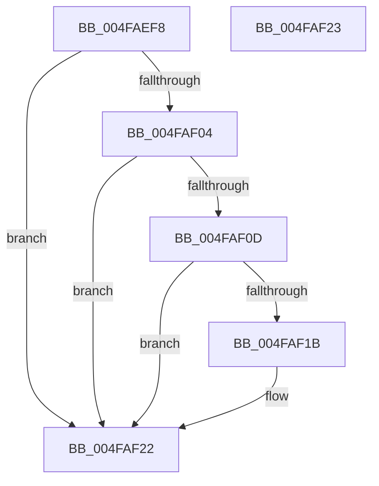

# KiResetGlobalDpcWatchdogProfiler

- RVA: `0x004FAEF8`–`0x004FAF24` (길이 `44` bytes)
- VA: `0x00000001404FAEF8`
- 실행 섹션: `.text`
- PDB 이름 있음: `예`; PDB Function 태그: `아니요`
- unwind 정보 RVA: `0x000DB714`
- 디코드: `11`개 명령, `44/44` bytes 표시
- 미해석 바이트: `0` (있으면 어셈블리에 `.byte`로 보존)

> 이 문서는 커널 이미지의 기계어와 PDB 기호를 분석해 생성했습니다. 4번과 5번은 함수 원형과 자료형을 바이너리 사용 방식에서 추정한 C 해석이며 원본 소스 복구 결과는 아닙니다.

## 1. Dependencies

- 직접 호출 지점: **0**; 고유 호출 대상: **0**
- 직접 호출자로 확인된 함수: **2**
- RIP 상대 이미지 참조: **0**

### Outgoing calls
- 직접 디코드된 call 명령이 없습니다.

### Direct callers
- [KeAccumulateTicks](../39/KeAccumulateTicks_function_0039C140.md) at `0x0039C7AA`
- [KeRelaxTimingConstraints](../5B/KeRelaxTimingConstraints_function_005B59C8.md) at `0x005B5A09`

### Static image references
- 디코드된 RIP-relative 메모리 참조가 없습니다.

## 2. Other-region calls and transfers

- 다른 실행 섹션으로 향하는 call: **0**
- 별도 외부 분기/꼬리 이동을 확인하지 못했습니다.

## 3. Assembly (complete function range)

```asm
004FAEF8  48 8B 91 A8 8E 00 00            mov rdx, qword ptr [rcx + 0x8ea8]
004FAEFF  48 85 D2                        test rdx, rdx
004FAF02  74 1E                           je 0x1404faf22
004FAF04  48 39 91 B0 8E 00 00            cmp qword ptr [rcx + 0x8eb0], rdx
004FAF0B  74 15                           je 0x1404faf22
004FAF0D  8B 81 B4 83 00 00               mov eax, dword ptr [rcx + 0x83b4]
004FAF13  39 81 AC 83 00 00               cmp dword ptr [rcx + 0x83ac], eax
004FAF19  7D 07                           jge 0x1404faf22
004FAF1B  48 89 91 B0 8E 00 00            mov qword ptr [rcx + 0x8eb0], rdx
004FAF22  C3                              ret
004FAF23  CC                              int3
```

## 4. C-style interpretation (structured pseudocode)

```c
__int64 __fastcall KiResetGlobalDpcWatchdogProfiler(__int64 a1)
{
    if (*(unsigned __int64 *)(a1 + 36520) == 0) goto loc_004FAF22;
    if ((*(unsigned __int64 *)(a1 + 36528)) == (*(unsigned __int64 *)(a1 + 36520))) goto loc_004FAF22;
    if ((*(unsigned int *)(a1 + 33708)) < ((unsigned int)((unsigned int)(*(unsigned int *)(a1 + 33716))))) {
        *(unsigned __int64 *)(a1 + 36528) = *(unsigned __int64 *)(a1 + 36520);
    }
    return (unsigned int)(*(unsigned int *)(a1 + 33716));
}
```

## 5. (Beta) C Style

```c
int64_t KiResetGlobalDpcWatchdogProfiler(void *Arg1)
{
    uint8_t *arg1 = (uint8_t *)Arg1;

    if (*(uint64_t *)(arg1 + 0x8EA8) == 0) goto loc_004FAF22;
    if ((*(uint64_t *)(arg1 + 0x8EB0)) == (*(uint64_t *)(arg1 + 0x8EA8))) goto loc_004FAF22;
    if ((*(uint32_t *)(arg1 + 0x83AC)) < ((uint32_t)((uint32_t)(*(uint32_t *)(arg1 + 0x83B4))))) {
        *(uint64_t *)(arg1 + 0x8EB0) = *(uint64_t *)(arg1 + 0x8EA8);
    }
    return (uint32_t)(*(uint32_t *)(arg1 + 0x83B4));
}
```

### 관측된 메모리 오프셋

구조체 형식이 확인되지 않은 접근은 인자 기준의 오프셋으로만 기록했습니다.

| 기준 인자 | 오프셋 표현 | 폭 (bit) | 접근 |
|---|---:|---:|---|
| `Arg1` | `+ 0x83AC` | `32` | `R` |
| `Arg1` | `+ 0x83B4` | `32` | `R` |
| `Arg1` | `+ 0x8EA8` | `64` | `R` |
| `Arg1` | `+ 0x8EB0` | `64` | `R` |
| `Arg1` | `+ 0x8EB0` | `64` | `W` |

## 6. Execution-region graph

[열기: 2D/3D 그래프와 함수 탐색 컨트롤 패널](../../../control-panel.html?section=text&rva=0x004FAEF8&view=graph)

- 2D 그래프는 위에서 아래로 흐르고, 3D 그래프는 빈 공간을 드래그해 회전합니다. Shift+드래그는 이동, 휠은 확대·축소, 함수 노드 선택은 대상 보고서 이동입니다.

### Static fallback


