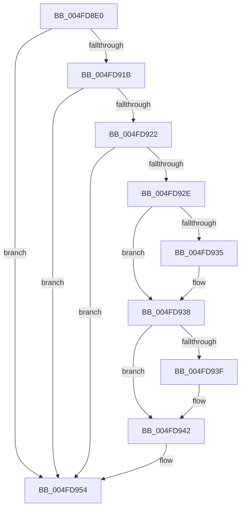

# KiRestoreDebugRegisterState

- RVA: `0x004FD8E0`–`0x004FD955` (길이 `117` bytes)
- VA: `0x00000001404FD8E0`
- 실행 섹션: `.text`
- PDB 이름 있음: `예`; PDB Function 태그: `아니요`
- unwind 정보 RVA: `0x000C15E4`
- 디코드: `33`개 명령, `117/117` bytes 표시
- 미해석 바이트: `0` (있으면 어셈블리에 `.byte`로 보존)

> 이 문서는 커널 이미지의 기계어와 PDB 기호를 분석해 생성했습니다. 4번과 5번은 함수 원형과 자료형을 바이너리 사용 방식에서 추정한 C 해석이며 원본 소스 복구 결과는 아닙니다.

## 1. Dependencies

- 직접 호출 지점: **0**; 고유 호출 대상: **0**
- 직접 호출자로 확인된 함수: **30**
- RIP 상대 이미지 참조: **1**

### Outgoing calls
- 직접 디코드된 call 명령이 없습니다.

### Direct callers
- [NtContinueEx](../6B/NtContinueEx_function_006B10D0.md) at `0x006B12A4`
- [NtRaiseException](../6B/NtRaiseException_function_006B1560.md) at `0x006B1744`
- [KiRestoreSetContextState](../6B/KiRestoreSetContextState_function_006B1CA0.md) at `0x006B1E19`
- [KiCallUserMode](../6B/KiCallUserMode_function_006B2180.md) at `0x006B25AB`
- [KxStartUserThread](../6B/KxStartUserThread_function_006B2E50.md) at `0x006B2FDF`
- [KiChainedDispatch](../6B/KiChainedDispatch_function_006B3480.md) at `0x006B35B1`
- [KiInterruptDispatch](../6B/KiInterruptDispatch_function_006B3B30.md) at `0x006B3C61`
- [KiInterruptDispatchNoLock](../6B/KiInterruptDispatchNoLock_function_006B3F10.md) at `0x006B4041`
- [KiInterruptDispatchNoLockNoEtw](../6B/KiInterruptDispatchNoLockNoEtw_function_006B42F0.md) at `0x006B4421`
- [KiInterruptDispatchNoEOI](../6B/KiInterruptDispatchNoEOI_function_006B46D0.md) at `0x006B47F9`
- [KiSpuriousDispatchNoEOI](../6B/KiSpuriousDispatchNoEOI_function_006B4AA0.md) at `0x006B4BBE`
- [KxIsrLinkage](../6B/KxIsrLinkage_function_006B5680.md) at `0x006B5B6D`
- [KiApcInterrupt](../6B/KiApcInterrupt_function_006B5E20.md) at `0x006B629A`
- [KiHvInterruptDispatch](../6B/KiHvInterruptDispatch_function_006B7750.md) at `0x006B788F`
- [KiVmbusInterruptDispatch](../6B/KiVmbusInterruptDispatch_function_006B7B40.md) at `0x006B7C6B`
- [KiSwInterrupt](../6B/KiSwInterrupt_function_006B8070.md) at `0x006B8506`
- [KiDpcInterrupt](../6B/KiDpcInterrupt_function_006B87C0.md) at `0x006B8C2E`
- [KiIpiInterrupt](../6B/KiIpiInterrupt_function_006B8F20.md) at `0x006B93AF`
- [NtCallEnclave](../6B/NtCallEnclave_function_006BABA0.md) at `0x006BACB6`
- [KiNmiInterrupt](../6B/KiNmiInterrupt_function_006BD3C0.md) at `0x006BD6A2`
- [KiBoundFault](../6B/KiBoundFault_function_006BE040.md) at `0x006BE489`
- [KiInvalidOpcodeFault](../6B/KiInvalidOpcodeFault_function_006BE740.md) at `0x006BEB3F`
- [KiPageFault](../6C/KiPageFault_function_006C0740.md) at `0x006C0CA0`
- [KiMcheckAbort](../6C/KiMcheckAbort_function_006C16C0.md) at `0x006C1A44`
- [KxMcheckAlternateReturn](../6C/KxMcheckAlternateReturn_function_006C1E00.md) at `0x006C222E`
- [KiVirtualizationException](../6C/KiVirtualizationException_function_006C2900.md) at `0x006C2D50`
- [KiControlProtectionFault](../6C/KiControlProtectionFault_function_006C3040.md) at `0x006C34F2`
- [KiSystemCall64](../6C/KiSystemCall64_function_006C4A40.md) at `0x006C50DA`
- [KiSystemCall64](../6C/KiSystemCall64_function_006C4A40.md) at `0x006C545A`
- [KiExceptionDispatch](../6C/KiExceptionDispatch_function_006C5900.md) at `0x006C5B62`
- [KiFastFailDispatch](../6C/KiFastFailDispatch_function_006C5E40.md) at `0x006C6023`

### Static image references
- `0x004FD922` → RVA `0x00F475C0` (`.data`; read)

## 2. Other-region calls and transfers

- 다른 실행 섹션으로 향하는 call: **0**
- 별도 외부 분기/꼬리 이동을 확인하지 못했습니다.

## 3. Assembly (complete function range)

```asm
004FD8E0  33 D2                           xor edx, edx
004FD8E2  0F 23 FA                        mov dr7, rdx
004FD8E5  48 8B 45 58                     mov rax, qword ptr [rbp + 0x58]
004FD8E9  48 8B 55 60                     mov rdx, qword ptr [rbp + 0x60]
004FD8ED  0F 23 C0                        mov dr0, rax
004FD8F0  0F 23 CA                        mov dr1, rdx
004FD8F3  48 8B 45 68                     mov rax, qword ptr [rbp + 0x68]
004FD8F7  48 8B 55 70                     mov rdx, qword ptr [rbp + 0x70]
004FD8FB  0F 23 D0                        mov dr2, rax
004FD8FE  0F 23 DA                        mov dr3, rdx
004FD901  48 8B 95 80 00 00 00            mov rdx, qword ptr [rbp + 0x80]
004FD908  33 C0                           xor eax, eax
004FD90A  0F 23 F0                        mov dr6, rax
004FD90D  0F 23 FA                        mov dr7, rdx
004FD910  65 F6 04 25 22 91 00 00 02      test byte ptr gs:[0x9122], 2
004FD919  74 39                           je 0x1404fd954
004FD91B  66 F7 C2 00 03                  test dx, 0x300
004FD920  74 32                           je 0x1404fd954
004FD922  F7 05 94 9C A4 00 02 00 00 00   test dword ptr [rip + 0xa49c94], 2
004FD92C  75 26                           jne 0x1404fd954
004FD92E  66 F7 C2 00 02                  test dx, 0x200
004FD933  74 03                           je 0x1404fd938
004FD935  83 C8 02                        or eax, 2
004FD938  66 F7 C2 00 01                  test dx, 0x100
004FD93D  74 03                           je 0x1404fd942
004FD93F  83 C8 01                        or eax, 1
004FD942  44 8B C0                        mov r8d, eax
004FD945  B9 D9 01 00 00                  mov ecx, 0x1d9
004FD94A  0F 32                           rdmsr
004FD94C  83 E0 FC                        and eax, 0xfffffffc
004FD94F  41 0B C0                        or eax, r8d
004FD952  0F 30                           wrmsr
004FD954  C3                              ret
```

## 4. C-style interpretation (structured pseudocode)

```c
__int64 __fastcall KiRestoreDebugRegisterState(__int64 a1, int a2)
{
    __int64 result;

    a2 = 0;
    result = 0;
    if (((*(unsigned __int8 *)(gs_base + (0 + 37154))) & (2)) == 0) goto loc_004FD954;
    if ((((unsigned __int16)(*(unsigned __int64 *)(v_rbp + 128))) & (768)) == 0) goto loc_004FD954;
    if (((*(unsigned int *)(v_rip + 10787988)) & (2)) != 0) goto loc_004FD954;
    if ((((unsigned __int16)(*(unsigned __int64 *)(v_rbp + 128))) & (512)) != 0) {
        result = (unsigned int)((result) | (2));
    }
    if ((((unsigned __int16)(*(unsigned __int64 *)(v_rbp + 128))) & (256)) != 0) {
        result = (unsigned int)((result) | (1));
    }
    result = (unsigned int)((result) & (0xFFFFFFFCULL));
    result = (unsigned int)((result) | ((unsigned int)((unsigned int)((unsigned int)(result)))));
loc_004FD954:
    return result;
}
```

## 5. (Beta) C Style

```c
int64_t KiRestoreDebugRegisterState(int64_t Arg1, int32_t Arg2)
{
    int64_t result;

    Arg2 = 0;
    result = 0;
    if (((*(uint8_t *)(gs_base + (0 + 0x9122))) & (2)) == 0) goto loc_004FD954;
    if ((((uint16_t)(*(uint64_t *)(local_rbp + 0x80))) & (768)) == 0) goto loc_004FD954;
    if (((*(uint32_t *)(v_rip + 0xA49C94)) & (2)) != 0) goto loc_004FD954;
    if ((((uint16_t)(*(uint64_t *)(local_rbp + 0x80))) & (512)) != 0) {
        result = (uint32_t)((result) | (2));
    }
    if ((((uint16_t)(*(uint64_t *)(local_rbp + 0x80))) & (256)) != 0) {
        result = (uint32_t)((result) | (1));
    }
    result = (uint32_t)((result) & (0xFFFFFFFCULL));
    result = (uint32_t)((result) | ((uint32_t)((uint32_t)((uint32_t)(result)))));
loc_004FD954:
    return result;
}
```

## 6. Execution-region graph

[열기: 2D/3D 그래프와 함수 탐색 컨트롤 패널](../../../control-panel.html?section=text&rva=0x004FD8E0&view=graph)

- 2D 그래프는 위에서 아래로 흐르고, 3D 그래프는 빈 공간을 드래그해 회전합니다. Shift+드래그는 이동, 휠은 확대·축소, 함수 노드 선택은 대상 보고서 이동입니다.

### Static fallback


