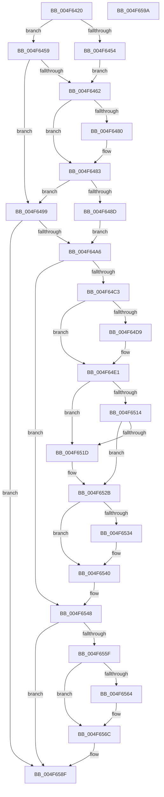

# KiResumeClockTimer

- RVA: `0x004F6420`–`0x004F659B` (길이 `379` bytes)
- VA: `0x00000001404F6420`
- 실행 섹션: `.text`
- PDB 이름 있음: `예`; PDB Function 태그: `아니요`
- unwind 정보 RVA: `0x000BEF94`
- 디코드: `95`개 명령, `379/379` bytes 표시
- 미해석 바이트: `0` (있으면 어셈블리에 `.byte`로 보존)

> 이 문서는 커널 이미지의 기계어와 PDB 기호를 분석해 생성했습니다. 4번과 5번은 함수 원형과 자료형을 바이너리 사용 방식에서 추정한 C 해석이며 원본 소스 복구 결과는 아닙니다.

## 1. Dependencies

- 직접 호출 지점: **9**; 고유 호출 대상: **8**
- 직접 호출자로 확인된 함수: **2**
- RIP 상대 이미지 참조: **14**

### Outgoing calls
- `0x004F6469` → [guard_dispatch_icall](../6B/guard_dispatch_icall_function_006BAAD0.md) (function, `0x006BAAD0`)
- `0x004F6483` → [guard_dispatch_icall](../6B/guard_dispatch_icall_function_006BAAD0.md) (function, `0x006BAAD0`)
- `0x004F64AE` → [RtlGetInterruptTimePrecise](../20/RtlGetInterruptTimePrecise_function_0020A4C0.md) (function, `0x0020A4C0`)
- `0x004F64DC` → [KiRaiseIrqlProcessIrqlFlags](KiRaiseIrqlProcessIrqlFlags_function_004F56FC.md) (function, `0x004F56FC`)
- `0x004F650A` → [KiSetClockTimer](../39/KiSetClockTimer_function_0039DB2C.md) (function, `0x0039DB2C`)
- `0x004F6526` → [KiSetClockTimerKTimerDeadlines](../23/KiSetClockTimerKTimerDeadlines_function_0023671C.md) (function, `0x0023671C`)
- `0x004F653B` → [KiLowerIrqlProcessIrqlFlags](KiLowerIrqlProcessIrqlFlags_function_004F5698.md) (function, `0x004F5698`)
- `0x004F6555` → [KiRestoreClockTickRate](../4D/KiRestoreClockTickRate_function_004D2780.md) (function, `0x004D2780`)
- `0x004F657A` → [KiEventClockStateChange](../46/KiEventClockStateChange_function_0046279C.md) (function, `0x0046279C`)

### Direct callers
- [KeResumeClockTimer](KeResumeClockTimer_function_004F6408.md) at `0x004F640C`
- [KeResumeClockTimerSafe](../5B/KeResumeClockTimerSafe_function_005BB334.md) at `0x005BB360`
- [KeResumeClockTimerSafe](../5B/KeResumeClockTimerSafe_function_005BB334.md) at `0x005BB382`

### Static image references
- `0x004F643D` → RVA `0x00FCF000` (`CACHEALI`; read)
- `0x004F6449` → RVA `0x00F21FB0` (`.data`; read)
- `0x004F6459` → RVA `0x00FC6ABF` (`ALMOSTRO`; read)
- `0x004F6462` → RVA `0x00E00AE0` (`.data`; read)
- `0x004F646E` → RVA `0x00FC6A85` (`ALMOSTRO`; read)
- `0x004F6477` → RVA `0x00E00AD8` (`.data`; read)
- `0x004F648D` → RVA `0x00F21F20` (`.data`; read/write)
- `0x004F64D0` → RVA `0x00FC6D20` (`ALMOSTRO`; read)
- `0x004F64E1` → RVA `0x00FC6D5C` (`ALMOSTRO`; read)
- `0x004F64EB` → RVA `0x00FC6B3C` (`ALMOSTRO`; read)
- `0x004F6514` → RVA `0x00FC5030` (`ALMOSTRO`; read)
- `0x004F6566` → RVA `0x00FCF000` (`CACHEALI`; read/write)
- `0x004F657F` → RVA `0x00FC6B7C` (`ALMOSTRO`; read)
- `0x004F6588` → RVA `0x00F21F88` (`.data`; write)

## 2. Other-region calls and transfers

- 다른 실행 섹션으로 향하는 call: **0**
- 별도 외부 분기/꼬리 이동을 확인하지 못했습니다.

## 3. Assembly (complete function range)

```asm
004F6420  40 53                           push rbx
004F6422  55                              push rbp
004F6423  56                              push rsi
004F6424  57                              push rdi
004F6425  41 56                           push r14
004F6427  48 83 EC 40                     sub rsp, 0x40
004F642B  48 83 64 24 78 00               and qword ptr [rsp + 0x78], 0
004F6431  40 32 FF                        xor dil, dil
004F6434  65 48 8B 34 25 20 00 00 00      mov rsi, qword ptr gs:[0x20]
004F643D  8B 1D BD 8B AD 00               mov ebx, dword ptr [rip + 0xad8bbd]
004F6443  48 83 64 24 70 00               and qword ptr [rsp + 0x70], 0
004F6449  8B 05 61 BB A2 00               mov eax, dword ptr [rip + 0xa2bb61]
004F644F  39 46 24                        cmp dword ptr [rsi + 0x24], eax
004F6452  75 05                           jne 0x1404f6459
004F6454  40 B7 01                        mov dil, 1
004F6457  EB 09                           jmp 0x1404f6462
004F6459  40 38 3D 5F 06 AD 00            cmp byte ptr [rip + 0xad065f], dil
004F6460  74 37                           je 0x1404f6499
004F6462  48 8B 05 77 A6 90 00            mov rax, qword ptr [rip + 0x90a677]
004F6469  E8 62 46 1C 00                  call 0x1406baad0
004F646E  80 3D 10 06 AD 00 00            cmp byte ptr [rip + 0xad0610], 0
004F6475  B1 01                           mov cl, 1
004F6477  48 8B 05 5A A6 90 00            mov rax, qword ptr [rip + 0x90a65a]
004F647E  75 03                           jne 0x1404f6483
004F6480  40 8A CF                        mov cl, dil
004F6483  E8 48 46 1C 00                  call 0x1406baad0
004F6488  40 84 FF                        test dil, dil
004F648B  74 0C                           je 0x1404f6499
004F648D  FF 05 8D BA A2 00               inc dword ptr [rip + 0xa2ba8d]
004F6493  C6 46 21 01                     mov byte ptr [rsi + 0x21], 1
004F6497  EB 0D                           jmp 0x1404f64a6
004F6499  80 3D E5 05 AD 00 00            cmp byte ptr [rip + 0xad05e5], 0
004F64A0  0F 84 E9 00 00 00               je 0x1404f658f
004F64A6  48 8D 8C 24 80 00 00 00         lea rcx, [rsp + 0x80]
004F64AE  E8 0D 40 D1 FF                  call 0x14020a4c0
004F64B3  80 3D CB 05 AD 00 00            cmp byte ptr [rip + 0xad05cb], 0
004F64BA  48 8B E8                        mov rbp, rax
004F64BD  0F 84 85 00 00 00               je 0x1404f6548
004F64C3  45 0F 20 C6                     mov r14, cr8
004F64C7  BA 0F 00 00 00                  mov edx, 0xf
004F64CC  44 0F 22 C2                     mov cr8, rdx
004F64D0  83 3D 49 08 AD 00 00            cmp dword ptr [rip + 0xad0849], 0
004F64D7  74 08                           je 0x1404f64e1
004F64D9  41 8A CE                        mov cl, r14b
004F64DC  E8 1B F2 FF FF                  call 0x1404f56fc
004F64E1  44 8B 05 74 08 AD 00            mov r8d, dword ptr [rip + 0xad0874]
004F64E8  48 8B D5                        mov rdx, rbp
004F64EB  44 8B 0D 4A 06 AD 00            mov r9d, dword ptr [rip + 0xad064a]
004F64F2  49 F7 D8                        neg r8
004F64F5  C6 44 24 30 00                  mov byte ptr [rsp + 0x30], 0
004F64FA  48 8B CE                        mov rcx, rsi
004F64FD  C6 44 24 28 01                  mov byte ptr [rsp + 0x28], 1
004F6502  C7 44 24 20 03 00 00 00         mov dword ptr [rsp + 0x20], 3
004F650A  E8 1D 76 EA FF                  call 0x14039db2c
004F650F  40 84 FF                        test dil, dil
004F6512  75 09                           jne 0x1404f651d
004F6514  83 3D 15 EB AC 00 00            cmp dword ptr [rip + 0xaceb15], 0
004F651B  75 0E                           jne 0x1404f652b
004F651D  44 8A C7                        mov r8b, dil
004F6520  48 8B D5                        mov rdx, rbp
004F6523  48 8B CE                        mov rcx, rsi
004F6526  E8 F1 01 D4 FF                  call 0x14023671c
004F652B  83 3D EE 07 AD 00 00            cmp dword ptr [rip + 0xad07ee], 0
004F6532  74 0C                           je 0x1404f6540
004F6534  44 0F 20 C1                     mov rcx, cr8
004F6538  41 8A D6                        mov dl, r14b
004F653B  E8 58 F1 FF FF                  call 0x1404f5698
004F6540  41 0F B6 C6                     movzx eax, r14b
004F6544  44 0F 22 C0                     mov cr8, rax
004F6548  4C 8D 44 24 78                  lea r8, [rsp + 0x78]
004F654D  48 8B CD                        mov rcx, rbp
004F6550  48 8D 54 24 70                  lea rdx, [rsp + 0x70]
004F6555  E8 26 C2 FD FF                  call 0x1404d2780
004F655A  40 84 FF                        test dil, dil
004F655D  74 30                           je 0x1404f658f
004F655F  83 FB 02                        cmp ebx, 2
004F6562  75 08                           jne 0x1404f656c
004F6564  33 DB                           xor ebx, ebx
004F6566  87 1D 94 8A AD 00               xchg dword ptr [rip + 0xad8a94], ebx
004F656C  4C 8D 4C 24 70                  lea r9, [rsp + 0x70]
004F6571  8B D3                           mov edx, ebx
004F6573  4C 8D 44 24 78                  lea r8, [rsp + 0x78]
004F6578  33 C9                           xor ecx, ecx
004F657A  E8 1D C2 F6 FF                  call 0x14046279c
004F657F  8B 05 F7 05 AD 00               mov eax, dword ptr [rip + 0xad05f7]
004F6585  48 03 C5                        add rax, rbp
004F6588  48 89 05 F9 B9 A2 00            mov qword ptr [rip + 0xa2b9f9], rax
004F658F  48 83 C4 40                     add rsp, 0x40
004F6593  41 5E                           pop r14
004F6595  5F                              pop rdi
004F6596  5E                              pop rsi
004F6597  5D                              pop rbp
004F6598  5B                              pop rbx
004F6599  C3                              ret
004F659A  CC                              int3
```

## 4. C-style interpretation (structured pseudocode)

```c
__int64 __fastcall KiResumeClockTimer(void)
{
    __int64 result;
    __int64 v_rbx;
    __int64 v_rdi;
    __int64 v_rsp;
    unsigned __int8 v_stack_m38;
    unsigned __int8 v_stack_m40;
    unsigned int v_stack_m48;
    unsigned __int64 v_stack_p10;
    unsigned __int64 v_stack_p18;
    unsigned __int64 v_stack_p8;

    v_rsp = (v_rsp) - (64);
    v_rdi = 0;
    if ((*(unsigned int *)(*(unsigned __int64 *)(gs_base + (0 + 32)) + 36)) != ((unsigned int)((unsigned int)(*(unsigned int *)(v_rip + 10664801))))) goto loc_004F6459;
    goto loc_004F6462;
loc_004F6459:
    if ((*(unsigned __int8 *)(v_rip + 11339359)) == 1) goto loc_004F6499;
loc_004F6462:
    result = guard_dispatch_icall(a1, a2, a3, a4);
    if ((*(unsigned __int8 *)(v_rip + 11339280)) == 0) {
        a1 = 1;
    }
    result = guard_dispatch_icall(a1, a2, a3, a4);
    if (1 == 0) goto loc_004F6499;
    *(unsigned __int8 *)(*(unsigned __int64 *)(gs_base + (0 + 32)) + 33) = 1;
    goto loc_004F64A6;
loc_004F6499:
    if ((*(unsigned __int8 *)(v_rip + 11339237)) == 0) goto loc_004F658F;
loc_004F64A6:
    result = RtlGetInterruptTimePrecise(v_stack_p18, a2, a3, a4);
    if ((*(unsigned __int8 *)(v_rip + 11339211)) == 0) goto loc_004F6548;
    if ((*(unsigned int *)(v_rip + 11339849)) != 0) {
        a1 = (unsigned __int8)(v_cr8);
        result = KiRaiseIrqlProcessIrqlFlags(a1, 15, a3, a4);
    }
    a3 = -((unsigned int)(*(unsigned int *)(v_rip + 11339892)));
    v_stack_m38 = 0;
    v_stack_m40 = 1;
    v_stack_m48 = 3;
    result = KiSetClockTimer(*(unsigned __int64 *)(gs_base + (0 + 32)), result, a3, (unsigned int)(*(unsigned int *)(v_rip + 11339338)));
    if (1 != 0) goto loc_004F651D;
    if ((*(unsigned int *)(v_rip + 11332373)) == 0) {
        a3 = 1;
        a2 = result;
        a1 = *(unsigned __int64 *)(gs_base + (0 + 32));
        result = KiSetClockTimerKTimerDeadlines(a1, a2, a3, (unsigned int)(*(unsigned int *)(v_rip + 11339338)));
    }
    if ((*(unsigned int *)(v_rip + 11339758)) != 0) {
        a1 = 15;
        a2 = (unsigned __int8)(v_cr8);
        result = KiLowerIrqlProcessIrqlFlags(a1, a2, a3, (unsigned int)(*(unsigned int *)(v_rip + 11339338)));
    }
loc_004F6548:
    result = KiRestoreClockTickRate(result, v_stack_p8, v_stack_p10, (unsigned int)(*(unsigned int *)(v_rip + 11339338)));
    if (1 == 0) goto loc_004F658F;
    v_rbx = (unsigned int)(*(unsigned int *)(v_rip + 11373501));
    if (((unsigned int)((unsigned int)(*(unsigned int *)(v_rip + 11373501)))) == 2) {
        v_rbx = 0;
    }
    a1 = 0;
    result = KiEventClockStateChange(a1, 0, v_stack_p10, v_stack_p8);
    result = ((unsigned int)(*(unsigned int *)(v_rip + 11339255))) + (result);
    *(unsigned __int64 *)(v_rip + 10664441) = result;
loc_004F658F:
    v_rsp = (v_rsp) + (64);
    return result;
}
```

## 5. (Beta) C Style

```c
void KiResumeClockTimer(void)
{
    int64_t result;
    int64_t local_rbx;
    int64_t local_rdi;
    int64_t local_rsp;
    uint8_t v_stack_m38;
    uint8_t v_stack_m40;
    uint32_t v_stack_m48;
    uint64_t v_stack_p10;
    uint64_t v_stack_p18;
    uint64_t v_stack_p8;

    local_rsp = (local_rsp) - (64);
    local_rdi = 0;
    if ((*(uint32_t *)(*(uint64_t *)(gs_base + (0 + 0x20)) + 0x24)) != ((uint32_t)((uint32_t)(*(uint32_t *)(v_rip + 0xA2BB61))))) goto loc_004F6459;
    goto loc_004F6462;
loc_004F6459:
    if ((*(uint8_t *)(v_rip + 0xAD065F)) == 1) goto loc_004F6499;
loc_004F6462:
    result = guard_dispatch_icall(a1, a2, a3, a4);
    if ((*(uint8_t *)(v_rip + 0xAD0610)) == 0) {
        a1 = 1;
    }
    result = guard_dispatch_icall(a1, a2, a3, a4);
    if (1 == 0) goto loc_004F6499;
    *(uint8_t *)(*(uint64_t *)(gs_base + (0 + 0x20)) + 0x21) = 1;
    goto loc_004F64A6;
loc_004F6499:
    if ((*(uint8_t *)(v_rip + 0xAD05E5)) == 0) goto loc_004F658F;
loc_004F64A6:
    result = RtlGetInterruptTimePrecise(v_stack_p18, a2, a3, a4);
    if ((*(uint8_t *)(v_rip + 0xAD05CB)) == 0) goto loc_004F6548;
    if ((*(uint32_t *)(v_rip + 0xAD0849)) != 0) {
        a1 = (uint8_t)(v_cr8);
        result = KiRaiseIrqlProcessIrqlFlags(a1, 15, a3, a4);
    }
    a3 = -((uint32_t)(*(uint32_t *)(v_rip + 0xAD0874)));
    v_stack_m38 = 0;
    v_stack_m40 = 1;
    v_stack_m48 = 3;
    result = KiSetClockTimer(*(uint64_t *)(gs_base + (0 + 0x20)), result, a3, (uint32_t)(*(uint32_t *)(v_rip + 0xAD064A)));
    if (1 != 0) goto loc_004F651D;
    if ((*(uint32_t *)(v_rip + 0xACEB15)) == 0) {
        a3 = 1;
        a2 = result;
        a1 = *(uint64_t *)(gs_base + (0 + 0x20));
        result = KiSetClockTimerKTimerDeadlines(a1, a2, a3, (uint32_t)(*(uint32_t *)(v_rip + 0xAD064A)));
    }
    if ((*(uint32_t *)(v_rip + 0xAD07EE)) != 0) {
        a1 = 15;
        a2 = (uint8_t)(v_cr8);
        result = KiLowerIrqlProcessIrqlFlags(a1, a2, a3, (uint32_t)(*(uint32_t *)(v_rip + 0xAD064A)));
    }
loc_004F6548:
    result = KiRestoreClockTickRate(result, v_stack_p8, v_stack_p10, (uint32_t)(*(uint32_t *)(v_rip + 0xAD064A)));
    if (1 == 0) goto loc_004F658F;
    local_rbx = (uint32_t)(*(uint32_t *)(v_rip + 0xAD8BBD));
    if (((uint32_t)((uint32_t)(*(uint32_t *)(v_rip + 0xAD8BBD)))) == 2) {
        local_rbx = 0;
    }
    a1 = 0;
    result = KiEventClockStateChange(a1, 0, v_stack_p10, v_stack_p8);
    result = ((uint32_t)(*(uint32_t *)(v_rip + 0xAD05F7))) + (result);
    *(uint64_t *)(v_rip + 0xA2B9F9) = result;
loc_004F658F:
    local_rsp = (local_rsp) + (64);
    return result;
}
```

## 6. Execution-region graph

[열기: 2D/3D 그래프와 함수 탐색 컨트롤 패널](../../../control-panel.html?section=text&rva=0x004F6420&view=graph)

- 2D 그래프는 위에서 아래로 흐르고, 3D 그래프는 빈 공간을 드래그해 회전합니다. Shift+드래그는 이동, 휠은 확대·축소, 함수 노드 선택은 대상 보고서 이동입니다.

### Static fallback


