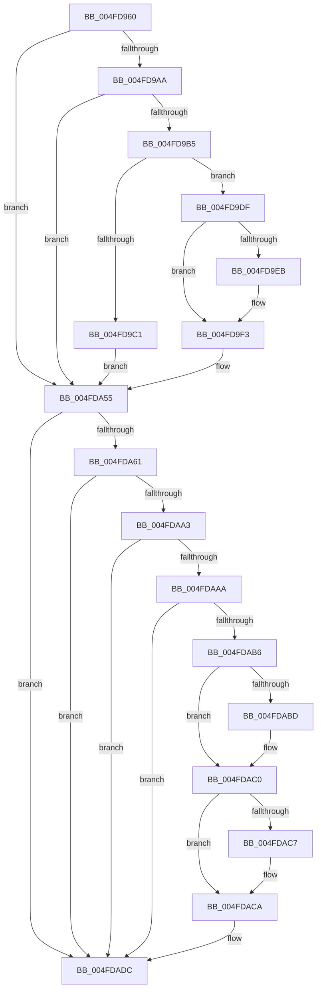

# KiSaveDebugRegisterState

- RVA: `0x004FD960`–`0x004FDADD` (길이 `381` bytes)
- VA: `0x00000001404FD960`
- 실행 섹션: `.text`
- PDB 이름 있음: `예`; PDB Function 태그: `아니요`
- unwind 정보 RVA: `0x000C15E8`
- 디코드: `87`개 명령, `381/381` bytes 표시
- 미해석 바이트: `0` (있으면 어셈블리에 `.byte`로 보존)

> 이 문서는 커널 이미지의 기계어와 PDB 기호를 분석해 생성했습니다. 4번과 5번은 함수 원형과 자료형을 바이너리 사용 방식에서 추정한 C 해석이며 원본 소스 복구 결과는 아닙니다.

## 1. Dependencies

- 직접 호출 지점: **0**; 고유 호출 대상: **0**
- 직접 호출자로 확인된 함수: **39**
- RIP 상대 이미지 참조: **6**

### Outgoing calls
- 직접 디코드된 call 명령이 없습니다.

### Direct callers
- [KyStartUserThread](../6B/KyStartUserThread_function_006B2AF0.md) at `0x006B2DD1`
- [KxIsrLinkage](../6B/KxIsrLinkage_function_006B5680.md) at `0x006B595E`
- [KiApcInterrupt](../6B/KiApcInterrupt_function_006B5E20.md) at `0x006B6102`
- [KiHvInterrupt](../6B/KiHvInterrupt_function_006B6620.md) at `0x006B6900`
- [KiVmbusInterrupt0](../6B/KiVmbusInterrupt0_function_006B6990.md) at `0x006B6C70`
- [KiVmbusInterrupt1](../6B/KiVmbusInterrupt1_function_006B6D00.md) at `0x006B6FE0`
- [KiVmbusInterrupt2](../6B/KiVmbusInterrupt2_function_006B7070.md) at `0x006B7350`
- [KiVmbusInterrupt3](../6B/KiVmbusInterrupt3_function_006B73E0.md) at `0x006B76C0`
- [KiSwInterrupt](../6B/KiSwInterrupt_function_006B8070.md) at `0x006B8352`
- [KiDpcInterrupt](../6B/KiDpcInterrupt_function_006B87C0.md) at `0x006B8AA2`
- [KiIpiInterrupt](../6B/KiIpiInterrupt_function_006B8F20.md) at `0x006B9202`
- [KiDivideErrorFault](../6B/KiDivideErrorFault_function_006BCA00.md) at `0x006BCCE1`
- [KxDebugTrapOrFault](../6B/KxDebugTrapOrFault_function_006BCF40.md) at `0x006BD221`
- [KiNmiInterrupt](../6B/KiNmiInterrupt_function_006BD3C0.md) at `0x006BD522`
- [KiBreakpointTrap](../6B/KiBreakpointTrap_function_006BD940.md) at `0x006BDC21`
- [KiOverflowTrap](../6B/KiOverflowTrap_function_006BDCC0.md) at `0x006BDFA1`
- [KiBoundFault](../6B/KiBoundFault_function_006BE040.md) at `0x006BE321`
- [KiInvalidOpcodeFault](../6B/KiInvalidOpcodeFault_function_006BE740.md) at `0x006BEA21`
- [KiNpxNotAvailableFault](../6B/KiNpxNotAvailableFault_function_006BEE00.md) at `0x006BF0E1`
- [KiDoubleFaultAbort](../6B/KiDoubleFaultAbort_function_006BF1C0.md) at `0x006BF49D`
- [KiNpxSegmentOverrunAbort](../6B/KiNpxSegmentOverrunAbort_function_006BF540.md) at `0x006BF821`
- [KiInvalidTssFault](../6B/KiInvalidTssFault_function_006BF8C0.md) at `0x006BFB9D`
- [KiSegmentNotPresentFault](../6B/KiSegmentNotPresentFault_function_006BFC40.md) at `0x006BFF1D`
- [KiStackFault](../6C/KiStackFault_function_006C0040.md) at `0x006C031D`
- [KiGeneralProtectionFault](../6C/KiGeneralProtectionFault_function_006C03C0.md) at `0x006C069D`
- [KiPageFault](../6C/KiPageFault_function_006C0740.md) at `0x006C0A34`
- [KiFloatingErrorFault](../6C/KiFloatingErrorFault_function_006C0F40.md) at `0x006C1221`
- [KiAlignmentFault](../6C/KiAlignmentFault_function_006C1340.md) at `0x006C161D`
- [KiMcheckAbort](../6C/KiMcheckAbort_function_006C16C0.md) at `0x006C1822`
- [KxMcheckAlternateReturn](../6C/KxMcheckAlternateReturn_function_006C1E00.md) at `0x006C20FA`
- [KiXmmException](../6C/KiXmmException_function_006C2500.md) at `0x006C27E1`
- [KiVirtualizationException](../6C/KiVirtualizationException_function_006C2900.md) at `0x006C2BE1`
- [KiControlProtectionFault](../6C/KiControlProtectionFault_function_006C3040.md) at `0x006C331D`
- [KiRaiseSecurityCheckFailure](../6C/KiRaiseSecurityCheckFailure_function_006C37C0.md) at `0x006C3AB3`
- [KiRaiseAssertion](../6C/KiRaiseAssertion_function_006C3B40.md) at `0x006C3E33`
- [KiDebugServiceTrap](../6C/KiDebugServiceTrap_function_006C3EC0.md) at `0x006C41B2`
- [KiSystemCall32](../6C/KiSystemCall32_function_006C4500.md) at `0x006C481B`
- [KiSystemCall64](../6C/KiSystemCall64_function_006C4A40.md) at `0x006C4D50`
- [KiSystemCall32Shadow](../../kvascode/BC/KiSystemCall32Shadow_function_00BCCE40.md) at `0x00BCD151`

### Static image references
- `0x004FD9B5` → RVA `0x00F475C0` (`.data`; read)
- `0x004FD9DF` → RVA `0x00FC6FCC` (`ALMOSTRO`; read)
- `0x004FD9F3` → RVA `0x00FC6CFC` (`ALMOSTRO`; read)
- `0x004FDA04` → RVA `0x00FC6D58` (`ALMOSTRO`; read)
- `0x004FDA21` → RVA `0x00FC6E60` (`ALMOSTRO`; read)
- `0x004FDA35` → RVA `0x00FC6E64` (`ALMOSTRO`; read)

## 2. Other-region calls and transfers

- 다른 실행 섹션으로 향하는 call: **0**
- 별도 외부 분기/꼬리 이동을 확인하지 못했습니다.

## 3. Assembly (complete function range)

```asm
004FD960  65 4C 8B 0C 25 18 00 00 00      mov r9, qword ptr gs:[0x18]
004FD969  0F 21 C0                        mov rax, dr0
004FD96C  0F 21 CA                        mov rdx, dr1
004FD96F  48 89 45 58                     mov qword ptr [rbp + 0x58], rax
004FD973  48 89 55 60                     mov qword ptr [rbp + 0x60], rdx
004FD977  0F 21 D0                        mov rax, dr2
004FD97A  0F 21 DA                        mov rdx, dr3
004FD97D  48 89 45 68                     mov qword ptr [rbp + 0x68], rax
004FD981  48 89 55 70                     mov qword ptr [rbp + 0x70], rdx
004FD985  0F 21 F0                        mov rax, dr6
004FD988  0F 21 FA                        mov rdx, dr7
004FD98B  48 89 45 78                     mov qword ptr [rbp + 0x78], rax
004FD98F  48 89 95 80 00 00 00            mov qword ptr [rbp + 0x80], rdx
004FD996  33 C0                           xor eax, eax
004FD998  0F 23 F8                        mov dr7, rax
004FD99B  65 F6 04 25 22 91 00 00 02      test byte ptr gs:[0x9122], 2
004FD9A4  0F 84 AB 00 00 00               je 0x1404fda55
004FD9AA  66 F7 C2 00 03                  test dx, 0x300
004FD9AF  0F 84 A0 00 00 00               je 0x1404fda55
004FD9B5  F7 05 01 9C A4 00 02 00 00 00   test dword ptr [rip + 0xa49c01], 2
004FD9BF  74 1E                           je 0x1404fd9df
004FD9C1  48 89 85 98 00 00 00            mov qword ptr [rbp + 0x98], rax
004FD9C8  48 89 85 90 00 00 00            mov qword ptr [rbp + 0x90], rax
004FD9CF  48 89 85 A8 00 00 00            mov qword ptr [rbp + 0xa8], rax
004FD9D6  48 89 85 A0 00 00 00            mov qword ptr [rbp + 0xa0], rax
004FD9DD  EB 76                           jmp 0x1404fda55
004FD9DF  44 8B 05 E6 95 AC 00            mov r8d, dword ptr [rip + 0xac95e6]
004FD9E6  45 0B C0                        or r8d, r8d
004FD9E9  74 08                           je 0x1404fd9f3
004FD9EB  41 8B C8                        mov ecx, r8d
004FD9EE  0F 32                           rdmsr
004FD9F0  44 8B C0                        mov r8d, eax
004FD9F3  8B 0D 03 93 AC 00               mov ecx, dword ptr [rip + 0xac9303]
004FD9F9  41 03 C8                        add ecx, r8d
004FD9FC  0F 32                           rdmsr
004FD9FE  89 85 98 00 00 00               mov dword ptr [rbp + 0x98], eax
004FDA04  8B 0D 4E 93 AC 00               mov ecx, dword ptr [rip + 0xac934e]
004FDA0A  89 95 9C 00 00 00               mov dword ptr [rbp + 0x9c], edx
004FDA10  41 03 C8                        add ecx, r8d
004FDA13  0F 32                           rdmsr
004FDA15  89 85 90 00 00 00               mov dword ptr [rbp + 0x90], eax
004FDA1B  89 95 94 00 00 00               mov dword ptr [rbp + 0x94], edx
004FDA21  8B 0D 39 94 AC 00               mov ecx, dword ptr [rip + 0xac9439]
004FDA27  0F 32                           rdmsr
004FDA29  89 85 A8 00 00 00               mov dword ptr [rbp + 0xa8], eax
004FDA2F  89 95 AC 00 00 00               mov dword ptr [rbp + 0xac], edx
004FDA35  8B 0D 29 94 AC 00               mov ecx, dword ptr [rip + 0xac9429]
004FDA3B  0F 32                           rdmsr
004FDA3D  89 85 A0 00 00 00               mov dword ptr [rbp + 0xa0], eax
004FDA43  89 95 A4 00 00 00               mov dword ptr [rbp + 0xa4], edx
004FDA49  B9 D9 01 00 00                  mov ecx, 0x1d9
004FDA4E  0F 32                           rdmsr
004FDA50  83 E0 FC                        and eax, 0xfffffffc
004FDA53  0F 30                           wrmsr
004FDA55  66 41 F7 81 C8 02 00 00 55 03   test word ptr [r9 + 0x2c8], 0x355
004FDA5F  74 7B                           je 0x1404fdadc
004FDA61  49 8B 81 A0 02 00 00            mov rax, qword ptr [r9 + 0x2a0]
004FDA68  49 8B 91 A8 02 00 00            mov rdx, qword ptr [r9 + 0x2a8]
004FDA6F  0F 23 C0                        mov dr0, rax
004FDA72  0F 23 CA                        mov dr1, rdx
004FDA75  49 8B 81 B0 02 00 00            mov rax, qword ptr [r9 + 0x2b0]
004FDA7C  49 8B 91 B8 02 00 00            mov rdx, qword ptr [r9 + 0x2b8]
004FDA83  0F 23 D0                        mov dr2, rax
004FDA86  0F 23 DA                        mov dr3, rdx
004FDA89  49 8B 91 C8 02 00 00            mov rdx, qword ptr [r9 + 0x2c8]
004FDA90  33 C0                           xor eax, eax
004FDA92  0F 23 F0                        mov dr6, rax
004FDA95  0F 23 FA                        mov dr7, rdx
004FDA98  65 F6 04 25 22 91 00 00 02      test byte ptr gs:[0x9122], 2
004FDAA1  74 39                           je 0x1404fdadc
004FDAA3  66 F7 C2 00 03                  test dx, 0x300
004FDAA8  74 32                           je 0x1404fdadc
004FDAAA  F7 05 0C 9B A4 00 02 00 00 00   test dword ptr [rip + 0xa49b0c], 2
004FDAB4  75 26                           jne 0x1404fdadc
004FDAB6  66 F7 C2 00 02                  test dx, 0x200
004FDABB  74 03                           je 0x1404fdac0
004FDABD  83 C8 02                        or eax, 2
004FDAC0  66 F7 C2 00 01                  test dx, 0x100
004FDAC5  74 03                           je 0x1404fdaca
004FDAC7  83 C8 01                        or eax, 1
004FDACA  44 8B C0                        mov r8d, eax
004FDACD  B9 D9 01 00 00                  mov ecx, 0x1d9
004FDAD2  0F 32                           rdmsr
004FDAD4  83 E0 FC                        and eax, 0xfffffffc
004FDAD7  41 0B C0                        or eax, r8d
004FDADA  0F 30                           wrmsr
004FDADC  C3                              ret
```

## 4. C-style interpretation (structured pseudocode)

```c
__int64 __fastcall KiSaveDebugRegisterState(void)
{
    __int64 result;

    *(unsigned __int64 *)(v_rbp + 88) = v_dr0;
    *(unsigned __int64 *)(v_rbp + 96) = v_dr1;
    *(unsigned __int64 *)(v_rbp + 104) = v_dr2;
    *(unsigned __int64 *)(v_rbp + 112) = v_dr3;
    *(unsigned __int64 *)(v_rbp + 120) = v_dr6;
    *(unsigned __int64 *)(v_rbp + 128) = v_dr7;
    result = 0;
    if (((*(unsigned __int8 *)(gs_base + (0 + 37154))) & (2)) == 0) goto loc_004FDA55;
    if ((((unsigned __int16)(v_dr7)) & (768)) == 0) goto loc_004FDA55;
    if (((*(unsigned int *)(v_rip + 10787841)) & (2)) == 0) goto loc_004FD9DF;
    *(unsigned __int64 *)(v_rbp + 152) = 0;
    *(unsigned __int64 *)(v_rbp + 144) = 0;
    *(unsigned __int64 *)(v_rbp + 168) = 0;
    *(unsigned __int64 *)(v_rbp + 160) = 0;
    goto loc_004FDA55;
loc_004FD9DF:
    a3 = (unsigned int)(((unsigned int)(*(unsigned int *)(v_rip + 11310566))) | ((unsigned int)((unsigned int)(*(unsigned int *)(v_rip + 11310566)))));
    if (!(condition_is_equal)) {
        a1 = (unsigned int)(a3);
        a3 = 0;
    }
    a1 = (unsigned int)(((unsigned int)(*(unsigned int *)(v_rip + 11309827))) + ((unsigned int)(a3)));
    *(unsigned int *)(v_rbp + 152) = 0;
    *(unsigned int *)(v_rbp + 156) = (unsigned int)(v_dr7);
    a1 = (unsigned int)(((unsigned int)(*(unsigned int *)(v_rip + 11309902))) + ((unsigned int)(a3)));
    *(unsigned int *)(v_rbp + 144) = 0;
    *(unsigned int *)(v_rbp + 148) = (unsigned int)(v_dr7);
    *(unsigned int *)(v_rbp + 168) = 0;
    *(unsigned int *)(v_rbp + 172) = (unsigned int)(v_dr7);
    *(unsigned int *)(v_rbp + 160) = 0;
    *(unsigned int *)(v_rbp + 164) = (unsigned int)(v_dr7);
    result = (unsigned int)((result) & (0xFFFFFFFCULL));
loc_004FDA55:
    if (((*(unsigned __int16 *)(*(unsigned __int64 *)(gs_base + (0 + 24)) + 712)) & (853)) == 0) goto loc_004FDADC;
    result = 0;
    if (((*(unsigned __int8 *)(gs_base + (0 + 37154))) & (2)) == 0) goto loc_004FDADC;
    if ((((unsigned __int16)(*(unsigned __int64 *)(*(unsigned __int64 *)(gs_base + (0 + 24)) + 712))) & (768)) == 0) goto loc_004FDADC;
    if (((*(unsigned int *)(v_rip + 10787596)) & (2)) != 0) goto loc_004FDADC;
    if ((((unsigned __int16)(*(unsigned __int64 *)(*(unsigned __int64 *)(gs_base + (0 + 24)) + 712))) & (512)) != 0) {
        result = (unsigned int)((result) | (2));
    }
    if ((((unsigned __int16)(*(unsigned __int64 *)(*(unsigned __int64 *)(gs_base + (0 + 24)) + 712))) & (256)) != 0) {
        result = (unsigned int)((result) | (1));
    }
    result = (unsigned int)((result) & (0xFFFFFFFCULL));
    result = (unsigned int)((result) | ((unsigned int)((unsigned int)((unsigned int)(result)))));
loc_004FDADC:
    return result;
}
```

## 5. (Beta) C Style

```c
void KiSaveDebugRegisterState(void)
{
    int64_t result;

    *(uint64_t *)(local_rbp + 0x58) = v_dr0;
    *(uint64_t *)(local_rbp + 0x60) = v_dr1;
    *(uint64_t *)(local_rbp + 0x68) = v_dr2;
    *(uint64_t *)(local_rbp + 0x70) = v_dr3;
    *(uint64_t *)(local_rbp + 0x78) = v_dr6;
    *(uint64_t *)(local_rbp + 0x80) = v_dr7;
    result = 0;
    if (((*(uint8_t *)(gs_base + (0 + 0x9122))) & (2)) == 0) goto loc_004FDA55;
    if ((((uint16_t)(v_dr7)) & (768)) == 0) goto loc_004FDA55;
    if (((*(uint32_t *)(v_rip + 0xA49C01)) & (2)) == 0) goto loc_004FD9DF;
    *(uint64_t *)(local_rbp + 0x98) = 0;
    *(uint64_t *)(local_rbp + 0x90) = 0;
    *(uint64_t *)(local_rbp + 0xA8) = 0;
    *(uint64_t *)(local_rbp + 0xA0) = 0;
    goto loc_004FDA55;
loc_004FD9DF:
    a3 = (uint32_t)(((uint32_t)(*(uint32_t *)(v_rip + 0xAC95E6))) | ((uint32_t)((uint32_t)(*(uint32_t *)(v_rip + 0xAC95E6)))));
    if (!(condition_is_equal)) {
        a1 = (uint32_t)(a3);
        a3 = 0;
    }
    a1 = (uint32_t)(((uint32_t)(*(uint32_t *)(v_rip + 0xAC9303))) + ((uint32_t)(a3)));
    *(uint32_t *)(local_rbp + 0x98) = 0;
    *(uint32_t *)(local_rbp + 0x9C) = (uint32_t)(v_dr7);
    a1 = (uint32_t)(((uint32_t)(*(uint32_t *)(v_rip + 0xAC934E))) + ((uint32_t)(a3)));
    *(uint32_t *)(local_rbp + 0x90) = 0;
    *(uint32_t *)(local_rbp + 0x94) = (uint32_t)(v_dr7);
    *(uint32_t *)(local_rbp + 0xA8) = 0;
    *(uint32_t *)(local_rbp + 0xAC) = (uint32_t)(v_dr7);
    *(uint32_t *)(local_rbp + 0xA0) = 0;
    *(uint32_t *)(local_rbp + 0xA4) = (uint32_t)(v_dr7);
    result = (uint32_t)((result) & (0xFFFFFFFCULL));
loc_004FDA55:
    if (((*(uint16_t *)(*(uint64_t *)(gs_base + (0 + 0x18)) + 0x2C8)) & (853)) == 0) goto loc_004FDADC;
    result = 0;
    if (((*(uint8_t *)(gs_base + (0 + 0x9122))) & (2)) == 0) goto loc_004FDADC;
    if ((((uint16_t)(*(uint64_t *)(*(uint64_t *)(gs_base + (0 + 0x18)) + 0x2C8))) & (768)) == 0) goto loc_004FDADC;
    if (((*(uint32_t *)(v_rip + 0xA49B0C)) & (2)) != 0) goto loc_004FDADC;
    if ((((uint16_t)(*(uint64_t *)(*(uint64_t *)(gs_base + (0 + 0x18)) + 0x2C8))) & (512)) != 0) {
        result = (uint32_t)((result) | (2));
    }
    if ((((uint16_t)(*(uint64_t *)(*(uint64_t *)(gs_base + (0 + 0x18)) + 0x2C8))) & (256)) != 0) {
        result = (uint32_t)((result) | (1));
    }
    result = (uint32_t)((result) & (0xFFFFFFFCULL));
    result = (uint32_t)((result) | ((uint32_t)((uint32_t)((uint32_t)(result)))));
loc_004FDADC:
    return result;
}
```

## 6. Execution-region graph

[열기: 2D/3D 그래프와 함수 탐색 컨트롤 패널](../../../control-panel.html?section=text&rva=0x004FD960&view=graph)

- 2D 그래프는 위에서 아래로 흐르고, 3D 그래프는 빈 공간을 드래그해 회전합니다. Shift+드래그는 이동, 휠은 확대·축소, 함수 노드 선택은 대상 보고서 이동입니다.

### Static fallback


