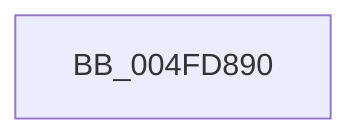

# KiSaveInitialProcessorControlState

- RVA: `0x004FD890`–`0x004FD8CB` (길이 `59` bytes)
- VA: `0x00000001404FD890`
- 실행 섹션: `.text`
- PDB 이름 있음: `예`; PDB Function 태그: `아니요`
- unwind 정보 RVA: `0x000C15D8`
- 디코드: `16`개 명령, `59/59` bytes 표시
- 미해석 바이트: `0` (있으면 어셈블리에 `.byte`로 보존)

> 이 문서는 커널 이미지의 기계어와 PDB 기호를 분석해 생성했습니다. 4번과 5번은 함수 원형과 자료형을 바이너리 사용 방식에서 추정한 C 해석이며 원본 소스 복구 결과는 아닙니다.

## 1. Dependencies

- 직접 호출 지점: **0**; 고유 호출 대상: **0**
- 직접 호출자로 확인된 함수: **1**
- RIP 상대 이미지 참조: **0**

### Outgoing calls
- 직접 디코드된 call 명령이 없습니다.

### Direct callers
- [KiInitializeBootStructures](../../pagelk/B6/KiInitializeBootStructures_function_00B68530.md) at `0x00B689F4`

### Static image references
- 디코드된 RIP-relative 메모리 참조가 없습니다.

## 2. Other-region calls and transfers

- 다른 실행 섹션으로 향하는 call: **0**
- 별도 외부 분기/꼬리 이동을 확인하지 못했습니다.

## 3. Assembly (complete function range)

```asm
004FD890  0F 20 C0                        mov rax, cr0
004FD893  48 89 01                        mov qword ptr [rcx], rax
004FD896  0F 20 D0                        mov rax, cr2
004FD899  48 89 41 08                     mov qword ptr [rcx + 8], rax
004FD89D  0F 20 D8                        mov rax, cr3
004FD8A0  48 89 41 10                     mov qword ptr [rcx + 0x10], rax
004FD8A4  0F 20 E0                        mov rax, cr4
004FD8A7  48 89 41 18                     mov qword ptr [rcx + 0x18], rax
004FD8AB  44 0F 20 C0                     mov rax, cr8
004FD8AF  48 89 81 A0 00 00 00            mov qword ptr [rcx + 0xa0], rax
004FD8B6  0F 01 41 56                     sgdt [rcx + 0x56]
004FD8BA  0F 01 49 66                     sidt [rcx + 0x66]
004FD8BE  0F 00 49 70                     str word ptr [rcx + 0x70]
004FD8C2  0F 00 41 72                     sldt word ptr [rcx + 0x72]
004FD8C6  0F AE 59 74                     stmxcsr dword ptr [rcx + 0x74]
004FD8CA  C3                              ret
```

## 4. C-style interpretation (structured pseudocode)

```c
__int64 __fastcall KiSaveInitialProcessorControlState(__int64 a1)
{
    *(unsigned __int64 *)(a1) = v_cr0;
    *(unsigned __int64 *)(a1 + 8) = v_cr2;
    *(unsigned __int64 *)(a1 + 16) = v_cr3;
    *(unsigned __int64 *)(a1 + 24) = v_cr4;
    *(unsigned __int64 *)(a1 + 160) = v_cr8;
    return v_cr8;
}
```

## 5. (Beta) C Style

```c
int64_t KiSaveInitialProcessorControlState(void *Arg1)
{
    uint8_t *arg1 = (uint8_t *)Arg1;

    *(uint64_t *)(arg1) = v_cr0;
    *(uint64_t *)(arg1 + 0x8) = v_cr2;
    *(uint64_t *)(arg1 + 0x10) = v_cr3;
    *(uint64_t *)(arg1 + 0x18) = v_cr4;
    *(uint64_t *)(arg1 + 0xA0) = v_cr8;
    return v_cr8;
}
```

### 관측된 메모리 오프셋

구조체 형식이 확인되지 않은 접근은 인자 기준의 오프셋으로만 기록했습니다.

| 기준 인자 | 오프셋 표현 | 폭 (bit) | 접근 |
|---|---:|---:|---|
| `Arg1` | `+ 0x0` | `64` | `W` |
| `Arg1` | `+ 0x8` | `64` | `W` |
| `Arg1` | `+ 0x10` | `64` | `W` |
| `Arg1` | `+ 0x18` | `64` | `W` |
| `Arg1` | `+ 0x56` | `80` | `W` |
| `Arg1` | `+ 0x66` | `80` | `W` |
| `Arg1` | `+ 0x70` | `16` | `W` |
| `Arg1` | `+ 0x72` | `16` | `W` |
| `Arg1` | `+ 0x74` | `32` | `R` |
| `Arg1` | `+ 0xA0` | `64` | `W` |

## 6. Execution-region graph

[열기: 2D/3D 그래프와 함수 탐색 컨트롤 패널](../../../control-panel.html?section=text&rva=0x004FD890&view=graph)

- 2D 그래프는 위에서 아래로 흐르고, 3D 그래프는 빈 공간을 드래그해 회전합니다. Shift+드래그는 이동, 휠은 확대·축소, 함수 노드 선택은 대상 보고서 이동입니다.

### Static fallback


