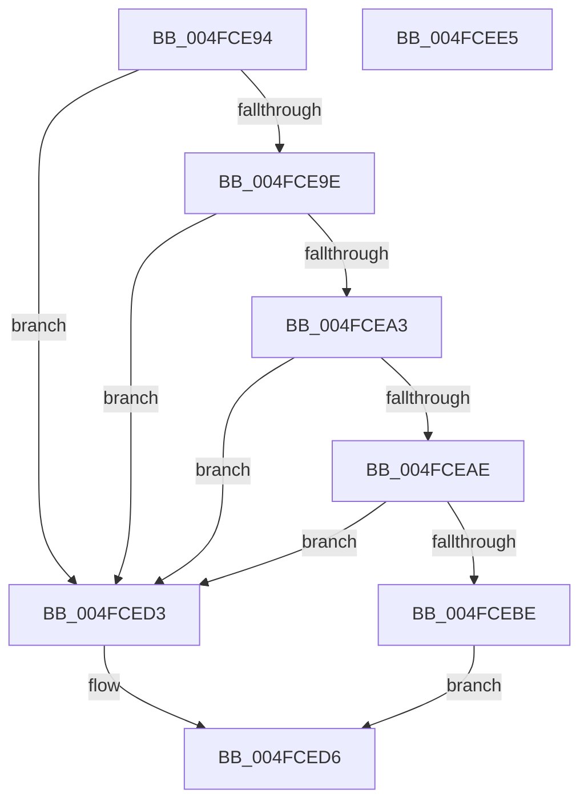

# KiSetDebuggerOwner

- RVA: `0x004FCE94`–`0x004FCEE6` (길이 `82` bytes)
- VA: `0x00000001404FCE94`
- 실행 섹션: `.text`
- PDB 이름 있음: `예`; PDB Function 태그: `아니요`
- unwind 정보 RVA: `0x000DB714`
- 디코드: `21`개 명령, `82/82` bytes 표시
- 미해석 바이트: `0` (있으면 어셈블리에 `.byte`로 보존)

> 이 문서는 커널 이미지의 기계어와 PDB 기호를 분석해 생성했습니다. 4번과 5번은 함수 원형과 자료형을 바이너리 사용 방식에서 추정한 C 해석이며 원본 소스 복구 결과는 아닙니다.

## 1. Dependencies

- 직접 호출 지점: **0**; 고유 호출 대상: **0**
- 직접 호출자로 확인된 함수: **5**
- RIP 상대 이미지 참조: **6**

### Outgoing calls
- 직접 디코드된 call 명령이 없습니다.

### Direct callers
- [KeFreezeExecution](../4D/KeFreezeExecution_function_004DFA40.md) at `0x004DFBC8`
- [KeBugCheck2](../5B/KeBugCheck2_function_005B27D0.md) at `0x005B34CF`
- [KeSwitchFrozenProcessor](../5C/KeSwitchFrozenProcessor_function_005C2F40.md) at `0x005C2F8E`
- [KiFreezeTargetExecution](../5C/KiFreezeTargetExecution_function_005C30A0.md) at `0x005C3222`
- [KiBugCheckRecoveryFreezeOtherProcessors](../5C/KiBugCheckRecoveryFreezeOtherProcessors_function_005C7120.md) at `0x005C71B3`

### Static image references
- `0x004FCE94` → RVA `0x00E66924` (`.data`; read)
- `0x004FCEA3` → RVA `0x00FC6A80` (`ALMOSTRO`; read)
- `0x004FCEC2` → RVA `0x00FC8C48` (`ALMOSTRO`; read)
- `0x004FCEC9` → RVA `0x00FC8C40` (`ALMOSTRO`; read)
- `0x004FCED6` → RVA `0x00F10DF0` (`.data`; write)
- `0x004FCEDD` → RVA `0x00F10E00` (`.data`; read/write)

## 2. Other-region calls and transfers

- 다른 실행 섹션으로 향하는 call: **0**
- 별도 외부 분기/꼬리 이동을 확인하지 못했습니다.

## 3. Assembly (complete function range)

```asm
004FCE94  8B 05 8A 9A 96 00               mov eax, dword ptr [rip + 0x969a8a]
004FCE9A  85 C0                           test eax, eax
004FCE9C  75 35                           jne 0x1404fced3
004FCE9E  48 85 C9                        test rcx, rcx
004FCEA1  74 30                           je 0x1404fced3
004FCEA3  8B 05 D7 9B AC 00               mov eax, dword ptr [rip + 0xac9bd7]
004FCEA9  83 F8 01                        cmp eax, 1
004FCEAC  74 25                           je 0x1404fced3
004FCEAE  48 B8 C6 03 00 00 80 F7 FF FF   movabs rax, 0xfffff780000003c6
004FCEB8  8A 00                           mov al, byte ptr [rax]
004FCEBA  84 C0                           test al, al
004FCEBC  75 15                           jne 0x1404fced3
004FCEBE  83 79 24 00                     cmp dword ptr [rcx + 0x24], 0
004FCEC2  48 8B 15 7F BD AC 00            mov rdx, qword ptr [rip + 0xacbd7f]
004FCEC9  48 0F 45 15 6F BD AC 00         cmovne rdx, qword ptr [rip + 0xacbd6f]
004FCED1  EB 03                           jmp 0x1404fced6
004FCED3  48 8B D1                        mov rdx, rcx
004FCED6  48 89 15 13 3F A1 00            mov qword ptr [rip + 0xa13f13], rdx
004FCEDD  48 87 0D 1C 3F A1 00            xchg qword ptr [rip + 0xa13f1c], rcx
004FCEE4  C3                              ret
004FCEE5  CC                              int3
```

## 4. C-style interpretation (structured pseudocode)

```c
__int64 __fastcall KiSetDebuggerOwner(__int64 a1)
{
    if ((unsigned int)((unsigned int)(*(unsigned int *)(v_rip + 9869962))) != 0) goto loc_004FCED3;
    if (a1 == 0) goto loc_004FCED3;
    if (((unsigned int)((unsigned int)(*(unsigned int *)(v_rip + 11312087)))) == 1) goto loc_004FCED3;
    if ((unsigned __int8)(*(unsigned __int8 *)((unsigned int)(*(unsigned int *)(v_rip + 11312087)))) != 0) goto loc_004FCED3;
    a2 = *(unsigned __int64 *)(v_rip + 11320703);
    if ((*(unsigned int *)(a1 + 36)) != 0) { a2 = *(unsigned __int64 *)(v_rip + 11320687); }
    goto loc_004FCED6;
loc_004FCED3:
loc_004FCED6:
    *(unsigned __int64 *)(v_rip + 10567443) = a1;
    return *(unsigned __int8 *)((unsigned int)(*(unsigned int *)(v_rip + 11312087)));
}
```

## 5. (Beta) C Style

```c
int64_t KiSetDebuggerOwner(int64_t Arg1)
{
    if ((uint32_t)((uint32_t)(*(uint32_t *)(v_rip + 0x969A8A))) != 0) goto loc_004FCED3;
    if (Arg1 == 0) goto loc_004FCED3;
    if (((uint32_t)((uint32_t)(*(uint32_t *)(v_rip + 0xAC9BD7)))) == 1) goto loc_004FCED3;
    if ((uint8_t)(*(uint8_t *)((uint32_t)(*(uint32_t *)(v_rip + 0xAC9BD7)))) != 0) goto loc_004FCED3;
    a2 = *(uint64_t *)(v_rip + 0xACBD7F);
    if ((*(uint32_t *)(Arg1 + 0x24)) != 0) { a2 = *(uint64_t *)(v_rip + 0xACBD6F); }
    goto loc_004FCED6;
loc_004FCED3:
loc_004FCED6:
    *(uint64_t *)(v_rip + 0xA13F13) = Arg1;
    return *(uint8_t *)((uint32_t)(*(uint32_t *)(v_rip + 0xAC9BD7)));
}
```

## 6. Execution-region graph

[열기: 2D/3D 그래프와 함수 탐색 컨트롤 패널](../../../control-panel.html?section=text&rva=0x004FCE94&view=graph)

- 2D 그래프는 위에서 아래로 흐르고, 3D 그래프는 빈 공간을 드래그해 회전합니다. Shift+드래그는 이동, 휠은 확대·축소, 함수 노드 선택은 대상 보고서 이동입니다.

### Static fallback


