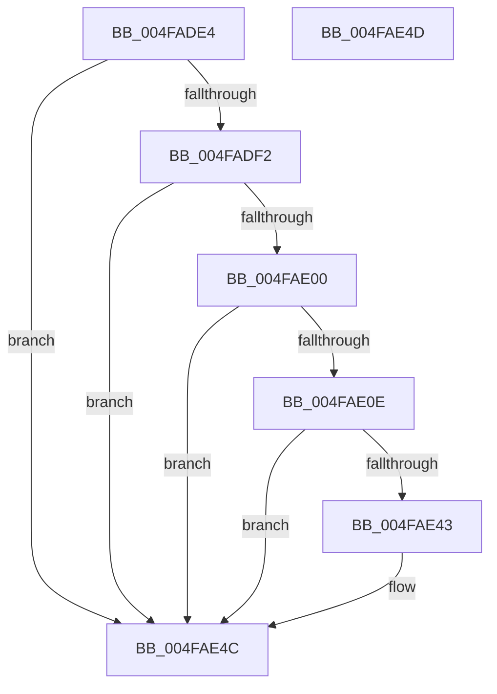

# KiSetMicrocodeUpdateOptions

- RVA: `0x004FADE4`–`0x004FAE4E` (길이 `106` bytes)
- VA: `0x00000001404FADE4`
- 실행 섹션: `.text`
- PDB 이름 있음: `예`; PDB Function 태그: `아니요`
- unwind 정보 RVA: `0x000DB714`
- 디코드: `28`개 명령, `106/106` bytes 표시
- 미해석 바이트: `0` (있으면 어셈블리에 `.byte`로 보존)

> 이 문서는 커널 이미지의 기계어와 PDB 기호를 분석해 생성했습니다. 4번과 5번은 함수 원형과 자료형을 바이너리 사용 방식에서 추정한 C 해석이며 원본 소스 복구 결과는 아닙니다.

## 1. Dependencies

- 직접 호출 지점: **0**; 고유 호출 대상: **0**
- 직접 호출자로 확인된 함수: **2**
- RIP 상대 이미지 참조: **1**

### Outgoing calls
- 직접 디코드된 call 명령이 없습니다.

### Direct callers
- [KiRestoreFeatureBits](../4D/KiRestoreFeatureBits_function_004D4D18.md) at `0x004D4DCD`
- [KiOptimizeSpecCtrlSettingsWorker](../5B/KiOptimizeSpecCtrlSettingsWorker_function_005BF5A0.md) at `0x005BFB79`

### Static image references
- `0x004FADE4` → RVA `0x00FC6B48` (`ALMOSTRO`; read)

## 2. Other-region calls and transfers

- 다른 실행 섹션으로 향하는 call: **0**
- 별도 외부 분기/꼬리 이동을 확인하지 못했습니다.

## 3. Assembly (complete function range)

```asm
004FADE4  48 8B 05 5D BD AC 00            mov rax, qword ptr [rip + 0xacbd5d]
004FADEB  48 0F BA E0 12                  bt rax, 0x12
004FADF0  73 5A                           jae 0x1404fae4c
004FADF2  48 8B 05 4F BD AC 00            mov rax, qword ptr [rip + 0xacbd4f]
004FADF9  48 0F BA E0 13                  bt rax, 0x13
004FADFE  73 4C                           jae 0x1404fae4c
004FAE00  48 8B 05 41 BD AC 00            mov rax, qword ptr [rip + 0xacbd41]
004FAE07  48 0F BA E0 14                  bt rax, 0x14
004FAE0C  72 3E                           jb 0x1404fae4c
004FAE0E  41 BA 23 01 00 00               mov r10d, 0x123
004FAE14  41 8B CA                        mov ecx, r10d
004FAE17  0F 32                           rdmsr
004FAE19  4C 8B 0D 28 BD AC 00            mov r9, qword ptr [rip + 0xacbd28]
004FAE20  48 C1 E2 20                     shl rdx, 0x20
004FAE24  48 0B C2                        or rax, rdx
004FAE27  4C 8B C0                        mov r8, rax
004FAE2A  48 8B D0                        mov rdx, rax
004FAE2D  49 83 E0 EF                     and r8, 0xffffffffffffffef
004FAE31  48 83 CA 10                     or rdx, 0x10
004FAE35  49 0F BA E1 2E                  bt r9, 0x2e
004FAE3A  49 0F 43 D0                     cmovae rdx, r8
004FAE3E  48 3B D0                        cmp rdx, rax
004FAE41  74 09                           je 0x1404fae4c
004FAE43  48 8B C2                        mov rax, rdx
004FAE46  48 C1 EA 20                     shr rdx, 0x20
004FAE4A  0F 30                           wrmsr
004FAE4C  C3                              ret
004FAE4D  CC                              int3
```

## 4. C-style interpretation (structured pseudocode)

```c
__int64 __fastcall KiSetMicrocodeUpdateOptions(__int64 a1, __int64 a2)
{
    __int64 result;

    if (condition_is_above_or_equal) goto loc_004FAE4C;
    if (condition_is_above_or_equal) goto loc_004FAE4C;
    if (condition_is_below) goto loc_004FAE4C;
    a2 = (a2) << (32);
    result = (*(unsigned __int64 *)(v_rip + 11320641)) | (a2);
    a3 = (result) & (-17);
    a2 = (result) | (16);
    if (condition_is_above_or_equal) { a2 = a3; }
    if (a2 != result) {
        result = a2;
        a2 = (a2) >> (32);
    }
    return result;
}
```

## 5. (Beta) C Style

```c
int64_t KiSetMicrocodeUpdateOptions(int64_t Arg1, int64_t Arg2)
{
    int64_t result;

    if (condition_is_above_or_equal) goto loc_004FAE4C;
    if (condition_is_above_or_equal) goto loc_004FAE4C;
    if (condition_is_below) goto loc_004FAE4C;
    Arg2 = (Arg2) << (32);
    result = (*(uint64_t *)(v_rip + 0xACBD41)) | (Arg2);
    a3 = (result) & (-17);
    Arg2 = (result) | (16);
    if (condition_is_above_or_equal) { Arg2 = a3; }
    if (Arg2 != result) {
        result = Arg2;
        Arg2 = (Arg2) >> (32);
    }
    return result;
}
```

## 6. Execution-region graph

[열기: 2D/3D 그래프와 함수 탐색 컨트롤 패널](../../../control-panel.html?section=text&rva=0x004FADE4&view=graph)

- 2D 그래프는 위에서 아래로 흐르고, 3D 그래프는 빈 공간을 드래그해 회전합니다. Shift+드래그는 이동, 휠은 확대·축소, 함수 노드 선택은 대상 보고서 이동입니다.

### Static fallback


