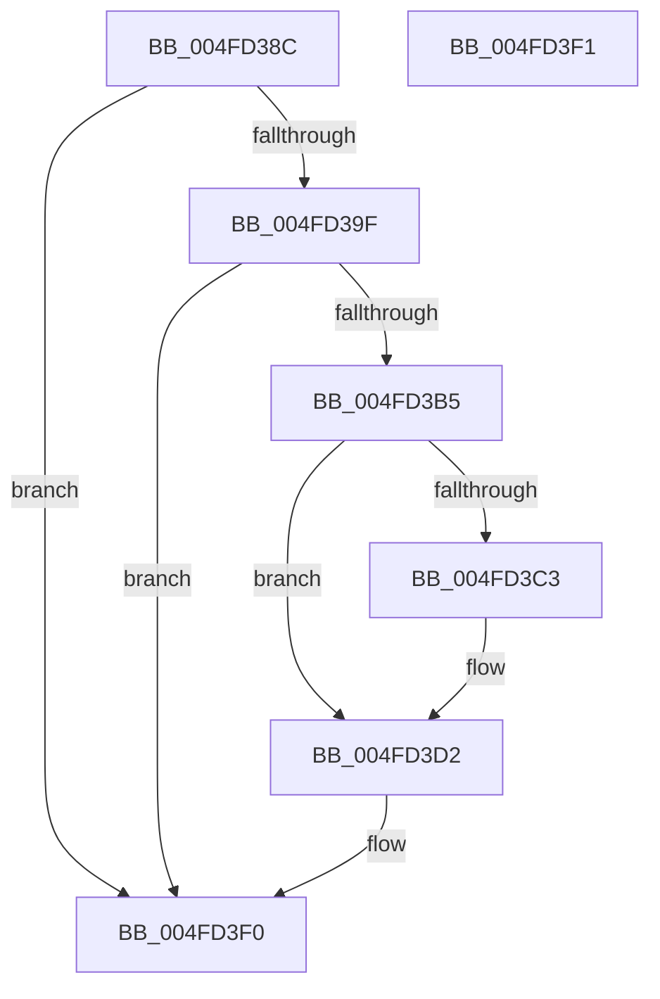

# KiSetVirtualMitigationControl

- RVA: `0x004FD38C`–`0x004FD3F2` (길이 `102` bytes)
- VA: `0x00000001404FD38C`
- 실행 섹션: `.text`
- PDB 이름 있음: `예`; PDB Function 태그: `아니요`
- unwind 정보 RVA: `0x000DB714`
- 디코드: `29`개 명령, `102/102` bytes 표시
- 미해석 바이트: `0` (있으면 어셈블리에 `.byte`로 보존)

> 이 문서는 커널 이미지의 기계어와 PDB 기호를 분석해 생성했습니다. 4번과 5번은 함수 원형과 자료형을 바이너리 사용 방식에서 추정한 C 해석이며 원본 소스 복구 결과는 아닙니다.

## 1. Dependencies

- 직접 호출 지점: **0**; 고유 호출 대상: **0**
- 직접 호출자로 확인된 함수: **2**
- RIP 상대 이미지 참조: **2**

### Outgoing calls
- 직접 디코드된 call 명령이 없습니다.

### Direct callers
- [KiRestoreFeatureBits](../4D/KiRestoreFeatureBits_function_004D4D18.md) at `0x004D4DA6`
- [KiOptimizeSpecCtrlSettingsWorker](../5B/KiOptimizeSpecCtrlSettingsWorker_function_005BF5A0.md) at `0x005BFB81`

### Static image references
- `0x004FD392` → RVA `0x00FC6B60` (`ALMOSTRO`; read)
- `0x004FD3B5` → RVA `0x00FC6B48` (`ALMOSTRO`; read)

## 2. Other-region calls and transfers

- 다른 실행 섹션으로 향하는 call: **0**
- 별도 외부 분기/꼬리 이동을 확인하지 못했습니다.

## 3. Assembly (complete function range)

```asm
004FD38C  45 33 C0                        xor r8d, r8d
004FD38F  4C 8B C9                        mov r9, rcx
004FD392  48 F7 05 C3 97 AC 00 00 00 00 20  test qword ptr [rip + 0xac97c3], 0x20000000
004FD39D  74 51                           je 0x1404fd3f0
004FD39F  B9 01 00 00 50                  mov ecx, 0x50000001
004FD3A4  0F 32                           rdmsr
004FD3A6  48 C1 E2 20                     shl rdx, 0x20
004FD3AA  48 0B C2                        or rax, rdx
004FD3AD  41 8D 50 01                     lea edx, [r8 + 1]
004FD3B1  84 C2                           test dl, al
004FD3B3  74 3B                           je 0x1404fd3f0
004FD3B5  48 8B 05 8C 97 AC 00            mov rax, qword ptr [rip + 0xac978c]
004FD3BC  48 0F BA E0 37                  bt rax, 0x37
004FD3C1  73 0F                           jae 0x1404fd3d2
004FD3C3  41 8A 81 DC 06 00 00            mov al, byte ptr [r9 + 0x6dc]
004FD3CA  24 30                           and al, 0x30
004FD3CC  3C 10                           cmp al, 0x10
004FD3CE  44 0F 44 C2                     cmove r8d, edx
004FD3D2  B9 02 00 00 50                  mov ecx, 0x50000002
004FD3D7  0F 32                           rdmsr
004FD3D9  48 C1 E2 20                     shl rdx, 0x20
004FD3DD  48 0B C2                        or rax, rdx
004FD3E0  48 83 E0 FE                     and rax, 0xfffffffffffffffe
004FD3E4  49 0B C0                        or rax, r8
004FD3E7  48 8B D0                        mov rdx, rax
004FD3EA  48 C1 EA 20                     shr rdx, 0x20
004FD3EE  0F 30                           wrmsr
004FD3F0  C3                              ret
004FD3F1  CC                              int3
```

## 4. C-style interpretation (structured pseudocode)

```c
__int64 __fastcall KiSetVirtualMitigationControl(__int64 a1, __int64 a2, int a3)
{
    __int64 result;

    a3 = 0;
    if (((*(unsigned __int64 *)(v_rip + 11311043)) & (0x20000000ULL)) == 0) goto loc_004FD3F0;
    a2 = (a2) << (32);
    result = (result) | (a2);
    if ((((unsigned __int8)(a3 + 1)) & ((unsigned __int8)(result))) == 0) goto loc_004FD3F0;
    result = *(unsigned __int64 *)(v_rip + 11310988);
    if (!(condition_is_above_or_equal)) {
        result = *(unsigned __int8 *)(a1 + 1756);
        result = (unsigned __int8)((result) & (48));
        if (((unsigned __int8)(result)) == 16) { a3 = (unsigned int)(a3 + 1); }
    }
    a2 = (a3 + 1) << (32);
    result = (result) | (a2);
    result = (result) & (-2);
    result = (result) | (a3);
    a2 = (result) >> (32);
loc_004FD3F0:
    return result;
}
```

## 5. (Beta) C Style

```c
int64_t KiSetVirtualMitigationControl(void *Arg1, int64_t Arg2, int32_t Arg3)
{
    uint8_t *arg1 = (uint8_t *)Arg1;

    int64_t result;

    Arg3 = 0;
    if (((*(uint64_t *)(v_rip + 0xAC97C3)) & (0x20000000ULL)) == 0) goto loc_004FD3F0;
    Arg2 = (Arg2) << (32);
    result = (result) | (Arg2);
    if ((((uint8_t)(Arg3 + 1)) & ((uint8_t)(result))) == 0) goto loc_004FD3F0;
    result = *(uint64_t *)(v_rip + 0xAC978C);
    if (!(condition_is_above_or_equal)) {
        result = *(uint8_t *)(arg1 + 0x6DC);
        result = (uint8_t)((result) & (48));
        if (((uint8_t)(result)) == 16) { Arg3 = (uint32_t)(Arg3 + 1); }
    }
    Arg2 = (Arg3 + 1) << (32);
    result = (result) | (Arg2);
    result = (result) & (-2);
    result = (result) | (Arg3);
    Arg2 = (result) >> (32);
loc_004FD3F0:
    return result;
}
```

### 관측된 메모리 오프셋

구조체 형식이 확인되지 않은 접근은 인자 기준의 오프셋으로만 기록했습니다.

| 기준 인자 | 오프셋 표현 | 폭 (bit) | 접근 |
|---|---:|---:|---|
| `Arg1` | `+ 0x6DC` | `8` | `R` |

## 6. Execution-region graph

[열기: 2D/3D 그래프와 함수 탐색 컨트롤 패널](../../../control-panel.html?section=text&rva=0x004FD38C&view=graph)

- 2D 그래프는 위에서 아래로 흐르고, 3D 그래프는 빈 공간을 드래그해 회전합니다. Shift+드래그는 이동, 휠은 확대·축소, 함수 노드 선택은 대상 보고서 이동입니다.

### Static fallback


