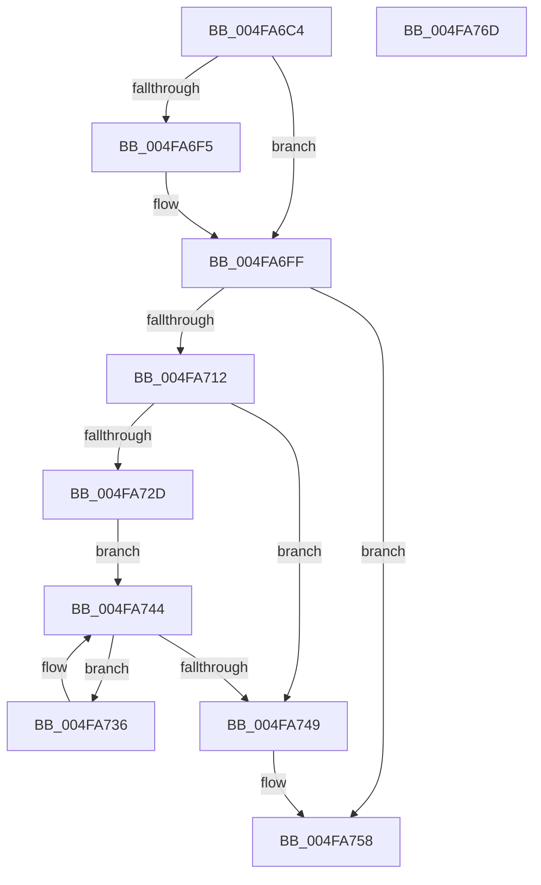

# KiSrcuProcessorInitialize

- RVA: `0x004FA6C4`–`0x004FA76E` (길이 `170` bytes)
- VA: `0x00000001404FA6C4`
- 실행 섹션: `.text`
- PDB 이름 있음: `예`; PDB Function 태그: `아니요`
- unwind 정보 RVA: `0x0005C954`
- 디코드: `44`개 명령, `170/170` bytes 표시
- 미해석 바이트: `0` (있으면 어셈블리에 `.byte`로 보존)

> 이 문서는 커널 이미지의 기계어와 PDB 기호를 분석해 생성했습니다. 4번과 5번은 함수 원형과 자료형을 바이너리 사용 방식에서 추정한 C 해석이며 원본 소스 복구 결과는 아닙니다.

## 1. Dependencies

- 직접 호출 지점: **6**; 고유 호출 대상: **4**
- 직접 호출자로 확인된 함수: **2**
- RIP 상대 이미지 참조: **4**

### Outgoing calls
- `0x004FA6E4` → [KeAcquireSpinLockRaiseToDpc](../20/KeAcquireSpinLockRaiseToDpc_function_00208470.md) (function, `0x00208470`)
- `0x004FA6FA` → [KiSrcuProcessorAddToTopologyTree](../5C/KiSrcuProcessorAddToTopologyTree_function_005C2A7C.md) (function, `0x005C2A7C`)
- `0x004FA709` → [KeReleaseSpinLock](../39/KeReleaseSpinLock_function_00392BA0.md) (function, `0x00392BA0`)
- `0x004FA719` → [KeAcquireSpinLockRaiseToDpc](../20/KeAcquireSpinLockRaiseToDpc_function_00208470.md) (function, `0x00208470`)
- `0x004FA73C` → [KiSrcuNotifyGracePeriodStartedOnCpu](../5C/KiSrcuNotifyGracePeriodStartedOnCpu_function_005C2788.md) (function, `0x005C2788`)
- `0x004FA753` → [KeReleaseSpinLock](../39/KeReleaseSpinLock_function_00392BA0.md) (function, `0x00392BA0`)

### Direct callers
- [KiRcuProcessorInitialize](../4D/KiRcuProcessorInitialize_function_004DF7E8.md) at `0x004DF90D`
- [KiRcuSystemInitialize](../../init/C7/KiRcuSystemInitialize_function_00C733A8.md) at `0x00C73566`

### Static image references
- `0x004FA6DD` → RVA `0x00F10E38` (`.data`; read)
- `0x004FA6E9` → RVA `0x00F10E40` (`.data`; read)
- `0x004FA712` → RVA `0x00F10E30` (`.data`; read)
- `0x004FA71E` → RVA `0x00F10E20` (`.data`; read)

## 2. Other-region calls and transfers

- 다른 실행 섹션으로 향하는 call: **0**
- 별도 외부 분기/꼬리 이동을 확인하지 못했습니다.

## 3. Assembly (complete function range)

```asm
004FA6C4  48 89 5C 24 08                  mov qword ptr [rsp + 8], rbx
004FA6C9  48 89 6C 24 10                  mov qword ptr [rsp + 0x10], rbp
004FA6CE  48 89 74 24 18                  mov qword ptr [rsp + 0x18], rsi
004FA6D3  57                              push rdi
004FA6D4  48 83 EC 20                     sub rsp, 0x20
004FA6D8  48 8B F1                        mov rsi, rcx
004FA6DB  8B DA                           mov ebx, edx
004FA6DD  48 8D 0D 54 67 A1 00            lea rcx, [rip + 0xa16754]
004FA6E4  E8 87 DD D0 FF                  call 0x140208470
004FA6E9  80 3D 50 67 A1 00 00            cmp byte ptr [rip + 0xa16750], 0
004FA6F0  44 8A C0                        mov r8b, al
004FA6F3  74 0A                           je 0x1404fa6ff
004FA6F5  8B D3                           mov edx, ebx
004FA6F7  48 8B CE                        mov rcx, rsi
004FA6FA  E8 7D 83 0C 00                  call 0x1405c2a7c
004FA6FF  41 8A D0                        mov dl, r8b
004FA702  48 8D 0D 2F 67 A1 00            lea rcx, [rip + 0xa1672f]
004FA709  E8 92 84 E9 FF                  call 0x140392ba0
004FA70E  85 DB                           test ebx, ebx
004FA710  74 46                           je 0x1404fa758
004FA712  48 8D 0D 17 67 A1 00            lea rcx, [rip + 0xa16717]
004FA719  E8 52 DD D0 FF                  call 0x140208470
004FA71E  48 8B 1D FB 66 A1 00            mov rbx, qword ptr [rip + 0xa166fb]
004FA725  40 8A F8                        mov dil, al
004FA728  48 85 DB                        test rbx, rbx
004FA72B  74 1C                           je 0x1404fa749
004FA72D  48 8D 2D EC 66 A1 00            lea rbp, [rip + 0xa166ec]
004FA734  EB 0E                           jmp 0x1404fa744
004FA736  48 8B D6                        mov rdx, rsi
004FA739  48 8B CB                        mov rcx, rbx
004FA73C  E8 47 80 0C 00                  call 0x1405c2788
004FA741  48 8B 1B                        mov rbx, qword ptr [rbx]
004FA744  48 3B DD                        cmp rbx, rbp
004FA747  75 ED                           jne 0x1404fa736
004FA749  40 8A D7                        mov dl, dil
004FA74C  48 8D 0D DD 66 A1 00            lea rcx, [rip + 0xa166dd]
004FA753  E8 48 84 E9 FF                  call 0x140392ba0
004FA758  48 8B 5C 24 30                  mov rbx, qword ptr [rsp + 0x30]
004FA75D  48 8B 6C 24 38                  mov rbp, qword ptr [rsp + 0x38]
004FA762  48 8B 74 24 40                  mov rsi, qword ptr [rsp + 0x40]
004FA767  48 83 C4 20                     add rsp, 0x20
004FA76B  5F                              pop rdi
004FA76C  C3                              ret
004FA76D  CC                              int3
```

## 4. C-style interpretation (structured pseudocode)

```c
__int64 __fastcall KiSrcuProcessorInitialize(__int64 a1, int a2)
{
    __int64 result;
    __int64 v_rsp;
    unsigned __int64 v_stack_p10;
    unsigned __int64 v_stack_p18;
    unsigned __int64 v_stack_p8;

    v_stack_p8 = v_rbx;
    v_stack_p10 = v_rbp;
    v_stack_p18 = v_rsi;
    v_rsp = (v_rsp) - (32);
    result = KeAcquireSpinLockRaiseToDpc(v_rip + 10577748, a2, a3, a4);
    if ((*(unsigned __int8 *)(v_rip + 10577744)) != 0) {
        a2 = (unsigned int)((unsigned int)(a2));
        a1 = a1;
        result = KiSrcuProcessorAddToTopologyTree(a1, a2, (unsigned __int8)(result), a4);
    }
    result = KeReleaseSpinLock(v_rip + 10577711, (unsigned __int8)((unsigned __int8)(result)), (unsigned __int8)(result), a4);
    if ((unsigned int)((unsigned int)(a2)) == 0) goto loc_004FA758;
    result = KeAcquireSpinLockRaiseToDpc(v_rip + 10577687, (unsigned __int8)((unsigned __int8)(result)), (unsigned __int8)(result), a4);
    if (*(unsigned __int64 *)(v_rip + 10577659) == 0) goto loc_004FA749;
    goto loc_004FA744;
loc_004FA736:
    result = KiSrcuNotifyGracePeriodStartedOnCpu(*(unsigned __int64 *)(v_rip + 10577659), a1, (unsigned __int8)(result), a4);
loc_004FA744:
    if ((*(unsigned __int64 *)(*(unsigned __int64 *)(v_rip + 10577659))) != (v_rip + 10577644)) goto loc_004FA736;
loc_004FA749:
    result = KeReleaseSpinLock(v_rip + 10577629, (unsigned __int8)((unsigned __int8)(result)), (unsigned __int8)(result), a4);
loc_004FA758:
    v_rsp = (v_rsp) + (32);
    return result;
}
```

## 5. (Beta) C Style

```c
int64_t KiSrcuProcessorInitialize(int64_t Arg1, int32_t Arg2)
{
    int64_t result;
    int64_t local_rsp;
    uint64_t v_stack_p10;
    uint64_t v_stack_p18;
    uint64_t v_stack_p8;

    v_stack_p8 = local_rbx;
    v_stack_p10 = local_rbp;
    v_stack_p18 = local_rsi;
    local_rsp = (local_rsp) - (32);
    result = KeAcquireSpinLockRaiseToDpc(v_rip + 10577748, Arg2, a3, a4);
    if ((*(uint8_t *)(v_rip + 0xA16750)) != 0) {
        Arg2 = (uint32_t)((uint32_t)(Arg2));
        Arg1 = Arg1;
        result = KiSrcuProcessorAddToTopologyTree(Arg1, Arg2, (uint8_t)(result), a4);
    }
    result = KeReleaseSpinLock(v_rip + 10577711, (uint8_t)((uint8_t)(result)), (uint8_t)(result), a4);
    if ((uint32_t)((uint32_t)(Arg2)) == 0) goto loc_004FA758;
    result = KeAcquireSpinLockRaiseToDpc(v_rip + 10577687, (uint8_t)((uint8_t)(result)), (uint8_t)(result), a4);
    if (*(uint64_t *)(v_rip + 0xA166FB) == 0) goto loc_004FA749;
    goto loc_004FA744;
loc_004FA736:
    result = KiSrcuNotifyGracePeriodStartedOnCpu(*(uint64_t *)(v_rip + 0xA166FB), Arg1, (uint8_t)(result), a4);
loc_004FA744:
    if ((*(uint64_t *)(*(uint64_t *)(v_rip + 0xA166FB))) != (v_rip + 10577644)) goto loc_004FA736;
loc_004FA749:
    result = KeReleaseSpinLock(v_rip + 10577629, (uint8_t)((uint8_t)(result)), (uint8_t)(result), a4);
loc_004FA758:
    local_rsp = (local_rsp) + (32);
    return result;
}
```

## 6. Execution-region graph

[열기: 2D/3D 그래프와 함수 탐색 컨트롤 패널](../../../control-panel.html?section=text&rva=0x004FA6C4&view=graph)

- 2D 그래프는 위에서 아래로 흐르고, 3D 그래프는 빈 공간을 드래그해 회전합니다. Shift+드래그는 이동, 휠은 확대·축소, 함수 노드 선택은 대상 보고서 이동입니다.

### Static fallback


