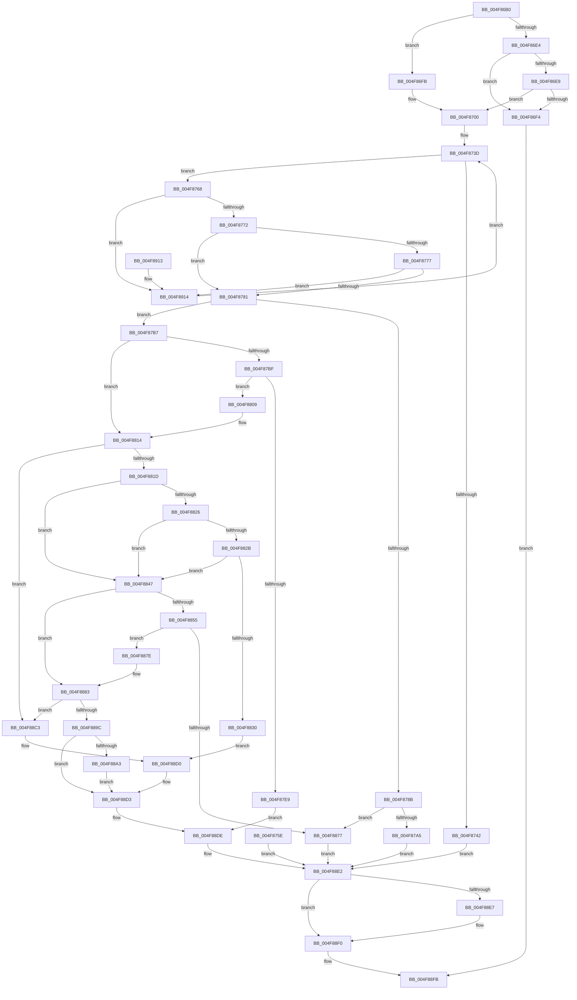

# KiTpHandleTrap

- RVA: `0x004F86B0`–`0x004F891C` (길이 `620` bytes)
- VA: `0x00000001404F86B0`
- 실행 섹션: `.text`
- PDB 이름 있음: `예`; PDB Function 태그: `아니요`
- unwind 정보 RVA: `0x000BF790`
- 디코드: `171`개 명령, `620/620` bytes 표시
- 미해석 바이트: `0` (있으면 어셈블리에 `.byte`로 보존)

> 이 문서는 커널 이미지의 기계어와 PDB 기호를 분석해 생성했습니다. 4번과 5번은 함수 원형과 자료형을 바이너리 사용 방식에서 추정한 C 해석이며 원본 소스 복구 결과는 아닙니다.

## 1. Dependencies

- 직접 호출 지점: **8**; 고유 호출 대상: **3**
- 직접 호출자로 확인된 함수: **1**
- RIP 상대 이미지 참조: **5**

### Outgoing calls
- `0x004F8798` → [KiTpCompletion](../../tracesup/BC/KiTpCompletion_function_00BC7010.md) (function, `0x00BC7010`)
- `0x004F87AD` → [KiTpWriteBreakpoint](../5C/KiTpWriteBreakpoint_function_005CAB18.md) (function, `0x005CAB18`)
- `0x004F87F9` → [KiTpCompletion](../../tracesup/BC/KiTpCompletion_function_00BC7010.md) (function, `0x00BC7010`)
- `0x004F883D` → [KiTpCompletion](../../tracesup/BC/KiTpCompletion_function_00BC7010.md) (function, `0x00BC7010`)
- `0x004F886E` → [guard_dispatch_icall](../6B/guard_dispatch_icall_function_006BAAD0.md) (function, `0x006BAAD0`)
- `0x004F8890` → [KiTpCompletion](../../tracesup/BC/KiTpCompletion_function_00BC7010.md) (function, `0x00BC7010`)
- `0x004F88BC` → [guard_dispatch_icall](../6B/guard_dispatch_icall_function_006BAAD0.md) (function, `0x006BAAD0`)
- `0x004F88CB` → [KiTpWriteBreakpoint](../5C/KiTpWriteBreakpoint_function_005CAB18.md) (function, `0x005CAB18`)

### Direct callers
- [KiDispatchException](../3D/KiDispatchException_function_003D7650.md) at `0x003D7D85`

### Static image references
- `0x004F86D5` → RVA `0x00FC6C10` (`ALMOSTRO`; read)
- `0x004F871E` → RVA `0x00F10784` (`.data`; read/write)
- `0x004F8732` → RVA `0x00F107A0` (`.data`; read)
- `0x004F8781` → RVA `0x00FC6D00` (`ALMOSTRO`; read)
- `0x004F884A` → RVA `0x00FC7400` (`ALMOSTRO`; read)

## 2. Other-region calls and transfers

- 다른 실행 섹션으로 향하는 call: **4**
  - `0x004F8798` → [KiTpCompletion](../../tracesup/BC/KiTpCompletion_function_00BC7010.md) (`.text` → `TRACESUP`)
  - `0x004F87F9` → [KiTpCompletion](../../tracesup/BC/KiTpCompletion_function_00BC7010.md) (`.text` → `TRACESUP`)
  - `0x004F883D` → [KiTpCompletion](../../tracesup/BC/KiTpCompletion_function_00BC7010.md) (`.text` → `TRACESUP`)
  - `0x004F8890` → [KiTpCompletion](../../tracesup/BC/KiTpCompletion_function_00BC7010.md) (`.text` → `TRACESUP`)
- 별도 외부 분기/꼬리 이동을 확인하지 못했습니다.

## 3. Assembly (complete function range)

```asm
004F86B0  48 89 5C 24 10                  mov qword ptr [rsp + 0x10], rbx
004F86B5  48 89 74 24 18                  mov qword ptr [rsp + 0x18], rsi
004F86BA  48 89 4C 24 08                  mov qword ptr [rsp + 8], rcx
004F86BF  57                              push rdi
004F86C0  41 54                           push r12
004F86C2  41 55                           push r13
004F86C4  41 56                           push r14
004F86C6  41 57                           push r15
004F86C8  48 83 EC 30                     sub rsp, 0x30
004F86CC  45 8A F8                        mov r15b, r8b
004F86CF  4C 8B EA                        mov r13, rdx
004F86D2  4C 8B D9                        mov r11, rcx
004F86D5  44 8B 15 34 E5 AC 00            mov r10d, dword ptr [rip + 0xace534]
004F86DC  33 DB                           xor ebx, ebx
004F86DE  41 F6 C2 02                     test r10b, 2
004F86E2  75 17                           jne 0x1404f86fb
004F86E4  45 84 C0                        test r8b, r8b
004F86E7  74 0B                           je 0x1404f86f4
004F86E9  8D 73 01                        lea esi, [rbx + 1]
004F86EC  44 23 D6                        and r10d, esi
004F86EF  45 84 D2                        test r10b, r10b
004F86F2  75 0C                           jne 0x1404f8700
004F86F4  32 C0                           xor al, al
004F86F6  E9 00 02 00 00                  jmp 0x1404f88fb
004F86FB  BE 01 00 00 00                  mov esi, 1
004F8700  88 5C 24 20                     mov byte ptr [rsp + 0x20], bl
004F8704  4C 8B F3                        mov r14, rbx
004F8707  48 8B 92 F8 00 00 00            mov rdx, qword ptr [rdx + 0xf8]
004F870E  65 48 8B 04 25 88 01 00 00      mov rax, qword ptr gs:[0x188]
004F8717  4C 8B 80 20 02 00 00            mov r8, qword ptr [rax + 0x220]
004F871E  F0 01 35 5F 80 A1 00            lock add dword ptr [rip + 0xa1805f], esi
004F8725  48 8B CA                        mov rcx, rdx
004F8728  48 C1 E9 04                     shr rcx, 4
004F872C  81 E1 FF 3F 00 00               and ecx, 0x3fff
004F8732  48 8B 05 67 80 A1 00            mov rax, qword ptr [rip + 0xa18067]
004F8739  48 8B 3C C8                     mov rdi, qword ptr [rax + rcx*8]
004F873D  48 85 FF                        test rdi, rdi
004F8740  75 26                           jne 0x1404f8768
004F8742  B8 CC 00 00 00                  mov eax, 0xcc
004F8747  89 44 24 24                     mov dword ptr [rsp + 0x24], eax
004F874B  38 02                           cmp byte ptr [rdx], al
004F874D  0F B6 44 24 20                  movzx eax, byte ptr [rsp + 0x20]
004F8752  0F 45 C6                        cmovne eax, esi
004F8755  88 44 24 20                     mov byte ptr [rsp + 0x20], al
004F8759  E9 84 01 00 00                  jmp 0x1404f88e2
004F875E  33 DB                           xor ebx, ebx
004F8760  44 8B F3                        mov r14d, ebx
004F8763  E9 7A 01 00 00                  jmp 0x1404f88e2
004F8768  48 3B 57 08                     cmp rdx, qword ptr [rdi + 8]
004F876C  0F 85 A2 01 00 00               jne 0x1404f8914
004F8772  38 5F 32                        cmp byte ptr [rdi + 0x32], bl
004F8775  74 0A                           je 0x1404f8781
004F8777  4C 3B 47 10                     cmp r8, qword ptr [rdi + 0x10]
004F877B  0F 85 93 01 00 00               jne 0x1404f8914
004F8781  8B 05 79 E5 AC 00               mov eax, dword ptr [rip + 0xace579]
004F8787  A8 04                           test al, 4
004F8789  74 2C                           je 0x1404f87b7
004F878B  48 8D 4F 34                     lea rcx, [rdi + 0x34]
004F878F  45 8A CF                        mov r9b, r15b
004F8792  4D 8B C5                        mov r8, r13
004F8795  49 8B D3                        mov rdx, r11
004F8798  E8 73 E8 6C 00                  call 0x140bc7010
004F879D  85 C0                           test eax, eax
004F879F  0F 89 D2 00 00 00               jns 0x1404f8877
004F87A5  45 33 C0                        xor r8d, r8d
004F87A8  33 D2                           xor edx, edx
004F87AA  48 8B CF                        mov rcx, rdi
004F87AD  E8 66 23 0D 00                  call 0x1405cab18
004F87B2  E9 2B 01 00 00                  jmp 0x1404f88e2
004F87B7  44 0F 20 C0                     mov rax, cr8
004F87BB  3C 02                           cmp al, 2
004F87BD  72 55                           jb 0x1404f8814
004F87BF  65 4C 8B 34 25 20 00 00 00      mov r14, qword ptr gs:[0x20]
004F87C8  41 8B 96 EC 00 00 00            mov edx, dword ptr [r14 + 0xec]
004F87CF  8B C2                           mov eax, edx
004F87D1  C1 E8 0A                        shr eax, 0xa
004F87D4  40 22 C6                        and al, sil
004F87D7  0F B6 C8                        movzx ecx, al
004F87DA  66 41 39 9E A6 83 00 00         cmp word ptr [r14 + 0x83a6], bx
004F87E2  0F 45 CE                        cmovne ecx, esi
004F87E5  84 C9                           test cl, cl
004F87E7  74 20                           je 0x1404f8809
004F87E9  4C 8B F3                        mov r14, rbx
004F87EC  48 8D 4F 34                     lea rcx, [rdi + 0x34]
004F87F0  45 8A CF                        mov r9b, r15b
004F87F3  4D 8B C5                        mov r8, r13
004F87F6  49 8B D3                        mov rdx, r11
004F87F9  E8 12 E8 6C 00                  call 0x140bc7010
004F87FE  C1 E8 1F                        shr eax, 0x1f
004F8801  40 32 C6                        xor al, sil
004F8804  E9 D5 00 00 00                  jmp 0x1404f88de
004F8809  0F BA EA 0A                     bts edx, 0xa
004F880D  41 89 96 EC 00 00 00            mov dword ptr [r14 + 0xec], edx
004F8814  45 84 C9                        test r9b, r9b
004F8817  0F 84 A6 00 00 00               je 0x1404f88c3
004F881D  48 8B 47 10                     mov rax, qword ptr [rdi + 0x10]
004F8821  48 85 C0                        test rax, rax
004F8824  74 21                           je 0x1404f8847
004F8826  38 5F 32                        cmp byte ptr [rdi + 0x32], bl
004F8829  75 1C                           jne 0x1404f8847
004F882B  49 3B C0                        cmp rax, r8
004F882E  74 17                           je 0x1404f8847
004F8830  48 8D 4F 34                     lea rcx, [rdi + 0x34]
004F8834  45 8A CF                        mov r9b, r15b
004F8837  4D 8B C5                        mov r8, r13
004F883A  49 8B D3                        mov rdx, r11
004F883D  E8 CE E7 6C 00                  call 0x140bc7010
004F8842  E9 89 00 00 00                  jmp 0x1404f88d0
004F8847  8A 47 18                        mov al, byte ptr [rdi + 0x18]
004F884A  4C 8D 25 AF EB AC 00            lea r12, [rip + 0xacebaf]
004F8851  84 C0                           test al, al
004F8853  74 2E                           je 0x1404f8883
004F8855  B8 20 00 00 00                  mov eax, 0x20
004F885A  8D 48 10                        lea ecx, [rax + 0x10]
004F885D  38 5F 32                        cmp byte ptr [rdi + 0x32], bl
004F8860  0F 45 C1                        cmovne eax, ecx
004F8863  4A 8B 04 20                     mov rax, qword ptr [rax + r12]
004F8867  48 8B 57 20                     mov rdx, qword ptr [rdi + 0x20]
004F886B  49 8B CD                        mov rcx, r13
004F886E  E8 5D 22 1C 00                  call 0x1406baad0
004F8873  84 C0                           test al, al
004F8875  74 07                           je 0x1404f887e
004F8877  40 88 74 24 20                  mov byte ptr [rsp + 0x20], sil
004F887C  EB 64                           jmp 0x1404f88e2
004F887E  4C 8B 5C 24 60                  mov r11, qword ptr [rsp + 0x60]
004F8883  48 8D 4F 34                     lea rcx, [rdi + 0x34]
004F8887  45 8A CF                        mov r9b, r15b
004F888A  4D 8B C5                        mov r8, r13
004F888D  49 8B D3                        mov rdx, r11
004F8890  E8 7B E7 6C 00                  call 0x140bc7010
004F8895  44 8B F8                        mov r15d, eax
004F8898  85 C0                           test eax, eax
004F889A  78 27                           js 0x1404f88c3
004F889C  8A 47 19                        mov al, byte ptr [rdi + 0x19]
004F889F  84 C0                           test al, al
004F88A1  74 30                           je 0x1404f88d3
004F88A3  B8 28 00 00 00                  mov eax, 0x28
004F88A8  8D 48 10                        lea ecx, [rax + 0x10]
004F88AB  38 5F 32                        cmp byte ptr [rdi + 0x32], bl
004F88AE  0F 45 C1                        cmovne eax, ecx
004F88B1  4A 8B 04 20                     mov rax, qword ptr [rax + r12]
004F88B5  48 8B 57 28                     mov rdx, qword ptr [rdi + 0x28]
004F88B9  49 8B CD                        mov rcx, r13
004F88BC  E8 0F 22 1C 00                  call 0x1406baad0
004F88C1  EB 10                           jmp 0x1404f88d3
004F88C3  45 33 C0                        xor r8d, r8d
004F88C6  33 D2                           xor edx, edx
004F88C8  48 8B CF                        mov rcx, rdi
004F88CB  E8 48 22 0D 00                  call 0x1405cab18
004F88D0  44 8B F8                        mov r15d, eax
004F88D3  0F B6 44 24 20                  movzx eax, byte ptr [rsp + 0x20]
004F88D8  45 85 FF                        test r15d, r15d
004F88DB  0F 49 C6                        cmovns eax, esi
004F88DE  88 44 24 20                     mov byte ptr [rsp + 0x20], al
004F88E2  4D 85 F6                        test r14, r14
004F88E5  74 09                           je 0x1404f88f0
004F88E7  41 0F BA B6 EC 00 00 00 0A      btr dword ptr [r14 + 0xec], 0xa
004F88F0  F0 FF 0D 8D 7E A1 00            lock dec dword ptr [rip + 0xa17e8d]
004F88F7  8A 44 24 20                     mov al, byte ptr [rsp + 0x20]
004F88FB  48 8B 5C 24 68                  mov rbx, qword ptr [rsp + 0x68]
004F8900  48 8B 74 24 70                  mov rsi, qword ptr [rsp + 0x70]
004F8905  48 83 C4 30                     add rsp, 0x30
004F8909  41 5F                           pop r15
004F890B  41 5E                           pop r14
004F890D  41 5D                           pop r13
004F890F  41 5C                           pop r12
004F8911  5F                              pop rdi
004F8912  C3                              ret
004F8913  CC                              int3
004F8914  48 8B 3F                        mov rdi, qword ptr [rdi]
004F8917  E9 21 FE FF FF                  jmp 0x1404f873d
```

## 4. C-style interpretation (structured pseudocode)

```c
__int64 __fastcall KiTpHandleTrap(__int64 a1, __int64 a2, unsigned __int8 a3)
{
    __int64 result;
    __int64 v_r10;
    __int64 v_rbx;
    __int64 v_rsp;
    unsigned int v_stack_m34;
    unsigned __int8 v_stack_m38;
    unsigned __int64 v_stack_p10;
    unsigned __int64 v_stack_p18;
    unsigned __int64 v_stack_p8;

    v_stack_p10 = v_rbx;
    v_stack_p18 = v_rsi;
    v_stack_p8 = a1;
    v_rsp = (v_rsp) - (48);
    v_rbx = 0;
    if ((((unsigned __int8)((unsigned int)(*(unsigned int *)(v_rip + 11330868)))) & (2)) != 0) goto loc_004F86FB;
    if (a3 == 0) goto loc_004F86F4;
    v_r10 = (unsigned int)(((unsigned int)(*(unsigned int *)(v_rip + 11330868))) & ((unsigned int)(v_rbx + 1)));
    if ((unsigned __int8)(v_r10) != 0) goto loc_004F8700;
loc_004F86F4:
    result = 0;
    goto loc_004F88FB;
loc_004F86FB:
loc_004F8700:
    v_stack_m38 = 0;
    a1 = (*(unsigned __int64 *)(a2 + 248)) >> (4);
    a1 = (unsigned int)((a1) & (0x3FFFULL));
loc_004F873D:
    if (*(unsigned __int64 *)(*(unsigned __int64 *)(v_rip + 10584167) + a1 * 8) != 0) goto loc_004F8768;
    v_stack_m34 = 204;
    result = v_stack_m38;
    if ((*(unsigned __int8 *)(*(unsigned __int64 *)(a2 + 248))) != 204) { result = 1; }
    v_stack_m38 = (unsigned __int8)(result);
    goto loc_004F88E2;
loc_004F8768:
    if ((*(unsigned __int64 *)(a2 + 248)) != (*(unsigned __int64 *)(*(unsigned __int64 *)(*(unsigned __int64 *)(v_rip + 10584167) + a1 * 8) + 8))) goto loc_004F8914;
    if ((*(unsigned __int8 *)(*(unsigned __int64 *)(*(unsigned __int64 *)(v_rip + 10584167) + a1 * 8) + 50)) == 0) goto loc_004F8781;
    if ((*(unsigned __int64 *)(*(unsigned __int64 *)(gs_base + (0 + 392)) + 544)) != (*(unsigned __int64 *)(*(unsigned __int64 *)(*(unsigned __int64 *)(v_rip + 10584167) + a1 * 8) + 16))) goto loc_004F8914;
loc_004F8781:
    if ((((unsigned __int8)((unsigned int)(*(unsigned int *)(v_rip + 11330937)))) & (4)) == 0) goto loc_004F87B7;
    result = KiTpCompletion(*(unsigned __int64 *)(*(unsigned __int64 *)(v_rip + 10584167) + a1 * 8) + 52, a1, a2, a3);
    if (!sign_flag) goto loc_004F8877;
    a3 = 0;
    a2 = 0;
    result = KiTpWriteBreakpoint(*(unsigned __int64 *)(*(unsigned __int64 *)(v_rip + 10584167) + a1 * 8), a2, a3, a3);
    goto loc_004F88E2;
loc_004F87B7:
    if (((unsigned __int8)(v_cr8)) < 2) goto loc_004F8814;
    result = (unsigned int)(((unsigned int)((unsigned int)((unsigned int)(*(unsigned int *)(*(unsigned __int64 *)(gs_base + (0 + 32)) + 236))))) >> (10));
    result = (unsigned __int8)((result) & (1));
    a1 = (unsigned __int8)(result);
    if ((*(unsigned __int16 *)(*(unsigned __int64 *)(gs_base + (0 + 32)) + 33702)) != 0) { a1 = 1; }
    if ((unsigned __int8)(a1) == 0) goto loc_004F8809;
    result = KiTpCompletion(*(unsigned __int64 *)(*(unsigned __int64 *)(v_rip + 10584167) + a1 * 8) + 52, a1, 0, 0);
    result = (unsigned int)((result) >> (31));
    result = (unsigned __int8)((result) ^ (1));
    goto loc_004F88DE;
loc_004F8809:
    *(unsigned int *)(0 + 236) = (unsigned int)(a1);
loc_004F8814:
    if (0 == 0) goto loc_004F88C3;
    if (*(unsigned __int64 *)(*(unsigned __int64 *)(*(unsigned __int64 *)(v_rip + 10584167) + a1 * 8) + 16) == 0) goto loc_004F8847;
    if ((*(unsigned __int8 *)(*(unsigned __int64 *)(*(unsigned __int64 *)(v_rip + 10584167) + a1 * 8) + 50)) != 0) goto loc_004F8847;
    if ((*(unsigned __int64 *)(*(unsigned __int64 *)(*(unsigned __int64 *)(v_rip + 10584167) + a1 * 8) + 16)) == 0) goto loc_004F8847;
    result = KiTpCompletion(*(unsigned __int64 *)(*(unsigned __int64 *)(v_rip + 10584167) + a1 * 8) + 52, a1, 0, 0);
    goto loc_004F88D0;
loc_004F8847:
    if ((unsigned __int8)(*(unsigned __int8 *)(*(unsigned __int64 *)(*(unsigned __int64 *)(v_rip + 10584167) + a1 * 8) + 24)) == 0) goto loc_004F8883;
    result = 32;
    if ((*(unsigned __int8 *)(*(unsigned __int64 *)(*(unsigned __int64 *)(v_rip + 10584167) + a1 * 8) + 50)) != 0) { result = (unsigned int)(32 + 16); }
    result = guard_dispatch_icall(0, *(unsigned __int64 *)(*(unsigned __int64 *)(*(unsigned __int64 *)(v_rip + 10584167) + a1 * 8) + 32), 0, 0);
    if ((unsigned __int8)(result) == 0) goto loc_004F887E;
loc_004F8877:
    v_stack_m38 = 1;
    goto loc_004F88E2;
loc_004F887E:
loc_004F8883:
    result = KiTpCompletion(*(unsigned __int64 *)(*(unsigned __int64 *)(v_rip + 10584167) + a1 * 8) + 52, v_stack_p8, 0, 0);
    if (sign_flag) goto loc_004F88C3;
    if ((unsigned __int8)(*(unsigned __int8 *)(*(unsigned __int64 *)(*(unsigned __int64 *)(v_rip + 10584167) + a1 * 8) + 25)) == 0) goto loc_004F88D3;
    result = 40;
    if ((*(unsigned __int8 *)(*(unsigned __int64 *)(*(unsigned __int64 *)(v_rip + 10584167) + a1 * 8) + 50)) != 0) { result = (unsigned int)(40 + 16); }
    result = guard_dispatch_icall(0, *(unsigned __int64 *)(*(unsigned __int64 *)(*(unsigned __int64 *)(v_rip + 10584167) + a1 * 8) + 40), 0, 0);
    goto loc_004F88D3;
loc_004F88C3:
    a3 = 0;
    a2 = 0;
    result = KiTpWriteBreakpoint(*(unsigned __int64 *)(*(unsigned __int64 *)(v_rip + 10584167) + a1 * 8), a2, a3, 0);
loc_004F88D0:
loc_004F88D3:
    result = v_stack_m38;
    if (!sign_flag) { result = 1; }
loc_004F88DE:
    v_stack_m38 = (unsigned __int8)(result);
loc_004F88E2:
    if (0 != 0) {
    }
loc_004F88FB:
    v_rsp = (v_rsp) + (48);
    return v_stack_m38;
loc_004F8914:
    goto loc_004F873D;
}
```

## 5. (Beta) C Style

```c
int64_t KiTpHandleTrap(int64_t Arg1, void *Arg2, uint8_t Arg3)
{
    uint8_t *arg2 = (uint8_t *)Arg2;

    int64_t result;
    int64_t local_r10;
    int64_t local_rbx;
    int64_t local_rsp;
    uint32_t v_stack_m34;
    uint8_t v_stack_m38;
    uint64_t v_stack_p10;
    uint64_t v_stack_p18;
    uint64_t v_stack_p8;

    v_stack_p10 = local_rbx;
    v_stack_p18 = local_rsi;
    v_stack_p8 = Arg1;
    local_rsp = (local_rsp) - (48);
    local_rbx = 0;
    if ((((uint8_t)((uint32_t)(*(uint32_t *)(v_rip + 0xACE534)))) & (2)) != 0) goto loc_004F86FB;
    if (Arg3 == 0) goto loc_004F86F4;
    local_r10 = (uint32_t)(((uint32_t)(*(uint32_t *)(v_rip + 0xACE534))) & ((uint32_t)(local_rbx + 1)));
    if ((uint8_t)(local_r10) != 0) goto loc_004F8700;
loc_004F86F4:
    result = 0;
    goto loc_004F88FB;
loc_004F86FB:
loc_004F8700:
    v_stack_m38 = 0;
    Arg1 = (*(uint64_t *)(arg2 + 0xF8)) >> (4);
    Arg1 = (uint32_t)((Arg1) & (0x3FFFULL));
loc_004F873D:
    if (*(uint64_t *)(*(uint64_t *)(v_rip + 0xA18067) + Arg1 * 8) != 0) goto loc_004F8768;
    v_stack_m34 = 204;
    result = v_stack_m38;
    if ((*(uint8_t *)(*(uint64_t *)(arg2 + 0xF8))) != 204) { result = 1; }
    v_stack_m38 = (uint8_t)(result);
    goto loc_004F88E2;
loc_004F8768:
    if ((*(uint64_t *)(arg2 + 0xF8)) != (*(uint64_t *)(*(uint64_t *)(*(uint64_t *)(v_rip + 0xA18067) + Arg1 * 8) + 0x8))) goto loc_004F8914;
    if ((*(uint8_t *)(*(uint64_t *)(*(uint64_t *)(v_rip + 0xA18067) + Arg1 * 8) + 0x32)) == 0) goto loc_004F8781;
    if ((*(uint64_t *)(*(uint64_t *)(gs_base + (0 + 0x188)) + 0x220)) != (*(uint64_t *)(*(uint64_t *)(*(uint64_t *)(v_rip + 0xA18067) + Arg1 * 8) + 0x10))) goto loc_004F8914;
loc_004F8781:
    if ((((uint8_t)((uint32_t)(*(uint32_t *)(v_rip + 0xACE579)))) & (4)) == 0) goto loc_004F87B7;
    result = KiTpCompletion(*(uint64_t *)(*(uint64_t *)(v_rip + 0xA18067) + Arg1 * 8) + 52, Arg1, Arg2, Arg3);
    if (!sign_flag) goto loc_004F8877;
    Arg3 = 0;
    Arg2 = 0;
    result = KiTpWriteBreakpoint(*(uint64_t *)(*(uint64_t *)(v_rip + 0xA18067) + Arg1 * 8), Arg2, Arg3, Arg3);
    goto loc_004F88E2;
loc_004F87B7:
    if (((uint8_t)(v_cr8)) < 2) goto loc_004F8814;
    result = (uint32_t)(((uint32_t)((uint32_t)((uint32_t)(*(uint32_t *)(*(uint64_t *)(gs_base + (0 + 0x20)) + 0xEC))))) >> (10));
    result = (uint8_t)((result) & (1));
    Arg1 = (uint8_t)(result);
    if ((*(uint16_t *)(*(uint64_t *)(gs_base + (0 + 0x20)) + 0x83A6)) != 0) { Arg1 = 1; }
    if ((uint8_t)(Arg1) == 0) goto loc_004F8809;
    result = KiTpCompletion(*(uint64_t *)(*(uint64_t *)(v_rip + 0xA18067) + Arg1 * 8) + 52, Arg1, 0, 0);
    result = (uint32_t)((result) >> (31));
    result = (uint8_t)((result) ^ (1));
    goto loc_004F88DE;
loc_004F8809:
    *(uint32_t *)(0 + 0xEC) = (uint32_t)(Arg1);
loc_004F8814:
    if (0 == 0) goto loc_004F88C3;
    if (*(uint64_t *)(*(uint64_t *)(*(uint64_t *)(v_rip + 0xA18067) + Arg1 * 8) + 0x10) == 0) goto loc_004F8847;
    if ((*(uint8_t *)(*(uint64_t *)(*(uint64_t *)(v_rip + 0xA18067) + Arg1 * 8) + 0x32)) != 0) goto loc_004F8847;
    if ((*(uint64_t *)(*(uint64_t *)(*(uint64_t *)(v_rip + 0xA18067) + Arg1 * 8) + 0x10)) == 0) goto loc_004F8847;
    result = KiTpCompletion(*(uint64_t *)(*(uint64_t *)(v_rip + 0xA18067) + Arg1 * 8) + 52, Arg1, 0, 0);
    goto loc_004F88D0;
loc_004F8847:
    if ((uint8_t)(*(uint8_t *)(*(uint64_t *)(*(uint64_t *)(v_rip + 0xA18067) + Arg1 * 8) + 0x18)) == 0) goto loc_004F8883;
    result = 32;
    if ((*(uint8_t *)(*(uint64_t *)(*(uint64_t *)(v_rip + 0xA18067) + Arg1 * 8) + 0x32)) != 0) { result = (uint32_t)(32 + 16); }
    result = guard_dispatch_icall(0, *(uint64_t *)(*(uint64_t *)(*(uint64_t *)(v_rip + 0xA18067) + Arg1 * 8) + 0x20), 0, 0);
    if ((uint8_t)(result) == 0) goto loc_004F887E;
loc_004F8877:
    v_stack_m38 = 1;
    goto loc_004F88E2;
loc_004F887E:
loc_004F8883:
    result = KiTpCompletion(*(uint64_t *)(*(uint64_t *)(v_rip + 0xA18067) + Arg1 * 8) + 52, v_stack_p8, 0, 0);
    if (sign_flag) goto loc_004F88C3;
    if ((uint8_t)(*(uint8_t *)(*(uint64_t *)(*(uint64_t *)(v_rip + 0xA18067) + Arg1 * 8) + 0x19)) == 0) goto loc_004F88D3;
    result = 40;
    if ((*(uint8_t *)(*(uint64_t *)(*(uint64_t *)(v_rip + 0xA18067) + Arg1 * 8) + 0x32)) != 0) { result = (uint32_t)(40 + 16); }
    result = guard_dispatch_icall(0, *(uint64_t *)(*(uint64_t *)(*(uint64_t *)(v_rip + 0xA18067) + Arg1 * 8) + 0x28), 0, 0);
    goto loc_004F88D3;
loc_004F88C3:
    Arg3 = 0;
    Arg2 = 0;
    result = KiTpWriteBreakpoint(*(uint64_t *)(*(uint64_t *)(v_rip + 0xA18067) + Arg1 * 8), Arg2, Arg3, 0);
loc_004F88D0:
loc_004F88D3:
    result = v_stack_m38;
    if (!sign_flag) { result = 1; }
loc_004F88DE:
    v_stack_m38 = (uint8_t)(result);
loc_004F88E2:
    if (0 != 0) {
    }
loc_004F88FB:
    local_rsp = (local_rsp) + (48);
    return v_stack_m38;
loc_004F8914:
    goto loc_004F873D;
}
```

### 관측된 메모리 오프셋

구조체 형식이 확인되지 않은 접근은 인자 기준의 오프셋으로만 기록했습니다.

| 기준 인자 | 오프셋 표현 | 폭 (bit) | 접근 |
|---|---:|---:|---|
| `Arg2` | `+ 0xF8` | `64` | `R` |

## 6. Execution-region graph

[열기: 2D/3D 그래프와 함수 탐색 컨트롤 패널](../../../control-panel.html?section=text&rva=0x004F86B0&view=graph)

- 2D 그래프는 위에서 아래로 흐르고, 3D 그래프는 빈 공간을 드래그해 회전합니다. Shift+드래그는 이동, 휠은 확대·축소, 함수 노드 선택은 대상 보고서 이동입니다.

### Static fallback


