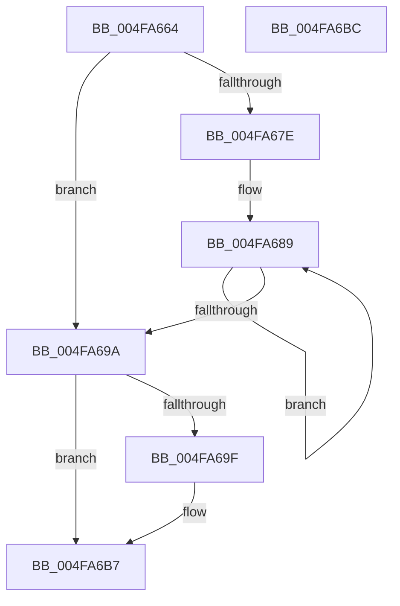

# KiWriteCpuSetMasks

- RVA: `0x004FA664`–`0x004FA6BD` (길이 `89` bytes)
- VA: `0x00000001404FA664`
- 실행 섹션: `.text`
- PDB 이름 있음: `예`; PDB Function 태그: `아니요`
- unwind 정보 RVA: `0x0005C788`
- 디코드: `30`개 명령, `89/89` bytes 표시
- 미해석 바이트: `0` (있으면 어셈블리에 `.byte`로 보존)

> 이 문서는 커널 이미지의 기계어와 PDB 기호를 분석해 생성했습니다. 4번과 5번은 함수 원형과 자료형을 바이너리 사용 방식에서 추정한 C 해석이며 원본 소스 복구 결과는 아닙니다.

## 1. Dependencies

- 직접 호출 지점: **1**; 고유 호출 대상: **1**
- 직접 호출자로 확인된 함수: **2**
- RIP 상대 이미지 참조: **0**

### Outgoing calls
- `0x004FA6B2` → [memset](../6C/memset_function_006C6C40.md) (function, `0x006C6C40`)

### Direct callers
- [KeSetSelectedCpuSetsThread](../30/KeSetSelectedCpuSetsThread_function_003033D0.md) at `0x0030348B`
- [KeSetCpuSetsProcess](../5C/KeSetCpuSetsProcess_function_005C10D4.md) at `0x005C1141`
- [KeSetCpuSetsProcess](../5C/KeSetCpuSetsProcess_function_005C10D4.md) at `0x005C1169`

### Static image references
- 디코드된 RIP-relative 메모리 참조가 없습니다.

## 2. Other-region calls and transfers

- 다른 실행 섹션으로 향하는 call: **0**
- 별도 외부 분기/꼬리 이동을 확인하지 못했습니다.

## 3. Assembly (complete function range)

```asm
004FA664  48 83 EC 28                     sub rsp, 0x28
004FA668  44 3B CA                        cmp r9d, edx
004FA66B  8B C2                           mov eax, edx
004FA66D  4D 8B D0                        mov r10, r8
004FA670  4C 8B D9                        mov r11, rcx
004FA673  41 0F 42 C1                     cmovb eax, r9d
004FA677  45 33 C9                        xor r9d, r9d
004FA67A  85 C0                           test eax, eax
004FA67C  74 1C                           je 0x1404fa69a
004FA67E  4C 8B C1                        mov r8, rcx
004FA681  4C 2B D1                        sub r10, rcx
004FA684  8B C8                           mov ecx, eax
004FA686  44 8B C8                        mov r9d, eax
004FA689  4B 8B 04 02                     mov rax, qword ptr [r10 + r8]
004FA68D  49 89 00                        mov qword ptr [r8], rax
004FA690  4D 8D 40 08                     lea r8, [r8 + 8]
004FA694  48 83 E9 01                     sub rcx, 1
004FA698  75 EF                           jne 0x1404fa689
004FA69A  44 3B CA                        cmp r9d, edx
004FA69D  73 18                           jae 0x1404fa6b7
004FA69F  41 2B D1                        sub edx, r9d
004FA6A2  41 8B C1                        mov eax, r9d
004FA6A5  44 8B C2                        mov r8d, edx
004FA6A8  33 D2                           xor edx, edx
004FA6AA  49 C1 E0 03                     shl r8, 3
004FA6AE  49 8D 0C C3                     lea rcx, [r11 + rax*8]
004FA6B2  E8 89 C5 1C 00                  call 0x1406c6c40
004FA6B7  48 83 C4 28                     add rsp, 0x28
004FA6BB  C3                              ret
004FA6BC  CC                              int3
```

## 4. C-style interpretation (structured pseudocode)

```c
__int64 __fastcall KiWriteCpuSetMasks(__int64 a1, int a2, __int64 a3, int a4)
{
    __int64 result;
    __int64 v_r10;
    __int64 v_rsp;

    v_rsp = (v_rsp) - (40);
    result = (unsigned int)(a2);
    if (a4 < a2) { result = a4; }
    a4 = 0;
    if ((unsigned int)(result) == 0) goto loc_004FA69A;
    v_r10 = (a3) - (a1);
loc_004FA689:
    *(unsigned __int64 *)(a1) = *(unsigned __int64 *)(v_r10 + a1 * 1);
    a1 = ((unsigned int)((unsigned int)(result))) - (1);
    if (condition_is_not_equal) goto loc_004FA689;
loc_004FA69A:
    result = *(unsigned __int64 *)(v_r10 + a1 * 1);
    if (((unsigned int)((unsigned int)((unsigned int)(result)))) < a2) {
        a2 = (unsigned int)((a2) - ((unsigned int)((unsigned int)((unsigned int)(result)))));
        result = (unsigned int)((unsigned int)((unsigned int)(result)));
        a3 = a2;
        a2 = 0;
        a3 = (a3) << (3);
        a1 = a1 + result * 8;
        result = memset(a1, a2, a3, (unsigned int)((unsigned int)(result)));
    }
    v_rsp = (v_rsp) + (40);
    return result;
}
```

## 5. (Beta) C Style

```c
int64_t KiWriteCpuSetMasks(void *Arg1, int32_t Arg2, void *Arg3, int32_t Arg4)
{
    uint8_t *arg1 = (uint8_t *)Arg1;
    uint8_t *arg3 = (uint8_t *)Arg3;

    int64_t result;
    int64_t local_r10;
    int64_t local_rsp;

    local_rsp = (local_rsp) - (40);
    result = (uint32_t)(Arg2);
    if (Arg4 < Arg2) { result = Arg4; }
    Arg4 = 0;
    if ((uint32_t)(result) == 0) goto loc_004FA69A;
    local_r10 = (Arg3) - (Arg1);
loc_004FA689:
    *(uint64_t *)(arg1) = *(uint64_t *)(local_r10 + arg1 * 1);
    Arg1 = ((uint32_t)((uint32_t)(result))) - (1);
    if (condition_is_not_equal) goto loc_004FA689;
loc_004FA69A:
    result = *(uint64_t *)(local_r10 + arg1 * 1);
    if (((uint32_t)((uint32_t)((uint32_t)(result)))) < Arg2) {
        Arg2 = (uint32_t)((Arg2) - ((uint32_t)((uint32_t)((uint32_t)(result)))));
        result = (uint32_t)((uint32_t)((uint32_t)(result)));
        Arg3 = Arg2;
        Arg2 = 0;
        Arg3 = (Arg3) << (3);
        Arg1 = Arg1 + result * 8;
        result = memset(Arg1, Arg2, Arg3, (uint32_t)((uint32_t)(result)));
    }
    local_rsp = (local_rsp) + (40);
    return result;
}
```

### 관측된 메모리 오프셋

구조체 형식이 확인되지 않은 접근은 인자 기준의 오프셋으로만 기록했습니다.

| 기준 인자 | 오프셋 표현 | 폭 (bit) | 접근 |
|---|---:|---:|---|
| `Arg1` | `+ 0x0` | `64` | `W` |
| `Arg1` | `+ 0x0 + rax*8` | `64` | `R` |
| `Arg1` | `+ 0x8` | `64` | `R` |
| `Arg3` | `+ 0x0 + r8*1` | `64` | `R` |

## 6. Execution-region graph

[열기: 2D/3D 그래프와 함수 탐색 컨트롤 패널](../../../control-panel.html?section=text&rva=0x004FA664&view=graph)

- 2D 그래프는 위에서 아래로 흐르고, 3D 그래프는 빈 공간을 드래그해 회전합니다. Shift+드래그는 이동, 휠은 확대·축소, 함수 노드 선택은 대상 보고서 이동입니다.

### Static fallback


