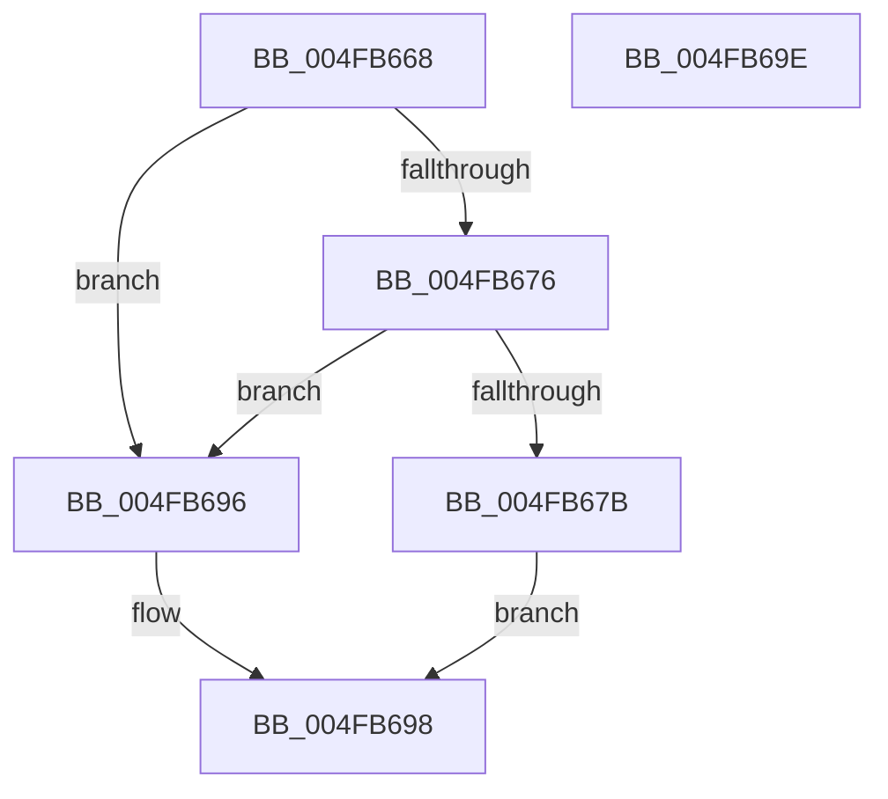

# LZ4_initStreamHC

- RVA: `0x004FB668`–`0x004FB69F` (길이 `55` bytes)
- VA: `0x00000001404FB668`
- 실행 섹션: `.text`
- PDB 이름 있음: `예`; PDB Function 태그: `아니요`
- unwind 정보 RVA: `0x0005CF00`
- 디코드: `18`개 명령, `55/55` bytes 표시
- 미해석 바이트: `0` (있으면 어셈블리에 `.byte`로 보존)

> 이 문서는 커널 이미지의 기계어와 PDB 기호를 분석해 생성했습니다. 4번과 5번은 함수 원형과 자료형을 바이너리 사용 방식에서 추정한 C 해석이며 원본 소스 복구 결과는 아닙니다.

## 1. Dependencies

- 직접 호출 지점: **1**; 고유 호출 대상: **1**
- 직접 호출자로 확인된 함수: **2**
- RIP 상대 이미지 참조: **0**

### Outgoing calls
- `0x004FB683` → [memset](../6C/memset_function_006C6C40.md) (function, `0x006C6C40`)

### Direct callers
- [LZ4_compress_HC_extStateHC](../4E/LZ4_compress_HC_extStateHC_function_004E2F10.md) at `0x004E2F30`
- [LZ4_resetStreamHC_fast](../5F/LZ4_resetStreamHC_fast_function_005FFC34.md) at `0x005FFC47`

### Static image references
- 디코드된 RIP-relative 메모리 참조가 없습니다.

## 2. Other-region calls and transfers

- 다른 실행 섹션으로 향하는 call: **0**
- 별도 외부 분기/꼬리 이동을 확인하지 못했습니다.

## 3. Assembly (complete function range)

```asm
004FB668  40 53                           push rbx
004FB66A  48 83 EC 20                     sub rsp, 0x20
004FB66E  48 8B D9                        mov rbx, rcx
004FB671  48 85 C9                        test rcx, rcx
004FB674  74 20                           je 0x1404fb696
004FB676  F6 C3 07                        test bl, 7
004FB679  75 1B                           jne 0x1404fb696
004FB67B  33 D2                           xor edx, edx
004FB67D  41 B8 30 00 04 00               mov r8d, 0x40030
004FB683  E8 B8 B5 1C 00                  call 0x1406c6c40
004FB688  48 8B C3                        mov rax, rbx
004FB68B  66 C7 83 24 00 04 00 09 00      mov word ptr [rbx + 0x40024], 9
004FB694  EB 02                           jmp 0x1404fb698
004FB696  33 C0                           xor eax, eax
004FB698  48 83 C4 20                     add rsp, 0x20
004FB69C  5B                              pop rbx
004FB69D  C3                              ret
004FB69E  CC                              int3
```

## 4. C-style interpretation (structured pseudocode)

```c
__int64 __fastcall LZ4_initStreamHC(__int64 a1, int a2)
{
    __int64 result;
    __int64 v_rsp;

    v_rsp = (v_rsp) - (32);
    if (a1 == 0) goto loc_004FB696;
    if ((((unsigned __int8)(a1)) & (7)) != 0) goto loc_004FB696;
    a2 = 0;
    result = memset(a1, a2, (unsigned int)(0x40030ULL), a4);
    *(unsigned __int16 *)(a1 + 262180) = 9;
    goto loc_004FB698;
loc_004FB696:
    result = 0;
loc_004FB698:
    v_rsp = (v_rsp) + (32);
    return result;
}
```

## 5. (Beta) C Style

```c
int64_t LZ4_initStreamHC(int64_t Arg1, int32_t Arg2)
{
    int64_t result;
    int64_t local_rsp;

    local_rsp = (local_rsp) - (32);
    if (Arg1 == 0) goto loc_004FB696;
    if ((((uint8_t)(Arg1)) & (7)) != 0) goto loc_004FB696;
    Arg2 = 0;
    result = memset(Arg1, Arg2, (uint32_t)(0x40030ULL), a4);
    *(uint16_t *)(Arg1 + 0x40024) = 9;
    goto loc_004FB698;
loc_004FB696:
    result = 0;
loc_004FB698:
    local_rsp = (local_rsp) + (32);
    return result;
}
```

## 6. Execution-region graph

[열기: 2D/3D 그래프와 함수 탐색 컨트롤 패널](../../../control-panel.html?section=text&rva=0x004FB668&view=graph)

- 2D 그래프는 위에서 아래로 흐르고, 3D 그래프는 빈 공간을 드래그해 회전합니다. Shift+드래그는 이동, 휠은 확대·축소, 함수 노드 선택은 대상 보고서 이동입니다.

### Static fallback


