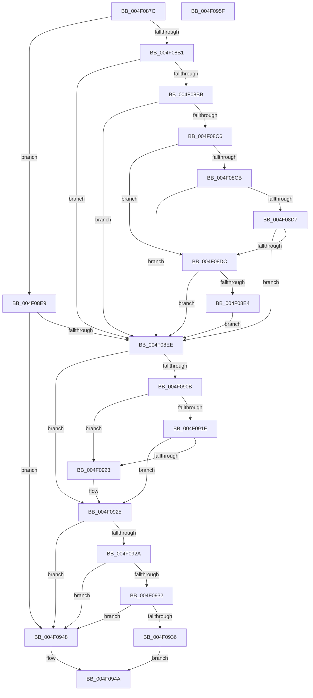

# LdrImageDirectoryEntryToLoadConfigEx

- RVA: `0x004F087C`–`0x004F0960` (길이 `228` bytes)
- VA: `0x00000001404F087C`
- 실행 섹션: `.text`
- PDB 이름 있음: `예`; PDB Function 태그: `아니요`
- unwind 정보 RVA: `0x000B3F28`
- 디코드: `70`개 명령, `228/228` bytes 표시
- 미해석 바이트: `0` (있으면 어셈블리에 `.byte`로 보존)

> 이 문서는 커널 이미지의 기계어와 PDB 기호를 분석해 생성했습니다. 4번과 5번은 함수 원형과 자료형을 바이너리 사용 방식에서 추정한 C 해석이며 원본 소스 복구 결과는 아닙니다.

## 1. Dependencies

- 직접 호출 지점: **1**; 고유 호출 대상: **1**
- 직접 호출자로 확인된 함수: **3**
- RIP 상대 이미지 참조: **0**

### Outgoing calls
- `0x004F08FE` → [RtlImageDirectoryEntryToData](../43/RtlImageDirectoryEntryToData_function_004328D0.md) (function, `0x004328D0`)

### Direct callers
- [MiCaptureBootDriverRetpolineInfo](../../page/80/MiCaptureBootDriverRetpolineInfo_function_0080137C.md) at `0x008013D5`
- [LdrInitSecurityCookie](../../page/A7/LdrInitSecurityCookie_function_00A7FD44.md) at `0x00A7FD72`
- [LdrImageDirectoryEntryToLoadConfig](../../page/A8/LdrImageDirectoryEntryToLoadConfig_function_00A8F564.md) at `0x00A8F568`

### Static image references
- 디코드된 RIP-relative 메모리 참조가 없습니다.

## 2. Other-region calls and transfers

- 다른 실행 섹션으로 향하는 call: **0**
- 별도 외부 분기/꼬리 이동을 확인하지 못했습니다.

## 3. Assembly (complete function range)

```asm
004F087C  48 8B C4                        mov rax, rsp
004F087F  48 89 58 08                     mov qword ptr [rax + 8], rbx
004F0883  48 89 68 18                     mov qword ptr [rax + 0x18], rbp
004F0887  48 89 70 20                     mov qword ptr [rax + 0x20], rsi
004F088B  89 50 10                        mov dword ptr [rax + 0x10], edx
004F088E  57                              push rdi
004F088F  48 83 EC 20                     sub rsp, 0x20
004F0893  33 DB                           xor ebx, ebx
004F0895  48 8B F9                        mov rdi, rcx
004F0898  89 58 10                        mov dword ptr [rax + 0x10], ebx
004F089B  8B F3                           mov esi, ebx
004F089D  48 8D 41 FF                     lea rax, [rcx - 1]
004F08A1  48 BD FF FF FE FF FF 7F 00 00   movabs rbp, 0x7ffffffeffff
004F08AB  48 83 F8 FD                     cmp rax, -3
004F08AF  77 38                           ja 0x1404f08e9
004F08B1  B8 4D 5A 00 00                  mov eax, 0x5a4d
004F08B6  66 39 01                        cmp word ptr [rcx], ax
004F08B9  75 33                           jne 0x1404f08ee
004F08BB  8B 41 3C                        mov eax, dword ptr [rcx + 0x3c]
004F08BE  48 03 C1                        add rax, rcx
004F08C1  48 3B C1                        cmp rax, rcx
004F08C4  72 28                           jb 0x1404f08ee
004F08C6  48 3B CD                        cmp rcx, rbp
004F08C9  77 11                           ja 0x1404f08dc
004F08CB  48 8D 88 07 01 00 00            lea rcx, [rax + 0x107]
004F08D2  48 3B C8                        cmp rcx, rax
004F08D5  72 17                           jb 0x1404f08ee
004F08D7  48 3B CD                        cmp rcx, rbp
004F08DA  77 12                           ja 0x1404f08ee
004F08DC  81 38 50 45 00 00               cmp dword ptr [rax], 0x4550
004F08E2  75 0A                           jne 0x1404f08ee
004F08E4  48 8B F0                        mov rsi, rax
004F08E7  EB 05                           jmp 0x1404f08ee
004F08E9  48 85 FF                        test rdi, rdi
004F08EC  74 5A                           je 0x1404f0948
004F08EE  41 B8 0A 00 00 00               mov r8d, 0xa
004F08F4  4C 8D 4C 24 38                  lea r9, [rsp + 0x38]
004F08F9  B2 01                           mov dl, 1
004F08FB  48 8B CF                        mov rcx, rdi
004F08FE  E8 CD 1F F4 FF                  call 0x1404328d0
004F0903  48 8B C8                        mov rcx, rax
004F0906  48 3B FD                        cmp rdi, rbp
004F0909  77 1A                           ja 0x1404f0925
004F090B  48 83 C0 04                     add rax, 4
004F090F  48 BA 00 00 FF FF FF 7F 00 00   movabs rdx, 0x7fffffff0000
004F0919  48 3B C2                        cmp rax, rdx
004F091C  77 05                           ja 0x1404f0923
004F091E  48 3B C1                        cmp rax, rcx
004F0921  73 02                           jae 0x1404f0925
004F0923  8A 02                           mov al, byte ptr [rdx]
004F0925  48 85 C9                        test rcx, rcx
004F0928  74 1E                           je 0x1404f0948
004F092A  8B 44 24 38                     mov eax, dword ptr [rsp + 0x38]
004F092E  85 C0                           test eax, eax
004F0930  74 16                           je 0x1404f0948
004F0932  3B 01                           cmp eax, dword ptr [rcx]
004F0934  75 12                           jne 0x1404f0948
004F0936  B8 64 86 00 00                  mov eax, 0x8664
004F093B  66 39 46 04                     cmp word ptr [rsi + 4], ax
004F093F  48 0F 44 D9                     cmove rbx, rcx
004F0943  48 8B C3                        mov rax, rbx
004F0946  EB 02                           jmp 0x1404f094a
004F0948  33 C0                           xor eax, eax
004F094A  48 8B 5C 24 30                  mov rbx, qword ptr [rsp + 0x30]
004F094F  48 8B 6C 24 40                  mov rbp, qword ptr [rsp + 0x40]
004F0954  48 8B 74 24 48                  mov rsi, qword ptr [rsp + 0x48]
004F0959  48 83 C4 20                     add rsp, 0x20
004F095D  5F                              pop rdi
004F095E  C3                              ret
004F095F  CC                              int3
```

## 4. C-style interpretation (structured pseudocode)

```c
__int64 __fastcall LdrImageDirectoryEntryToLoadConfigEx(__int64 a1, int a2)
{
    __int64 result;
    __int64 v_rbx;
    __int64 v_rsp;
    unsigned __int64 v_stack_p10;
    unsigned __int64 v_stack_p18;
    unsigned __int64 v_stack_p20;
    unsigned __int64 v_stack_p8;

    *(unsigned __int64 *)(v_rsp + 8) = v_rbx;
    *(unsigned __int64 *)(v_rsp + 24) = v_rbp;
    *(unsigned __int64 *)(v_rsp + 32) = v_rsi;
    *(unsigned int *)(v_rsp + 16) = a2;
    v_rsp = (v_rsp) - (32);
    v_rbx = 0;
    *(unsigned int *)(v_rsp + 16) = 0;
    if ((a1 - 1) > -3) goto loc_004F08E9;
    if ((*(unsigned __int16 *)(a1)) != ((unsigned __int16)((unsigned int)(0x5A4DULL)))) goto loc_004F08EE;
    result = ((unsigned int)(*(unsigned int *)(a1 + 60))) + (a1);
    if (result < a1) goto loc_004F08EE;
    if (a1 > v_rbp) goto loc_004F08DC;
    if ((result + 263) < result) goto loc_004F08EE;
    if ((result + 263) > v_rbp) goto loc_004F08EE;
loc_004F08DC:
    if ((*(unsigned int *)(result)) != 0x4550ULL) goto loc_004F08EE;
    goto loc_004F08EE;
loc_004F08E9:
    if (a1 == 0) goto loc_004F0948;
loc_004F08EE:
    result = RtlImageDirectoryEntryToData(a1, 1, 10, v_stack_p10);
    if (a1 > v_rbp) goto loc_004F0925;
    result = (result) + (4);
    if (result > 1) goto loc_004F0923;
    if (result < result) {
        result = *(unsigned __int8 *)(1);
    }
    if (result == 0) goto loc_004F0948;
    if ((unsigned int)((unsigned int)(v_stack_p10)) == 0) goto loc_004F0948;
    if (((unsigned int)((unsigned int)(v_stack_p10))) != (*(unsigned int *)(result))) goto loc_004F0948;
    if ((*(unsigned __int16 *)(result + 4)) == ((unsigned __int16)((unsigned int)(0x8664ULL)))) { v_rbx = result; }
    goto loc_004F094A;
loc_004F0948:
    result = 0;
loc_004F094A:
    v_rsp = (v_rsp) + (32);
    return result;
}
```

## 5. (Beta) C Style

```c
int64_t LdrImageDirectoryEntryToLoadConfigEx(void *Arg1, int32_t Arg2)
{
    uint8_t *arg1 = (uint8_t *)Arg1;

    int64_t result;
    int64_t local_rbx;
    int64_t local_rsp;
    uint64_t v_stack_p10;
    uint64_t v_stack_p18;
    uint64_t v_stack_p20;
    uint64_t v_stack_p8;

    *(uint64_t *)(local_rsp + 0x8) = local_rbx;
    *(uint64_t *)(local_rsp + 0x18) = local_rbp;
    *(uint64_t *)(local_rsp + 0x20) = local_rsi;
    *(uint32_t *)(local_rsp + 0x10) = Arg2;
    local_rsp = (local_rsp) - (32);
    local_rbx = 0;
    *(uint32_t *)(local_rsp + 0x10) = 0;
    if ((Arg1 - 1) > -3) goto loc_004F08E9;
    if ((*(uint16_t *)(arg1)) != ((uint16_t)((uint32_t)(0x5A4DULL)))) goto loc_004F08EE;
    result = ((uint32_t)(*(uint32_t *)(arg1 + 0x3C))) + (Arg1);
    if (result < Arg1) goto loc_004F08EE;
    if (Arg1 > local_rbp) goto loc_004F08DC;
    if ((result + 263) < result) goto loc_004F08EE;
    if ((result + 263) > local_rbp) goto loc_004F08EE;
loc_004F08DC:
    if ((*(uint32_t *)(result)) != 0x4550ULL) goto loc_004F08EE;
    goto loc_004F08EE;
loc_004F08E9:
    if (Arg1 == NULL) goto loc_004F0948;
loc_004F08EE:
    result = RtlImageDirectoryEntryToData(Arg1, 1, 10, v_stack_p10);
    if (Arg1 > local_rbp) goto loc_004F0925;
    result = (result) + (4);
    if (result > 1) goto loc_004F0923;
    if (result < result) {
        result = *(uint8_t *)(1);
    }
    if (result == 0) goto loc_004F0948;
    if ((uint32_t)((uint32_t)(v_stack_p10)) == 0) goto loc_004F0948;
    if (((uint32_t)((uint32_t)(v_stack_p10))) != (*(uint32_t *)(result))) goto loc_004F0948;
    if ((*(uint16_t *)(result + 0x4)) == ((uint16_t)((uint32_t)(0x8664ULL)))) { local_rbx = result; }
    goto loc_004F094A;
loc_004F0948:
    result = 0;
loc_004F094A:
    local_rsp = (local_rsp) + (32);
    return result;
}
```

### 관측된 메모리 오프셋

구조체 형식이 확인되지 않은 접근은 인자 기준의 오프셋으로만 기록했습니다.

| 기준 인자 | 오프셋 표현 | 폭 (bit) | 접근 |
|---|---:|---:|---|
| `Arg1` | `- 0x1` | `64` | `R` |
| `Arg1` | `+ 0x0` | `16` | `R` |
| `Arg1` | `+ 0x3C` | `32` | `R` |

## 6. Execution-region graph

[열기: 2D/3D 그래프와 함수 탐색 컨트롤 패널](../../../control-panel.html?section=text&rva=0x004F087C&view=graph)

- 2D 그래프는 위에서 아래로 흐르고, 3D 그래프는 빈 공간을 드래그해 회전합니다. Shift+드래그는 이동, 휠은 확대·축소, 함수 노드 선택은 대상 보고서 이동입니다.

### Static fallback


