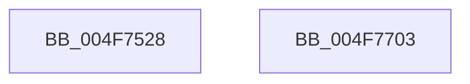

# McTemplateK0xxxxxxxxxxxxxxxxxxq_EtwWriteTransfer

- RVA: `0x004F7528`–`0x004F7704` (길이 `476` bytes)
- VA: `0x00000001404F7528`
- 실행 섹션: `.text`
- PDB 이름 있음: `예`; PDB Function 태그: `아니요`
- unwind 정보 RVA: `0x000BF5E0`
- 디코드: `80`개 명령, `476/476` bytes 표시
- 미해석 바이트: `0` (있으면 어셈블리에 `.byte`로 보존)

> 이 문서는 커널 이미지의 기계어와 PDB 기호를 분석해 생성했습니다. 4번과 5번은 함수 원형과 자료형을 바이너리 사용 방식에서 추정한 C 해석이며 원본 소스 복구 결과는 아닙니다.

## 1. Dependencies

- 직접 호출 지점: **2**; 고유 호출 대상: **2**
- 직접 호출자로 확인된 함수: **1**
- RIP 상대 이미지 참조: **4**

### Outgoing calls
- `0x004F76E6` → [McGenEventWrite_EtwWriteTransfer](../42/McGenEventWrite_EtwWriteTransfer_function_00424FC8.md) (function, `0x00424FC8`)
- `0x004F76F5` → [_security_check_cookie](../6A/_security_check_cookie_function_006AC640.md) (function, `0x006AC640`)

### Direct callers
- [CcPostVolumeTelemetry](../42/CcPostVolumeTelemetry_function_00420FF8.md) at `0x004212E3`

### Static image references
- `0x004F753D` → RVA `0x00E0A740` (`.data`; read)
- `0x004F754E` → RVA `0x00E0A874` (`.data`; read)
- `0x004F7554` → RVA `0x0001ED88` (`.rdata`; read)
- `0x004F755F` → RVA `0x00E06BD0` (`.data`; read)

## 2. Other-region calls and transfers

- 다른 실행 섹션으로 향하는 call: **0**
- 별도 외부 분기/꼬리 이동을 확인하지 못했습니다.

## 3. Assembly (complete function range)

```asm
004F7528  4C 89 4C 24 20                  mov qword ptr [rsp + 0x20], r9
004F752D  55                              push rbp
004F752E  48 8D AC 24 70 FF FF FF         lea rbp, [rsp - 0x90]
004F7536  48 81 EC 90 01 00 00            sub rsp, 0x190
004F753D  48 8B 05 FC 31 91 00            mov rax, qword ptr [rip + 0x9131fc]
004F7544  48 33 C4                        xor rax, rsp
004F7547  48 89 85 80 00 00 00            mov qword ptr [rbp + 0x80], rax
004F754E  8B 05 20 33 91 00               mov eax, dword ptr [rip + 0x913320]
004F7554  48 8D 15 2D 78 B2 FF            lea rdx, [rip - 0x4d87d3]
004F755B  89 44 24 30                     mov dword ptr [rsp + 0x30], eax
004F755F  48 8D 0D 6A F6 90 00            lea rcx, [rip + 0x90f66a]
004F7566  48 8D 85 B8 00 00 00            lea rax, [rbp + 0xb8]
004F756D  48 C7 44 24 58 08 00 00 00      mov qword ptr [rsp + 0x58], 8
004F7576  48 89 44 24 50                  mov qword ptr [rsp + 0x50], rax
004F757B  41 B9 14 00 00 00               mov r9d, 0x14
004F7581  48 8D 85 C0 00 00 00            lea rax, [rbp + 0xc0]
004F7588  48 C7 44 24 68 08 00 00 00      mov qword ptr [rsp + 0x68], 8
004F7591  48 89 44 24 60                  mov qword ptr [rsp + 0x60], rax
004F7596  45 33 C0                        xor r8d, r8d
004F7599  48 8D 85 C8 00 00 00            lea rax, [rbp + 0xc8]
004F75A0  48 C7 44 24 78 08 00 00 00      mov qword ptr [rsp + 0x78], 8
004F75A9  48 89 44 24 70                  mov qword ptr [rsp + 0x70], rax
004F75AE  48 8D 85 D0 00 00 00            lea rax, [rbp + 0xd0]
004F75B5  48 89 45 80                     mov qword ptr [rbp - 0x80], rax
004F75B9  48 8D 85 D8 00 00 00            lea rax, [rbp + 0xd8]
004F75C0  48 89 45 90                     mov qword ptr [rbp - 0x70], rax
004F75C4  48 8D 85 E0 00 00 00            lea rax, [rbp + 0xe0]
004F75CB  48 89 45 A0                     mov qword ptr [rbp - 0x60], rax
004F75CF  48 8D 85 E8 00 00 00            lea rax, [rbp + 0xe8]
004F75D6  48 89 45 B0                     mov qword ptr [rbp - 0x50], rax
004F75DA  48 8D 85 F0 00 00 00            lea rax, [rbp + 0xf0]
004F75E1  48 89 45 C0                     mov qword ptr [rbp - 0x40], rax
004F75E5  48 8D 85 F8 00 00 00            lea rax, [rbp + 0xf8]
004F75EC  48 89 45 D0                     mov qword ptr [rbp - 0x30], rax
004F75F0  48 8D 85 00 01 00 00            lea rax, [rbp + 0x100]
004F75F7  48 89 45 E0                     mov qword ptr [rbp - 0x20], rax
004F75FB  48 8D 85 08 01 00 00            lea rax, [rbp + 0x108]
004F7602  48 89 45 F0                     mov qword ptr [rbp - 0x10], rax
004F7606  48 8D 85 10 01 00 00            lea rax, [rbp + 0x110]
004F760D  48 89 45 00                     mov qword ptr [rbp], rax
004F7611  48 8D 85 18 01 00 00            lea rax, [rbp + 0x118]
004F7618  48 89 45 10                     mov qword ptr [rbp + 0x10], rax
004F761C  48 8D 85 20 01 00 00            lea rax, [rbp + 0x120]
004F7623  48 89 45 20                     mov qword ptr [rbp + 0x20], rax
004F7627  48 8D 85 28 01 00 00            lea rax, [rbp + 0x128]
004F762E  48 89 45 30                     mov qword ptr [rbp + 0x30], rax
004F7632  48 8D 85 30 01 00 00            lea rax, [rbp + 0x130]
004F7639  48 89 45 40                     mov qword ptr [rbp + 0x40], rax
004F763D  48 8D 85 38 01 00 00            lea rax, [rbp + 0x138]
004F7644  48 89 45 50                     mov qword ptr [rbp + 0x50], rax
004F7648  48 8D 85 40 01 00 00            lea rax, [rbp + 0x140]
004F764F  48 89 45 60                     mov qword ptr [rbp + 0x60], rax
004F7653  48 8D 44 24 30                  lea rax, [rsp + 0x30]
004F7658  48 89 45 70                     mov qword ptr [rbp + 0x70], rax
004F765C  48 8D 44 24 40                  lea rax, [rsp + 0x40]
004F7661  48 89 44 24 20                  mov qword ptr [rsp + 0x20], rax
004F7666  48 C7 45 88 08 00 00 00         mov qword ptr [rbp - 0x78], 8
004F766E  48 C7 45 98 08 00 00 00         mov qword ptr [rbp - 0x68], 8
004F7676  48 C7 45 A8 08 00 00 00         mov qword ptr [rbp - 0x58], 8
004F767E  48 C7 45 B8 08 00 00 00         mov qword ptr [rbp - 0x48], 8
004F7686  48 C7 45 C8 08 00 00 00         mov qword ptr [rbp - 0x38], 8
004F768E  48 C7 45 D8 08 00 00 00         mov qword ptr [rbp - 0x28], 8
004F7696  48 C7 45 E8 08 00 00 00         mov qword ptr [rbp - 0x18], 8
004F769E  48 C7 45 F8 08 00 00 00         mov qword ptr [rbp - 8], 8
004F76A6  48 C7 45 08 08 00 00 00         mov qword ptr [rbp + 8], 8
004F76AE  48 C7 45 18 08 00 00 00         mov qword ptr [rbp + 0x18], 8
004F76B6  48 C7 45 28 08 00 00 00         mov qword ptr [rbp + 0x28], 8
004F76BE  48 C7 45 38 08 00 00 00         mov qword ptr [rbp + 0x38], 8
004F76C6  48 C7 45 48 08 00 00 00         mov qword ptr [rbp + 0x48], 8
004F76CE  48 C7 45 58 08 00 00 00         mov qword ptr [rbp + 0x58], 8
004F76D6  48 C7 45 68 08 00 00 00         mov qword ptr [rbp + 0x68], 8
004F76DE  48 C7 45 78 04 00 00 00         mov qword ptr [rbp + 0x78], 4
004F76E6  E8 DD D8 F2 FF                  call 0x140424fc8
004F76EB  48 8B 8D 80 00 00 00            mov rcx, qword ptr [rbp + 0x80]
004F76F2  48 33 CC                        xor rcx, rsp
004F76F5  E8 46 4F 1B 00                  call 0x1406ac640
004F76FA  48 81 C4 90 01 00 00            add rsp, 0x190
004F7701  5D                              pop rbp
004F7702  C3                              ret
004F7703  CC                              int3
```

## 4. C-style interpretation (structured pseudocode)

```c
__int64 __fastcall McTemplateK0xxxxxxxxxxxxxxxxxxq_EtwWriteTransfer(__int64 a1, __int64 a2, int a3, __int64 a4, __int64 a5, __int64 a6, __int64 a7, __int64 a8, __int64 a9, __int64 a10, __int64 a11, __int64 a12, __int64 a13, __int64 a14, __int64 a15, __int64 a16, __int64 a17, __int64 a18, __int64 a19, __int64 a20, __int64 a21)
{
    __int64 result;
    __int64 v_rsp;
    unsigned __int64 v_stack_m100;
    unsigned __int64 v_stack_m108;
    unsigned __int64 v_stack_m110;
    unsigned __int64 v_stack_m118;
    unsigned __int64 v_stack_m120;
    unsigned __int64 v_stack_m128;
    unsigned __int64 v_stack_m130;
    unsigned __int64 v_stack_m138;
    unsigned __int64 v_stack_m140;
    unsigned __int64 v_stack_m148;
    unsigned __int64 v_stack_m158;
    unsigned int v_stack_m168;
    unsigned __int64 v_stack_m178;
    unsigned __int64 v_stack_m18;
    unsigned __int64 v_stack_m20;
    unsigned __int64 v_stack_m28;
    unsigned __int64 v_stack_m30;
    unsigned __int64 v_stack_m38;
    unsigned __int64 v_stack_m40;
    unsigned __int64 v_stack_m48;
    unsigned __int64 v_stack_m50;
    unsigned __int64 v_stack_m58;
    unsigned __int64 v_stack_m60;
    unsigned __int64 v_stack_m68;
    unsigned __int64 v_stack_m70;
    unsigned __int64 v_stack_m78;
    unsigned __int64 v_stack_m80;
    unsigned __int64 v_stack_m88;
    unsigned __int64 v_stack_m90;
    unsigned __int64 v_stack_m98;
    unsigned __int64 v_stack_mA0;
    unsigned __int64 v_stack_mA8;
    unsigned __int64 v_stack_mB0;
    unsigned __int64 v_stack_mB8;
    unsigned __int64 v_stack_mC0;
    unsigned __int64 v_stack_mC8;
    unsigned __int64 v_stack_mD0;
    unsigned __int64 v_stack_mD8;
    unsigned __int64 v_stack_mE0;
    unsigned __int64 v_stack_mE8;
    unsigned __int64 v_stack_mF0;
    unsigned __int64 v_stack_mF8;
    unsigned __int64 v_stack_p20;

    v_stack_p20 = a4;
    v_rsp = (v_rsp) - (400);
    result = (*(unsigned __int64 *)(v_rip + 9515516)) ^ (v_rsp);
    v_stack_m18 = result;
    v_stack_m168 = (unsigned int)((unsigned int)(*(unsigned int *)(v_rip + 9515808)));
    v_stack_m140 = 8;
    v_stack_m148 = v_stack_p20;
    v_stack_m130 = 8;
    v_stack_m138 = a5;
    a3 = 0;
    v_stack_m120 = 8;
    v_stack_m128 = a6;
    v_stack_m118 = a7;
    v_stack_m108 = a8;
    v_stack_mF8 = a9;
    v_stack_mE8 = a10;
    v_stack_mD8 = a11;
    v_stack_mC8 = a12;
    v_stack_mB8 = a13;
    v_stack_mA8 = a14;
    v_stack_m98 = a15;
    v_stack_m88 = a16;
    v_stack_m78 = a17;
    v_stack_m68 = a18;
    v_stack_m58 = a19;
    v_stack_m48 = a20;
    v_stack_m38 = a21;
    v_stack_m28 = v_stack_m168;
    v_stack_m178 = v_stack_m158;
    v_stack_m110 = 8;
    v_stack_m100 = 8;
    v_stack_mF0 = 8;
    v_stack_mE0 = 8;
    v_stack_mD0 = 8;
    v_stack_mC0 = 8;
    v_stack_mB0 = 8;
    v_stack_mA0 = 8;
    v_stack_m90 = 8;
    v_stack_m80 = 8;
    v_stack_m70 = 8;
    v_stack_m60 = 8;
    v_stack_m50 = 8;
    v_stack_m40 = 8;
    v_stack_m30 = 8;
    v_stack_m20 = 4;
    result = McGenEventWrite_EtwWriteTransfer(v_rip + 9500266, v_rip - 5081043, a3, 20);
    a1 = (v_stack_m18) ^ (v_rsp);
    result = _security_check_cookie(a1, v_rip - 5081043, a3, 20);
    v_rsp = (v_rsp) + (400);
    return result;
}
```

## 5. (Beta) C Style

```c
int64_t McTemplateK0xxxxxxxxxxxxxxxxxxq_EtwWriteTransfer(int64_t Arg1, int64_t Arg2, int32_t Arg3, int64_t Arg4, int64_t Arg5, int64_t Arg6, int64_t Arg7, int64_t Arg8, int64_t Arg9, int64_t Arg10, int64_t Arg11, int64_t Arg12, int64_t Arg13, int64_t Arg14, int64_t Arg15, int64_t Arg16, int64_t Arg17, int64_t Arg18, int64_t Arg19, int64_t Arg20, int64_t Arg21)
{
    int64_t result;
    int64_t local_rsp;
    uint64_t v_stack_m100;
    uint64_t v_stack_m108;
    uint64_t v_stack_m110;
    uint64_t v_stack_m118;
    uint64_t v_stack_m120;
    uint64_t v_stack_m128;
    uint64_t v_stack_m130;
    uint64_t v_stack_m138;
    uint64_t v_stack_m140;
    uint64_t v_stack_m148;
    uint64_t v_stack_m158;
    uint32_t v_stack_m168;
    uint64_t v_stack_m178;
    uint64_t v_stack_m18;
    uint64_t v_stack_m20;
    uint64_t v_stack_m28;
    uint64_t v_stack_m30;
    uint64_t v_stack_m38;
    uint64_t v_stack_m40;
    uint64_t v_stack_m48;
    uint64_t v_stack_m50;
    uint64_t v_stack_m58;
    uint64_t v_stack_m60;
    uint64_t v_stack_m68;
    uint64_t v_stack_m70;
    uint64_t v_stack_m78;
    uint64_t v_stack_m80;
    uint64_t v_stack_m88;
    uint64_t v_stack_m90;
    uint64_t v_stack_m98;
    uint64_t v_stack_mA0;
    uint64_t v_stack_mA8;
    uint64_t v_stack_mB0;
    uint64_t v_stack_mB8;
    uint64_t v_stack_mC0;
    uint64_t v_stack_mC8;
    uint64_t v_stack_mD0;
    uint64_t v_stack_mD8;
    uint64_t v_stack_mE0;
    uint64_t v_stack_mE8;
    uint64_t v_stack_mF0;
    uint64_t v_stack_mF8;
    uint64_t v_stack_p20;

    v_stack_p20 = Arg4;
    local_rsp = (local_rsp) - (400);
    result = (*(uint64_t *)(v_rip + 0x9131FC)) ^ (local_rsp);
    v_stack_m18 = result;
    v_stack_m168 = (uint32_t)((uint32_t)(*(uint32_t *)(v_rip + 0x913320)));
    v_stack_m140 = 8;
    v_stack_m148 = v_stack_p20;
    v_stack_m130 = 8;
    v_stack_m138 = Arg5;
    Arg3 = 0;
    v_stack_m120 = 8;
    v_stack_m128 = Arg6;
    v_stack_m118 = Arg7;
    v_stack_m108 = Arg8;
    v_stack_mF8 = Arg9;
    v_stack_mE8 = Arg10;
    v_stack_mD8 = Arg11;
    v_stack_mC8 = Arg12;
    v_stack_mB8 = Arg13;
    v_stack_mA8 = Arg14;
    v_stack_m98 = Arg15;
    v_stack_m88 = Arg16;
    v_stack_m78 = Arg17;
    v_stack_m68 = Arg18;
    v_stack_m58 = Arg19;
    v_stack_m48 = Arg20;
    v_stack_m38 = Arg21;
    v_stack_m28 = v_stack_m168;
    v_stack_m178 = v_stack_m158;
    v_stack_m110 = 8;
    v_stack_m100 = 8;
    v_stack_mF0 = 8;
    v_stack_mE0 = 8;
    v_stack_mD0 = 8;
    v_stack_mC0 = 8;
    v_stack_mB0 = 8;
    v_stack_mA0 = 8;
    v_stack_m90 = 8;
    v_stack_m80 = 8;
    v_stack_m70 = 8;
    v_stack_m60 = 8;
    v_stack_m50 = 8;
    v_stack_m40 = 8;
    v_stack_m30 = 8;
    v_stack_m20 = 4;
    result = McGenEventWrite_EtwWriteTransfer(v_rip + 9500266, v_rip - 5081043, Arg3, 20);
    Arg1 = (v_stack_m18) ^ (local_rsp);
    result = _security_check_cookie(Arg1, v_rip - 5081043, Arg3, 20);
    local_rsp = (local_rsp) + (400);
    return result;
}
```

## 6. Execution-region graph

[열기: 2D/3D 그래프와 함수 탐색 컨트롤 패널](../../../control-panel.html?section=text&rva=0x004F7528&view=graph)

- 2D 그래프는 위에서 아래로 흐르고, 3D 그래프는 빈 공간을 드래그해 회전합니다. Shift+드래그는 이동, 휠은 확대·축소, 함수 노드 선택은 대상 보고서 이동입니다.

### Static fallback


