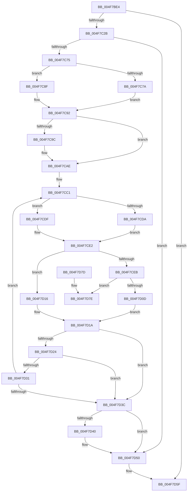

# MiApplyDebuggerPatches

- RVA: `0x004F7BE4`–`0x004F7D9A` (길이 `438` bytes)
- VA: `0x00000001404F7BE4`
- 실행 섹션: `.text`
- PDB 이름 있음: `예`; PDB Function 태그: `아니요`
- unwind 정보 RVA: `0x000BF718`
- 디코드: `117`개 명령, `438/438` bytes 표시
- 미해석 바이트: `0` (있으면 어셈블리에 `.byte`로 보존)

> 이 문서는 커널 이미지의 기계어와 PDB 기호를 분석해 생성했습니다. 4번과 5번은 함수 원형과 자료형을 바이너리 사용 방식에서 추정한 C 해석이며 원본 소스 복구 결과는 아닙니다.

## 1. Dependencies

- 직접 호출 지점: **9**; 고유 호출 대상: **9**
- 직접 호출자로 확인된 함수: **2**
- RIP 상대 이미지 참조: **3**

### Outgoing calls
- `0x004F7C47` → [ExAcquireSpinLockShared](../24/ExAcquireSpinLockShared_function_0024DCE0.md) (function, `0x0024DCE0`)
- `0x004F7C55` → [MiCompactDebuggerPatchTable](../68/MiCompactDebuggerPatchTable_function_006844C0.md) (function, `0x006844C0`)
- `0x004F7C68` → [MiFindFirstDebuggerPatch](../68/MiFindFirstDebuggerPatch_function_00685FA0.md) (function, `0x00685FA0`)
- `0x004F7C85` → [MiMapPageInHyperSpaceWorker](../33/MiMapPageInHyperSpaceWorker_function_00332B10.md) (function, `0x00332B10`)
- `0x004F7CA6` → [MiGetPagePrivilege](../28/MiGetPagePrivilege_function_00285420.md) (function, `0x00285420`)
- `0x004F7D04` → [MiDbgCopyPrivilegedData](../68/MiDbgCopyPrivilegedData_function_00685198.md) (function, `0x00685198`)
- `0x004F7D4B` → [MiUnmapPageInHyperSpaceWorker](../43/MiUnmapPageInHyperSpaceWorker_function_00432800.md) (function, `0x00432800`)
- `0x004F7D5A` → [MiReleaseSpinLockShared](../34/MiReleaseSpinLockShared_function_00348BF0.md) (function, `0x00348BF0`)
- `0x004F7D94` → [KeBugCheckEx](KeBugCheckEx_function_004FD660.md) (function, `0x004FD660`)

### Direct callers
- [MiWalkEntireImage](../36/MiWalkEntireImage_function_00365D70.md) at `0x00366E0F`
- [MiValidateInPage](../38/MiValidateInPage_function_00382E0C.md) at `0x003832CF`

### Static image references
- `0x004F7C06` → RVA `0x00E35BF8` (`.data`; read)
- `0x004F7C3D` → RVA `0x00E35BF0` (`.data`; read)
- `0x004F7CB2` → RVA `0x00E2CB40` (`.data`; read)

## 2. Other-region calls and transfers

- 다른 실행 섹션으로 향하는 call: **0**
- 별도 외부 분기/꼬리 이동을 확인하지 못했습니다.

## 3. Assembly (complete function range)

```asm
004F7BE4  48 8B C4                        mov rax, rsp
004F7BE7  48 89 58 08                     mov qword ptr [rax + 8], rbx
004F7BEB  48 89 68 10                     mov qword ptr [rax + 0x10], rbp
004F7BEF  48 89 70 18                     mov qword ptr [rax + 0x18], rsi
004F7BF3  57                              push rdi
004F7BF4  41 54                           push r12
004F7BF6  41 55                           push r13
004F7BF8  41 56                           push r14
004F7BFA  41 57                           push r15
004F7BFC  48 83 EC 50                     sub rsp, 0x50
004F7C00  45 33 F6                        xor r14d, r14d
004F7C03  0F 57 C0                        xorps xmm0, xmm0
004F7C06  44 39 35 EB DF 93 00            cmp dword ptr [rip + 0x93dfeb], r14d
004F7C0D  49 8B F1                        mov rsi, r9
004F7C10  45 8B E0                        mov r12d, r8d
004F7C13  44 89 70 BC                     mov dword ptr [rax - 0x44], r14d
004F7C17  48 8B DA                        mov rbx, rdx
004F7C1A  44 89 70 B8                     mov dword ptr [rax - 0x48], r14d
004F7C1E  4C 8B F9                        mov r15, rcx
004F7C21  0F 11 40 C0                     movups xmmword ptr [rax - 0x40], xmm0
004F7C25  0F 84 34 01 00 00               je 0x1404f7d5f
004F7C2B  4B 8D 3C 49                     lea rdi, [r9 + r9*2]
004F7C2F  48 C1 E7 04                     shl rdi, 4
004F7C33  48 B8 00 00 00 00 00 DE FF FF   movabs rax, 0xffffde0000000000
004F7C3D  48 8D 0D AC DF 93 00            lea rcx, [rip + 0x93dfac]
004F7C44  48 03 F8                        add rdi, rax
004F7C47  E8 94 60 D5 FF                  call 0x14024dce0
004F7C4C  41 8D 6E 01                     lea ebp, [r14 + 1]
004F7C50  44 8A E8                        mov r13b, al
004F7C53  8B CD                           mov ecx, ebp
004F7C55  E8 66 C8 18 00                  call 0x1406844c0
004F7C5A  4C 8D 4C 24 30                  lea r9, [rsp + 0x30]
004F7C5F  44 8B C5                        mov r8d, ebp
004F7C62  41 8B D4                        mov edx, r12d
004F7C65  49 8B CF                        mov rcx, r15
004F7C68  E8 33 E3 18 00                  call 0x140685fa0
004F7C6D  85 C0                           test eax, eax
004F7C6F  0F 84 DB 00 00 00               je 0x1404f7d50
004F7C75  48 85 DB                        test rbx, rbx
004F7C78  75 15                           jne 0x1404f7c8f
004F7C7A  33 D2                           xor edx, edx
004F7C7C  41 B8 00 00 00 80               mov r8d, 0x80000000
004F7C82  48 8B CE                        mov rcx, rsi
004F7C85  E8 86 AE E3 FF                  call 0x140332b10
004F7C8A  48 8B D8                        mov rbx, rax
004F7C8D  EB 03                           jmp 0x1404f7c92
004F7C8F  41 8B EE                        mov ebp, r14d
004F7C92  41 F7 47 5C 00 00 0C 00         test dword ptr [r15 + 0x5c], 0xc0000
004F7C9A  74 12                           je 0x1404f7cae
004F7C9C  4C 8D 44 24 38                  lea r8, [rsp + 0x38]
004F7CA1  33 D2                           xor edx, edx
004F7CA3  48 8B CF                        mov rcx, rdi
004F7CA6  E8 75 D7 D8 FF                  call 0x140285420
004F7CAB  44 8B F0                        mov r14d, eax
004F7CAE  8B 7C 24 30                     mov edi, dword ptr [rsp + 0x30]
004F7CB2  4C 8D 0D 87 4E 93 00            lea r9, [rip + 0x934e87]
004F7CB9  49 8B 8C F9 B0 80 00 00         mov rcx, qword ptr [r9 + rdi*8 + 0x80b0]
004F7CC1  44 8B 41 08                     mov r8d, dword ptr [rcx + 8]
004F7CC5  41 C1 E8 02                     shr r8d, 2
004F7CC9  41 81 E0 FF 03 00 00            and r8d, 0x3ff
004F7CD0  83 BC 24 A0 00 00 00 00         cmp dword ptr [rsp + 0xa0], 0
004F7CD8  74 05                           je 0x1404f7cdf
004F7CDA  8B 41 0C                        mov eax, dword ptr [rcx + 0xc]
004F7CDD  EB 03                           jmp 0x1404f7ce2
004F7CDF  8B 41 10                        mov eax, dword ptr [rcx + 0x10]
004F7CE2  89 44 24 34                     mov dword ptr [rsp + 0x34], eax
004F7CE6  45 85 F6                        test r14d, r14d
004F7CE9  74 2B                           je 0x1404f7d16
004F7CEB  41 C1 E0 02                     shl r8d, 2
004F7CEF  4C 8D 4C 24 34                  lea r9, [rsp + 0x34]
004F7CF4  48 8D 54 24 38                  lea rdx, [rsp + 0x38]
004F7CF9  C7 44 24 20 04 00 00 00         mov dword ptr [rsp + 0x20], 4
004F7D01  48 8B CE                        mov rcx, rsi
004F7D04  E8 8F D4 18 00                  call 0x140685198
004F7D09  85 C0                           test eax, eax
004F7D0B  78 71                           js 0x1404f7d7e
004F7D0D  4C 8D 0D 2C 4E 93 00            lea r9, [rip + 0x934e2c]
004F7D14  EB 04                           jmp 0x1404f7d1a
004F7D16  42 89 04 83                     mov dword ptr [rbx + r8*4], eax
004F7D1A  FF C7                           inc edi
004F7D1C  3B 3D D6 DE 93 00               cmp edi, dword ptr [rip + 0x93ded6]
004F7D22  73 18                           jae 0x1404f7d3c
004F7D24  49 8B 8C F9 B0 80 00 00         mov rcx, qword ptr [r9 + rdi*8 + 0x80b0]
004F7D2C  4C 39 39                        cmp qword ptr [rcx], r15
004F7D2F  75 0B                           jne 0x1404f7d3c
004F7D31  8B 41 08                        mov eax, dword ptr [rcx + 8]
004F7D34  C1 E8 0C                        shr eax, 0xc
004F7D37  41 3B C4                        cmp eax, r12d
004F7D3A  74 85                           je 0x1404f7cc1
004F7D3C  85 ED                           test ebp, ebp
004F7D3E  74 10                           je 0x1404f7d50
004F7D40  41 B8 00 00 00 80               mov r8d, 0x80000000
004F7D46  B2 11                           mov dl, 0x11
004F7D48  48 8B CB                        mov rcx, rbx
004F7D4B  E8 B0 AA F3 FF                  call 0x140432800
004F7D50  41 8A D5                        mov dl, r13b
004F7D53  48 8D 0D 96 DE 93 00            lea rcx, [rip + 0x93de96]
004F7D5A  E8 91 0E E5 FF                  call 0x140348bf0
004F7D5F  4C 8D 5C 24 50                  lea r11, [rsp + 0x50]
004F7D64  49 8B 5B 30                     mov rbx, qword ptr [r11 + 0x30]
004F7D68  49 8B 6B 38                     mov rbp, qword ptr [r11 + 0x38]
004F7D6C  49 8B 73 40                     mov rsi, qword ptr [r11 + 0x40]
004F7D70  49 8B E3                        mov rsp, r11
004F7D73  41 5F                           pop r15
004F7D75  41 5E                           pop r14
004F7D77  41 5D                           pop r13
004F7D79  41 5C                           pop r12
004F7D7B  5F                              pop rdi
004F7D7C  C3                              ret
004F7D7D  CC                              int3
004F7D7E  48 83 64 24 20 00               and qword ptr [rsp + 0x20], 0
004F7D84  4C 8B C6                        mov r8, rsi
004F7D87  4C 63 C8                        movsxd r9, eax
004F7D8A  BA 13 15 05 00                  mov edx, 0x51513
004F7D8F  B9 1A 00 00 00                  mov ecx, 0x1a
004F7D94  E8 C7 58 00 00                  call 0x1404fd660
004F7D99  CC                              int3
```

## 4. C-style interpretation (structured pseudocode)

```c
__int64 __fastcall MiApplyDebuggerPatches(__int64 a1, __int64 a2, int a3, __int64 a4, unsigned int a5)
{
    __int64 result;
    __int64 v_r14;
    __int64 v_rdi;
    __int64 v_rsp;
    unsigned __int64 v_stack_m28;
    unsigned __int64 v_stack_m30;
    unsigned __int64 v_stack_m40;
    unsigned int v_stack_m44;
    unsigned __int64 v_stack_m48;
    unsigned int v_stack_m58;

    *(unsigned __int64 *)(v_rsp + 8) = v_rbx;
    *(unsigned __int64 *)(v_rsp + 16) = v_rbp;
    *(unsigned __int64 *)(v_rsp + 24) = v_rsi;
    v_rsp = (v_rsp) - (80);
    v_r14 = 0;
    *(unsigned int *)(v_rsp - 68) = 0;
    *(unsigned int *)(v_rsp - 72) = 0;
    *(unsigned __int64 *)(v_rsp - 64) = v_xmm0;
    if ((*(unsigned int *)(v_rip + 9691115)) == 0) goto loc_004F7D5F;
    v_rdi = (a4 + a4 * 2) << (4);
    v_rdi = (v_rdi) + (v_rsp);
    result = ExAcquireSpinLockShared(v_rip + 9691052, a2, a3, a4);
    result = MiCompactDebuggerPatchTable((unsigned int)((unsigned int)(v_r14 + 1)), a2, a3, a4);
    result = MiFindFirstDebuggerPatch(a1, (unsigned int)((unsigned int)((unsigned int)(a3))), (unsigned int)((unsigned int)(v_r14 + 1)), v_stack_m48);
    if ((unsigned int)(result) == 0) goto loc_004F7D50;
    if (a2 != 0) goto loc_004F7C8F;
    a2 = 0;
    result = MiMapPageInHyperSpaceWorker(a4, a2, (unsigned int)(0x80000000ULL), v_stack_m48);
    goto loc_004F7C92;
loc_004F7C8F:
loc_004F7C92:
    if (((*(unsigned int *)(a1 + 92)) & (0xC0000ULL)) != 0) {
        a3 = v_stack_m40;
        a2 = 0;
        a1 = v_rdi;
        result = MiGetPagePrivilege(a1, a2, a3, v_stack_m48);
        v_r14 = (unsigned int)(result);
    }
loc_004F7CC1:
    a3 = (unsigned int)(((unsigned int)(*(unsigned int *)(*(unsigned __int64 *)(v_rip + 9653895 + (unsigned int)(v_stack_m48) * 8 + 32944) + 8))) >> (2));
    a3 = (unsigned int)((a3) & (0x3FFULL));
    if (a5 == 0) goto loc_004F7CDF;
    goto loc_004F7CE2;
loc_004F7CDF:
loc_004F7CE2:
    v_stack_m44 = (unsigned int)((unsigned int)(*(unsigned int *)(*(unsigned __int64 *)(v_rip + 9653895 + (unsigned int)(v_stack_m48) * 8 + 32944) + 16)));
    if ((unsigned int)(v_r14) == 0) goto loc_004F7D16;
    a3 = (unsigned int)((a3) << (2));
    v_stack_m58 = 4;
    result = MiDbgCopyPrivilegedData(a4, v_stack_m40, a3, v_stack_m44);
    if (sign_flag) goto loc_004F7D7E;
    goto loc_004F7D1A;
loc_004F7D16:
    *(unsigned int *)(result + a3 * 4) = (unsigned int)(result);
loc_004F7D1A:
    v_rdi = (unsigned int)(((unsigned int)(v_stack_m48)) + 1);
    if (((unsigned int)(v_rdi)) >= (*(unsigned int *)(v_rip + 9690838))) goto loc_004F7D3C;
    if ((*(unsigned __int64 *)(*(unsigned __int64 *)(v_rip + 9653804 + v_rdi * 8 + 32944))) != a1) goto loc_004F7D3C;
    result = (unsigned int)(((unsigned int)(*(unsigned int *)(*(unsigned __int64 *)(v_rip + 9653804 + v_rdi * 8 + 32944) + 8))) >> (12));
    if (((unsigned int)(result)) == ((unsigned int)((unsigned int)(a3)))) goto loc_004F7CC1;
loc_004F7D3C:
    if (0 != 0) {
        a3 = 0x80000000ULL;
        a2 = 17;
        a1 = result;
        result = MiUnmapPageInHyperSpaceWorker(a1, a2, a3, v_rip + 9653804);
    }
    result = MiReleaseSpinLockShared(v_rip + 9690774, (unsigned __int8)((unsigned __int8)(result)), a3, v_rip + 9653804);
loc_004F7D5F:
    return result;
loc_004F7D7E:
    result = KeBugCheckEx(26, (unsigned int)(0x51513ULL), *(unsigned __int64 *)(v_stack_m28 + 64), (int)((unsigned int)(result)));
    return result;
}
```

## 5. (Beta) C Style

```c
int64_t MiApplyDebuggerPatches(void *Arg1, int64_t Arg2, int32_t Arg3, void *Arg4, uint32_t Arg5)
{
    uint8_t *arg1 = (uint8_t *)Arg1;
    uint8_t *arg4 = (uint8_t *)Arg4;

    int64_t result;
    int64_t local_r14;
    int64_t local_rdi;
    int64_t local_rsp;
    uint64_t v_stack_m28;
    uint64_t v_stack_m30;
    uint64_t v_stack_m40;
    uint32_t v_stack_m44;
    uint64_t v_stack_m48;
    uint32_t v_stack_m58;

    *(uint64_t *)(local_rsp + 0x8) = local_rbx;
    *(uint64_t *)(local_rsp + 0x10) = local_rbp;
    *(uint64_t *)(local_rsp + 0x18) = local_rsi;
    local_rsp = (local_rsp) - (80);
    local_r14 = 0;
    *(uint32_t *)(local_rsp - 0x44) = 0;
    *(uint32_t *)(local_rsp - 0x48) = 0;
    *(uint64_t *)(local_rsp - 0x40) = v_xmm0;
    if ((*(uint32_t *)(v_rip + 0x93DFEB)) == 0) goto loc_004F7D5F;
    local_rdi = (Arg4 + Arg4 * 2) << (4);
    local_rdi = (local_rdi) + (local_rsp);
    result = ExAcquireSpinLockShared(v_rip + 9691052, Arg2, Arg3, Arg4);
    result = MiCompactDebuggerPatchTable((uint32_t)((uint32_t)(local_r14 + 1)), Arg2, Arg3, Arg4);
    result = MiFindFirstDebuggerPatch(Arg1, (uint32_t)((uint32_t)((uint32_t)(Arg3))), (uint32_t)((uint32_t)(local_r14 + 1)), v_stack_m48);
    if ((uint32_t)(result) == 0) goto loc_004F7D50;
    if (Arg2 != 0) goto loc_004F7C8F;
    Arg2 = 0;
    result = MiMapPageInHyperSpaceWorker(Arg4, Arg2, (uint32_t)(0x80000000ULL), v_stack_m48);
    goto loc_004F7C92;
loc_004F7C8F:
loc_004F7C92:
    if (((*(uint32_t *)(arg1 + 0x5C)) & (0xC0000ULL)) != 0) {
        Arg3 = v_stack_m40;
        Arg2 = 0;
        Arg1 = local_rdi;
        result = MiGetPagePrivilege(Arg1, Arg2, Arg3, v_stack_m48);
        local_r14 = (uint32_t)(result);
    }
loc_004F7CC1:
    Arg3 = (uint32_t)(((uint32_t)(*(uint32_t *)(*(uint64_t *)(v_rip + 0x934E87 + (uint32_t)(v_stack_m48) * 8 + 0x80B0) + 0x8))) >> (2));
    Arg3 = (uint32_t)((Arg3) & (0x3FFULL));
    if (Arg5 == 0) goto loc_004F7CDF;
    goto loc_004F7CE2;
loc_004F7CDF:
loc_004F7CE2:
    v_stack_m44 = (uint32_t)((uint32_t)(*(uint32_t *)(*(uint64_t *)(v_rip + 0x934E87 + (uint32_t)(v_stack_m48) * 8 + 0x80B0) + 0x10)));
    if ((uint32_t)(local_r14) == 0) goto loc_004F7D16;
    Arg3 = (uint32_t)((Arg3) << (2));
    v_stack_m58 = 4;
    result = MiDbgCopyPrivilegedData(Arg4, v_stack_m40, Arg3, v_stack_m44);
    if (sign_flag) goto loc_004F7D7E;
    goto loc_004F7D1A;
loc_004F7D16:
    *(uint32_t *)(result + Arg3 * 4) = (uint32_t)(result);
loc_004F7D1A:
    local_rdi = (uint32_t)(((uint32_t)(v_stack_m48)) + 1);
    if (((uint32_t)(local_rdi)) >= (*(uint32_t *)(v_rip + 0x93DED6))) goto loc_004F7D3C;
    if ((*(uint64_t *)(*(uint64_t *)(v_rip + 0x934E2C + local_rdi * 8 + 0x80B0))) != Arg1) goto loc_004F7D3C;
    result = (uint32_t)(((uint32_t)(*(uint32_t *)(*(uint64_t *)(v_rip + 0x934E2C + local_rdi * 8 + 0x80B0) + 0x8))) >> (12));
    if (((uint32_t)(result)) == ((uint32_t)((uint32_t)(Arg3)))) goto loc_004F7CC1;
loc_004F7D3C:
    if (0 != 0) {
        Arg3 = 0x80000000ULL;
        Arg2 = 17;
        Arg1 = result;
        result = MiUnmapPageInHyperSpaceWorker(Arg1, Arg2, Arg3, v_rip + 9653804);
    }
    result = MiReleaseSpinLockShared(v_rip + 9690774, (uint8_t)((uint8_t)(result)), Arg3, v_rip + 9653804);
loc_004F7D5F:
    return result;
loc_004F7D7E:
    result = KeBugCheckEx(26, (uint32_t)(0x51513ULL), *(uint64_t *)(v_stack_m28 + 0x40), (int32_t)((uint32_t)(result)));
    return result;
}
```

### 관측된 메모리 오프셋

구조체 형식이 확인되지 않은 접근은 인자 기준의 오프셋으로만 기록했습니다.

| 기준 인자 | 오프셋 표현 | 폭 (bit) | 접근 |
|---|---:|---:|---|
| `Arg1` | `+ 0x5C` | `32` | `R` |
| `Arg4` | `+ 0x0 + r9*2` | `64` | `R` |

## 6. Execution-region graph

[열기: 2D/3D 그래프와 함수 탐색 컨트롤 패널](../../../control-panel.html?section=text&rva=0x004F7BE4&view=graph)

- 2D 그래프는 위에서 아래로 흐르고, 3D 그래프는 빈 공간을 드래그해 회전합니다. Shift+드래그는 이동, 휠은 확대·축소, 함수 노드 선택은 대상 보고서 이동입니다.

### Static fallback


