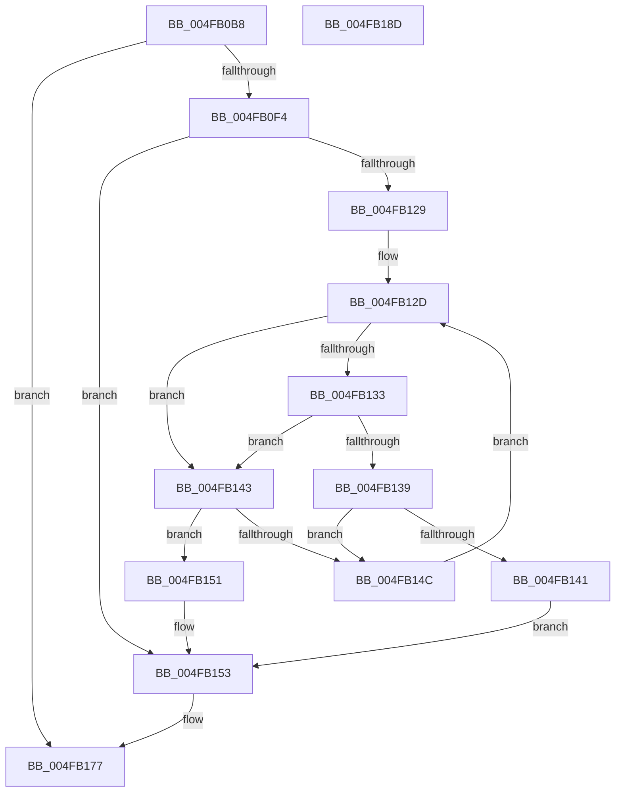

# MiCreateKernelStackNode

- RVA: `0x004FB0B8`–`0x004FB18E` (길이 `214` bytes)
- VA: `0x00000001404FB0B8`
- 실행 섹션: `.text`
- PDB 이름 있음: `예`; PDB Function 태그: `아니요`
- unwind 정보 RVA: `0x0006F978`
- 디코드: `58`개 명령, `214/214` bytes 표시
- 미해석 바이트: `0` (있으면 어셈블리에 `.byte`로 보존)

> 이 문서는 커널 이미지의 기계어와 PDB 기호를 분석해 생성했습니다. 4번과 5번은 함수 원형과 자료형을 바이너리 사용 방식에서 추정한 C 해석이며 원본 소스 복구 결과는 아닙니다.

## 1. Dependencies

- 직접 호출 지점: **4**; 고유 호출 대상: **4**
- 직접 호출자로 확인된 함수: **1**
- RIP 상대 이미지 참조: **2**

### Outgoing calls
- `0x004FB0E1` → [MiAllocatePool](../35/MiAllocatePool_function_0035B540.md) (function, `0x0035B540`)
- `0x004FB115` → [ExAcquireSpinLockExclusive](../24/ExAcquireSpinLockExclusive_function_00248690.md) (function, `0x00248690`)
- `0x004FB160` → [RtlAvlInsertNodeEx](../26/RtlAvlInsertNodeEx_function_00265790.md) (function, `0x00265790`)
- `0x004FB16F` → [MiReleaseSpinLockExclusive](../24/MiReleaseSpinLockExclusive_function_002482C0.md) (function, `0x002482C0`)

### Direct callers
- [MiOutPageSingleKernelStack](../2A/MiOutPageSingleKernelStack_function_002A1790.md) at `0x002A1BA1`

### Static image references
- `0x004FB0F7` → RVA `0x00E35FD8` (`.data`; read)
- `0x004FB11A` → RVA `0x00E35FD0` (`.data`; read)

## 2. Other-region calls and transfers

- 다른 실행 섹션으로 향하는 call: **0**
- 별도 외부 분기/꼬리 이동을 확인하지 못했습니다.

## 3. Assembly (complete function range)

```asm
004FB0B8  48 89 5C 24 08                  mov qword ptr [rsp + 8], rbx
004FB0BD  48 89 74 24 10                  mov qword ptr [rsp + 0x10], rsi
004FB0C2  48 89 7C 24 18                  mov qword ptr [rsp + 0x18], rdi
004FB0C7  41 56                           push r14
004FB0C9  48 83 EC 20                     sub rsp, 0x20
004FB0CD  48 8B F2                        mov rsi, rdx
004FB0D0  4C 8B F1                        mov r14, rcx
004FB0D3  BA 30 00 00 00                  mov edx, 0x30
004FB0D8  41 B8 4D 69 4B 73               mov r8d, 0x734b694d
004FB0DE  8D 4A 10                        lea ecx, [rdx + 0x10]
004FB0E1  E8 5A 04 E6 FF                  call 0x14035b540
004FB0E6  33 DB                           xor ebx, ebx
004FB0E8  48 8B F8                        mov rdi, rax
004FB0EB  48 85 C0                        test rax, rax
004FB0EE  0F 84 83 00 00 00               je 0x1404fb177
004FB0F4  48 8B 06                        mov rax, qword ptr [rsi]
004FB0F7  48 8D 0D DA AE 93 00            lea rcx, [rip + 0x93aeda]
004FB0FE  48 FF C8                        dec rax
004FB101  48 89 47 18                     mov qword ptr [rdi + 0x18], rax
004FB105  48 8B 46 08                     mov rax, qword ptr [rsi + 8]
004FB109  48 89 47 20                     mov qword ptr [rdi + 0x20], rax
004FB10D  41 0F B7 06                     movzx eax, word ptr [r14]
004FB111  66 89 47 28                     mov word ptr [rdi + 0x28], ax
004FB115  E8 76 D5 D4 FF                  call 0x140248690
004FB11A  48 8B 15 AF AE 93 00            mov rdx, qword ptr [rip + 0x93aeaf]
004FB121  40 8A F0                        mov sil, al
004FB124  48 85 D2                        test rdx, rdx
004FB127  74 2A                           je 0x1404fb153
004FB129  48 8B 4F 18                     mov rcx, qword ptr [rdi + 0x18]
004FB12D  48 3B 4A 18                     cmp rcx, qword ptr [rdx + 0x18]
004FB131  77 10                           ja 0x1404fb143
004FB133  48 3B 4A 20                     cmp rcx, qword ptr [rdx + 0x20]
004FB137  73 0A                           jae 0x1404fb143
004FB139  48 8B 02                        mov rax, qword ptr [rdx]
004FB13C  48 85 C0                        test rax, rax
004FB13F  75 0B                           jne 0x1404fb14c
004FB141  EB 10                           jmp 0x1404fb153
004FB143  48 8B 42 08                     mov rax, qword ptr [rdx + 8]
004FB147  48 85 C0                        test rax, rax
004FB14A  74 05                           je 0x1404fb151
004FB14C  48 8B D0                        mov rdx, rax
004FB14F  EB DC                           jmp 0x1404fb12d
004FB151  B3 01                           mov bl, 1
004FB153  4C 8B CF                        mov r9, rdi
004FB156  48 8D 0D 73 AE 93 00            lea rcx, [rip + 0x93ae73]
004FB15D  44 8A C3                        mov r8b, bl
004FB160  E8 2B A6 D6 FF                  call 0x140265790
004FB165  40 8A D6                        mov dl, sil
004FB168  48 8D 0D 69 AE 93 00            lea rcx, [rip + 0x93ae69]
004FB16F  E8 4C D1 D4 FF                  call 0x1402482c0
004FB174  48 8B C7                        mov rax, rdi
004FB177  48 8B 5C 24 30                  mov rbx, qword ptr [rsp + 0x30]
004FB17C  48 8B 74 24 38                  mov rsi, qword ptr [rsp + 0x38]
004FB181  48 8B 7C 24 40                  mov rdi, qword ptr [rsp + 0x40]
004FB186  48 83 C4 20                     add rsp, 0x20
004FB18A  41 5E                           pop r14
004FB18C  C3                              ret
004FB18D  CC                              int3
```

## 4. C-style interpretation (structured pseudocode)

```c
__int64 __fastcall MiCreateKernelStackNode(__int64 a1, __int64 a2)
{
    __int64 result;
    __int64 v_rbx;
    __int64 v_rsp;
    unsigned __int64 v_stack_p10;
    unsigned __int64 v_stack_p18;
    unsigned __int64 v_stack_p8;

    v_stack_p8 = v_rbx;
    v_stack_p10 = v_rsi;
    v_stack_p18 = v_rdi;
    v_rsp = (v_rsp) - (32);
    result = MiAllocatePool(48 + 16, 48, (unsigned int)(0x734B694DULL), a4);
    v_rbx = 0;
    if (result == 0) goto loc_004FB177;
    result = (*(unsigned __int64 *)(a2)) - 1;
    *(unsigned __int64 *)(result + 24) = result;
    *(unsigned __int64 *)(result + 32) = *(unsigned __int64 *)(a2 + 8);
    *(unsigned __int16 *)(result + 40) = (unsigned __int16)(*(unsigned __int16 *)(a1));
    result = ExAcquireSpinLockExclusive(v_rip + 9678554, 48, (unsigned int)(0x734B694DULL), a4);
    if (*(unsigned __int64 *)(v_rip + 9678511) == 0) goto loc_004FB153;
loc_004FB12D:
    if ((*(unsigned __int64 *)(result + 24)) > (*(unsigned __int64 *)(*(unsigned __int64 *)(v_rip + 9678511) + 24))) goto loc_004FB143;
    if ((*(unsigned __int64 *)(result + 24)) >= (*(unsigned __int64 *)(*(unsigned __int64 *)(v_rip + 9678511) + 32))) goto loc_004FB143;
    if (*(unsigned __int64 *)(*(unsigned __int64 *)(v_rip + 9678511)) != 0) goto loc_004FB14C;
    goto loc_004FB153;
loc_004FB143:
    if (*(unsigned __int64 *)(*(unsigned __int64 *)(v_rip + 9678511) + 8) == 0) goto loc_004FB151;
loc_004FB14C:
    goto loc_004FB12D;
loc_004FB151:
loc_004FB153:
    result = RtlAvlInsertNodeEx(v_rip + 9678451, *(unsigned __int64 *)(*(unsigned __int64 *)(v_rip + 9678511) + 8), 1, result);
    result = MiReleaseSpinLockExclusive(v_rip + 9678441, (unsigned __int8)((unsigned __int8)(result)), 1, result);
loc_004FB177:
    v_rsp = (v_rsp) + (32);
    return result;
}
```

## 5. (Beta) C Style

```c
int64_t MiCreateKernelStackNode(void *Arg1, void *Arg2)
{
    uint8_t *arg1 = (uint8_t *)Arg1;
    uint8_t *arg2 = (uint8_t *)Arg2;

    int64_t result;
    int64_t local_rbx;
    int64_t local_rsp;
    uint64_t v_stack_p10;
    uint64_t v_stack_p18;
    uint64_t v_stack_p8;

    v_stack_p8 = local_rbx;
    v_stack_p10 = local_rsi;
    v_stack_p18 = local_rdi;
    local_rsp = (local_rsp) - (32);
    result = MiAllocatePool(48 + 16, 48, (uint32_t)(0x734B694DULL), a4);
    local_rbx = 0;
    if (result == 0) goto loc_004FB177;
    result = (*(uint64_t *)(arg2)) - 1;
    *(uint64_t *)(result + 0x18) = result;
    *(uint64_t *)(result + 0x20) = *(uint64_t *)(arg2 + 0x8);
    *(uint16_t *)(result + 0x28) = (uint16_t)(*(uint16_t *)(arg1));
    result = ExAcquireSpinLockExclusive(v_rip + 9678554, 48, (uint32_t)(0x734B694DULL), a4);
    if (*(uint64_t *)(v_rip + 0x93AEAF) == 0) goto loc_004FB153;
loc_004FB12D:
    if ((*(uint64_t *)(result + 0x18)) > (*(uint64_t *)(*(uint64_t *)(v_rip + 0x93AEAF) + 0x18))) goto loc_004FB143;
    if ((*(uint64_t *)(result + 0x18)) >= (*(uint64_t *)(*(uint64_t *)(v_rip + 0x93AEAF) + 0x20))) goto loc_004FB143;
    if (*(uint64_t *)(*(uint64_t *)(v_rip + 0x93AEAF)) != 0) goto loc_004FB14C;
    goto loc_004FB153;
loc_004FB143:
    if (*(uint64_t *)(*(uint64_t *)(v_rip + 0x93AEAF) + 0x8) == 0) goto loc_004FB151;
loc_004FB14C:
    goto loc_004FB12D;
loc_004FB151:
loc_004FB153:
    result = RtlAvlInsertNodeEx(v_rip + 9678451, *(uint64_t *)(*(uint64_t *)(v_rip + 0x93AEAF) + 0x8), 1, result);
    result = MiReleaseSpinLockExclusive(v_rip + 9678441, (uint8_t)((uint8_t)(result)), 1, result);
loc_004FB177:
    local_rsp = (local_rsp) + (32);
    return result;
}
```

### 관측된 메모리 오프셋

구조체 형식이 확인되지 않은 접근은 인자 기준의 오프셋으로만 기록했습니다.

| 기준 인자 | 오프셋 표현 | 폭 (bit) | 접근 |
|---|---:|---:|---|
| `Arg1` | `+ 0x0` | `16` | `R` |
| `Arg2` | `+ 0x0` | `64` | `R` |
| `Arg2` | `+ 0x8` | `64` | `R` |

## 6. Execution-region graph

[열기: 2D/3D 그래프와 함수 탐색 컨트롤 패널](../../../control-panel.html?section=text&rva=0x004FB0B8&view=graph)

- 2D 그래프는 위에서 아래로 흐르고, 3D 그래프는 빈 공간을 드래그해 회전합니다. Shift+드래그는 이동, 휠은 확대·축소, 함수 노드 선택은 대상 보고서 이동입니다.

### Static fallback


