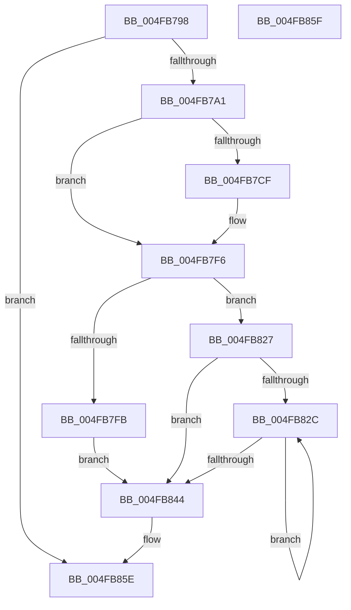

# MiDecommitAddTbFlushEntries

- RVA: `0x004FB798`–`0x004FB860` (길이 `200` bytes)
- VA: `0x00000001404FB798`
- 실행 섹션: `.text`
- PDB 이름 있음: `예`; PDB Function 태그: `아니요`
- unwind 정보 RVA: `0x000BFA24`
- 디코드: `55`개 명령, `200/200` bytes 표시
- 미해석 바이트: `0` (있으면 어셈블리에 `.byte`로 보존)

> 이 문서는 커널 이미지의 기계어와 PDB 기호를 분석해 생성했습니다. 4번과 5번은 함수 원형과 자료형을 바이너리 사용 방식에서 추정한 C 해석이며 원본 소스 복구 결과는 아닙니다.

## 1. Dependencies

- 직접 호출 지점: **4**; 고유 호출 대상: **4**
- 직접 호출자로 확인된 함수: **3**
- RIP 상대 이미지 참조: **0**

### Outgoing calls
- `0x004FB7CF` → [MiGetProcessorFlushList](../24/MiGetProcessorFlushList_function_00242C90.md) (function, `0x00242C90`)
- `0x004FB7F1` → [MiInitializeTbFlushList](../29/MiInitializeTbFlushList_function_00294F00.md) (function, `0x00294F00`)
- `0x004FB820` → [MiInsertTbFlushEntry](../29/MiInsertTbFlushEntry_function_00293670.md) (function, `0x00293670`)
- `0x004FB835` → [MiInsertLargeTbFlushEntry](../37/MiInsertLargeTbFlushEntry_function_0037827C.md) (function, `0x0037827C`)

### Direct callers
- [MiDeleteVa](../27/MiDeleteVa_function_002789E0.md) at `0x00278FC9`
- [MiDeleteLargeUserPde](../4C/MiDeleteLargeUserPde_function_004C4D54.md) at `0x004C4E8A`
- [MiDecommitLargePte](../4D/MiDecommitLargePte_function_004D1ED4.md) at `0x004D1F9E`

### Static image references
- 디코드된 RIP-relative 메모리 참조가 없습니다.

## 2. Other-region calls and transfers

- 다른 실행 섹션으로 향하는 call: **0**
- 별도 외부 분기/꼬리 이동을 확인하지 못했습니다.

## 3. Assembly (complete function range)

```asm
004FB798  4D 85 C9                        test r9, r9
004FB79B  0F 84 BD 00 00 00               je 0x1404fb85e
004FB7A1  48 8B C4                        mov rax, rsp
004FB7A4  48 89 58 08                     mov qword ptr [rax + 8], rbx
004FB7A8  48 89 68 10                     mov qword ptr [rax + 0x10], rbp
004FB7AC  48 89 70 18                     mov qword ptr [rax + 0x18], rsi
004FB7B0  48 89 78 20                     mov qword ptr [rax + 0x20], rdi
004FB7B4  41 56                           push r14
004FB7B6  48 83 EC 30                     sub rsp, 0x30
004FB7BA  48 8B 71 10                     mov rsi, qword ptr [rcx + 0x10]
004FB7BE  49 8B F9                        mov rdi, r9
004FB7C1  45 8B F0                        mov r14d, r8d
004FB7C4  48 8B DA                        mov rbx, rdx
004FB7C7  48 8B E9                        mov rbp, rcx
004FB7CA  48 85 F6                        test rsi, rsi
004FB7CD  75 27                           jne 0x1404fb7f6
004FB7CF  E8 BC 74 D4 FF                  call 0x140242c90
004FB7D4  48 8B 55 20                     mov rdx, qword ptr [rbp + 0x20]
004FB7D8  45 33 C9                        xor r9d, r9d
004FB7DB  48 89 45 10                     mov qword ptr [rbp + 0x10], rax
004FB7DF  48 8B C8                        mov rcx, rax
004FB7E2  48 8B F0                        mov rsi, rax
004FB7E5  C7 44 24 20 01 00 00 00         mov dword ptr [rsp + 0x20], 1
004FB7ED  44 8B 40 0C                     mov r8d, dword ptr [rax + 0xc]
004FB7F1  E8 0A 97 D9 FF                  call 0x140294f00
004FB7F6  45 85 F6                        test r14d, r14d
004FB7F9  75 2C                           jne 0x1404fb827
004FB7FB  48 C1 E3 19                     shl rbx, 0x19
004FB7FF  48 B8 00 00 00 00 80 F6 FF FF   movabs rax, 0xfffff68000000000
004FB809  48 C1 E0 19                     shl rax, 0x19
004FB80D  45 33 C9                        xor r9d, r9d
004FB810  48 2B D8                        sub rbx, rax
004FB813  4C 8B C7                        mov r8, rdi
004FB816  48 C1 FB 10                     sar rbx, 0x10
004FB81A  48 8B CE                        mov rcx, rsi
004FB81D  48 8B D3                        mov rdx, rbx
004FB820  E8 4B 7E D9 FF                  call 0x140293670
004FB825  EB 1D                           jmp 0x1404fb844
004FB827  48 85 FF                        test rdi, rdi
004FB82A  74 18                           je 0x1404fb844
004FB82C  4C 8B C3                        mov r8, rbx
004FB82F  41 8B D6                        mov edx, r14d
004FB832  48 8B CE                        mov rcx, rsi
004FB835  E8 42 CA E7 FF                  call 0x14037827c
004FB83A  48 83 C3 08                     add rbx, 8
004FB83E  48 83 EF 01                     sub rdi, 1
004FB842  75 E8                           jne 0x1404fb82c
004FB844  48 8B 5C 24 40                  mov rbx, qword ptr [rsp + 0x40]
004FB849  48 8B 6C 24 48                  mov rbp, qword ptr [rsp + 0x48]
004FB84E  48 8B 74 24 50                  mov rsi, qword ptr [rsp + 0x50]
004FB853  48 8B 7C 24 58                  mov rdi, qword ptr [rsp + 0x58]
004FB858  48 83 C4 30                     add rsp, 0x30
004FB85C  41 5E                           pop r14
004FB85E  C3                              ret
004FB85F  CC                              int3
```

## 4. C-style interpretation (structured pseudocode)

```c
__int64 __fastcall MiDecommitAddTbFlushEntries(__int64 a1, __int64 a2, int a3, __int64 a4)
{
    __int64 result;
    __int64 v_rbx;
    __int64 v_rdi;
    __int64 v_rsi;
    __int64 v_rsp;
    unsigned int v_stack_m18;
    unsigned __int64 v_stack_p10;
    unsigned __int64 v_stack_p18;
    unsigned __int64 v_stack_p20;
    unsigned __int64 v_stack_p8;

    if (a4 == 0) goto loc_004FB85E;
    *(unsigned __int64 *)(v_rsp + 8) = v_rbx;
    *(unsigned __int64 *)(v_rsp + 16) = v_rbp;
    *(unsigned __int64 *)(v_rsp + 24) = v_rsi;
    *(unsigned __int64 *)(v_rsp + 32) = v_rdi;
    v_rsp = (v_rsp) - (48);
    result = v_rsp;
    v_rsi = *(unsigned __int64 *)(a1 + 16);
    if (*(unsigned __int64 *)(a1 + 16) == 0) {
        result = MiGetProcessorFlushList(a1, a2, a3, a4);
        a2 = *(unsigned __int64 *)(a1 + 32);
        a4 = 0;
        *(unsigned __int64 *)(a1 + 16) = result;
        a1 = result;
        v_rsi = result;
        v_stack_m18 = 1;
        a3 = *(unsigned int *)(result + 12);
        result = MiInitializeTbFlushList(a1, a2, a3, a4);
    }
    if ((unsigned int)((unsigned int)(a3)) != 0) goto loc_004FB827;
    v_rbx = (a2) << (25);
    result = (result) << (25);
    a4 = 0;
    v_rbx = (v_rbx) - (result);
    v_rbx = (v_rbx) >> (16);
    result = MiInsertTbFlushEntry(v_rsi, v_rbx, 0, a4);
    goto loc_004FB844;
loc_004FB827:
    if (0 == 0) goto loc_004FB844;
loc_004FB82C:
    result = MiInsertLargeTbFlushEntry(v_rsi, (unsigned int)((unsigned int)((unsigned int)(a3))), v_rbx, a4);
    v_rbx = (v_rbx) + (8);
    v_rdi = (a4) - (1);
    if (condition_is_not_equal) goto loc_004FB82C;
loc_004FB844:
    v_rsp = (v_rsp) + (48);
loc_004FB85E:
    return result;
}
```

## 5. (Beta) C Style

```c
int64_t MiDecommitAddTbFlushEntries(void *Arg1, int64_t Arg2, int32_t Arg3, int64_t Arg4)
{
    uint8_t *arg1 = (uint8_t *)Arg1;

    int64_t result;
    int64_t local_rbx;
    int64_t local_rdi;
    int64_t local_rsi;
    int64_t local_rsp;
    uint32_t v_stack_m18;
    uint64_t v_stack_p10;
    uint64_t v_stack_p18;
    uint64_t v_stack_p20;
    uint64_t v_stack_p8;

    if (Arg4 == 0) goto loc_004FB85E;
    *(uint64_t *)(local_rsp + 0x8) = local_rbx;
    *(uint64_t *)(local_rsp + 0x10) = local_rbp;
    *(uint64_t *)(local_rsp + 0x18) = local_rsi;
    *(uint64_t *)(local_rsp + 0x20) = local_rdi;
    local_rsp = (local_rsp) - (48);
    result = local_rsp;
    local_rsi = *(uint64_t *)(arg1 + 0x10);
    if (*(uint64_t *)(arg1 + 0x10) == 0) {
        result = MiGetProcessorFlushList(Arg1, Arg2, Arg3, Arg4);
        Arg2 = *(uint64_t *)(arg1 + 0x20);
        Arg4 = 0;
        *(uint64_t *)(arg1 + 0x10) = result;
        Arg1 = result;
        local_rsi = result;
        v_stack_m18 = 1;
        Arg3 = *(uint32_t *)(result + 0xC);
        result = MiInitializeTbFlushList(Arg1, Arg2, Arg3, Arg4);
    }
    if ((uint32_t)((uint32_t)(Arg3)) != 0) goto loc_004FB827;
    local_rbx = (Arg2) << (25);
    result = (result) << (25);
    Arg4 = 0;
    local_rbx = (local_rbx) - (result);
    local_rbx = (local_rbx) >> (16);
    result = MiInsertTbFlushEntry(local_rsi, local_rbx, 0, Arg4);
    goto loc_004FB844;
loc_004FB827:
    if (0 == 0) goto loc_004FB844;
loc_004FB82C:
    result = MiInsertLargeTbFlushEntry(local_rsi, (uint32_t)((uint32_t)((uint32_t)(Arg3))), local_rbx, Arg4);
    local_rbx = (local_rbx) + (8);
    local_rdi = (Arg4) - (1);
    if (condition_is_not_equal) goto loc_004FB82C;
loc_004FB844:
    local_rsp = (local_rsp) + (48);
loc_004FB85E:
    return result;
}
```

### 관측된 메모리 오프셋

구조체 형식이 확인되지 않은 접근은 인자 기준의 오프셋으로만 기록했습니다.

| 기준 인자 | 오프셋 표현 | 폭 (bit) | 접근 |
|---|---:|---:|---|
| `Arg1` | `+ 0x10` | `64` | `R` |
| `Arg1` | `+ 0x10` | `64` | `W` |
| `Arg1` | `+ 0x20` | `64` | `R` |

## 6. Execution-region graph

[열기: 2D/3D 그래프와 함수 탐색 컨트롤 패널](../../../control-panel.html?section=text&rva=0x004FB798&view=graph)

- 2D 그래프는 위에서 아래로 흐르고, 3D 그래프는 빈 공간을 드래그해 회전합니다. Shift+드래그는 이동, 휠은 확대·축소, 함수 노드 선택은 대상 보고서 이동입니다.

### Static fallback


