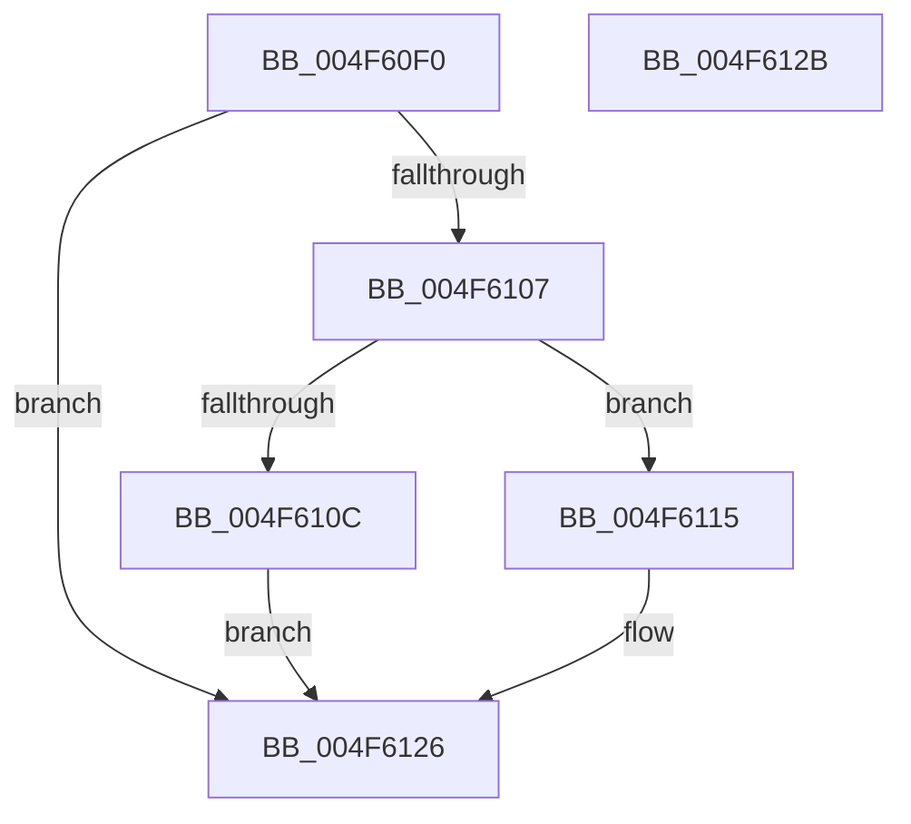

# MiDecrementCloneHeaderCount

- RVA: `0x004F60F0`–`0x004F612C` (길이 `60` bytes)
- VA: `0x00000001404F60F0`
- 실행 섹션: `.text`
- PDB 이름 있음: `예`; PDB Function 태그: `아니요`
- unwind 정보 RVA: `0x0005C788`
- 디코드: `17`개 명령, `60/60` bytes 표시
- 미해석 바이트: `0` (있으면 어셈블리에 `.byte`로 보존)

> 이 문서는 커널 이미지의 기계어와 PDB 기호를 분석해 생성했습니다. 4번과 5번은 함수 원형과 자료형을 바이너리 사용 방식에서 추정한 C 해석이며 원본 소스 복구 결과는 아닙니다.

## 1. Dependencies

- 직접 호출 지점: **1**; 고유 호출 대상: **1**
- 직접 호출자로 확인된 함수: **3**
- RIP 상대 이미지 참조: **0**

### Outgoing calls
- `0x004F6121` → [KeSetEvent](../33/KeSetEvent_function_0033F310.md) (function, `0x0033F310`)

### Direct callers
- [MiDeleteCloneDescriptor](MiDeleteCloneDescriptor_function_004F9E28.md) at `0x004F9EA4`
- [MiDrainCrossPartitionUsage](../69/MiDrainCrossPartitionUsage_function_00690984.md) at `0x00690AC4`
- [MiFreeCloneDescriptor](../../page/A8/MiFreeCloneDescriptor_function_00A89F0C.md) at `0x00A89F61`

### Static image references
- 디코드된 RIP-relative 메모리 참조가 없습니다.

## 2. Other-region calls and transfers

- 다른 실행 섹션으로 향하는 call: **0**
- 별도 외부 분기/꼬리 이동을 확인하지 못했습니다.

## 3. Assembly (complete function range)

```asm
004F60F0  48 83 EC 28                     sub rsp, 0x28
004F60F4  48 83 C8 FF                     or rax, 0xffffffffffffffff
004F60F8  F0 48 0F C1 81 D8 06 00 00      lock xadd qword ptr [rcx + 0x6d8], rax
004F6101  48 83 E8 01                     sub rax, 1
004F6105  7F 1F                           jg 0x1404f6126
004F6107  48 85 C0                        test rax, rax
004F610A  74 09                           je 0x1404f6115
004F610C  B9 0E 00 00 00                  mov ecx, 0xe
004F6111  CD 29                           int 0x29
004F6113  EB 11                           jmp 0x1404f6126
004F6115  48 8B 89 E8 0A 00 00            mov rcx, qword ptr [rcx + 0xae8]
004F611C  45 33 C0                        xor r8d, r8d
004F611F  33 D2                           xor edx, edx
004F6121  E8 EA 91 E4 FF                  call 0x14033f310
004F6126  48 83 C4 28                     add rsp, 0x28
004F612A  C3                              ret
004F612B  CC                              int3
```

## 4. C-style interpretation (structured pseudocode)

```c
__int64 __fastcall MiDecrementCloneHeaderCount(__int64 a1, int a2, int a3)
{
    __int64 result;
    __int64 v_rsp;

    v_rsp = (v_rsp) - (40);
    result = (result) | (-1);
    result = (result) - (1);
    if (condition_is_greater) goto loc_004F6126;
    if (result == 0) goto loc_004F6115;
    goto loc_004F6126;
loc_004F6115:
    a3 = 0;
    a2 = 0;
    result = KeSetEvent(*(unsigned __int64 *)(14 + 2792), a2, a3, a4);
loc_004F6126:
    v_rsp = (v_rsp) + (40);
    return result;
}
```

## 5. (Beta) C Style

```c
int64_t MiDecrementCloneHeaderCount(void *Arg1, int32_t Arg2, int32_t Arg3)
{
    uint8_t *arg1 = (uint8_t *)Arg1;

    int64_t result;
    int64_t local_rsp;

    local_rsp = (local_rsp) - (40);
    result = (result) | (-1);
    result = (result) - (1);
    if (condition_is_greater) goto loc_004F6126;
    if (result == 0) goto loc_004F6115;
    goto loc_004F6126;
loc_004F6115:
    Arg3 = 0;
    Arg2 = 0;
    result = KeSetEvent(*(uint64_t *)(14 + 0xAE8), Arg2, Arg3, a4);
loc_004F6126:
    local_rsp = (local_rsp) + (40);
    return result;
}
```

### 관측된 메모리 오프셋

구조체 형식이 확인되지 않은 접근은 인자 기준의 오프셋으로만 기록했습니다.

| 기준 인자 | 오프셋 표현 | 폭 (bit) | 접근 |
|---|---:|---:|---|
| `Arg1` | `+ 0x6D8` | `64` | `R/W` |
| `Arg1` | `+ 0xAE8` | `64` | `R` |

## 6. Execution-region graph

[열기: 2D/3D 그래프와 함수 탐색 컨트롤 패널](../../../control-panel.html?section=text&rva=0x004F60F0&view=graph)

- 2D 그래프는 위에서 아래로 흐르고, 3D 그래프는 빈 공간을 드래그해 회전합니다. Shift+드래그는 이동, 휠은 확대·축소, 함수 노드 선택은 대상 보고서 이동입니다.

### Static fallback


