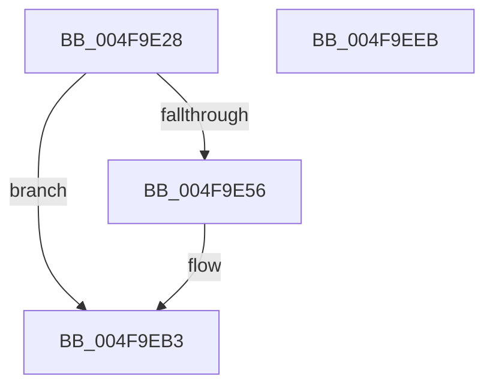

# MiDeleteCloneDescriptor

- RVA: `0x004F9E28`–`0x004F9EEC` (길이 `196` bytes)
- VA: `0x00000001404F9E28`
- 실행 섹션: `.text`
- PDB 이름 있음: `예`; PDB Function 태그: `아니요`
- unwind 정보 RVA: `0x0006C8E8`
- 디코드: `48`개 명령, `196/196` bytes 표시
- 미해석 바이트: `0` (있으면 어셈블리에 `.byte`로 보존)

> 이 문서는 커널 이미지의 기계어와 PDB 기호를 분석해 생성했습니다. 4번과 5번은 함수 원형과 자료형을 바이너리 사용 방식에서 추정한 C 해석이며 원본 소스 복구 결과는 아닙니다.

## 1. Dependencies

- 직접 호출 지점: **6**; 고유 호출 대상: **5**
- 직접 호출자로 확인된 함수: **2**
- RIP 상대 이미지 참조: **0**

### Outgoing calls
- `0x004F9E8B` → [ExpInterlockedPushEntrySList](../6B/ExpInterlockedPushEntrySList_function_006BA5B0.md) (function, `0x006BA5B0`)
- `0x004F9E9C` → [KeSetEvent](../33/KeSetEvent_function_0033F310.md) (function, `0x0033F310`)
- `0x004F9EA4` → [MiDecrementCloneHeaderCount](MiDecrementCloneHeaderCount_function_004F60F0.md) (function, `0x004F60F0`)
- `0x004F9EAE` → [ExFreePoolWithTag](../../poolcode/B8/ExFreePoolWithTag_function_00B82870.md) (function, `0x00B82870`)
- `0x004F9EBA` → [PsReturnProcessNonPagedPoolQuota](../41/PsReturnProcessNonPagedPoolQuota_function_0041C200.md) (function, `0x0041C200`)
- `0x004F9ED1` → [ExpInterlockedPushEntrySList](../6B/ExpInterlockedPushEntrySList_function_006BA5B0.md) (function, `0x006BA5B0`)

### Direct callers
- [MiDecrementCloneBlockReference](../22/MiDecrementCloneBlockReference_function_0022B9D0.md) at `0x0022BA56`
- [MiDeleteInsertedCloneVads](../../page/81/MiDeleteInsertedCloneVads_function_00811564.md) at `0x0081165F`

### Static image references
- 디코드된 RIP-relative 메모리 참조가 없습니다.

## 2. Other-region calls and transfers

- 다른 실행 섹션으로 향하는 call: **1**
  - `0x004F9EAE` → [ExFreePoolWithTag](../../poolcode/B8/ExFreePoolWithTag_function_00B82870.md) (`.text` → `POOLCODE`)
- 별도 외부 분기/꼬리 이동을 확인하지 못했습니다.

## 3. Assembly (complete function range)

```asm
004F9E28  48 89 5C 24 10                  mov qword ptr [rsp + 0x10], rbx
004F9E2D  48 89 6C 24 18                  mov qword ptr [rsp + 0x18], rbp
004F9E32  48 89 74 24 20                  mov qword ptr [rsp + 0x20], rsi
004F9E37  57                              push rdi
004F9E38  48 83 EC 20                     sub rsp, 0x20
004F9E3C  48 8B 72 38                     mov rsi, qword ptr [rdx + 0x38]
004F9E40  48 8B FA                        mov rdi, rdx
004F9E43  48 8B E9                        mov rbp, rcx
004F9E46  48 83 C8 FF                     or rax, 0xffffffffffffffff
004F9E4A  F0 48 0F C1 46 08               lock xadd qword ptr [rsi + 8], rax
004F9E50  48 83 F8 01                     cmp rax, 1
004F9E54  75 5D                           jne 0x1404f9eb3
004F9E56  4C 8B 42 20                     mov r8, qword ptr [rdx + 0x20]
004F9E5A  B8 00 00 00 00                  mov eax, 0
004F9E5F  4C 2B 42 18                     sub r8, qword ptr [rdx + 0x18]
004F9E63  48 8B 5E 18                     mov rbx, qword ptr [rsi + 0x18]
004F9E67  49 83 C0 20                     add r8, 0x20
004F9E6B  48 8B 56 10                     mov rdx, qword ptr [rsi + 0x10]
004F9E6F  49 F7 C0 FF 0F 00 00            test r8, 0xfff
004F9E76  0F 95 C0                        setne al
004F9E79  49 C1 E8 0C                     shr r8, 0xc
004F9E7D  41 03 C0                        add eax, r8d
004F9E80  48 8D 8B 60 09 00 00            lea rcx, [rbx + 0x960]
004F9E87  48 89 42 18                     mov qword ptr [rdx + 0x18], rax
004F9E8B  E8 20 07 1C 00                  call 0x1406ba5b0
004F9E90  48 8D 8B 40 09 00 00            lea rcx, [rbx + 0x940]
004F9E97  45 33 C0                        xor r8d, r8d
004F9E9A  33 D2                           xor edx, edx
004F9E9C  E8 6F 54 E4 FF                  call 0x14033f310
004F9EA1  48 8B CB                        mov rcx, rbx
004F9EA4  E8 47 C2 FF FF                  call 0x1404f60f0
004F9EA9  33 D2                           xor edx, edx
004F9EAB  48 8B CE                        mov rcx, rsi
004F9EAE  E8 BD 89 68 00                  call 0x140b82870
004F9EB3  48 8B 57 40                     mov rdx, qword ptr [rdi + 0x40]
004F9EB7  48 8B CD                        mov rcx, rbp
004F9EBA  E8 41 23 F2 FF                  call 0x14041c200
004F9EBF  48 8B 8D 10 04 00 00            mov rcx, qword ptr [rbp + 0x410]
004F9EC6  48 8D 57 50                     lea rdx, [rdi + 0x50]
004F9ECA  48 81 C1 30 04 00 00            add rcx, 0x430
004F9ED1  E8 DA 06 1C 00                  call 0x1406ba5b0
004F9ED6  48 8B 5C 24 38                  mov rbx, qword ptr [rsp + 0x38]
004F9EDB  48 8B 6C 24 40                  mov rbp, qword ptr [rsp + 0x40]
004F9EE0  48 8B 74 24 48                  mov rsi, qword ptr [rsp + 0x48]
004F9EE5  48 83 C4 20                     add rsp, 0x20
004F9EE9  5F                              pop rdi
004F9EEA  C3                              ret
004F9EEB  CC                              int3
```

## 4. C-style interpretation (structured pseudocode)

```c
__int64 __fastcall MiDeleteCloneDescriptor(__int64 a1, __int64 a2)
{
    __int64 result;
    __int64 v_rbx;
    __int64 v_rsp;
    unsigned __int64 v_stack_p10;
    unsigned __int64 v_stack_p18;
    unsigned __int64 v_stack_p20;

    v_stack_p10 = v_rbx;
    v_stack_p18 = v_rbp;
    v_stack_p20 = v_rsi;
    v_rsp = (v_rsp) - (32);
    result = (result) | (-1);
    if (result == 1) {
        a3 = *(unsigned __int64 *)(a2 + 32);
        result = 0;
        a3 = (a3) - (*(unsigned __int64 *)(a2 + 24));
        v_rbx = *(unsigned __int64 *)(*(unsigned __int64 *)(a2 + 56) + 24);
        a3 = (a3) + (32);
        a2 = *(unsigned __int64 *)(*(unsigned __int64 *)(a2 + 56) + 16);
        result = (((a3) & (0xFFFULL)) != 0) ? 1 : 0;
        a3 = (a3) >> (12);
        result = (unsigned int)((result) + ((unsigned int)(a3)));
        a1 = v_rbx + 2400;
        *(unsigned __int64 *)(a2 + 24) = result;
        result = ExpInterlockedPushEntrySList(a1, a2, a3, a4);
        a1 = v_rbx + 2368;
        a3 = 0;
        a2 = 0;
        result = KeSetEvent(a1, a2, a3, a4);
        a1 = v_rbx;
        result = MiDecrementCloneHeaderCount(a1, a2, a3, a4);
        a2 = 0;
        a1 = *(unsigned __int64 *)(a2 + 56);
        result = ExFreePoolWithTag(a1, a2, a3, a4);
    }
    result = PsReturnProcessNonPagedPoolQuota(a1, *(unsigned __int64 *)(a2 + 64), a3, a4);
    a1 = (*(unsigned __int64 *)(a1 + 1040)) + (0x430ULL);
    result = ExpInterlockedPushEntrySList(a1, a2 + 80, a3, a4);
    v_rsp = (v_rsp) + (32);
    return result;
}
```

## 5. (Beta) C Style

```c
int64_t MiDeleteCloneDescriptor(void *Arg1, void *Arg2)
{
    uint8_t *arg1 = (uint8_t *)Arg1;
    uint8_t *arg2 = (uint8_t *)Arg2;

    int64_t result;
    int64_t local_rbx;
    int64_t local_rsp;
    uint64_t v_stack_p10;
    uint64_t v_stack_p18;
    uint64_t v_stack_p20;

    v_stack_p10 = local_rbx;
    v_stack_p18 = local_rbp;
    v_stack_p20 = local_rsi;
    local_rsp = (local_rsp) - (32);
    result = (result) | (-1);
    if (result == 1) {
        a3 = *(uint64_t *)(arg2 + 0x20);
        result = 0;
        a3 = (a3) - (*(uint64_t *)(arg2 + 0x18));
        local_rbx = *(uint64_t *)(*(uint64_t *)(arg2 + 0x38) + 0x18);
        a3 = (a3) + (32);
        Arg2 = *(uint64_t *)(*(uint64_t *)(arg2 + 0x38) + 0x10);
        result = (((a3) & (0xFFFULL)) != 0) ? 1 : 0;
        a3 = (a3) >> (12);
        result = (uint32_t)((result) + ((uint32_t)(a3)));
        Arg1 = local_rbx + 2400;
        *(uint64_t *)(arg2 + 0x18) = result;
        result = ExpInterlockedPushEntrySList(Arg1, Arg2, a3, a4);
        Arg1 = local_rbx + 2368;
        a3 = 0;
        Arg2 = 0;
        result = KeSetEvent(Arg1, Arg2, a3, a4);
        Arg1 = local_rbx;
        result = MiDecrementCloneHeaderCount(Arg1, Arg2, a3, a4);
        Arg2 = 0;
        Arg1 = *(uint64_t *)(arg2 + 0x38);
        result = ExFreePoolWithTag(Arg1, Arg2, a3, a4);
    }
    result = PsReturnProcessNonPagedPoolQuota(Arg1, *(uint64_t *)(arg2 + 0x40), a3, a4);
    Arg1 = (*(uint64_t *)(arg1 + 0x410)) + (0x430ULL);
    result = ExpInterlockedPushEntrySList(Arg1, Arg2 + 80, a3, a4);
    local_rsp = (local_rsp) + (32);
    return result;
}
```

### 관측된 메모리 오프셋

구조체 형식이 확인되지 않은 접근은 인자 기준의 오프셋으로만 기록했습니다.

| 기준 인자 | 오프셋 표현 | 폭 (bit) | 접근 |
|---|---:|---:|---|
| `Arg1` | `+ 0x410` | `64` | `R` |
| `Arg2` | `+ 0x18` | `64` | `R` |
| `Arg2` | `+ 0x20` | `64` | `R` |
| `Arg2` | `+ 0x38` | `64` | `R` |
| `Arg2` | `+ 0x40` | `64` | `R` |
| `Arg2` | `+ 0x50` | `64` | `R` |

## 6. Execution-region graph

[열기: 2D/3D 그래프와 함수 탐색 컨트롤 패널](../../../control-panel.html?section=text&rva=0x004F9E28&view=graph)

- 2D 그래프는 위에서 아래로 흐르고, 3D 그래프는 빈 공간을 드래그해 회전합니다. Shift+드래그는 이동, 휠은 확대·축소, 함수 노드 선택은 대상 보고서 이동입니다.

### Static fallback


