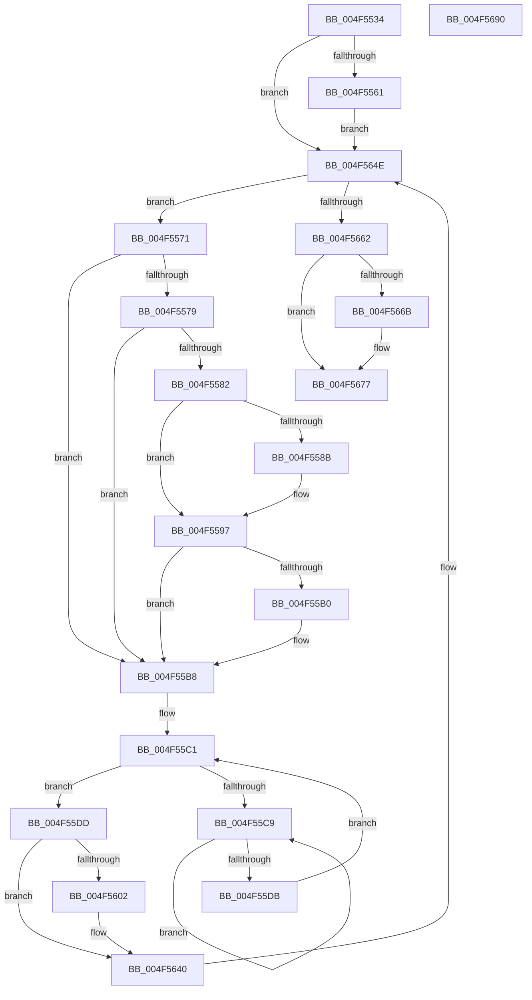

# MiFlushFileOnlyDeleteChain

- RVA: `0x004F5534`–`0x004F5691` (길이 `349` bytes)
- VA: `0x00000001404F5534`
- 실행 섹션: `.text`
- PDB 이름 있음: `예`; PDB Function 태그: `아니요`
- unwind 정보 RVA: `0x000BD748`
- 디코드: `96`개 명령, `349/349` bytes 표시
- 미해석 바이트: `0` (있으면 어셈블리에 `.byte`로 보존)

> 이 문서는 커널 이미지의 기계어와 PDB 기호를 분석해 생성했습니다. 4번과 5번은 함수 원형과 자료형을 바이너리 사용 방식에서 추정한 C 해석이며 원본 소스 복구 결과는 아닙니다.

## 1. Dependencies

- 직접 호출 지점: **9**; 고유 호출 대상: **7**
- 직접 호출자로 확인된 함수: **1**
- RIP 상대 이미지 참조: **1**

### Outgoing calls
- `0x004F5567` → [KiRaiseIrqlProcessIrqlFlags](KiRaiseIrqlProcessIrqlFlags_function_004F56FC.md) (function, `0x004F56FC`)
- `0x004F5579` → [KeShouldYieldProcessor](../27/KeShouldYieldProcessor_function_002773E0.md) (function, `0x002773E0`)
- `0x004F5592` → [KiLowerIrqlProcessIrqlFlags](KiLowerIrqlProcessIrqlFlags_function_004F5698.md) (function, `0x004F5698`)
- `0x004F55B3` → [KiRaiseIrqlProcessIrqlFlags](KiRaiseIrqlProcessIrqlFlags_function_004F56FC.md) (function, `0x004F56FC`)
- `0x004F55CE` → [KeYieldProcessorEx](../3F/KeYieldProcessorEx_function_003FBD00.md) (function, `0x003FBD00`)
- `0x004F55F9` → [MiRemoveLockedPageCharge](../24/MiRemoveLockedPageCharge_function_00246950.md) (function, `0x00246950`)
- `0x004F563B` → [MiInsertPageInFreeOrZeroedList](../33/MiInsertPageInFreeOrZeroedList_function_00334D20.md) (function, `0x00334D20`)
- `0x004F5651` → [MiUnlinkPageChainHead](../36/MiUnlinkPageChainHead_function_00365C40.md) (function, `0x00365C40`)
- `0x004F5672` → [KiLowerIrqlProcessIrqlFlags](KiLowerIrqlProcessIrqlFlags_function_004F5698.md) (function, `0x004F5698`)

### Direct callers
- [MiWalkEntireImage](../36/MiWalkEntireImage_function_00365D70.md) at `0x003665B5`

### Static image references
- `0x004F5555` → RVA `0x00FC6D20` (`ALMOSTRO`; read)

## 2. Other-region calls and transfers

- 다른 실행 섹션으로 향하는 call: **0**
- 별도 외부 분기/꼬리 이동을 확인하지 못했습니다.

## 3. Assembly (complete function range)

```asm
004F5534  48 89 5C 24 08                  mov qword ptr [rsp + 8], rbx
004F5539  55                              push rbp
004F553A  56                              push rsi
004F553B  57                              push rdi
004F553C  41 54                           push r12
004F553E  41 56                           push r14
004F5540  48 83 EC 20                     sub rsp, 0x20
004F5544  4C 8B F1                        mov r14, rcx
004F5547  33 ED                           xor ebp, ebp
004F5549  44 0F 20 C7                     mov rdi, cr8
004F554D  44 8D 65 02                     lea r12d, [rbp + 2]
004F5551  45 0F 22 C4                     mov cr8, r12
004F5555  39 2D C5 17 AD 00               cmp dword ptr [rip + 0xad17c5], ebp
004F555B  0F 84 ED 00 00 00               je 0x1404f564e
004F5561  41 8A D4                        mov dl, r12b
004F5564  40 8A CF                        mov cl, dil
004F5567  E8 90 01 00 00                  call 0x1404f56fc
004F556C  E9 DD 00 00 00                  jmp 0x1404f564e
004F5571  FF C5                           inc ebp
004F5573  40 F6 C5 0F                     test bpl, 0xf
004F5577  75 3F                           jne 0x1404f55b8
004F5579  E8 62 1E D8 FF                  call 0x1402773e0
004F557E  85 C0                           test eax, eax
004F5580  74 36                           je 0x1404f55b8
004F5582  83 3D 97 17 AD 00 00            cmp dword ptr [rip + 0xad1797], 0
004F5589  74 0C                           je 0x1404f5597
004F558B  44 0F 20 C1                     mov rcx, cr8
004F558F  40 8A D7                        mov dl, dil
004F5592  E8 01 01 00 00                  call 0x1404f5698
004F5597  40 0F B6 C7                     movzx eax, dil
004F559B  44 0F 22 C0                     mov cr8, rax
004F559F  44 0F 20 C1                     mov rcx, cr8
004F55A3  45 0F 22 C4                     mov cr8, r12
004F55A7  83 3D 72 17 AD 00 00            cmp dword ptr [rip + 0xad1772], 0
004F55AE  74 08                           je 0x1404f55b8
004F55B0  41 8A D4                        mov dl, r12b
004F55B3  E8 44 01 00 00                  call 0x1404f56fc
004F55B8  83 64 24 60 00                  and dword ptr [rsp + 0x60], 0
004F55BD  48 8D 73 18                     lea rsi, [rbx + 0x18]
004F55C1  F0 48 0F BA 2E 3F               lock bts qword ptr [rsi], 0x3f
004F55C7  73 14                           jae 0x1404f55dd
004F55C9  48 8D 4C 24 60                  lea rcx, [rsp + 0x60]
004F55CE  E8 2D 67 F0 FF                  call 0x1403fbd00
004F55D3  48 8B 06                        mov rax, qword ptr [rsi]
004F55D6  48 85 C0                        test rax, rax
004F55D9  78 EE                           js 0x1404f55c9
004F55DB  EB E4                           jmp 0x1404f55c1
004F55DD  8B 43 20                        mov eax, dword ptr [rbx + 0x20]
004F55E0  48 8B CB                        mov rcx, rbx
004F55E3  89 44 24 58                     mov dword ptr [rsp + 0x58], eax
004F55E7  C1 E8 10                        shr eax, 0x10
004F55EA  24 FE                           and al, 0xfe
004F55EC  0C 06                           or al, 6
004F55EE  88 44 24 5A                     mov byte ptr [rsp + 0x5a], al
004F55F2  8B 44 24 58                     mov eax, dword ptr [rsp + 0x58]
004F55F6  89 43 20                        mov dword ptr [rbx + 0x20], eax
004F55F9  E8 52 13 D5 FF                  call 0x140246950
004F55FE  85 C0                           test eax, eax
004F5600  74 3E                           je 0x1404f5640
004F5602  8B 43 20                        mov eax, dword ptr [rbx + 0x20]
004F5605  89 44 24 58                     mov dword ptr [rsp + 0x58], eax
004F5609  C1 E8 18                        shr eax, 0x18
004F560C  0C 10                           or al, 0x10
004F560E  88 44 24 5B                     mov byte ptr [rsp + 0x5b], al
004F5612  8B 44 24 58                     mov eax, dword ptr [rsp + 0x58]
004F5616  89 43 20                        mov dword ptr [rbx + 0x20], eax
004F5619  48 B8 00 00 00 00 00 DE FF FF   movabs rax, 0xffffde0000000000
004F5623  48 2B D8                        sub rbx, rax
004F5626  48 B9 AB AA AA AA AA AA AA AA   movabs rcx, 0xaaaaaaaaaaaaaaab
004F5630  48 C1 FB 04                     sar rbx, 4
004F5634  41 8B D4                        mov edx, r12d
004F5637  48 0F AF CB                     imul rcx, rbx
004F563B  E8 E0 F6 E3 FF                  call 0x140334d20
004F5640  48 B8 FF FF FF FF FF FF FF 7F   movabs rax, 0x7fffffffffffffff
004F564A  F0 48 21 06                     lock and qword ptr [rsi], rax
004F564E  49 8B CE                        mov rcx, r14
004F5651  E8 EA 05 E7 FF                  call 0x140365c40
004F5656  48 8B D8                        mov rbx, rax
004F5659  48 85 C0                        test rax, rax
004F565C  0F 85 0F FF FF FF               jne 0x1404f5571
004F5662  83 3D B7 16 AD 00 00            cmp dword ptr [rip + 0xad16b7], 0
004F5669  74 0C                           je 0x1404f5677
004F566B  44 0F 20 C1                     mov rcx, cr8
004F566F  40 8A D7                        mov dl, dil
004F5672  E8 21 00 00 00                  call 0x1404f5698
004F5677  40 0F B6 C7                     movzx eax, dil
004F567B  44 0F 22 C0                     mov cr8, rax
004F567F  48 8B 5C 24 50                  mov rbx, qword ptr [rsp + 0x50]
004F5684  48 83 C4 20                     add rsp, 0x20
004F5688  41 5E                           pop r14
004F568A  41 5C                           pop r12
004F568C  5F                              pop rdi
004F568D  5E                              pop rsi
004F568E  5D                              pop rbp
004F568F  C3                              ret
004F5690  CC                              int3
```

## 4. C-style interpretation (structured pseudocode)

```c
__int64 __fastcall MiFlushFileOnlyDeleteChain(__int64 a1)
{
    __int64 result;
    __int64 v_rbp;
    __int64 v_rbx;
    __int64 v_rsp;
    unsigned int v_stack_p10;
    unsigned __int8 v_stack_p12;
    unsigned __int8 v_stack_p13;
    unsigned int v_stack_p18;
    unsigned __int64 v_stack_p8;

    v_stack_p8 = v_rbx;
    v_rsp = (v_rsp) - (32);
    v_rbp = 0;
    if ((*(unsigned int *)(v_rip + 11343813)) == 0) goto loc_004F564E;
    result = KiRaiseIrqlProcessIrqlFlags((unsigned __int8)(v_cr8), (unsigned __int8)(v_rbp + 2), a3, a4);
    goto loc_004F564E;
loc_004F5571:
    v_rbp = (unsigned int)((v_rbp) + 1);
    if ((((unsigned __int8)(v_rbp)) & (15)) != 0) goto loc_004F55B8;
    result = KeShouldYieldProcessor((unsigned __int8)(v_cr8), (unsigned __int8)(v_rbp + 2), a3, a4);
    if ((unsigned int)(result) == 0) goto loc_004F55B8;
    if ((*(unsigned int *)(v_rip + 11343767)) != 0) {
        a1 = v_rbp + 2;
        a2 = (unsigned __int8)(v_cr8);
        result = KiLowerIrqlProcessIrqlFlags(a1, a2, a3, a4);
    }
    result = (unsigned __int8)(v_cr8);
    if ((*(unsigned int *)(v_rip + 11343730)) != 0) {
        a2 = (unsigned __int8)(v_rbp + 2);
        result = KiRaiseIrqlProcessIrqlFlags((unsigned __int8)(v_cr8), a2, a3, a4);
    }
loc_004F55C1:
    if ((*(unsigned int *)(v_rip + 11343730)) >= 0) goto loc_004F55DD;
loc_004F55C9:
    result = KeYieldProcessorEx(v_stack_p18, a2, a3, a4);
    if (sign_flag) goto loc_004F55C9;
    goto loc_004F55C1;
loc_004F55DD:
    v_stack_p10 = (unsigned int)((unsigned int)(*(unsigned int *)(v_rbx + 32)));
    result = (unsigned int)(((unsigned int)(*(unsigned int *)(v_rbx + 32))) >> (16));
    result = (unsigned __int8)((result) & (254));
    result = (unsigned __int8)((result) | (6));
    v_stack_p12 = (unsigned __int8)(result);
    *(unsigned int *)(v_rbx + 32) = (unsigned int)((unsigned int)(v_stack_p10));
    result = MiRemoveLockedPageCharge(v_rbx, a2, a3, a4);
    if ((unsigned int)(result) != 0) {
        result = *(unsigned int *)(v_rbx + 32);
        v_stack_p10 = (unsigned int)(result);
        result = (unsigned int)((result) >> (24));
        result = (unsigned __int8)((result) | (16));
        v_stack_p13 = (unsigned __int8)(result);
        result = v_stack_p10;
        *(unsigned int *)(v_rbx + 32) = (unsigned int)(result);
        v_rbx = (v_rbx) - (result);
        v_rbx = (v_rbx) >> (4);
        a2 = (unsigned int)(v_rbp + 2);
        a1 = (v_rbx) * (v_rbx);
        result = MiInsertPageInFreeOrZeroedList(a1, a2, a3, a4);
    }
loc_004F564E:
    result = MiUnlinkPageChainHead(a1, a2, a3, a4);
    if (result != 0) goto loc_004F5571;
    if ((*(unsigned int *)(v_rip + 11343543)) != 0) {
        a1 = v_rbp + 2;
        a2 = (unsigned __int8)(v_cr8);
        result = KiLowerIrqlProcessIrqlFlags(a1, a2, a3, a4);
    }
    v_rsp = (v_rsp) + (32);
    return (unsigned __int8)(v_cr8);
}
```

## 5. (Beta) C Style

```c
int64_t MiFlushFileOnlyDeleteChain(int64_t Arg1)
{
    int64_t result;
    int64_t local_rbp;
    int64_t local_rbx;
    int64_t local_rsp;
    uint32_t v_stack_p10;
    uint8_t v_stack_p12;
    uint8_t v_stack_p13;
    uint32_t v_stack_p18;
    uint64_t v_stack_p8;

    v_stack_p8 = local_rbx;
    local_rsp = (local_rsp) - (32);
    local_rbp = 0;
    if ((*(uint32_t *)(v_rip + 0xAD17C5)) == 0) goto loc_004F564E;
    result = KiRaiseIrqlProcessIrqlFlags((uint8_t)(v_cr8), (uint8_t)(local_rbp + 2), a3, a4);
    goto loc_004F564E;
loc_004F5571:
    local_rbp = (uint32_t)((local_rbp) + 1);
    if ((((uint8_t)(local_rbp)) & (15)) != 0) goto loc_004F55B8;
    result = KeShouldYieldProcessor((uint8_t)(v_cr8), (uint8_t)(local_rbp + 2), a3, a4);
    if ((uint32_t)(result) == 0) goto loc_004F55B8;
    if ((*(uint32_t *)(v_rip + 0xAD1797)) != 0) {
        Arg1 = local_rbp + 2;
        a2 = (uint8_t)(v_cr8);
        result = KiLowerIrqlProcessIrqlFlags(Arg1, a2, a3, a4);
    }
    result = (uint8_t)(v_cr8);
    if ((*(uint32_t *)(v_rip + 0xAD1772)) != 0) {
        a2 = (uint8_t)(local_rbp + 2);
        result = KiRaiseIrqlProcessIrqlFlags((uint8_t)(v_cr8), a2, a3, a4);
    }
loc_004F55C1:
    if ((*(uint32_t *)(v_rip + 0xAD1772)) >= 0) goto loc_004F55DD;
loc_004F55C9:
    result = KeYieldProcessorEx(v_stack_p18, a2, a3, a4);
    if (sign_flag) goto loc_004F55C9;
    goto loc_004F55C1;
loc_004F55DD:
    v_stack_p10 = (uint32_t)((uint32_t)(*(uint32_t *)(local_rbx + 0x20)));
    result = (uint32_t)(((uint32_t)(*(uint32_t *)(local_rbx + 0x20))) >> (16));
    result = (uint8_t)((result) & (254));
    result = (uint8_t)((result) | (6));
    v_stack_p12 = (uint8_t)(result);
    *(uint32_t *)(local_rbx + 0x20) = (uint32_t)((uint32_t)(v_stack_p10));
    result = MiRemoveLockedPageCharge(local_rbx, a2, a3, a4);
    if ((uint32_t)(result) != 0) {
        result = *(uint32_t *)(local_rbx + 0x20);
        v_stack_p10 = (uint32_t)(result);
        result = (uint32_t)((result) >> (24));
        result = (uint8_t)((result) | (16));
        v_stack_p13 = (uint8_t)(result);
        result = v_stack_p10;
        *(uint32_t *)(local_rbx + 0x20) = (uint32_t)(result);
        local_rbx = (local_rbx) - (result);
        local_rbx = (local_rbx) >> (4);
        a2 = (uint32_t)(local_rbp + 2);
        Arg1 = (local_rbx) * (local_rbx);
        result = MiInsertPageInFreeOrZeroedList(Arg1, a2, a3, a4);
    }
loc_004F564E:
    result = MiUnlinkPageChainHead(Arg1, a2, a3, a4);
    if (result != 0) goto loc_004F5571;
    if ((*(uint32_t *)(v_rip + 0xAD16B7)) != 0) {
        Arg1 = local_rbp + 2;
        a2 = (uint8_t)(v_cr8);
        result = KiLowerIrqlProcessIrqlFlags(Arg1, a2, a3, a4);
    }
    local_rsp = (local_rsp) + (32);
    return (uint8_t)(v_cr8);
}
```

## 6. Execution-region graph

[열기: 2D/3D 그래프와 함수 탐색 컨트롤 패널](../../../control-panel.html?section=text&rva=0x004F5534&view=graph)

- 2D 그래프는 위에서 아래로 흐르고, 3D 그래프는 빈 공간을 드래그해 회전합니다. Shift+드래그는 이동, 휠은 확대·축소, 함수 노드 선택은 대상 보고서 이동입니다.

### Static fallback


