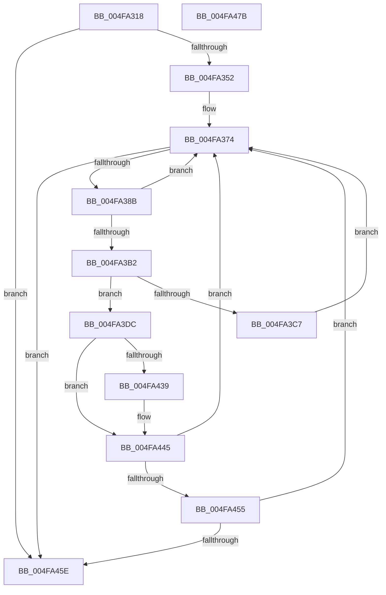

# MiFreeModifiedReservations

- RVA: `0x004FA318`–`0x004FA47C` (길이 `356` bytes)
- VA: `0x00000001404FA318`
- 실행 섹션: `.text`
- PDB 이름 있음: `예`; PDB Function 태그: `아니요`
- unwind 정보 RVA: `0x0005D79C`
- 디코드: `90`개 명령, `356/356` bytes 표시
- 미해석 바이트: `0` (있으면 어셈블리에 `.byte`로 보존)

> 이 문서는 커널 이미지의 기계어와 PDB 기호를 분석해 생성했습니다. 4번과 5번은 함수 원형과 자료형을 바이너리 사용 방식에서 추정한 C 해석이며 원본 소스 복구 결과는 아닙니다.

## 1. Dependencies

- 직접 호출 지점: **9**; 고유 호출 대상: **8**
- 직접 호출자로 확인된 함수: **2**
- RIP 상대 이미지 참조: **1**

### Outgoing calls
- `0x004FA3A3` → [MiSafeLockPage](../32/MiSafeLockPage_function_00321620.md) (function, `0x00321620`)
- `0x004FA3B9` → [ExAcquireSpinLockExclusiveAtDpcLevel](../24/ExAcquireSpinLockExclusiveAtDpcLevel_function_00248E80.md) (function, `0x00248E80`)
- `0x004FA3CA` → [ExReleaseSpinLockExclusiveFromDpcLevel](../24/ExReleaseSpinLockExclusiveFromDpcLevel_function_002497E0.md) (function, `0x002497E0`)
- `0x004FA3D5` → [MiUnlockPage](../31/MiUnlockPage_function_0031A3E0.md) (function, `0x0031A3E0`)
- `0x004FA3E4` → [MiUnlinkPageFromListEx](../28/MiUnlinkPageFromListEx_function_00287590.md) (function, `0x00287590`)
- `0x004FA3FC` → [ExReleaseSpinLockExclusiveFromDpcLevel](../24/ExReleaseSpinLockExclusiveFromDpcLevel_function_002497E0.md) (function, `0x002497E0`)
- `0x004FA409` → [MiInsertPageInList](../2B/MiInsertPageInList_function_002BA000.md) (function, `0x002BA000`)
- `0x004FA42B` → [MiReleasePageFileInfo](../28/MiReleasePageFileInfo_function_00283FD0.md) (function, `0x00283FD0`)
- `0x004FA440` → [KiLowerIrqlProcessIrqlFlags](KiLowerIrqlProcessIrqlFlags_function_004F5698.md) (function, `0x004F5698`)

### Direct callers
- [MiPageFileNoFreeSpace](../47/MiPageFileNoFreeSpace_function_0047E45C.md) at `0x0047E48D`
- [sub_006F4DB8](../6F/Unknown_function_006F4DB8.md) at `0x006F4E16`

### Static image references
- `0x004FA430` → RVA `0x00FC6D20` (`ALMOSTRO`; read)

## 2. Other-region calls and transfers

- 다른 실행 섹션으로 향하는 call: **0**
- 별도 외부 분기/꼬리 이동을 확인하지 못했습니다.

## 3. Assembly (complete function range)

```asm
004FA318  48 89 5C 24 10                  mov qword ptr [rsp + 0x10], rbx
004FA31D  48 89 6C 24 18                  mov qword ptr [rsp + 0x18], rbp
004FA322  48 89 74 24 20                  mov qword ptr [rsp + 0x20], rsi
004FA327  57                              push rdi
004FA328  41 54                           push r12
004FA32A  41 55                           push r13
004FA32C  41 56                           push r14
004FA32E  41 57                           push r15
004FA330  48 83 EC 20                     sub rsp, 0x20
004FA334  0F B7 81 AC 00 00 00            movzx eax, word ptr [rcx + 0xac]
004FA33B  44 8B EA                        mov r13d, edx
004FA33E  48 8B 91 D8 00 00 00            mov rdx, qword ptr [rcx + 0xd8]
004FA345  48 89 54 24 50                  mov qword ptr [rsp + 0x50], rdx
004FA34A  A8 40                           test al, 0x40
004FA34C  0F 85 0C 01 00 00               jne 0x1404fa45e
004FA352  83 E0 0F                        and eax, 0xf
004FA355  48 83 C0 30                     add rax, 0x30
004FA359  48 6B E8 58                     imul rbp, rax, 0x58
004FA35D  41 8B C5                        mov eax, r13d
004FA360  48 03 EA                        add rbp, rdx
004FA363  F7 D8                           neg eax
004FA365  48 1B F6                        sbb rsi, rsi
004FA368  48 F7 D6                        not rsi
004FA36B  81 E6 00 00 01 00               and esi, 0x10000
004FA371  45 33 FF                        xor r15d, r15d
004FA374  48 8B 5D 10                     mov rbx, qword ptr [rbp + 0x10]
004FA378  48 B8 FF FF FF FF 3F 00 00 00   movabs rax, 0x3fffffffff
004FA382  48 3B D8                        cmp rbx, rax
004FA385  0F 84 D3 00 00 00               je 0x1404fa45e
004FA38B  48 8D 3C 5B                     lea rdi, [rbx + rbx*2]
004FA38F  48 C1 E7 04                     shl rdi, 4
004FA393  48 B8 00 00 00 00 00 DE FF FF   movabs rax, 0xffffde0000000000
004FA39D  48 8B CB                        mov rcx, rbx
004FA3A0  48 03 F8                        add rdi, rax
004FA3A3  E8 78 72 E2 FF                  call 0x140321620
004FA3A8  44 0F B6 F0                     movzx r14d, al
004FA3AC  41 80 FE 11                     cmp r14b, 0x11
004FA3B0  74 C2                           je 0x1404fa374
004FA3B2  4C 8D 65 20                     lea r12, [rbp + 0x20]
004FA3B6  49 8B CC                        mov rcx, r12
004FA3B9  E8 C2 EA D4 FF                  call 0x140248e80
004FA3BE  48 8B 55 10                     mov rdx, qword ptr [rbp + 0x10]
004FA3C2  48 3B DA                        cmp rbx, rdx
004FA3C5  74 15                           je 0x1404fa3dc
004FA3C7  49 8B CC                        mov rcx, r12
004FA3CA  E8 11 F4 D4 FF                  call 0x1402497e0
004FA3CF  41 8A D6                        mov dl, r14b
004FA3D2  48 8B CF                        mov rcx, rdi
004FA3D5  E8 06 00 E2 FF                  call 0x14031a3e0
004FA3DA  EB 98                           jmp 0x1404fa374
004FA3DC  BA 01 00 00 00                  mov edx, 1
004FA3E1  48 8B CF                        mov rcx, rdi
004FA3E4  E8 A7 D1 D8 FF                  call 0x140287590
004FA3E9  48 8B 5F 10                     mov rbx, qword ptr [rdi + 0x10]
004FA3ED  49 8B CC                        mov rcx, r12
004FA3F0  48 8B 47 10                     mov rax, qword ptr [rdi + 0x10]
004FA3F4  48 83 E0 FD                     and rax, 0xfffffffffffffffd
004FA3F8  48 89 47 10                     mov qword ptr [rdi + 0x10], rax
004FA3FC  E8 DF F3 D4 FF                  call 0x1402497e0
004FA401  BA 08 00 00 00                  mov edx, 8
004FA406  48 8B CF                        mov rcx, rdi
004FA409  E8 F2 FB DB FF                  call 0x1402ba000
004FA40E  48 B8 FF FF FF FF FF FF FF 7F   movabs rax, 0x7fffffffffffffff
004FA418  F0 48 21 47 18                  lock and qword ptr [rdi + 0x18], rax
004FA41D  48 8B 4C 24 50                  mov rcx, qword ptr [rsp + 0x50]
004FA422  41 B8 01 00 00 00               mov r8d, 1
004FA428  48 8B D3                        mov rdx, rbx
004FA42B  E8 A0 9B D8 FF                  call 0x140283fd0
004FA430  83 3D E9 C8 AC 00 00            cmp dword ptr [rip + 0xacc8e9], 0
004FA437  74 0C                           je 0x1404fa445
004FA439  44 0F 20 C1                     mov rcx, cr8
004FA43D  41 8A D6                        mov dl, r14b
004FA440  E8 53 B2 FF FF                  call 0x1404f5698
004FA445  45 0F 22 C6                     mov cr8, r14
004FA449  49 FF C7                        inc r15
004FA44C  45 85 ED                        test r13d, r13d
004FA44F  0F 85 1F FF FF FF               jne 0x1404fa374
004FA455  4C 3B FE                        cmp r15, rsi
004FA458  0F 82 16 FF FF FF               jb 0x1404fa374
004FA45E  48 8B 5C 24 58                  mov rbx, qword ptr [rsp + 0x58]
004FA463  48 8B 6C 24 60                  mov rbp, qword ptr [rsp + 0x60]
004FA468  48 8B 74 24 68                  mov rsi, qword ptr [rsp + 0x68]
004FA46D  48 83 C4 20                     add rsp, 0x20
004FA471  41 5F                           pop r15
004FA473  41 5E                           pop r14
004FA475  41 5D                           pop r13
004FA477  41 5C                           pop r12
004FA479  5F                              pop rdi
004FA47A  C3                              ret
004FA47B  CC                              int3
```

## 4. C-style interpretation (structured pseudocode)

```c
__int64 __fastcall MiFreeModifiedReservations(__int64 a1, int a2)
{
    __int64 result;
    __int64 v_r15;
    __int64 v_rbp;
    __int64 v_rdi;
    __int64 v_rsi;
    __int64 v_rsp;
    unsigned __int64 v_stack_p10;
    unsigned __int64 v_stack_p18;
    unsigned __int64 v_stack_p20;
    unsigned __int64 v_stack_p8;

    v_stack_p10 = v_rbx;
    v_stack_p18 = v_rbp;
    v_stack_p20 = v_rsi;
    v_rsp = (v_rsp) - (32);
    v_stack_p8 = *(unsigned __int64 *)(a1 + 216);
    if ((((unsigned __int8)(*(unsigned __int16 *)(a1 + 172))) & (64)) != 0) goto loc_004FA45E;
    result = (unsigned int)((*(unsigned __int16 *)(a1 + 172)) & (15));
    result = (result) + (48);
    v_rbp = (v_rbp) * (result);
    v_rbp = (v_rbp) + (*(unsigned __int64 *)(a1 + 216));
    result = (unsigned int)(-((unsigned int)((unsigned int)((unsigned int)(a2)))));
    v_rsi = ~(v_rsi);
    v_rsi = (unsigned int)((v_rsi) & (0x10000ULL));
    v_r15 = 0;
loc_004FA374:
    if ((*(unsigned __int64 *)(v_rbp + 16)) == result) goto loc_004FA45E;
    v_rdi = (*(unsigned __int64 *)(v_rbp + 16) + *(unsigned __int64 *)(v_rbp + 16) * 2) << (4);
    v_rdi = (v_rdi) + (result);
    result = MiSafeLockPage(*(unsigned __int64 *)(v_rbp + 16), *(unsigned __int64 *)(a1 + 216), a3, a4);
    if (((unsigned __int8)((unsigned __int8)(result))) == 17) goto loc_004FA374;
    result = ExAcquireSpinLockExclusiveAtDpcLevel(v_rbp + 32, *(unsigned __int64 *)(a1 + 216), a3, a4);
    if ((*(unsigned __int64 *)(v_rbp + 16)) == (*(unsigned __int64 *)(v_rbp + 16))) goto loc_004FA3DC;
    result = ExReleaseSpinLockExclusiveFromDpcLevel(v_rbp + 32, *(unsigned __int64 *)(v_rbp + 16), a3, a4);
    result = MiUnlockPage(v_rdi, (unsigned __int8)((unsigned __int8)(result)), a3, a4);
    goto loc_004FA374;
loc_004FA3DC:
    result = MiUnlinkPageFromListEx(v_rdi, 1, a3, a4);
    result = (*(unsigned __int64 *)(v_rdi + 16)) & (-3);
    *(unsigned __int64 *)(v_rdi + 16) = result;
    result = ExReleaseSpinLockExclusiveFromDpcLevel(v_rbp + 32, 1, a3, a4);
    result = MiInsertPageInList(v_rdi, 8, a3, a4);
    result = MiReleasePageFileInfo(v_stack_p8, *(unsigned __int64 *)(v_rdi + 16), 1, a4);
    if ((*(unsigned int *)(v_rip + 11323625)) != 0) {
        a1 = v_cr8;
        a2 = (unsigned __int8)((unsigned __int8)(result));
        result = KiLowerIrqlProcessIrqlFlags(a1, a2, 1, a4);
    }
    v_r15 = (v_r15) + 1;
    if ((unsigned int)((unsigned int)(a2)) != 0) goto loc_004FA374;
    if (v_r15 < v_rsi) goto loc_004FA374;
loc_004FA45E:
    v_rsp = (v_rsp) + (32);
    return result;
}
```

## 5. (Beta) C Style

```c
int64_t MiFreeModifiedReservations(void *Arg1, int32_t Arg2)
{
    uint8_t *arg1 = (uint8_t *)Arg1;

    int64_t result;
    int64_t local_r15;
    int64_t local_rbp;
    int64_t local_rdi;
    int64_t local_rsi;
    int64_t local_rsp;
    uint64_t v_stack_p10;
    uint64_t v_stack_p18;
    uint64_t v_stack_p20;
    uint64_t v_stack_p8;

    v_stack_p10 = local_rbx;
    v_stack_p18 = local_rbp;
    v_stack_p20 = local_rsi;
    local_rsp = (local_rsp) - (32);
    v_stack_p8 = *(uint64_t *)(arg1 + 0xD8);
    if ((((uint8_t)(*(uint16_t *)(arg1 + 0xAC))) & (64)) != 0) goto loc_004FA45E;
    result = (uint32_t)((*(uint16_t *)(arg1 + 0xAC)) & (15));
    result = (result) + (48);
    local_rbp = (local_rbp) * (result);
    local_rbp = (local_rbp) + (*(uint64_t *)(arg1 + 0xD8));
    result = (uint32_t)(-((uint32_t)((uint32_t)((uint32_t)(Arg2)))));
    local_rsi = ~(local_rsi);
    local_rsi = (uint32_t)((local_rsi) & (0x10000ULL));
    local_r15 = 0;
loc_004FA374:
    if ((*(uint64_t *)(local_rbp + 0x10)) == result) goto loc_004FA45E;
    local_rdi = (*(uint64_t *)(local_rbp + 0x10) + *(uint64_t *)(local_rbp + 0x10) * 2) << (4);
    local_rdi = (local_rdi) + (result);
    result = MiSafeLockPage(*(uint64_t *)(local_rbp + 0x10), *(uint64_t *)(arg1 + 0xD8), a3, a4);
    if (((uint8_t)((uint8_t)(result))) == 17) goto loc_004FA374;
    result = ExAcquireSpinLockExclusiveAtDpcLevel(local_rbp + 32, *(uint64_t *)(arg1 + 0xD8), a3, a4);
    if ((*(uint64_t *)(local_rbp + 0x10)) == (*(uint64_t *)(local_rbp + 0x10))) goto loc_004FA3DC;
    result = ExReleaseSpinLockExclusiveFromDpcLevel(local_rbp + 32, *(uint64_t *)(local_rbp + 0x10), a3, a4);
    result = MiUnlockPage(local_rdi, (uint8_t)((uint8_t)(result)), a3, a4);
    goto loc_004FA374;
loc_004FA3DC:
    result = MiUnlinkPageFromListEx(local_rdi, 1, a3, a4);
    result = (*(uint64_t *)(local_rdi + 0x10)) & (-3);
    *(uint64_t *)(local_rdi + 0x10) = result;
    result = ExReleaseSpinLockExclusiveFromDpcLevel(local_rbp + 32, 1, a3, a4);
    result = MiInsertPageInList(local_rdi, 8, a3, a4);
    result = MiReleasePageFileInfo(v_stack_p8, *(uint64_t *)(local_rdi + 0x10), 1, a4);
    if ((*(uint32_t *)(v_rip + 0xACC8E9)) != 0) {
        Arg1 = v_cr8;
        Arg2 = (uint8_t)((uint8_t)(result));
        result = KiLowerIrqlProcessIrqlFlags(Arg1, Arg2, 1, a4);
    }
    local_r15 = (local_r15) + 1;
    if ((uint32_t)((uint32_t)(Arg2)) != 0) goto loc_004FA374;
    if (local_r15 < local_rsi) goto loc_004FA374;
loc_004FA45E:
    local_rsp = (local_rsp) + (32);
    return result;
}
```

### 관측된 메모리 오프셋

구조체 형식이 확인되지 않은 접근은 인자 기준의 오프셋으로만 기록했습니다.

| 기준 인자 | 오프셋 표현 | 폭 (bit) | 접근 |
|---|---:|---:|---|
| `Arg1` | `+ 0xAC` | `16` | `R` |
| `Arg1` | `+ 0xD8` | `64` | `R` |

## 6. Execution-region graph

[열기: 2D/3D 그래프와 함수 탐색 컨트롤 패널](../../../control-panel.html?section=text&rva=0x004FA318&view=graph)

- 2D 그래프는 위에서 아래로 흐르고, 3D 그래프는 빈 공간을 드래그해 회전합니다. Shift+드래그는 이동, 휠은 확대·축소, 함수 노드 선택은 대상 보고서 이동입니다.

### Static fallback


