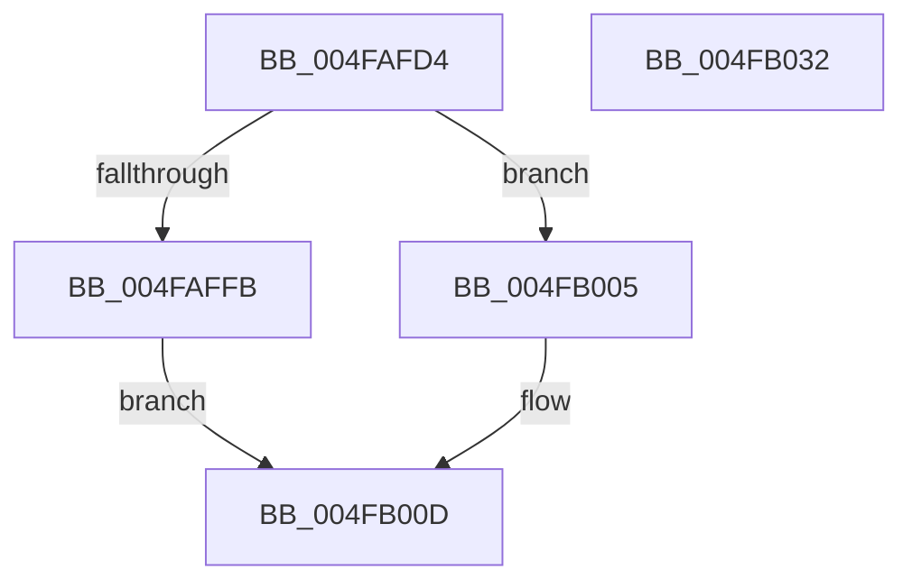

# MiFreeUltraMapping

- RVA: `0x004FAFD4`–`0x004FB033` (길이 `95` bytes)
- VA: `0x00000001404FAFD4`
- 실행 섹션: `.text`
- PDB 이름 있음: `예`; PDB Function 태그: `아니요`
- unwind 정보 RVA: `0x0005CAAC`
- 디코드: `25`개 명령, `95/95` bytes 표시
- 미해석 바이트: `0` (있으면 어셈블리에 `.byte`로 보존)

> 이 문서는 커널 이미지의 기계어와 PDB 기호를 분석해 생성했습니다. 4번과 5번은 함수 원형과 자료형을 바이너리 사용 방식에서 추정한 C 해석이며 원본 소스 복구 결과는 아닙니다.

## 1. Dependencies

- 직접 호출 지점: **3**; 고유 호출 대상: **3**
- 직접 호출자로 확인된 함수: **1**
- RIP 상대 이미지 참조: **3**

### Outgoing calls
- `0x004FAFFE` → [ExAcquireSpinLockExclusiveAtDpcLevel](../24/ExAcquireSpinLockExclusiveAtDpcLevel_function_00248E80.md) (function, `0x00248E80`)
- `0x004FB005` → [ExAcquireSpinLockExclusive](../24/ExAcquireSpinLockExclusive_function_00248690.md) (function, `0x00248690`)
- `0x004FB022` → [MiReleaseSpinLockExclusive](../24/MiReleaseSpinLockExclusive_function_002482C0.md) (function, `0x002482C0`)

### Direct callers
- [MiDereferenceHugeContext](../4D/MiDereferenceHugeContext_function_004D9664.md) at `0x004D97CD`

### Static image references
- `0x004FAFE1` → RVA `0x00E35FE8` (`.data`; read)
- `0x004FAFF0` → RVA `0x00E35FE0` (`.data`; read)
- `0x004FB00D` → RVA `0x00E36010` (`.data`; read)

## 2. Other-region calls and transfers

- 다른 실행 섹션으로 향하는 call: **0**
- 별도 외부 분기/꼬리 이동을 확인하지 못했습니다.

## 3. Assembly (complete function range)

```asm
004FAFD4  48 89 5C 24 08                  mov qword ptr [rsp + 8], rbx
004FAFD9  57                              push rdi
004FAFDA  48 83 EC 20                     sub rsp, 0x20
004FAFDE  48 8B D9                        mov rbx, rcx
004FAFE1  48 2B 1D 00 B0 93 00            sub rbx, qword ptr [rip + 0x93b000]
004FAFE8  48 C1 EB 1E                     shr rbx, 0x1e
004FAFEC  44 0F 20 C0                     mov rax, cr8
004FAFF0  48 8D 0D E9 AF 93 00            lea rcx, [rip + 0x93afe9]
004FAFF7  3C 02                           cmp al, 2
004FAFF9  75 0A                           jne 0x1404fb005
004FAFFB  40 B7 11                        mov dil, 0x11
004FAFFE  E8 7D DE D4 FF                  call 0x140248e80
004FB003  EB 08                           jmp 0x1404fb00d
004FB005  E8 86 D6 D4 FF                  call 0x140248690
004FB00A  40 8A F8                        mov dil, al
004FB00D  48 8B 15 FC AF 93 00            mov rdx, qword ptr [rip + 0x93affc]
004FB014  48 8D 0D C5 AF 93 00            lea rcx, [rip + 0x93afc5]
004FB01B  48 0F AB 1A                     bts qword ptr [rdx], rbx
004FB01F  40 8A D7                        mov dl, dil
004FB022  E8 99 D2 D4 FF                  call 0x1402482c0
004FB027  48 8B 5C 24 30                  mov rbx, qword ptr [rsp + 0x30]
004FB02C  48 83 C4 20                     add rsp, 0x20
004FB030  5F                              pop rdi
004FB031  C3                              ret
004FB032  CC                              int3
```

## 4. C-style interpretation (structured pseudocode)

```c
__int64 __fastcall MiFreeUltraMapping(__int64 a1)
{
    __int64 result;
    __int64 v_rbx;
    __int64 v_rsp;
    unsigned __int64 v_stack_p8;

    v_stack_p8 = v_rbx;
    v_rsp = (v_rsp) - (32);
    v_rbx = (a1) - (*(unsigned __int64 *)(v_rip + 9678848));
    v_rbx = (v_rbx) >> (30);
    if (((unsigned __int8)(v_cr8)) != 2) goto loc_004FB005;
    result = ExAcquireSpinLockExclusiveAtDpcLevel(v_rip + 9678825, a2, a3, a4);
    goto loc_004FB00D;
loc_004FB005:
    result = ExAcquireSpinLockExclusive(v_rip + 9678825, a2, a3, a4);
loc_004FB00D:
    result = MiReleaseSpinLockExclusive(v_rip + 9678789, (unsigned __int8)((unsigned __int8)(result)), a3, a4);
    v_rsp = (v_rsp) + (32);
    return result;
}
```

## 5. (Beta) C Style

```c
int64_t MiFreeUltraMapping(int64_t Arg1)
{
    int64_t result;
    int64_t local_rbx;
    int64_t local_rsp;
    uint64_t v_stack_p8;

    v_stack_p8 = local_rbx;
    local_rsp = (local_rsp) - (32);
    local_rbx = (Arg1) - (*(uint64_t *)(v_rip + 0x93B000));
    local_rbx = (local_rbx) >> (30);
    if (((uint8_t)(v_cr8)) != 2) goto loc_004FB005;
    result = ExAcquireSpinLockExclusiveAtDpcLevel(v_rip + 9678825, a2, a3, a4);
    goto loc_004FB00D;
loc_004FB005:
    result = ExAcquireSpinLockExclusive(v_rip + 9678825, a2, a3, a4);
loc_004FB00D:
    result = MiReleaseSpinLockExclusive(v_rip + 9678789, (uint8_t)((uint8_t)(result)), a3, a4);
    local_rsp = (local_rsp) + (32);
    return result;
}
```

## 6. Execution-region graph

[열기: 2D/3D 그래프와 함수 탐색 컨트롤 패널](../../../control-panel.html?section=text&rva=0x004FAFD4&view=graph)

- 2D 그래프는 위에서 아래로 흐르고, 3D 그래프는 빈 공간을 드래그해 회전합니다. Shift+드래그는 이동, 휠은 확대·축소, 함수 노드 선택은 대상 보고서 이동입니다.

### Static fallback


