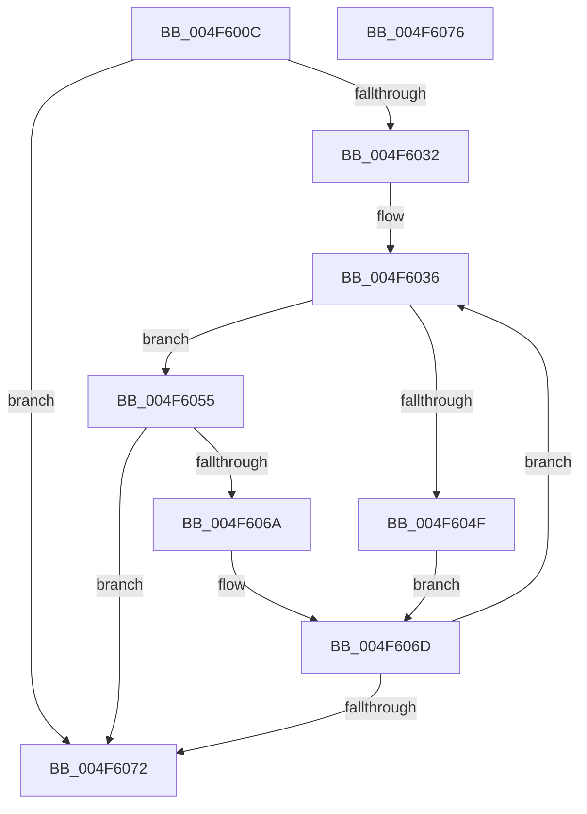

# MiGetAweNode

- RVA: `0x004F600C`–`0x004F6077` (길이 `107` bytes)
- VA: `0x00000001404F600C`
- 실행 섹션: `.text`
- PDB 이름 있음: `예`; PDB Function 태그: `아니요`
- unwind 정보 RVA: `0x000DB714`
- 디코드: `29`개 명령, `107/107` bytes 표시
- 미해석 바이트: `0` (있으면 어셈블리에 `.byte`로 보존)

> 이 문서는 커널 이미지의 기계어와 PDB 기호를 분석해 생성했습니다. 4번과 5번은 함수 원형과 자료형을 바이너리 사용 방식에서 추정한 C 해석이며 원본 소스 복구 결과는 아닙니다.

## 1. Dependencies

- 직접 호출 지점: **0**; 고유 호출 대상: **0**
- 직접 호출자로 확인된 함수: **6**
- RIP 상대 이미지 참조: **0**

### Outgoing calls
- 직접 디코드된 call 명령이 없습니다.

### Direct callers
- [MiWriteAwePtes](../4C/MiWriteAwePtes_function_004C51E0.md) at `0x004C54BF`
- [MiProtectAweRegion](../4C/MiProtectAweRegion_function_004CE62C.md) at `0x004CE6DE`
- [MiGetAwePageSizeFromVa](../68/MiGetAwePageSizeFromVa_function_00688D74.md) at `0x00688D78`
- [MiReferenceIncomingPhysicalPages](../68/MiReferenceIncomingPhysicalPages_function_006892C0.md) at `0x0068944F`
- [NtMapUserPhysicalPages](../../page/80/NtMapUserPhysicalPages_function_0080B460.md) at `0x0080B52F`
- [NtMapUserPhysicalPagesScatter](../../page/80/NtMapUserPhysicalPagesScatter_function_0080B750.md) at `0x0080B8C5`
- [NtMapUserPhysicalPagesScatter](../../page/80/NtMapUserPhysicalPagesScatter_function_0080B750.md) at `0x0080B97D`

### Static image references
- 디코드된 RIP-relative 메모리 참조가 없습니다.

## 2. Other-region calls and transfers

- 다른 실행 섹션으로 향하는 call: **0**
- 별도 외부 분기/꼬리 이동을 확인하지 못했습니다.

## 3. Assembly (complete function range)

```asm
004F600C  65 48 8B 04 25 88 01 00 00      mov rax, qword ptr gs:[0x188]
004F6015  4C 8B C9                        mov r9, rcx
004F6018  48 8B 90 B8 00 00 00            mov rdx, qword ptr [rax + 0xb8]
004F601F  48 8B 82 10 04 00 00            mov rax, qword ptr [rdx + 0x410]
004F6026  4C 8B 80 50 04 00 00            mov r8, qword ptr [rax + 0x450]
004F602D  4D 85 C0                        test r8, r8
004F6030  74 40                           je 0x1404f6072
004F6032  49 C1 E9 0C                     shr r9, 0xc
004F6036  4D 8B 50 18                     mov r10, qword ptr [r8 + 0x18]
004F603A  41 0F B6 4A 21                  movzx ecx, byte ptr [r10 + 0x21]
004F603F  41 8B 42 1C                     mov eax, dword ptr [r10 + 0x1c]
004F6043  48 C1 E1 20                     shl rcx, 0x20
004F6047  48 0B C8                        or rcx, rax
004F604A  4C 3B C9                        cmp r9, rcx
004F604D  76 06                           jbe 0x1404f6055
004F604F  4D 8B 40 08                     mov r8, qword ptr [r8 + 8]
004F6053  EB 18                           jmp 0x1404f606d
004F6055  41 0F B6 52 20                  movzx edx, byte ptr [r10 + 0x20]
004F605A  41 8B 4A 18                     mov ecx, dword ptr [r10 + 0x18]
004F605E  48 C1 E2 20                     shl rdx, 0x20
004F6062  48 0B D1                        or rdx, rcx
004F6065  4C 3B CA                        cmp r9, rdx
004F6068  73 08                           jae 0x1404f6072
004F606A  4D 8B 00                        mov r8, qword ptr [r8]
004F606D  4D 85 C0                        test r8, r8
004F6070  75 C4                           jne 0x1404f6036
004F6072  49 8B C0                        mov rax, r8
004F6075  C3                              ret
004F6076  CC                              int3
```

## 4. C-style interpretation (structured pseudocode)

```c
__int64 __fastcall MiGetAweNode(__int64 a1)
{
    if (*(unsigned __int64 *)(*(unsigned __int64 *)(*(unsigned __int64 *)(*(unsigned __int64 *)(gs_base + (0 + 392)) + 184) + 1040) + 1104) == 0) goto loc_004F6072;
    a4 = (a1) >> (12);
loc_004F6036:
    a1 = (*(unsigned __int8 *)(*(unsigned __int64 *)(*(unsigned __int64 *)(*(unsigned __int64 *)(*(unsigned __int64 *)(*(unsigned __int64 *)(gs_base + (0 + 392)) + 184) + 1040) + 1104) + 24) + 33)) << (32);
    a1 = (a1) | ((unsigned int)(*(unsigned int *)(*(unsigned __int64 *)(*(unsigned __int64 *)(*(unsigned __int64 *)(*(unsigned __int64 *)(*(unsigned __int64 *)(gs_base + (0 + 392)) + 184) + 1040) + 1104) + 24) + 28)));
    if (a4 <= a1) goto loc_004F6055;
    goto loc_004F606D;
loc_004F6055:
    a2 = (*(unsigned __int8 *)(*(unsigned __int64 *)(*(unsigned __int64 *)(*(unsigned __int64 *)(*(unsigned __int64 *)(*(unsigned __int64 *)(gs_base + (0 + 392)) + 184) + 1040) + 1104) + 24) + 32)) << (32);
    a2 = (a2) | ((unsigned int)(*(unsigned int *)(*(unsigned __int64 *)(*(unsigned __int64 *)(*(unsigned __int64 *)(*(unsigned __int64 *)(*(unsigned __int64 *)(gs_base + (0 + 392)) + 184) + 1040) + 1104) + 24) + 24)));
    if (a4 >= a2) goto loc_004F6072;
loc_004F606D:
    if (*(unsigned __int64 *)(*(unsigned __int64 *)(*(unsigned __int64 *)(*(unsigned __int64 *)(*(unsigned __int64 *)(*(unsigned __int64 *)(gs_base + (0 + 392)) + 184) + 1040) + 1104) + 8)) != 0) goto loc_004F6036;
loc_004F6072:
    return *(unsigned __int64 *)(*(unsigned __int64 *)(*(unsigned __int64 *)(*(unsigned __int64 *)(*(unsigned __int64 *)(*(unsigned __int64 *)(gs_base + (0 + 392)) + 184) + 1040) + 1104) + 8));
}
```

## 5. (Beta) C Style

```c
int64_t MiGetAweNode(int64_t Arg1)
{
    if (*(uint64_t *)(*(uint64_t *)(*(uint64_t *)(*(uint64_t *)(gs_base + (0 + 0x188)) + 0xB8) + 0x410) + 0x450) == 0) goto loc_004F6072;
    a4 = (Arg1) >> (12);
loc_004F6036:
    Arg1 = (*(uint8_t *)(*(uint64_t *)(*(uint64_t *)(*(uint64_t *)(*(uint64_t *)(*(uint64_t *)(gs_base + (0 + 0x188)) + 0xB8) + 0x410) + 0x450) + 0x18) + 0x21)) << (32);
    Arg1 = (Arg1) | ((uint32_t)(*(uint32_t *)(*(uint64_t *)(*(uint64_t *)(*(uint64_t *)(*(uint64_t *)(*(uint64_t *)(gs_base + (0 + 0x188)) + 0xB8) + 0x410) + 0x450) + 0x18) + 0x1C)));
    if (a4 <= Arg1) goto loc_004F6055;
    goto loc_004F606D;
loc_004F6055:
    a2 = (*(uint8_t *)(*(uint64_t *)(*(uint64_t *)(*(uint64_t *)(*(uint64_t *)(*(uint64_t *)(gs_base + (0 + 0x188)) + 0xB8) + 0x410) + 0x450) + 0x18) + 0x20)) << (32);
    a2 = (a2) | ((uint32_t)(*(uint32_t *)(*(uint64_t *)(*(uint64_t *)(*(uint64_t *)(*(uint64_t *)(*(uint64_t *)(gs_base + (0 + 0x188)) + 0xB8) + 0x410) + 0x450) + 0x18) + 0x18)));
    if (a4 >= a2) goto loc_004F6072;
loc_004F606D:
    if (*(uint64_t *)(*(uint64_t *)(*(uint64_t *)(*(uint64_t *)(*(uint64_t *)(*(uint64_t *)(gs_base + (0 + 0x188)) + 0xB8) + 0x410) + 0x450) + 0x8)) != 0) goto loc_004F6036;
loc_004F6072:
    return *(uint64_t *)(*(uint64_t *)(*(uint64_t *)(*(uint64_t *)(*(uint64_t *)(*(uint64_t *)(gs_base + (0 + 0x188)) + 0xB8) + 0x410) + 0x450) + 0x8));
}
```

## 6. Execution-region graph

[열기: 2D/3D 그래프와 함수 탐색 컨트롤 패널](../../../control-panel.html?section=text&rva=0x004F600C&view=graph)

- 2D 그래프는 위에서 아래로 흐르고, 3D 그래프는 빈 공간을 드래그해 회전합니다. Shift+드래그는 이동, 휠은 확대·축소, 함수 노드 선택은 대상 보고서 이동입니다.

### Static fallback


