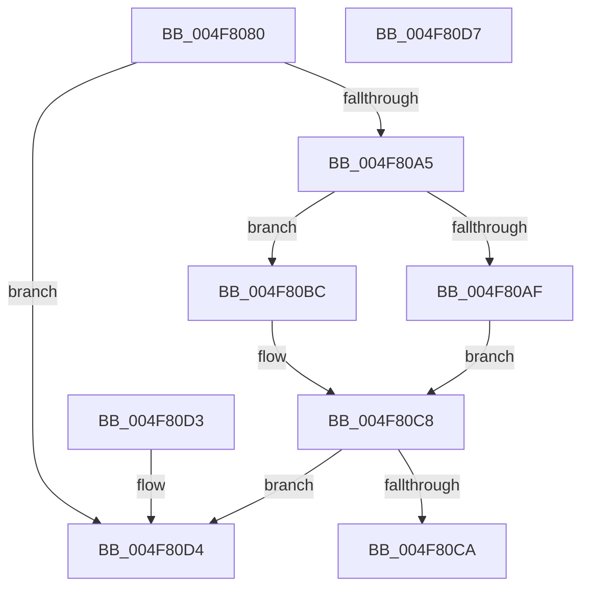

# MiGetGangAssignment

- RVA: `0x004F8080`–`0x004F80D8` (길이 `88` bytes)
- VA: `0x00000001404F8080`
- 실행 섹션: `.text`
- PDB 이름 있음: `예`; PDB Function 태그: `아니요`
- unwind 정보 RVA: `0x000DB714`
- 디코드: `28`개 명령, `88/88` bytes 표시
- 미해석 바이트: `0` (있으면 어셈블리에 `.byte`로 보존)

> 이 문서는 커널 이미지의 기계어와 PDB 기호를 분석해 생성했습니다. 4번과 5번은 함수 원형과 자료형을 바이너리 사용 방식에서 추정한 C 해석이며 원본 소스 복구 결과는 아닙니다.

## 1. Dependencies

- 직접 호출 지점: **0**; 고유 호출 대상: **0**
- 직접 호출자로 확인된 함수: **2**
- RIP 상대 이미지 참조: **0**

### Outgoing calls
- 직접 디코드된 call 명령이 없습니다.

### Direct callers
- [MiStartDpcGang](../2C/MiStartDpcGang_function_002C8C34.md) at `0x002C8D5C`
- [MiDpcGangTarget](../69/MiDpcGangTarget_function_00697E60.md) at `0x00697F1B`

### Static image references
- 디코드된 RIP-relative 메모리 참조가 없습니다.

## 2. Other-region calls and transfers

- 다른 실행 섹션으로 향하는 call: **0**
- 별도 외부 분기/꼬리 이동을 확인하지 못했습니다.

## 3. Assembly (complete function range)

```asm
004F8080  45 33 C9                        xor r9d, r9d
004F8083  4C 89 0A                        mov qword ptr [rdx], r9
004F8086  41 8D 41 01                     lea eax, [r9 + 1]
004F808A  F0 0F C1 81 B0 00 00 00         lock xadd dword ptr [rcx + 0xb0], eax
004F8092  FF C0                           inc eax
004F8094  4C 63 C0                        movsxd r8, eax
004F8097  8B 81 BC 00 00 00               mov eax, dword ptr [rcx + 0xbc]
004F809D  49 FF C8                        dec r8
004F80A0  4C 3B C0                        cmp r8, rax
004F80A3  73 2F                           jae 0x1404f80d4
004F80A5  8B 81 B8 00 00 00               mov eax, dword ptr [rcx + 0xb8]
004F80AB  A8 01                           test al, 1
004F80AD  75 0D                           jne 0x1404f80bc
004F80AF  48 8B 41 08                     mov rax, qword ptr [rcx + 8]
004F80B3  4E 8D 04 C0                     lea r8, [rax + r8*8]
004F80B7  4D 39 08                        cmp qword ptr [r8], r9
004F80BA  EB 0C                           jmp 0x1404f80c8
004F80BC  49 C1 E0 04                     shl r8, 4
004F80C0  4C 03 41 10                     add r8, qword ptr [rcx + 0x10]
004F80C4  4D 39 48 08                     cmp qword ptr [r8 + 8], r9
004F80C8  74 0A                           je 0x1404f80d4
004F80CA  4C 89 02                        mov qword ptr [rdx], r8
004F80CD  B8 01 00 00 00                  mov eax, 1
004F80D2  C3                              ret
004F80D3  CC                              int3
004F80D4  33 C0                           xor eax, eax
004F80D6  C3                              ret
004F80D7  CC                              int3
```

## 4. C-style interpretation (structured pseudocode)

```c
__int64 __fastcall MiGetGangAssignment(__int64 a1, __int64 a2, __int64 a3, int a4)
{
    __int64 result;

    a4 = 0;
    *(unsigned __int64 *)(a2) = 0;
    result = (unsigned int)((a4 + 1) + 1);
    a3 = ((int)((unsigned int)(result))) - 1;
    if (a3 >= ((unsigned int)(*(unsigned int *)(a1 + 188)))) goto loc_004F80D4;
    if ((((unsigned __int8)((unsigned int)(*(unsigned int *)(a1 + 184)))) & (1)) != 0) goto loc_004F80BC;
    goto loc_004F80C8;
loc_004F80BC:
    a3 = (*(unsigned __int64 *)(a1 + 8) + a3 * 8) << (4);
    a3 = (a3) + (*(unsigned __int64 *)(a1 + 16));
loc_004F80C8:
    if ((*(unsigned __int64 *)(a3 + 8)) == 0) goto loc_004F80D4;
    *(unsigned __int64 *)(a2) = a3;
    return 1;
loc_004F80D4:
    result = 0;
    return result;
}
```

## 5. (Beta) C Style

```c
int64_t MiGetGangAssignment(void *Arg1, void *Arg2, int64_t Arg3, int32_t Arg4)
{
    uint8_t *arg1 = (uint8_t *)Arg1;
    uint8_t *arg2 = (uint8_t *)Arg2;

    int64_t result;

    Arg4 = 0;
    *(uint64_t *)(arg2) = 0;
    result = (uint32_t)((Arg4 + 1) + 1);
    Arg3 = ((int32_t)((uint32_t)(result))) - 1;
    if (Arg3 >= ((uint32_t)(*(uint32_t *)(arg1 + 0xBC)))) goto loc_004F80D4;
    if ((((uint8_t)((uint32_t)(*(uint32_t *)(arg1 + 0xB8)))) & (1)) != 0) goto loc_004F80BC;
    goto loc_004F80C8;
loc_004F80BC:
    Arg3 = (*(uint64_t *)(arg1 + 0x8) + Arg3 * 8) << (4);
    Arg3 = (Arg3) + (*(uint64_t *)(arg1 + 0x10));
loc_004F80C8:
    if ((*(uint64_t *)(Arg3 + 0x8)) == 0) goto loc_004F80D4;
    *(uint64_t *)(arg2) = Arg3;
    return 1;
loc_004F80D4:
    result = 0;
    return result;
}
```

### 관측된 메모리 오프셋

구조체 형식이 확인되지 않은 접근은 인자 기준의 오프셋으로만 기록했습니다.

| 기준 인자 | 오프셋 표현 | 폭 (bit) | 접근 |
|---|---:|---:|---|
| `Arg1` | `+ 0x8` | `64` | `R` |
| `Arg1` | `+ 0x10` | `64` | `R` |
| `Arg1` | `+ 0xB0` | `32` | `R/W` |
| `Arg1` | `+ 0xB8` | `32` | `R` |
| `Arg1` | `+ 0xBC` | `32` | `R` |
| `Arg2` | `+ 0x0` | `64` | `W` |

## 6. Execution-region graph

[열기: 2D/3D 그래프와 함수 탐색 컨트롤 패널](../../../control-panel.html?section=text&rva=0x004F8080&view=graph)

- 2D 그래프는 위에서 아래로 흐르고, 3D 그래프는 빈 공간을 드래그해 회전합니다. Shift+드래그는 이동, 휠은 확대·축소, 함수 노드 선택은 대상 보고서 이동입니다.

### Static fallback


