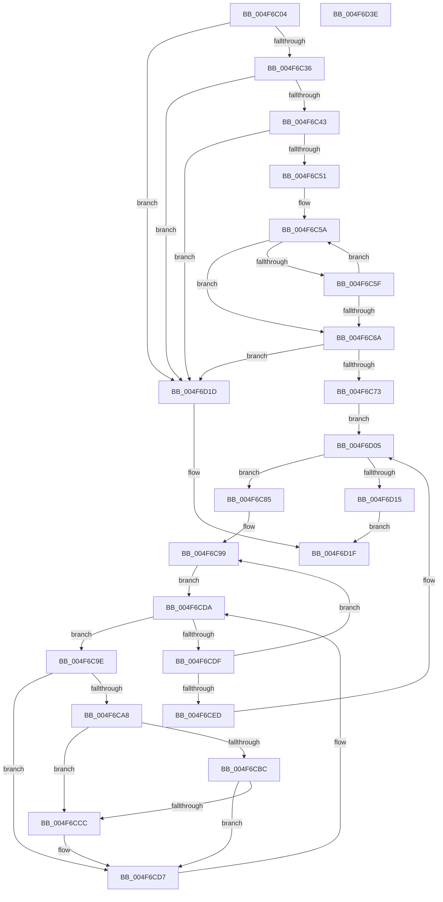

# MiGetHighestPteConsumer

- RVA: `0x004F6C04`–`0x004F6D3F` (길이 `315` bytes)
- VA: `0x00000001404F6C04`
- 실행 섹션: `.text`
- PDB 이름 있음: `예`; PDB Function 태그: `아니요`
- unwind 정보 RVA: `0x0005FEF8`
- 디코드: `86`개 명령, `315/315` bytes 표시
- 미해석 바이트: `0` (있으면 어셈블리에 `.byte`로 보존)

> 이 문서는 커널 이미지의 기계어와 PDB 기호를 분석해 생성했습니다. 4번과 5번은 함수 원형과 자료형을 바이너리 사용 방식에서 추정한 C 해석이며 원본 소스 복구 결과는 아닙니다.

## 1. Dependencies

- 직접 호출 지점: **2**; 고유 호출 대상: **1**
- 직접 호출자로 확인된 함수: **1**
- RIP 상대 이미지 참조: **5**

### Outgoing calls
- `0x004F6CB3` → [MiImageContainsVa](../4B/MiImageContainsVa_function_004B1874.md) (function, `0x004B1874`)
- `0x004F6CC3` → [MiImageContainsVa](../4B/MiImageContainsVa_function_004B1874.md) (function, `0x004B1874`)

### Direct callers
- [MiIssueNoPtesBugcheck](MiIssueNoPtesBugcheck_function_004F6B9C.md) at `0x004F6BB3`

### Static image references
- `0x004F6C28` → RVA `0x00FC51FC` (`ALMOSTRO`; read)
- `0x004F6C36` → RVA `0x00E35FA5` (`.data`; read)
- `0x004F6C43` → RVA `0x00EF54C0` (`.data`; read)
- `0x004F6C53` → RVA `0x00E388F0` (`.data`; read)
- `0x004F6C73` → RVA `0x00EF54C8` (`.data`; read)

## 2. Other-region calls and transfers

- 다른 실행 섹션으로 향하는 call: **0**
- 별도 외부 분기/꼬리 이동을 확인하지 못했습니다.

## 3. Assembly (complete function range)

```asm
004F6C04  48 8B C4                        mov rax, rsp
004F6C07  48 89 58 08                     mov qword ptr [rax + 8], rbx
004F6C0B  48 89 68 10                     mov qword ptr [rax + 0x10], rbp
004F6C0F  48 89 70 18                     mov qword ptr [rax + 0x18], rsi
004F6C13  48 89 78 20                     mov qword ptr [rax + 0x20], rdi
004F6C17  41 54                           push r12
004F6C19  41 56                           push r14
004F6C1B  41 57                           push r15
004F6C1D  48 83 EC 20                     sub rsp, 0x20
004F6C21  48 83 21 00                     and qword ptr [rcx], 0
004F6C25  4C 8B F9                        mov r15, rcx
004F6C28  8B 05 CE E5 AC 00               mov eax, dword ptr [rip + 0xace5ce]
004F6C2E  A8 01                           test al, 1
004F6C30  0F 84 E7 00 00 00               je 0x1404f6d1d
004F6C36  80 3D 68 F3 93 00 00            cmp byte ptr [rip + 0x93f368], 0
004F6C3D  0F 85 DA 00 00 00               jne 0x1404f6d1d
004F6C43  48 83 3D 75 E8 9F 00 00         cmp qword ptr [rip + 0x9fe875], 0
004F6C4B  0F 84 CC 00 00 00               je 0x1404f6d1d
004F6C51  33 C0                           xor eax, eax
004F6C53  48 8D 0D 96 1C 94 00            lea rcx, [rip + 0x941c96]
004F6C5A  48 39 09                        cmp qword ptr [rcx], rcx
004F6C5D  75 0B                           jne 0x1404f6c6a
004F6C5F  FF C0                           inc eax
004F6C61  48 83 C1 10                     add rcx, 0x10
004F6C65  83 F8 10                        cmp eax, 0x10
004F6C68  72 F0                           jb 0x1404f6c5a
004F6C6A  83 F8 10                        cmp eax, 0x10
004F6C6D  0F 84 AA 00 00 00               je 0x1404f6d1d
004F6C73  48 8B 35 4E E8 9F 00            mov rsi, qword ptr [rip + 0x9fe84e]
004F6C7A  45 33 C9                        xor r9d, r9d
004F6C7D  45 33 D2                        xor r10d, r10d
004F6C80  E9 80 00 00 00                  jmp 0x1404f6d05
004F6C85  33 DB                           xor ebx, ebx
004F6C87  4C 8D 35 62 1C 94 00            lea r14, [rip + 0x941c62]
004F6C8E  48 8D 3D 5B 1C 94 00            lea rdi, [rip + 0x941c5b]
004F6C95  44 8D 63 10                     lea r12d, [rbx + 0x10]
004F6C99  4D 8B 06                        mov r8, qword ptr [r14]
004F6C9C  EB 3C                           jmp 0x1404f6cda
004F6C9E  45 8B 58 40                     mov r11d, dword ptr [r8 + 0x40]
004F6CA2  41 F6 C3 02                     test r11b, 2
004F6CA6  75 2F                           jne 0x1404f6cd7
004F6CA8  49 8B 50 50                     mov rdx, qword ptr [r8 + 0x50]
004F6CAC  48 8B CE                        mov rcx, rsi
004F6CAF  49 8B 68 18                     mov rbp, qword ptr [r8 + 0x18]
004F6CB3  E8 BC AB FB FF                  call 0x1404b1874
004F6CB8  85 C0                           test eax, eax
004F6CBA  75 10                           jne 0x1404f6ccc
004F6CBC  49 8B 50 58                     mov rdx, qword ptr [r8 + 0x58]
004F6CC0  48 8B CE                        mov rcx, rsi
004F6CC3  E8 AC AB FB FF                  call 0x1404b1874
004F6CC8  85 C0                           test eax, eax
004F6CCA  74 0B                           je 0x1404f6cd7
004F6CCC  48 03 DD                        add rbx, rbp
004F6CCF  41 83 CB 02                     or r11d, 2
004F6CD3  45 89 58 40                     mov dword ptr [r8 + 0x40], r11d
004F6CD7  4D 8B 00                        mov r8, qword ptr [r8]
004F6CDA  4C 3B C7                        cmp r8, rdi
004F6CDD  75 BF                           jne 0x1404f6c9e
004F6CDF  48 83 C7 10                     add rdi, 0x10
004F6CE3  49 83 C6 10                     add r14, 0x10
004F6CE7  49 83 EC 01                     sub r12, 1
004F6CEB  75 AC                           jne 0x1404f6c99
004F6CED  49 3B D9                        cmp rbx, r9
004F6CF0  48 8B C6                        mov rax, rsi
004F6CF3  48 8B 76 08                     mov rsi, qword ptr [rsi + 8]
004F6CF7  49 0F 46 C2                     cmovbe rax, r10
004F6CFB  49 0F 46 D9                     cmovbe rbx, r9
004F6CFF  4C 8B D0                        mov r10, rax
004F6D02  4C 8B CB                        mov r9, rbx
004F6D05  48 8D 05 B4 E7 9F 00            lea rax, [rip + 0x9fe7b4]
004F6D0C  48 3B F0                        cmp rsi, rax
004F6D0F  0F 85 70 FF FF FF               jne 0x1404f6c85
004F6D15  4D 89 0F                        mov qword ptr [r15], r9
004F6D18  49 8B C2                        mov rax, r10
004F6D1B  EB 02                           jmp 0x1404f6d1f
004F6D1D  33 C0                           xor eax, eax
004F6D1F  48 8B 5C 24 40                  mov rbx, qword ptr [rsp + 0x40]
004F6D24  48 8B 6C 24 48                  mov rbp, qword ptr [rsp + 0x48]
004F6D29  48 8B 74 24 50                  mov rsi, qword ptr [rsp + 0x50]
004F6D2E  48 8B 7C 24 58                  mov rdi, qword ptr [rsp + 0x58]
004F6D33  48 83 C4 20                     add rsp, 0x20
004F6D37  41 5F                           pop r15
004F6D39  41 5E                           pop r14
004F6D3B  41 5C                           pop r12
004F6D3D  C3                              ret
004F6D3E  CC                              int3
```

## 4. C-style interpretation (structured pseudocode)

```c
__int64 __fastcall MiGetHighestPteConsumer(__int64 a1, __int64 a2, __int64 a3, int a4)
{
    __int64 result;
    __int64 v_r10;
    __int64 v_r11;
    __int64 v_r12;
    __int64 v_r14;
    __int64 v_rbx;
    __int64 v_rdi;
    __int64 v_rsp;
    unsigned __int64 v_stack_p10;
    unsigned __int64 v_stack_p18;
    unsigned __int64 v_stack_p20;
    unsigned __int64 v_stack_p8;

    *(unsigned __int64 *)(v_rsp + 8) = v_rbx;
    *(unsigned __int64 *)(v_rsp + 16) = v_rbp;
    *(unsigned __int64 *)(v_rsp + 24) = v_rsi;
    *(unsigned __int64 *)(v_rsp + 32) = v_rdi;
    v_rsp = (v_rsp) - (32);
    if ((((unsigned __int8)((unsigned int)(*(unsigned int *)(v_rip + 11331022)))) & (1)) == 0) goto loc_004F6D1D;
    if ((*(unsigned __int8 *)(v_rip + 9696104)) != 0) goto loc_004F6D1D;
    if ((*(unsigned __int64 *)(v_rip + 10479733)) == 0) goto loc_004F6D1D;
    result = 0;
loc_004F6C5A:
    if ((*(unsigned __int64 *)(v_rip + 9706646)) != (v_rip + 9706646)) goto loc_004F6C6A;
    result = (unsigned int)((result) + 1);
    a1 = (v_rip + 9706646) + (16);
    if (((unsigned int)(result)) < 16) goto loc_004F6C5A;
loc_004F6C6A:
    if (((unsigned int)(result)) == 16) goto loc_004F6D1D;
    a4 = 0;
    v_r10 = 0;
    goto loc_004F6D05;
loc_004F6C85:
    v_rbx = 0;
loc_004F6C99:
    goto loc_004F6CDA;
loc_004F6C9E:
    if ((((unsigned __int8)((unsigned int)(*(unsigned int *)(*(unsigned __int64 *)(v_rip + 9706594) + 64)))) & (2)) != 0) goto loc_004F6CD7;
    result = MiImageContainsVa(*(unsigned __int64 *)(v_rip + 10479694), *(unsigned __int64 *)(*(unsigned __int64 *)(v_rip + 9706594) + 80), *(unsigned __int64 *)(v_rip + 9706594), a4);
    if ((unsigned int)(result) != 0) goto loc_004F6CCC;
    result = MiImageContainsVa(*(unsigned __int64 *)(v_rip + 10479694), *(unsigned __int64 *)(*(unsigned __int64 *)(v_rip + 9706594) + 88), *(unsigned __int64 *)(v_rip + 9706594), a4);
    v_r11 = (unsigned int)(*(unsigned int *)(*(unsigned __int64 *)(v_rip + 9706594) + 64));
    if ((unsigned int)(result) != 0) {
        v_rbx = (v_rbx) + (*(unsigned __int64 *)(*(unsigned __int64 *)(v_rip + 9706594) + 24));
        v_r11 = (unsigned int)(((unsigned int)(*(unsigned int *)(*(unsigned __int64 *)(v_rip + 9706594) + 64))) | (2));
        *(unsigned int *)(*(unsigned __int64 *)(v_rip + 9706594) + 64) = (unsigned int)(v_r11);
    }
loc_004F6CDA:
    if ((*(unsigned __int64 *)(*(unsigned __int64 *)(v_rip + 9706594))) != (v_rip + 9706587)) goto loc_004F6C9E;
    v_rdi = (v_rip + 9706587) + (16);
    v_r14 = (v_rip + 9706594) + (16);
    v_r12 = (v_rbx + 16) - (1);
    if (condition_is_not_equal) goto loc_004F6C99;
    result = *(unsigned __int64 *)(v_rip + 10479694);
    if (v_rbx <= 0) {
        result = 0;
        v_rbx = 0;
    }
loc_004F6D05:
    if ((*(unsigned __int64 *)(*(unsigned __int64 *)(v_rip + 10479694) + 8)) != (v_rip + 10479540)) goto loc_004F6C85;
    *(unsigned __int64 *)(a1) = v_rbx;
    goto loc_004F6D1F;
loc_004F6D1D:
    result = 0;
loc_004F6D1F:
    v_rsp = (v_rsp) + (32);
    return result;
}
```

## 5. (Beta) C Style

```c
int64_t MiGetHighestPteConsumer(void *Arg1, int64_t Arg2, int64_t Arg3, int32_t Arg4)
{
    uint8_t *arg1 = (uint8_t *)Arg1;

    int64_t result;
    int64_t local_r10;
    int64_t local_r11;
    int64_t local_r12;
    int64_t local_r14;
    int64_t local_rbx;
    int64_t local_rdi;
    int64_t local_rsp;
    uint64_t v_stack_p10;
    uint64_t v_stack_p18;
    uint64_t v_stack_p20;
    uint64_t v_stack_p8;

    *(uint64_t *)(local_rsp + 0x8) = local_rbx;
    *(uint64_t *)(local_rsp + 0x10) = local_rbp;
    *(uint64_t *)(local_rsp + 0x18) = local_rsi;
    *(uint64_t *)(local_rsp + 0x20) = local_rdi;
    local_rsp = (local_rsp) - (32);
    if ((((uint8_t)((uint32_t)(*(uint32_t *)(v_rip + 0xACE5CE)))) & (1)) == 0) goto loc_004F6D1D;
    if ((*(uint8_t *)(v_rip + 0x93F368)) != 0) goto loc_004F6D1D;
    if ((*(uint64_t *)(v_rip + 0x9FE875)) == 0) goto loc_004F6D1D;
    result = 0;
loc_004F6C5A:
    if ((*(uint64_t *)(v_rip + 0x941C96)) != (v_rip + 9706646)) goto loc_004F6C6A;
    result = (uint32_t)((result) + 1);
    Arg1 = (v_rip + 9706646) + (16);
    if (((uint32_t)(result)) < 16) goto loc_004F6C5A;
loc_004F6C6A:
    if (((uint32_t)(result)) == 16) goto loc_004F6D1D;
    Arg4 = 0;
    local_r10 = 0;
    goto loc_004F6D05;
loc_004F6C85:
    local_rbx = 0;
loc_004F6C99:
    goto loc_004F6CDA;
loc_004F6C9E:
    if ((((uint8_t)((uint32_t)(*(uint32_t *)(*(uint64_t *)(v_rip + 0x941C62) + 0x40)))) & (2)) != 0) goto loc_004F6CD7;
    result = MiImageContainsVa(*(uint64_t *)(v_rip + 0x9FE84E), *(uint64_t *)(*(uint64_t *)(v_rip + 0x941C62) + 0x50), *(uint64_t *)(v_rip + 0x941C62), Arg4);
    if ((uint32_t)(result) != 0) goto loc_004F6CCC;
    result = MiImageContainsVa(*(uint64_t *)(v_rip + 0x9FE84E), *(uint64_t *)(*(uint64_t *)(v_rip + 0x941C62) + 0x58), *(uint64_t *)(v_rip + 0x941C62), Arg4);
    local_r11 = (uint32_t)(*(uint32_t *)(*(uint64_t *)(v_rip + 0x941C62) + 0x40));
    if ((uint32_t)(result) != 0) {
        local_rbx = (local_rbx) + (*(uint64_t *)(*(uint64_t *)(v_rip + 0x941C62) + 0x18));
        local_r11 = (uint32_t)(((uint32_t)(*(uint32_t *)(*(uint64_t *)(v_rip + 0x941C62) + 0x40))) | (2));
        *(uint32_t *)(*(uint64_t *)(v_rip + 0x941C62) + 0x40) = (uint32_t)(local_r11);
    }
loc_004F6CDA:
    if ((*(uint64_t *)(*(uint64_t *)(v_rip + 0x941C62))) != (v_rip + 9706587)) goto loc_004F6C9E;
    local_rdi = (v_rip + 9706587) + (16);
    local_r14 = (v_rip + 9706594) + (16);
    local_r12 = (local_rbx + 16) - (1);
    if (condition_is_not_equal) goto loc_004F6C99;
    result = *(uint64_t *)(v_rip + 0x9FE84E);
    if (local_rbx <= 0) {
        result = 0;
        local_rbx = 0;
    }
loc_004F6D05:
    if ((*(uint64_t *)(*(uint64_t *)(v_rip + 0x9FE84E) + 0x8)) != (v_rip + 10479540)) goto loc_004F6C85;
    *(uint64_t *)(arg1) = local_rbx;
    goto loc_004F6D1F;
loc_004F6D1D:
    result = 0;
loc_004F6D1F:
    local_rsp = (local_rsp) + (32);
    return result;
}
```

### 관측된 메모리 오프셋

구조체 형식이 확인되지 않은 접근은 인자 기준의 오프셋으로만 기록했습니다.

| 기준 인자 | 오프셋 표현 | 폭 (bit) | 접근 |
|---|---:|---:|---|
| `Arg1` | `+ 0x0` | `64` | `R/W` |
| `Arg1` | `+ 0x0` | `64` | `W` |

## 6. Execution-region graph

[열기: 2D/3D 그래프와 함수 탐색 컨트롤 패널](../../../control-panel.html?section=text&rva=0x004F6C04&view=graph)

- 2D 그래프는 위에서 아래로 흐르고, 3D 그래프는 빈 공간을 드래그해 회전합니다. Shift+드래그는 이동, 휠은 확대·축소, 함수 노드 선택은 대상 보고서 이동입니다.

### Static fallback


