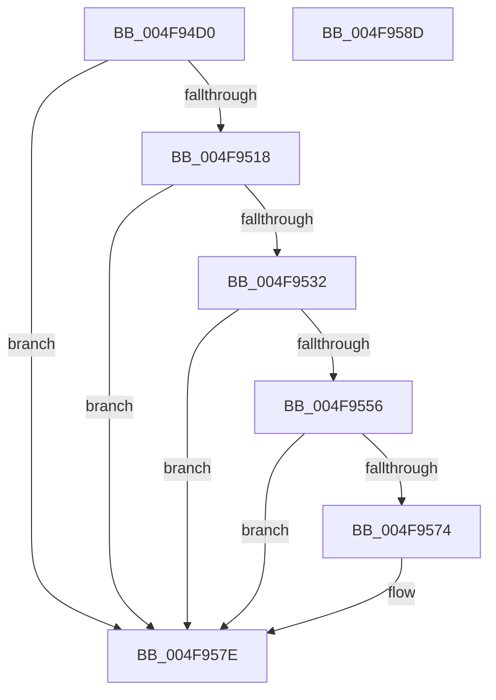

# MiGetLargeVadMappingIndex

- RVA: `0x004F94D0`–`0x004F958E` (길이 `190` bytes)
- VA: `0x00000001404F94D0`
- 실행 섹션: `.text`
- PDB 이름 있음: `예`; PDB Function 태그: `아니요`
- unwind 정보 RVA: `0x000BF894`
- 디코드: `55`개 명령, `190/190` bytes 표시
- 미해석 바이트: `0` (있으면 어셈블리에 `.byte`로 보존)

> 이 문서는 커널 이미지의 기계어와 PDB 기호를 분석해 생성했습니다. 4번과 5번은 함수 원형과 자료형을 바이너리 사용 방식에서 추정한 C 해석이며 원본 소스 복구 결과는 아닙니다.

## 1. Dependencies

- 직접 호출 지점: **2**; 고유 호출 대상: **1**
- 직접 호출자로 확인된 함수: **1**
- RIP 상대 이미지 참조: **0**

### Outgoing calls
- `0x004F953D` → [MiGetProtoPteAddress](../32/MiGetProtoPteAddress_function_0032E970.md) (function, `0x0032E970`)
- `0x004F9565` → [MiGetProtoPteAddress](../32/MiGetProtoPteAddress_function_0032E970.md) (function, `0x0032E970`)

### Direct callers
- [MiInPagePageTable](../3E/MiInPagePageTable_function_003EF8DC.md) at `0x003EFE6D`

### Static image references
- 디코드된 RIP-relative 메모리 참조가 없습니다.

## 2. Other-region calls and transfers

- 다른 실행 섹션으로 향하는 call: **0**
- 별도 외부 분기/꼬리 이동을 확인하지 못했습니다.

## 3. Assembly (complete function range)

```asm
004F94D0  4C 8B DC                        mov r11, rsp
004F94D3  49 89 5B 18                     mov qword ptr [r11 + 0x18], rbx
004F94D7  55                              push rbp
004F94D8  56                              push rsi
004F94D9  57                              push rdi
004F94DA  48 83 EC 20                     sub rsp, 0x20
004F94DE  44 0F B6 41 20                  movzx r8d, byte ptr [rcx + 0x20]
004F94E3  48 B8 00 00 FC FF FF FF 0F 00   movabs rax, 0xffffffffc0000
004F94ED  49 83 63 08 00                  and qword ptr [r11 + 8], 0
004F94F2  48 8B F9                        mov rdi, rcx
004F94F5  49 83 63 10 00                  and qword ptr [r11 + 0x10], 0
004F94FA  BB 01 00 00 00                  mov ebx, 1
004F94FF  48 C1 EA 0C                     shr rdx, 0xc
004F9503  49 C1 E0 20                     shl r8, 0x20
004F9507  48 8B F2                        mov rsi, rdx
004F950A  48 23 F0                        and rsi, rax
004F950D  8B 41 18                        mov eax, dword ptr [rcx + 0x18]
004F9510  4C 0B C0                        or r8, rax
004F9513  49 3B F0                        cmp rsi, r8
004F9516  72 66                           jb 0x1404f957e
004F9518  0F B6 49 21                     movzx ecx, byte ptr [rcx + 0x21]
004F951C  8B 47 1C                        mov eax, dword ptr [rdi + 0x1c]
004F951F  48 C1 E1 20                     shl rcx, 0x20
004F9523  48 0B C8                        or rcx, rax
004F9526  48 8D 86 FF FF 03 00            lea rax, [rsi + 0x3ffff]
004F952D  48 3B C1                        cmp rax, rcx
004F9530  77 4C                           ja 0x1404f957e
004F9532  4D 8D 4B 08                     lea r9, [r11 + 8]
004F9536  48 8B CF                        mov rcx, rdi
004F9539  44 8D 43 0B                     lea r8d, [rbx + 0xb]
004F953D  E8 2E 54 E3 FF                  call 0x14032e970
004F9542  48 8B 6C 24 40                  mov rbp, qword ptr [rsp + 0x40]
004F9547  8B 45 30                        mov eax, dword ptr [rbp + 0x30]
004F954A  25 00 00 00 C0                  and eax, 0xc0000000
004F954F  3D 00 00 00 80                  cmp eax, 0x80000000
004F9554  75 28                           jne 0x1404f957e
004F9556  4C 8D 4C 24 48                  lea r9, [rsp + 0x48]
004F955B  48 8B D6                        mov rdx, rsi
004F955E  44 8D 43 03                     lea r8d, [rbx + 3]
004F9562  48 8B CF                        mov rcx, rdi
004F9565  E8 06 54 E3 FF                  call 0x14032e970
004F956A  48 8B 4C 24 48                  mov rcx, qword ptr [rsp + 0x48]
004F956F  48 3B CD                        cmp rcx, rbp
004F9572  75 0A                           jne 0x1404f957e
004F9574  48 3B 41 08                     cmp rax, qword ptr [rcx + 8]
004F9578  8D 53 01                        lea edx, [rbx + 1]
004F957B  0F 44 DA                        cmove ebx, edx
004F957E  8B C3                           mov eax, ebx
004F9580  48 8B 5C 24 50                  mov rbx, qword ptr [rsp + 0x50]
004F9585  48 83 C4 20                     add rsp, 0x20
004F9589  5F                              pop rdi
004F958A  5E                              pop rsi
004F958B  5D                              pop rbp
004F958C  C3                              ret
004F958D  CC                              int3
```

## 4. C-style interpretation (structured pseudocode)

```c
__int64 __fastcall MiGetLargeVadMappingIndex(__int64 a1, __int64 a2)
{
    __int64 result;
    __int64 v_rbx;
    __int64 v_rsi;
    __int64 v_rsp;
    unsigned __int64 v_stack_p10;
    unsigned __int64 v_stack_p18;
    unsigned __int64 v_stack_p8;

    *(unsigned __int64 *)(v_rsp + 24) = v_rbx;
    v_rsp = (v_rsp) - (32);
    a2 = (a2) >> (12);
    a3 = (*(unsigned __int8 *)(a1 + 32)) << (32);
    v_rsi = (a2) & (result);
    a3 = (a3) | ((unsigned int)(*(unsigned int *)(a1 + 24)));
    if (v_rsi < a3) goto loc_004F957E;
    a1 = (*(unsigned __int8 *)(a1 + 33)) << (32);
    a1 = (a1) | ((unsigned int)(*(unsigned int *)(a1 + 28)));
    if ((v_rsi + 262143) > a1) goto loc_004F957E;
    result = MiGetProtoPteAddress(a1, a2, 1 + 11, v_rsp + 8);
    result = (unsigned int)(((unsigned int)(*(unsigned int *)(v_stack_p8 + 48))) & (0xC0000000ULL));
    if (((unsigned int)(result)) != 0x80000000ULL) goto loc_004F957E;
    result = MiGetProtoPteAddress(a1, v_rsi, 1 + 3, v_stack_p10);
    v_rbx = 1;
    if (v_stack_p10 == v_stack_p8) {
        a2 = 1 + 1;
        v_rbx = 1;
        if (result == (*(unsigned __int64 *)(v_stack_p10 + 8))) { v_rbx = (unsigned int)(a2); }
    }
    v_rsp = (v_rsp) + (32);
    return (unsigned int)((unsigned int)(v_rbx));
}
```

## 5. (Beta) C Style

```c
int64_t MiGetLargeVadMappingIndex(void *Arg1, int64_t Arg2)
{
    uint8_t *arg1 = (uint8_t *)Arg1;

    int64_t result;
    int64_t local_rbx;
    int64_t local_rsi;
    int64_t local_rsp;
    uint64_t v_stack_p10;
    uint64_t v_stack_p18;
    uint64_t v_stack_p8;

    *(uint64_t *)(local_rsp + 0x18) = local_rbx;
    local_rsp = (local_rsp) - (32);
    Arg2 = (Arg2) >> (12);
    a3 = (*(uint8_t *)(arg1 + 0x20)) << (32);
    local_rsi = (Arg2) & (result);
    a3 = (a3) | ((uint32_t)(*(uint32_t *)(arg1 + 0x18)));
    if (local_rsi < a3) goto loc_004F957E;
    Arg1 = (*(uint8_t *)(arg1 + 0x21)) << (32);
    Arg1 = (Arg1) | ((uint32_t)(*(uint32_t *)(arg1 + 0x1C)));
    if ((local_rsi + 262143) > Arg1) goto loc_004F957E;
    result = MiGetProtoPteAddress(Arg1, Arg2, 1 + 11, local_rsp + 8);
    result = (uint32_t)(((uint32_t)(*(uint32_t *)(v_stack_p8 + 0x30))) & (0xC0000000ULL));
    if (((uint32_t)(result)) != 0x80000000ULL) goto loc_004F957E;
    result = MiGetProtoPteAddress(Arg1, local_rsi, 1 + 3, v_stack_p10);
    local_rbx = 1;
    if (v_stack_p10 == v_stack_p8) {
        Arg2 = 1 + 1;
        local_rbx = 1;
        if (result == (*(uint64_t *)(v_stack_p10 + 0x8))) { local_rbx = (uint32_t)(Arg2); }
    }
    local_rsp = (local_rsp) + (32);
    return (uint32_t)((uint32_t)(local_rbx));
}
```

### 관측된 메모리 오프셋

구조체 형식이 확인되지 않은 접근은 인자 기준의 오프셋으로만 기록했습니다.

| 기준 인자 | 오프셋 표현 | 폭 (bit) | 접근 |
|---|---:|---:|---|
| `Arg1` | `+ 0x18` | `32` | `R` |
| `Arg1` | `+ 0x1C` | `32` | `R` |
| `Arg1` | `+ 0x20` | `8` | `R` |
| `Arg1` | `+ 0x21` | `8` | `R` |

## 6. Execution-region graph

[열기: 2D/3D 그래프와 함수 탐색 컨트롤 패널](../../../control-panel.html?section=text&rva=0x004F94D0&view=graph)

- 2D 그래프는 위에서 아래로 흐르고, 3D 그래프는 빈 공간을 드래그해 회전합니다. Shift+드래그는 이동, 휠은 확대·축소, 함수 노드 선택은 대상 보고서 이동입니다.

### Static fallback


