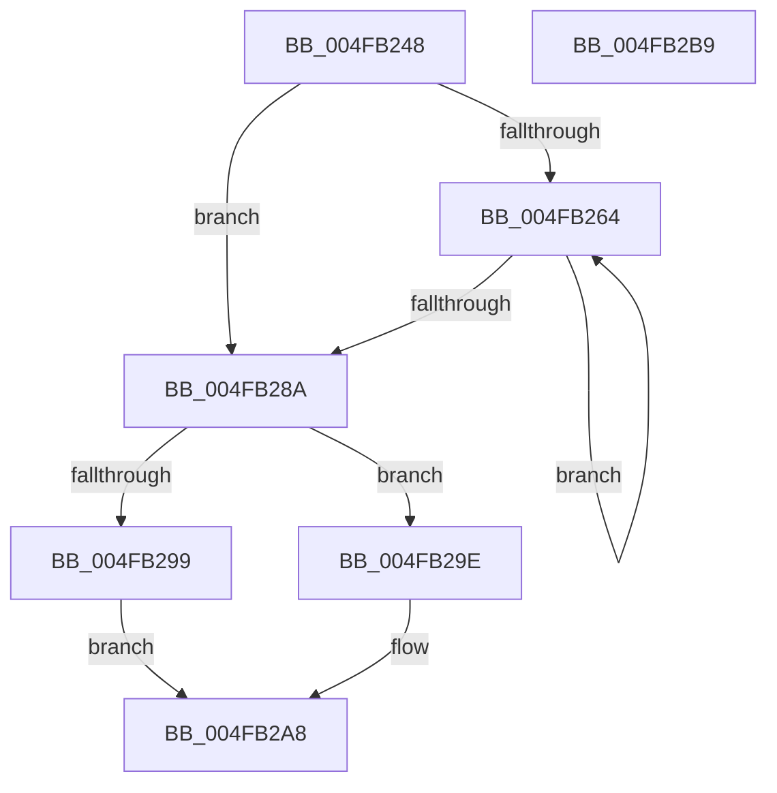

# MiGetNodeHugeRangeCounts

- RVA: `0x004FB248`–`0x004FB2BA` (길이 `114` bytes)
- VA: `0x00000001404FB248`
- 실행 섹션: `.text`
- PDB 이름 있음: `예`; PDB Function 태그: `아니요`
- unwind 정보 RVA: `0x000950EC`
- 디코드: `31`개 명령, `114/114` bytes 표시
- 미해석 바이트: `0` (있으면 어셈블리에 `.byte`로 보존)

> 이 문서는 커널 이미지의 기계어와 PDB 기호를 분석해 생성했습니다. 4번과 5번은 함수 원형과 자료형을 바이너리 사용 방식에서 추정한 C 해석이며 원본 소스 복구 결과는 아닙니다.

## 1. Dependencies

- 직접 호출 지점: **0**; 고유 호출 대상: **0**
- 직접 호출자로 확인된 함수: **2**
- RIP 상대 이미지 참조: **1**

### Outgoing calls
- 직접 디코드된 call 명령이 없습니다.

### Direct callers
- [MmFillEtwHugeIoSpaceInformation](../66/MmFillEtwHugeIoSpaceInformation_function_0066E37C.md) at `0x0066E3F1`
- [MmManagePartitionMemoryInformation](../../page/90/MmManagePartitionMemoryInformation_function_0090343C.md) at `0x00903833`

### Static image references
- `0x004FB255` → RVA `0x00FC5002` (`ALMOSTRO`; read)

## 2. Other-region calls and transfers

- 다른 실행 섹션으로 향하는 call: **0**
- 별도 외부 분기/꼬리 이동을 확인하지 못했습니다.

## 3. Assembly (complete function range)

```asm
004FB248  48 89 5C 24 08                  mov qword ptr [rsp + 8], rbx
004FB24D  48 89 7C 24 10                  mov qword ptr [rsp + 0x10], rdi
004FB252  45 33 DB                        xor r11d, r11d
004FB255  44 38 1D A6 9D AC 00            cmp byte ptr [rip + 0xac9da6], r11b
004FB25C  41 8B DB                        mov ebx, r11d
004FB25F  41 8B FB                        mov edi, r11d
004FB262  76 26                           jbe 0x1404fb28a
004FB264  44 8B D7                        mov r10d, edi
004FB267  FF C7                           inc edi
004FB269  4A 8B 84 D1 98 3A 00 00         mov rax, qword ptr [rcx + r10*8 + 0x3a98]
004FB271  4C 03 D8                        add r11, rax
004FB274  4A 8B 84 D1 A8 3A 00 00         mov rax, qword ptr [rcx + r10*8 + 0x3aa8]
004FB27C  48 03 D8                        add rbx, rax
004FB27F  0F B6 05 7C 9D AC 00            movzx eax, byte ptr [rip + 0xac9d7c]
004FB286  3B F8                           cmp edi, eax
004FB288  72 DA                           jb 0x1404fb264
004FB28A  48 8B 81 90 3A 00 00            mov rax, qword ptr [rcx + 0x3a90]
004FB291  48 89 02                        mov qword ptr [rdx], rax
004FB294  4C 3B D8                        cmp r11, rax
004FB297  76 05                           jbe 0x1404fb29e
004FB299  4C 8B D8                        mov r11, rax
004FB29C  EB 0A                           jmp 0x1404fb2a8
004FB29E  49 2B C3                        sub rax, r11
004FB2A1  48 3B D8                        cmp rbx, rax
004FB2A4  48 0F 47 D8                     cmova rbx, rax
004FB2A8  48 8B 7C 24 10                  mov rdi, qword ptr [rsp + 0x10]
004FB2AD  49 89 19                        mov qword ptr [r9], rbx
004FB2B0  48 8B 5C 24 08                  mov rbx, qword ptr [rsp + 8]
004FB2B5  4D 89 18                        mov qword ptr [r8], r11
004FB2B8  C3                              ret
004FB2B9  CC                              int3
```

## 4. C-style interpretation (structured pseudocode)

```c
__int64 __fastcall MiGetNodeHugeRangeCounts(__int64 a1, __int64 a2, __int64 a3, __int64 a4)
{
    __int64 result;
    __int64 v_r11;
    __int64 v_rbx;
    __int64 v_rdi;
    unsigned __int64 v_stack_p10;
    unsigned __int64 v_stack_p8;

    v_stack_p8 = v_rbx;
    v_stack_p10 = v_rdi;
    v_r11 = 0;
    if ((*(unsigned __int8 *)(v_rip + 11312550)) <= 0) goto loc_004FB28A;
loc_004FB264:
    v_rdi = (unsigned int)((0) + 1);
    v_r11 = (v_r11) + (*(unsigned __int64 *)(a1 + 0 * 8 + 15000));
    v_rbx = (0) + (*(unsigned __int64 *)(a1 + 0 * 8 + 15016));
    if (((unsigned int)(v_rdi)) < ((unsigned int)(*(unsigned __int8 *)(v_rip + 11312508)))) goto loc_004FB264;
loc_004FB28A:
    *(unsigned __int64 *)(a2) = *(unsigned __int64 *)(a1 + 14992);
    if (v_r11 <= (*(unsigned __int64 *)(a1 + 14992))) goto loc_004FB29E;
    goto loc_004FB2A8;
loc_004FB29E:
    result = (*(unsigned __int64 *)(a1 + 14992)) - (*(unsigned __int64 *)(a1 + 14992));
    if (v_rbx > result) { v_rbx = result; }
loc_004FB2A8:
    *(unsigned __int64 *)(a4) = v_rbx;
    *(unsigned __int64 *)(a3) = *(unsigned __int64 *)(a1 + 14992);
    return result;
}
```

## 5. (Beta) C Style

```c
int64_t MiGetNodeHugeRangeCounts(void *Arg1, void *Arg2, void *Arg3, void *Arg4)
{
    uint8_t *arg1 = (uint8_t *)Arg1;
    uint8_t *arg2 = (uint8_t *)Arg2;
    uint8_t *arg3 = (uint8_t *)Arg3;
    uint8_t *arg4 = (uint8_t *)Arg4;

    int64_t result;
    int64_t local_r11;
    int64_t local_rbx;
    int64_t local_rdi;
    uint64_t v_stack_p10;
    uint64_t v_stack_p8;

    v_stack_p8 = local_rbx;
    v_stack_p10 = local_rdi;
    local_r11 = 0;
    if ((*(uint8_t *)(v_rip + 0xAC9DA6)) <= 0) goto loc_004FB28A;
loc_004FB264:
    local_rdi = (uint32_t)((0) + 1);
    local_r11 = (local_r11) + (*(uint64_t *)(arg1 + 0x0 * 8 + 0x3A98));
    local_rbx = (0) + (*(uint64_t *)(arg1 + 0x0 * 8 + 0x3AA8));
    if (((uint32_t)(local_rdi)) < ((uint32_t)(*(uint8_t *)(v_rip + 0xAC9D7C)))) goto loc_004FB264;
loc_004FB28A:
    *(uint64_t *)(arg2) = *(uint64_t *)(arg1 + 0x3A90);
    if (local_r11 <= (*(uint64_t *)(arg1 + 0x3A90))) goto loc_004FB29E;
    goto loc_004FB2A8;
loc_004FB29E:
    result = (*(uint64_t *)(arg1 + 0x3A90)) - (*(uint64_t *)(arg1 + 0x3A90));
    if (local_rbx > result) { local_rbx = result; }
loc_004FB2A8:
    *(uint64_t *)(arg4) = local_rbx;
    *(uint64_t *)(arg3) = *(uint64_t *)(arg1 + 0x3A90);
    return result;
}
```

### 관측된 메모리 오프셋

구조체 형식이 확인되지 않은 접근은 인자 기준의 오프셋으로만 기록했습니다.

| 기준 인자 | 오프셋 표현 | 폭 (bit) | 접근 |
|---|---:|---:|---|
| `Arg1` | `+ 0x3A90` | `64` | `R` |
| `Arg1` | `+ 0x3A98 + r10*8` | `64` | `R` |
| `Arg1` | `+ 0x3AA8 + r10*8` | `64` | `R` |
| `Arg2` | `+ 0x0` | `64` | `W` |
| `Arg3` | `+ 0x0` | `64` | `W` |
| `Arg4` | `+ 0x0` | `64` | `W` |

## 6. Execution-region graph

[열기: 2D/3D 그래프와 함수 탐색 컨트롤 패널](../../../control-panel.html?section=text&rva=0x004FB248&view=graph)

- 2D 그래프는 위에서 아래로 흐르고, 3D 그래프는 빈 공간을 드래그해 회전합니다. Shift+드래그는 이동, 휠은 확대·축소, 함수 노드 선택은 대상 보고서 이동입니다.

### Static fallback


