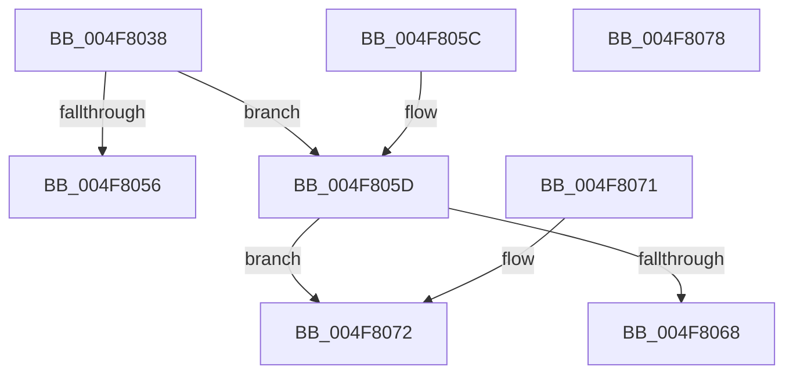

# MiGetVadLargePageMinimumIndex

- RVA: `0x004F8038`–`0x004F8079` (길이 `65` bytes)
- VA: `0x00000001404F8038`
- 실행 섹션: `.text`
- PDB 이름 있음: `예`; PDB Function 태그: `아니요`
- unwind 정보 RVA: `0x000DB714`
- 디코드: `20`개 명령, `65/65` bytes 표시
- 미해석 바이트: `0` (있으면 어셈블리에 `.byte`로 보존)

> 이 문서는 커널 이미지의 기계어와 PDB 기호를 분석해 생성했습니다. 4번과 5번은 함수 원형과 자료형을 바이너리 사용 방식에서 추정한 C 해석이며 원본 소스 복구 결과는 아닙니다.

## 1. Dependencies

- 직접 호출 지점: **0**; 고유 호출 대상: **0**
- 직접 호출자로 확인된 함수: **1**
- RIP 상대 이미지 참조: **1**

### Outgoing calls
- 직접 디코드된 call 명령이 없습니다.

### Direct callers
- [MiCommitExistingVad](../32/MiCommitExistingVad_function_0032A860.md) at `0x0032B4B4`

### Static image references
- `0x004F803B` → RVA `0x00000000` (`image boundary/outside`; read)

## 2. Other-region calls and transfers

- 다른 실행 섹션으로 향하는 call: **0**
- 별도 외부 분기/꼬리 이동을 확인하지 못했습니다.

## 3. Assembly (complete function range)

```asm
004F8038  8B 41 30                        mov eax, dword ptr [rcx + 0x30]
004F803B  4C 8D 05 BE 7F B0 FF            lea r8, [rip - 0x4f8042]
004F8042  8B C8                           mov ecx, eax
004F8044  48 C1 E9 13                     shr rcx, 0x13
004F8048  83 E1 03                        and ecx, 3
004F804B  41 83 BC C8 78 45 01 00 10      cmp dword ptr [r8 + rcx*8 + 0x14578], 0x10
004F8054  75 07                           jne 0x1404f805d
004F8056  B8 02 00 00 00                  mov eax, 2
004F805B  C3                              ret
004F805C  CC                              int3
004F805D  BA 00 00 A0 00                  mov edx, 0xa00000
004F8062  23 C2                           and eax, edx
004F8064  3B C2                           cmp eax, edx
004F8066  75 0A                           jne 0x1404f8072
004F8068  41 8B 84 88 10 3F 01 00         mov eax, dword ptr [r8 + rcx*4 + 0x13f10]
004F8070  C3                              ret
004F8071  CC                              int3
004F8072  B8 01 00 00 00                  mov eax, 1
004F8077  C3                              ret
004F8078  CC                              int3
```

## 4. C-style interpretation (structured pseudocode)

```c
__int64 __fastcall MiGetVadLargePageMinimumIndex(__int64 a1)
{
    __int64 result;

    a1 = ((unsigned int)((unsigned int)((unsigned int)(*(unsigned int *)(a1 + 48))))) >> (19);
    a1 = (unsigned int)((a1) & (3));
    if ((*(unsigned int *)(v_rip - 5210178 + a1 * 8 + 83320)) != 16) goto loc_004F805D;
    return 2;
loc_004F805D:
    result = (unsigned int)((2) & ((unsigned int)((unsigned int)(0xA00000ULL))));
    if (((unsigned int)(result)) != ((unsigned int)((unsigned int)(0xA00000ULL)))) goto loc_004F8072;
    return (unsigned int)(*(unsigned int *)(v_rip - 5210178 + a1 * 4 + 81680));
loc_004F8072:
    return 1;
}
```

## 5. (Beta) C Style

```c
int64_t MiGetVadLargePageMinimumIndex(void *Arg1)
{
    uint8_t *arg1 = (uint8_t *)Arg1;

    int64_t result;

    Arg1 = ((uint32_t)((uint32_t)((uint32_t)(*(uint32_t *)(arg1 + 0x30))))) >> (19);
    Arg1 = (uint32_t)((Arg1) & (3));
    if ((*(uint32_t *)(v_rip - 0x4F8042 + arg1 * 8 + 0x14578)) != 16) goto loc_004F805D;
    return 2;
loc_004F805D:
    result = (uint32_t)((2) & ((uint32_t)((uint32_t)(0xA00000ULL))));
    if (((uint32_t)(result)) != ((uint32_t)((uint32_t)(0xA00000ULL)))) goto loc_004F8072;
    return (uint32_t)(*(uint32_t *)(v_rip - 0x4F8042 + arg1 * 4 + 0x13F10));
loc_004F8072:
    return 1;
}
```

### 관측된 메모리 오프셋

구조체 형식이 확인되지 않은 접근은 인자 기준의 오프셋으로만 기록했습니다.

| 기준 인자 | 오프셋 표현 | 폭 (bit) | 접근 |
|---|---:|---:|---|
| `Arg1` | `+ 0x30` | `32` | `R` |

## 6. Execution-region graph

[열기: 2D/3D 그래프와 함수 탐색 컨트롤 패널](../../../control-panel.html?section=text&rva=0x004F8038&view=graph)

- 2D 그래프는 위에서 아래로 흐르고, 3D 그래프는 빈 공간을 드래그해 회전합니다. Shift+드래그는 이동, 휠은 확대·축소, 함수 노드 선택은 대상 보고서 이동입니다.

### Static fallback


