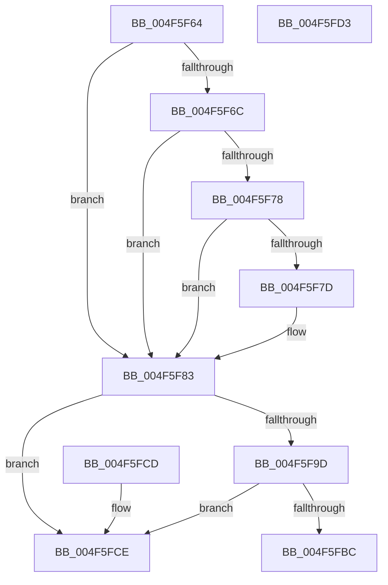

# MiGetValidAwePartitionId

- RVA: `0x004F5F64`–`0x004F5FD4` (길이 `112` bytes)
- VA: `0x00000001404F5F64`
- 실행 섹션: `.text`
- PDB 이름 있음: `예`; PDB Function 태그: `아니요`
- unwind 정보 RVA: `0x000DB714`
- 디코드: `31`개 명령, `112/112` bytes 표시
- 미해석 바이트: `0` (있으면 어셈블리에 `.byte`로 보존)

> 이 문서는 커널 이미지의 기계어와 PDB 기호를 분석해 생성했습니다. 4번과 5번은 함수 원형과 자료형을 바이너리 사용 방식에서 추정한 C 해석이며 원본 소스 복구 결과는 아닙니다.

## 1. Dependencies

- 직접 호출 지점: **0**; 고유 호출 대상: **0**
- 직접 호출자로 확인된 함수: **1**
- RIP 상대 이미지 참조: **2**

### Outgoing calls
- 직접 디코드된 call 명령이 없습니다.

### Direct callers
- [sub_0032BCD2](../32/Unknown_function_0032BCD2.md) at `0x0032BCE0`

### Static image references
- `0x004F5F6C` → RVA `0x00E2DC80` (`.data`; read)
- `0x004F5F94` → RVA `0x00E2DCE0` (`.data`; read)

## 2. Other-region calls and transfers

- 다른 실행 섹션으로 향하는 call: **0**
- 별도 외부 분기/꼬리 이동을 확인하지 못했습니다.

## 3. Assembly (complete function range)

```asm
004F5F64  45 33 C0                        xor r8d, r8d
004F5F67  F6 C1 01                        test cl, 1
004F5F6A  75 17                           jne 0x1404f5f83
004F5F6C  48 8B 05 0D 7D 93 00            mov rax, qword ptr [rip + 0x937d0d]
004F5F73  48 85 C0                        test rax, rax
004F5F76  74 0B                           je 0x1404f5f83
004F5F78  F6 C1 10                        test cl, 0x10
004F5F7B  75 06                           jne 0x1404f5f83
004F5F7D  48 F7 D0                        not rax
004F5F80  48 23 C8                        and rcx, rax
004F5F83  48 C1 E9 0C                     shr rcx, 0xc
004F5F87  48 B8 FF FF FF FF FF 00 00 00   movabs rax, 0xffffffffff
004F5F91  48 23 C8                        and rcx, rax
004F5F94  48 3B 0D 45 7D 93 00            cmp rcx, qword ptr [rip + 0x937d45]
004F5F9B  77 31                           ja 0x1404f5fce
004F5F9D  48 8D 14 49                     lea rdx, [rcx + rcx*2]
004F5FA1  48 03 D2                        add rdx, rdx
004F5FA4  48 B9 28 00 00 00 00 DE FF FF   movabs rcx, 0xffffde0000000028
004F5FAE  48 8B 04 D1                     mov rax, qword ptr [rcx + rdx*8]
004F5FB2  48 C1 E8 36                     shr rax, 0x36
004F5FB6  0F BA E0 00                     bt eax, 0
004F5FBA  73 12                           jae 0x1404f5fce
004F5FBC  48 8B 04 D1                     mov rax, qword ptr [rcx + rdx*8]
004F5FC0  B9 FF 03 00 00                  mov ecx, 0x3ff
004F5FC5  48 C1 E8 2B                     shr rax, 0x2b
004F5FC9  66 23 C1                        and ax, cx
004F5FCC  C3                              ret
004F5FCD  CC                              int3
004F5FCE  41 0F B7 C0                     movzx eax, r8w
004F5FD2  C3                              ret
004F5FD3  CC                              int3
```

## 4. C-style interpretation (structured pseudocode)

```c
__int64 __fastcall MiGetValidAwePartitionId(__int64 a1, __int64 a2, int a3)
{
    __int64 result;

    a3 = 0;
    if ((((unsigned __int8)(a1)) & (1)) != 0) goto loc_004F5F83;
    if (*(unsigned __int64 *)(v_rip + 9665805) == 0) goto loc_004F5F83;
    result = *(unsigned __int64 *)(v_rip + 9665805);
    if ((((unsigned __int8)(a1)) & (16)) == 0) {
        result = ~(*(unsigned __int64 *)(v_rip + 9665805));
        a1 = (a1) & (result);
    }
    a1 = (a1) >> (12);
    a1 = (a1) & (result);
    if (a1 > (*(unsigned __int64 *)(v_rip + 9665861))) goto loc_004F5FCE;
    a2 = (a1 + a1 * 2) + (a1 + a1 * 2);
    result = (*(unsigned __int64 *)(a1 + a2 * 8)) >> (54);
    if (condition_is_above_or_equal) goto loc_004F5FCE;
    result = (*(unsigned __int64 *)(a1 + a2 * 8)) >> (43);
    result = (unsigned __int16)((result) & ((unsigned __int16)((unsigned int)(0x3FFULL))));
    return result;
loc_004F5FCE:
    return 0;
}
```

## 5. (Beta) C Style

```c
int64_t MiGetValidAwePartitionId(int64_t Arg1, int64_t Arg2, int32_t Arg3)
{
    int64_t result;

    Arg3 = 0;
    if ((((uint8_t)(Arg1)) & (1)) != 0) goto loc_004F5F83;
    if (*(uint64_t *)(v_rip + 0x937D0D) == 0) goto loc_004F5F83;
    result = *(uint64_t *)(v_rip + 0x937D0D);
    if ((((uint8_t)(Arg1)) & (16)) == 0) {
        result = ~(*(uint64_t *)(v_rip + 0x937D0D));
        Arg1 = (Arg1) & (result);
    }
    Arg1 = (Arg1) >> (12);
    Arg1 = (Arg1) & (result);
    if (Arg1 > (*(uint64_t *)(v_rip + 0x937D45))) goto loc_004F5FCE;
    Arg2 = (Arg1 + Arg1 * 2) + (Arg1 + Arg1 * 2);
    result = (*(uint64_t *)(Arg1 + Arg2 * 8)) >> (54);
    if (condition_is_above_or_equal) goto loc_004F5FCE;
    result = (*(uint64_t *)(Arg1 + Arg2 * 8)) >> (43);
    result = (uint16_t)((result) & ((uint16_t)((uint32_t)(0x3FFULL))));
    return result;
loc_004F5FCE:
    return 0;
}
```

## 6. Execution-region graph

[열기: 2D/3D 그래프와 함수 탐색 컨트롤 패널](../../../control-panel.html?section=text&rva=0x004F5F64&view=graph)

- 2D 그래프는 위에서 아래로 흐르고, 3D 그래프는 빈 공간을 드래그해 회전합니다. Shift+드래그는 이동, 휠은 확대·축소, 함수 노드 선택은 대상 보고서 이동입니다.

### Static fallback


