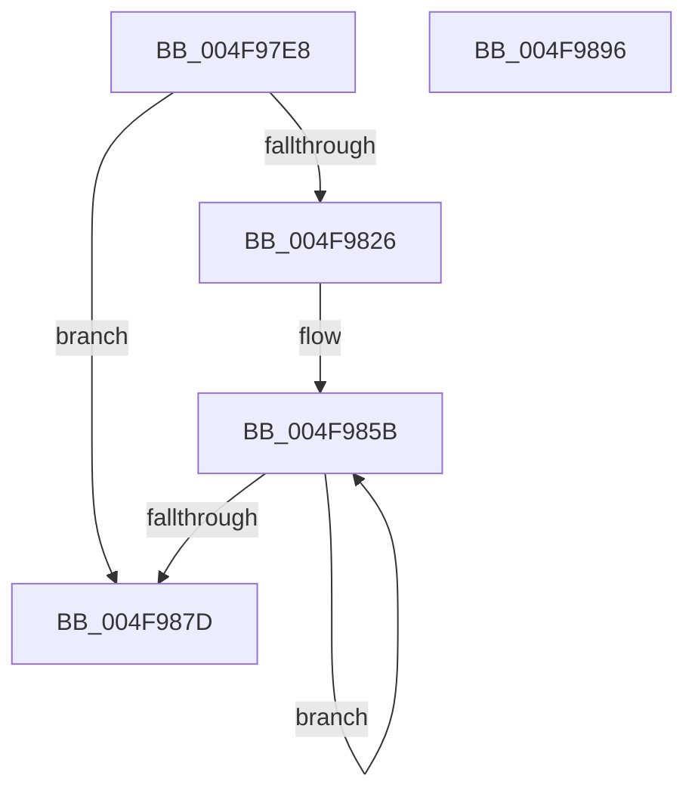

# MiInitializeFoundLargeNodePage

- RVA: `0x004F97E8`–`0x004F9897` (길이 `175` bytes)
- VA: `0x00000001404F97E8`
- 실행 섹션: `.text`
- PDB 이름 있음: `예`; PDB Function 태그: `아니요`
- unwind 정보 RVA: `0x00084C9C`
- 디코드: `50`개 명령, `175/175` bytes 표시
- 미해석 바이트: `0` (있으면 어셈블리에 `.byte`로 보존)

> 이 문서는 커널 이미지의 기계어와 PDB 기호를 분석해 생성했습니다. 4번과 5번은 함수 원형과 자료형을 바이너리 사용 방식에서 추정한 C 해석이며 원본 소스 복구 결과는 아닙니다.

## 1. Dependencies

- 직접 호출 지점: **3**; 고유 호출 대상: **3**
- 직접 호출자로 확인된 함수: **2**
- RIP 상대 이미지 참조: **1**

### Outgoing calls
- `0x004F9808` → [MiGetPfnPageSizeIndex](../31/MiGetPfnPageSizeIndex_function_0031C710.md) (function, `0x0031C710`)
- `0x004F981B` → [MiConvertActiveLargePageToSmall](../42/MiConvertActiveLargePageToSmall_function_00420AF8.md) (function, `0x00420AF8`)
- `0x004F986F` → [MiSetPfnOwnedAndActive](../46/MiSetPfnOwnedAndActive_function_004652AC.md) (function, `0x004652AC`)

### Direct callers
- [MiFindContiguousPagesEx](../28/MiFindContiguousPagesEx_function_0028BDE0.md) at `0x0028CA6E`
- [MiAllocatePartitionPhysicalPages](../../page/80/MiAllocatePartitionPhysicalPages_function_0080C9D4.md) at `0x0080CD1E`

### Static image references
- `0x004F9838` → RVA `0x00011C60` (`.rdata`; read)

## 2. Other-region calls and transfers

- 다른 실행 섹션으로 향하는 call: **0**
- 별도 외부 분기/꼬리 이동을 확인하지 못했습니다.

## 3. Assembly (complete function range)

```asm
004F97E8  48 89 5C 24 08                  mov qword ptr [rsp + 8], rbx
004F97ED  48 89 6C 24 10                  mov qword ptr [rsp + 0x10], rbp
004F97F2  48 89 74 24 18                  mov qword ptr [rsp + 0x18], rsi
004F97F7  57                              push rdi
004F97F8  41 56                           push r14
004F97FA  41 57                           push r15
004F97FC  48 83 EC 30                     sub rsp, 0x30
004F9800  41 8B F0                        mov esi, r8d
004F9803  8B FA                           mov edi, edx
004F9805  48 8B D9                        mov rbx, rcx
004F9808  E8 03 2F E2 FF                  call 0x14031c710
004F980D  41 BF 01 00 00 00               mov r15d, 1
004F9813  8B E8                           mov ebp, eax
004F9815  41 8B D7                        mov edx, r15d
004F9818  48 8B CB                        mov rcx, rbx
004F981B  E8 D8 72 F2 FF                  call 0x140420af8
004F9820  0F BA E7 1E                     bt edi, 0x1e
004F9824  72 57                           jb 0x1404f987d
004F9826  8B 53 20                        mov edx, dword ptr [rbx + 0x20]
004F9829  81 E7 00 00 10 00               and edi, 0x100000
004F982F  C1 EA 10                        shr edx, 0x10
004F9832  8B C5                           mov eax, ebp
004F9834  44 0F B6 F2                     movzx r14d, dl
004F9838  48 8D 2D 21 84 B1 FF            lea rbp, [rip - 0x4e7bdf]
004F983F  41 C1 EE 06                     shr r14d, 6
004F9843  F7 DF                           neg edi
004F9845  48 8B 6C C5 00                  mov rbp, qword ptr [rbp + rax*8]
004F984A  48 8B 43 10                     mov rax, qword ptr [rbx + 0x10]
004F984E  66 1B FF                        sbb di, di
004F9851  66 F7 DF                        neg di
004F9854  66 41 03 FF                     add di, r15w
004F9858  83 CE 08                        or esi, 8
004F985B  45 8B CE                        mov r9d, r14d
004F985E  66 89 7C 24 20                  mov word ptr [rsp + 0x20], di
004F9863  49 C7 C0 F8 FF FF FF            mov r8, 0xfffffffffffffff8
004F986A  8B D6                           mov edx, esi
004F986C  48 8B CB                        mov rcx, rbx
004F986F  E8 38 BA F6 FF                  call 0x1404652ac
004F9874  48 83 C3 30                     add rbx, 0x30
004F9878  49 2B EF                        sub rbp, r15
004F987B  75 DE                           jne 0x1404f985b
004F987D  48 8B 5C 24 50                  mov rbx, qword ptr [rsp + 0x50]
004F9882  48 8B 6C 24 58                  mov rbp, qword ptr [rsp + 0x58]
004F9887  48 8B 74 24 60                  mov rsi, qword ptr [rsp + 0x60]
004F988C  48 83 C4 30                     add rsp, 0x30
004F9890  41 5F                           pop r15
004F9892  41 5E                           pop r14
004F9894  5F                              pop rdi
004F9895  C3                              ret
004F9896  CC                              int3
```

## 4. C-style interpretation (structured pseudocode)

```c
__int64 __fastcall MiInitializeFoundLargeNodePage(__int64 a1, int a2, int a3)
{
    __int64 result;
    __int64 v_r14;
    __int64 v_rbp;
    __int64 v_rbx;
    __int64 v_rdi;
    __int64 v_rsi;
    __int64 v_rsp;
    unsigned __int16 v_stack_m28;
    unsigned __int64 v_stack_p10;
    unsigned __int64 v_stack_p18;
    unsigned __int64 v_stack_p8;

    v_stack_p8 = v_rbx;
    v_stack_p10 = v_rbp;
    v_stack_p18 = v_rsi;
    v_rsp = (v_rsp) - (48);
    result = MiGetPfnPageSizeIndex(a1, a2, a3, a4);
    result = MiConvertActiveLargePageToSmall(a1, 1, a3, a4);
    if (condition_is_below) goto loc_004F987D;
    v_rdi = (unsigned int)(((unsigned int)(a2)) & (0x100000ULL));
    a2 = (unsigned int)(((unsigned int)(*(unsigned int *)(a1 + 32))) >> (16));
    v_r14 = (unsigned int)(((unsigned __int8)(a2)) >> (6));
    v_rdi = (unsigned int)(-(v_rdi));
    v_rdi = (unsigned __int16)(-(v_rdi));
    v_rdi = (unsigned __int16)((v_rdi) + (1));
    v_rsi = (unsigned int)(((unsigned int)(a3)) | (8));
loc_004F985B:
    v_stack_m28 = (unsigned __int16)(v_rdi);
    result = MiSetPfnOwnedAndActive(a1, (unsigned int)((unsigned int)(v_rsi)), -8, (unsigned int)((unsigned int)(v_r14)));
    v_rbx = (a1) + (48);
    v_rbp = (*(unsigned __int64 *)(v_rip - 5143519 + (unsigned int)((unsigned int)((unsigned int)((unsigned int)(result)))) * 8)) - (1);
    if (condition_is_not_equal) goto loc_004F985B;
loc_004F987D:
    v_rsp = (v_rsp) + (48);
    return result;
}
```

## 5. (Beta) C Style

```c
int64_t MiInitializeFoundLargeNodePage(void *Arg1, int32_t Arg2, int32_t Arg3)
{
    uint8_t *arg1 = (uint8_t *)Arg1;

    int64_t result;
    int64_t local_r14;
    int64_t local_rbp;
    int64_t local_rbx;
    int64_t local_rdi;
    int64_t local_rsi;
    int64_t local_rsp;
    uint16_t v_stack_m28;
    uint64_t v_stack_p10;
    uint64_t v_stack_p18;
    uint64_t v_stack_p8;

    v_stack_p8 = local_rbx;
    v_stack_p10 = local_rbp;
    v_stack_p18 = local_rsi;
    local_rsp = (local_rsp) - (48);
    result = MiGetPfnPageSizeIndex(Arg1, Arg2, Arg3, a4);
    result = MiConvertActiveLargePageToSmall(Arg1, 1, Arg3, a4);
    if (condition_is_below) goto loc_004F987D;
    local_rdi = (uint32_t)(((uint32_t)(Arg2)) & (0x100000ULL));
    Arg2 = (uint32_t)(((uint32_t)(*(uint32_t *)(arg1 + 0x20))) >> (16));
    local_r14 = (uint32_t)(((uint8_t)(Arg2)) >> (6));
    local_rdi = (uint32_t)(-(local_rdi));
    local_rdi = (uint16_t)(-(local_rdi));
    local_rdi = (uint16_t)((local_rdi) + (1));
    local_rsi = (uint32_t)(((uint32_t)(Arg3)) | (8));
loc_004F985B:
    v_stack_m28 = (uint16_t)(local_rdi);
    result = MiSetPfnOwnedAndActive(Arg1, (uint32_t)((uint32_t)(local_rsi)), -8, (uint32_t)((uint32_t)(local_r14)));
    local_rbx = (Arg1) + (48);
    local_rbp = (*(uint64_t *)(v_rip - 0x4E7BDF + (uint32_t)((uint32_t)((uint32_t)((uint32_t)(result)))) * 8)) - (1);
    if (condition_is_not_equal) goto loc_004F985B;
loc_004F987D:
    local_rsp = (local_rsp) + (48);
    return result;
}
```

### 관측된 메모리 오프셋

구조체 형식이 확인되지 않은 접근은 인자 기준의 오프셋으로만 기록했습니다.

| 기준 인자 | 오프셋 표현 | 폭 (bit) | 접근 |
|---|---:|---:|---|
| `Arg1` | `+ 0x10` | `64` | `R` |
| `Arg1` | `+ 0x20` | `32` | `R` |

## 6. Execution-region graph

[열기: 2D/3D 그래프와 함수 탐색 컨트롤 패널](../../../control-panel.html?section=text&rva=0x004F97E8&view=graph)

- 2D 그래프는 위에서 아래로 흐르고, 3D 그래프는 빈 공간을 드래그해 회전합니다. Shift+드래그는 이동, 휠은 확대·축소, 함수 노드 선택은 대상 보고서 이동입니다.

### Static fallback


