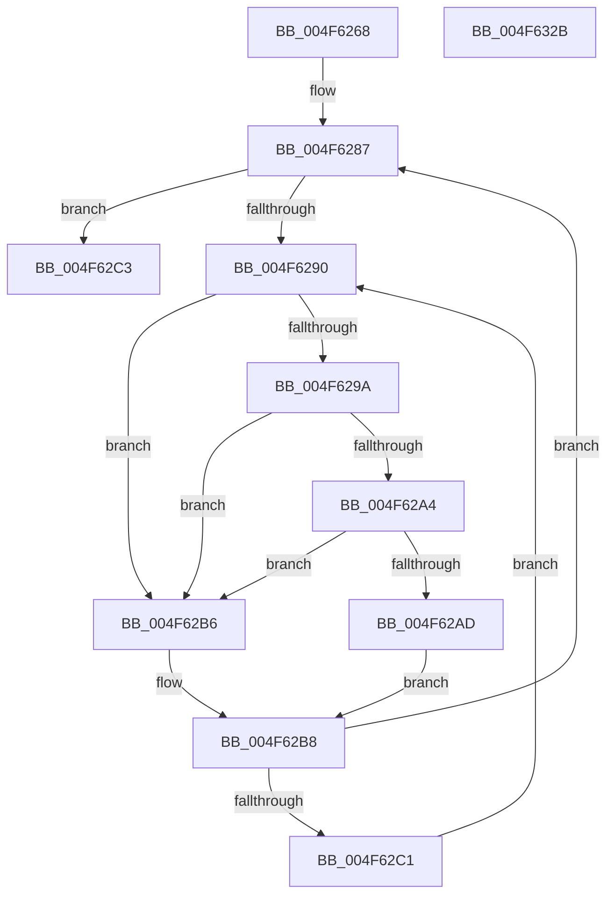

# MiInitializeLargeUserBasePfn

- RVA: `0x004F6268`–`0x004F632C` (길이 `196` bytes)
- VA: `0x00000001404F6268`
- 실행 섹션: `.text`
- PDB 이름 있음: `예`; PDB Function 태그: `아니요`
- unwind 정보 RVA: `0x0006C8E8`
- 디코드: `55`개 명령, `196/196` bytes 표시
- 미해석 바이트: `0` (있으면 어셈블리에 `.byte`로 보존)

> 이 문서는 커널 이미지의 기계어와 PDB 기호를 분석해 생성했습니다. 4번과 5번은 함수 원형과 자료형을 바이너리 사용 방식에서 추정한 C 해석이며 원본 소스 복구 결과는 아닙니다.

## 1. Dependencies

- 직접 호출 지점: **2**; 고유 호출 대상: **2**
- 직접 호출자로 확인된 함수: **1**
- RIP 상대 이미지 참조: **2**

### Outgoing calls
- `0x004F62A4` → [KiCheckVpBackingLongSpinWaitHypercall](../30/KiCheckVpBackingLongSpinWaitHypercall_function_0030F490.md) (function, `0x0030F490`)
- `0x004F62AF` → [HvlNotifyLongSpinWait](../30/HvlNotifyLongSpinWait_function_0030F460.md) (function, `0x0030F460`)

### Direct callers
- [MiInsertLargeUserMapping](../3D/MiInsertLargeUserMapping_function_003D3154.md) at `0x003D3291`

### Static image references
- `0x004F6292` → RVA `0x00FC52AC` (`ALMOSTRO`; reference)
- `0x004F629A` → RVA `0x00FC6AB8` (`ALMOSTRO`; read)

## 2. Other-region calls and transfers

- 다른 실행 섹션으로 향하는 call: **0**
- 별도 외부 분기/꼬리 이동을 확인하지 못했습니다.

## 3. Assembly (complete function range)

```asm
004F6268  48 89 5C 24 10                  mov qword ptr [rsp + 0x10], rbx
004F626D  48 89 6C 24 18                  mov qword ptr [rsp + 0x18], rbp
004F6272  48 89 74 24 20                  mov qword ptr [rsp + 0x20], rsi
004F6277  57                              push rdi
004F6278  48 83 EC 20                     sub rsp, 0x20
004F627C  49 8B F0                        mov rsi, r8
004F627F  48 8B EA                        mov rbp, rdx
004F6282  48 8B D9                        mov rbx, rcx
004F6285  33 FF                           xor edi, edi
004F6287  F0 48 0F BA 6B 18 3F            lock bts qword ptr [rbx + 0x18], 0x3f
004F628E  73 33                           jae 0x1404f62c3
004F6290  FF C7                           inc edi
004F6292  85 3D 14 F0 AC 00               test dword ptr [rip + 0xacf014], edi
004F6298  75 1C                           jne 0x1404f62b6
004F629A  8B 05 18 08 AD 00               mov eax, dword ptr [rip + 0xad0818]
004F62A0  A8 40                           test al, 0x40
004F62A2  74 12                           je 0x1404f62b6
004F62A4  E8 E7 91 E1 FF                  call 0x14030f490
004F62A9  84 C0                           test al, al
004F62AB  74 09                           je 0x1404f62b6
004F62AD  8B CF                           mov ecx, edi
004F62AF  E8 AC 91 E1 FF                  call 0x14030f460
004F62B4  EB 02                           jmp 0x1404f62b8
004F62B6  F3 90                           pause
004F62B8  48 8B 43 18                     mov rax, qword ptr [rbx + 0x18]
004F62BC  48 85 C0                        test rax, rax
004F62BF  79 C6                           jns 0x1404f6287
004F62C1  EB CD                           jmp 0x1404f6290
004F62C3  48 89 6B 08                     mov qword ptr [rbx + 8], rbp
004F62C7  48 C7 03 00 00 00 00            mov qword ptr [rbx], 0
004F62CE  48 8B 03                        mov rax, qword ptr [rbx]
004F62D1  48 C1 EE 03                     shr rsi, 3
004F62D5  48 8B CE                        mov rcx, rsi
004F62D8  48 33 C8                        xor rcx, rax
004F62DB  48 B8 01 00 00 00 00 F0 FF FF   movabs rax, 0xfffff00000000001
004F62E5  48 23 C8                        and rcx, rax
004F62E8  48 33 CE                        xor rcx, rsi
004F62EB  48 89 0B                        mov qword ptr [rbx], rcx
004F62EE  8B 43 20                        mov eax, dword ptr [rbx + 0x20]
004F62F1  89 44 24 30                     mov dword ptr [rsp + 0x30], eax
004F62F5  C1 E8 10                        shr eax, 0x10
004F62F8  24 FE                           and al, 0xfe
004F62FA  0C 06                           or al, 6
004F62FC  88 44 24 32                     mov byte ptr [rsp + 0x32], al
004F6300  8B 44 24 30                     mov eax, dword ptr [rsp + 0x30]
004F6304  89 43 20                        mov dword ptr [rbx + 0x20], eax
004F6307  48 B8 FF FF FF FF FF FF FF 7F   movabs rax, 0x7fffffffffffffff
004F6311  F0 48 21 43 18                  lock and qword ptr [rbx + 0x18], rax
004F6316  48 8B 5C 24 38                  mov rbx, qword ptr [rsp + 0x38]
004F631B  48 8B 6C 24 40                  mov rbp, qword ptr [rsp + 0x40]
004F6320  48 8B 74 24 48                  mov rsi, qword ptr [rsp + 0x48]
004F6325  48 83 C4 20                     add rsp, 0x20
004F6329  5F                              pop rdi
004F632A  C3                              ret
004F632B  CC                              int3
```

## 4. C-style interpretation (structured pseudocode)

```c
__int64 __fastcall MiInitializeLargeUserBasePfn(__int64 a1, __int64 a2, __int64 a3)
{
    __int64 result;
    __int64 v_rdi;
    __int64 v_rsi;
    __int64 v_rsp;
    unsigned __int64 v_stack_p10;
    unsigned __int64 v_stack_p18;
    unsigned __int64 v_stack_p20;
    unsigned int v_stack_p8;
    unsigned __int8 v_stack_pA;

    v_stack_p10 = v_rbx;
    v_stack_p18 = v_rbp;
    v_stack_p20 = v_rsi;
    v_rsp = (v_rsp) - (32);
    v_rdi = 0;
loc_004F6287:
    if (condition_is_above_or_equal) goto loc_004F62C3;
loc_004F6290:
    v_rdi = (unsigned int)((v_rdi) + 1);
    if (((*(unsigned int *)(v_rip + 11333652)) & ((unsigned int)(v_rdi))) != 0) goto loc_004F62B6;
    if ((((unsigned __int8)((unsigned int)(*(unsigned int *)(v_rip + 11339800)))) & (64)) == 0) goto loc_004F62B6;
    result = KiCheckVpBackingLongSpinWaitHypercall(a1, a2, a3, a4);
    if ((unsigned __int8)(result) == 0) goto loc_004F62B6;
    result = HvlNotifyLongSpinWait((unsigned int)((unsigned int)(v_rdi)), a2, a3, a4);
    goto loc_004F62B8;
loc_004F62B6:
loc_004F62B8:
    if (!sign_flag) goto loc_004F6287;
    goto loc_004F6290;
loc_004F62C3:
    *(unsigned __int64 *)(a1 + 8) = a2;
    *(unsigned __int64 *)(a1) = 0;
    v_rsi = (a3) >> (3);
    a1 = (v_rsi) ^ (*(unsigned __int64 *)(a1));
    a1 = (a1) & (*(unsigned __int64 *)(a1));
    a1 = (a1) ^ (v_rsi);
    *(unsigned __int64 *)(a1) = a1;
    v_stack_p8 = (unsigned int)((unsigned int)(*(unsigned int *)(a1 + 32)));
    result = (unsigned int)(((unsigned int)(*(unsigned int *)(a1 + 32))) >> (16));
    result = (unsigned __int8)((result) & (254));
    result = (unsigned __int8)((result) | (6));
    v_stack_pA = (unsigned __int8)(result);
    *(unsigned int *)(a1 + 32) = (unsigned int)((unsigned int)(v_stack_p8));
    v_rsp = (v_rsp) + (32);
    return (unsigned int)(v_stack_p8);
}
```

## 5. (Beta) C Style

```c
int64_t MiInitializeLargeUserBasePfn(void *Arg1, int64_t Arg2, int64_t Arg3)
{
    uint8_t *arg1 = (uint8_t *)Arg1;

    int64_t result;
    int64_t local_rdi;
    int64_t local_rsi;
    int64_t local_rsp;
    uint64_t v_stack_p10;
    uint64_t v_stack_p18;
    uint64_t v_stack_p20;
    uint32_t v_stack_p8;
    uint8_t v_stack_pA;

    v_stack_p10 = local_rbx;
    v_stack_p18 = local_rbp;
    v_stack_p20 = local_rsi;
    local_rsp = (local_rsp) - (32);
    local_rdi = 0;
loc_004F6287:
    if (condition_is_above_or_equal) goto loc_004F62C3;
loc_004F6290:
    local_rdi = (uint32_t)((local_rdi) + 1);
    if (((*(uint32_t *)(v_rip + 0xACF014)) & ((uint32_t)(local_rdi))) != 0) goto loc_004F62B6;
    if ((((uint8_t)((uint32_t)(*(uint32_t *)(v_rip + 0xAD0818)))) & (64)) == 0) goto loc_004F62B6;
    result = KiCheckVpBackingLongSpinWaitHypercall(Arg1, Arg2, Arg3, a4);
    if ((uint8_t)(result) == 0) goto loc_004F62B6;
    result = HvlNotifyLongSpinWait((uint32_t)((uint32_t)(local_rdi)), Arg2, Arg3, a4);
    goto loc_004F62B8;
loc_004F62B6:
loc_004F62B8:
    if (!sign_flag) goto loc_004F6287;
    goto loc_004F6290;
loc_004F62C3:
    *(uint64_t *)(arg1 + 0x8) = Arg2;
    *(uint64_t *)(arg1) = 0;
    local_rsi = (Arg3) >> (3);
    Arg1 = (local_rsi) ^ (*(uint64_t *)(arg1));
    Arg1 = (Arg1) & (*(uint64_t *)(arg1));
    Arg1 = (Arg1) ^ (local_rsi);
    *(void **)(arg1) = Arg1;
    v_stack_p8 = (uint32_t)((uint32_t)(*(uint32_t *)(arg1 + 0x20)));
    result = (uint32_t)(((uint32_t)(*(uint32_t *)(arg1 + 0x20))) >> (16));
    result = (uint8_t)((result) & (254));
    result = (uint8_t)((result) | (6));
    v_stack_pA = (uint8_t)(result);
    *(uint32_t *)(arg1 + 0x20) = (uint32_t)((uint32_t)(v_stack_p8));
    local_rsp = (local_rsp) + (32);
    return (uint32_t)(v_stack_p8);
}
```

### 관측된 메모리 오프셋

구조체 형식이 확인되지 않은 접근은 인자 기준의 오프셋으로만 기록했습니다.

| 기준 인자 | 오프셋 표현 | 폭 (bit) | 접근 |
|---|---:|---:|---|
| `Arg1` | `+ 0x0` | `64` | `R` |
| `Arg1` | `+ 0x0` | `64` | `W` |
| `Arg1` | `+ 0x8` | `64` | `W` |
| `Arg1` | `+ 0x18` | `64` | `R` |
| `Arg1` | `+ 0x18` | `64` | `R/W` |
| `Arg1` | `+ 0x20` | `32` | `R` |
| `Arg1` | `+ 0x20` | `32` | `W` |

## 6. Execution-region graph

[열기: 2D/3D 그래프와 함수 탐색 컨트롤 패널](../../../control-panel.html?section=text&rva=0x004F6268&view=graph)

- 2D 그래프는 위에서 아래로 흐르고, 3D 그래프는 빈 공간을 드래그해 회전합니다. Shift+드래그는 이동, 휠은 확대·축소, 함수 노드 선택은 대상 보고서 이동입니다.

### Static fallback


