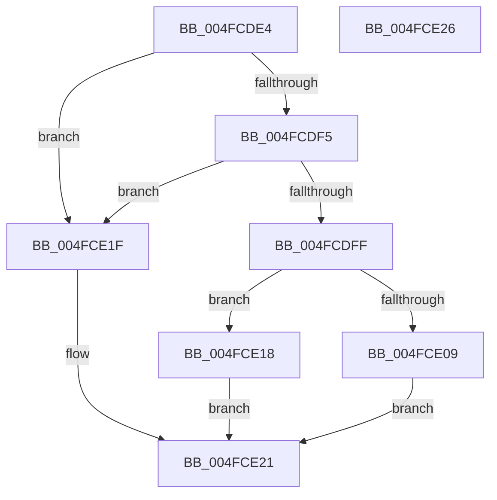

# MiIsFreeSlabPage

- RVA: `0x004FCDE4`–`0x004FCE27` (길이 `67` bytes)
- VA: `0x00000001404FCDE4`
- 실행 섹션: `.text`
- PDB 이름 있음: `예`; PDB Function 태그: `아니요`
- unwind 정보 RVA: `0x0005C788`
- 디코드: `23`개 명령, `67/67` bytes 표시
- 미해석 바이트: `0` (있으면 어셈블리에 `.byte`로 보존)

> 이 문서는 커널 이미지의 기계어와 PDB 기호를 분석해 생성했습니다. 4번과 5번은 함수 원형과 자료형을 바이너리 사용 방식에서 추정한 C 해석이며 원본 소스 복구 결과는 아닙니다.

## 1. Dependencies

- 직접 호출 지점: **1**; 고유 호출 대상: **1**
- 직접 호출자로 확인된 함수: **2**
- RIP 상대 이미지 참조: **0**

### Outgoing calls
- `0x004FCDEB` → [MiGetPfnSlabType](../28/MiGetPfnSlabType_function_0028E2D0.md) (function, `0x0028E2D0`)

### Direct callers
- [MiIsPageSecured](../22/MiIsPageSecured_function_00228524.md) at `0x00228558`
- [MiPurgeSlabEntry](../48/MiPurgeSlabEntry_function_0048D444.md) at `0x0048D51A`

### Static image references
- 디코드된 RIP-relative 메모리 참조가 없습니다.

## 2. Other-region calls and transfers

- 다른 실행 섹션으로 향하는 call: **0**
- 별도 외부 분기/꼬리 이동을 확인하지 못했습니다.

## 3. Assembly (complete function range)

```asm
004FCDE4  48 83 EC 28                     sub rsp, 0x28
004FCDE8  4C 8B C1                        mov r8, rcx
004FCDEB  E8 E0 14 D9 FF                  call 0x14028e2d0
004FCDF0  83 F8 09                        cmp eax, 9
004FCDF3  74 2A                           je 0x1404fce1f
004FCDF5  41 8A 40 22                     mov al, byte ptr [r8 + 0x22]
004FCDF9  24 07                           and al, 7
004FCDFB  3C 05                           cmp al, 5
004FCDFD  75 20                           jne 0x1404fce1f
004FCDFF  49 8B 40 08                     mov rax, qword ptr [r8 + 8]
004FCE03  48 83 F8 FF                     cmp rax, -1
004FCE07  74 0F                           je 0x1404fce18
004FCE09  49 8B 48 08                     mov rcx, qword ptr [r8 + 8]
004FCE0D  33 C0                           xor eax, eax
004FCE0F  48 83 F9 FE                     cmp rcx, -2
004FCE13  0F 94 C0                        sete al
004FCE16  EB 09                           jmp 0x1404fce21
004FCE18  B8 01 00 00 00                  mov eax, 1
004FCE1D  EB 02                           jmp 0x1404fce21
004FCE1F  33 C0                           xor eax, eax
004FCE21  48 83 C4 28                     add rsp, 0x28
004FCE25  C3                              ret
004FCE26  CC                              int3
```

## 4. C-style interpretation (structured pseudocode)

```c
__int64 __fastcall MiIsFreeSlabPage(__int64 a1)
{
    __int64 result;
    __int64 v_rsp;

    v_rsp = (v_rsp) - (40);
    result = MiGetPfnSlabType(a1, a2, a1, a4);
    if (((unsigned int)(result)) == 9) goto loc_004FCE1F;
    result = (unsigned __int8)((*(unsigned __int8 *)(a1 + 34)) & (7));
    if (((unsigned __int8)(result)) != 5) goto loc_004FCE1F;
    if ((*(unsigned __int64 *)(a1 + 8)) == -1) goto loc_004FCE18;
    result = 0;
    result = ((*(unsigned __int64 *)(a1 + 8)) == -2) ? 1 : 0;
    goto loc_004FCE21;
loc_004FCE18:
    goto loc_004FCE21;
loc_004FCE1F:
    result = 0;
loc_004FCE21:
    v_rsp = (v_rsp) + (40);
    return result;
}
```

## 5. (Beta) C Style

```c
int64_t MiIsFreeSlabPage(int64_t Arg1)
{
    int64_t result;
    int64_t local_rsp;

    local_rsp = (local_rsp) - (40);
    result = MiGetPfnSlabType(Arg1, a2, Arg1, a4);
    if (((uint32_t)(result)) == 9) goto loc_004FCE1F;
    result = (uint8_t)((*(uint8_t *)(Arg1 + 0x22)) & (7));
    if (((uint8_t)(result)) != 5) goto loc_004FCE1F;
    if ((*(uint64_t *)(Arg1 + 0x8)) == -1) goto loc_004FCE18;
    result = 0;
    result = ((*(uint64_t *)(Arg1 + 0x8)) == -2) ? 1 : 0;
    goto loc_004FCE21;
loc_004FCE18:
    goto loc_004FCE21;
loc_004FCE1F:
    result = 0;
loc_004FCE21:
    local_rsp = (local_rsp) + (40);
    return result;
}
```

## 6. Execution-region graph

[열기: 2D/3D 그래프와 함수 탐색 컨트롤 패널](../../../control-panel.html?section=text&rva=0x004FCDE4&view=graph)

- 2D 그래프는 위에서 아래로 흐르고, 3D 그래프는 빈 공간을 드래그해 회전합니다. Shift+드래그는 이동, 휠은 확대·축소, 함수 노드 선택은 대상 보고서 이동입니다.

### Static fallback


