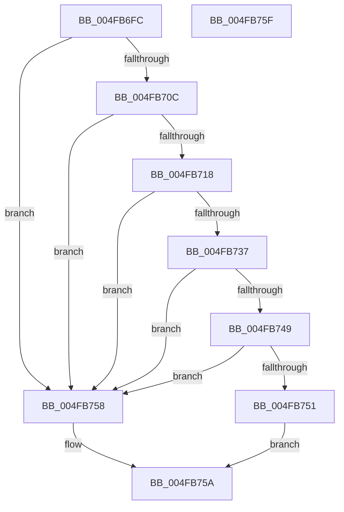

# MiIsVadEligibleForCommitRelease

- RVA: `0x004FB6FC`–`0x004FB760` (길이 `100` bytes)
- VA: `0x00000001404FB6FC`
- 실행 섹션: `.text`
- PDB 이름 있음: `예`; PDB Function 태그: `아니요`
- unwind 정보 RVA: `0x0005C788`
- 디코드: `30`개 명령, `100/100` bytes 표시
- 미해석 바이트: `0` (있으면 어셈블리에 `.byte`로 보존)

> 이 문서는 커널 이미지의 기계어와 PDB 기호를 분석해 생성했습니다. 4번과 5번은 함수 원형과 자료형을 바이너리 사용 방식에서 추정한 C 해석이며 원본 소스 복구 결과는 아닙니다.

## 1. Dependencies

- 직접 호출 지점: **2**; 고유 호출 대상: **2**
- 직접 호출자로 확인된 함수: **4**
- RIP 상대 이미지 참조: **0**

### Outgoing calls
- `0x004FB703` → [MiVadSupportsPrivateCommit](../31/MiVadSupportsPrivateCommit_function_00316FD0.md) (function, `0x00316FD0`)
- `0x004FB70F` → [MiVadMapsLargeImage](../2A/MiVadMapsLargeImage_function_002A70F0.md) (function, `0x002A70F0`)

### Direct callers
- [MiUserFault](../32/MiUserFault_function_00329840.md) at `0x0032A0B0`
- [MiReleaseOutSwappedProcessCommit](../3C/MiReleaseOutSwappedProcessCommit_function_003C8320.md) at `0x003C8461`
- [MiProcessCommitIntact](../40/MiProcessCommitIntact_function_004093C0.md) at `0x00409447`
- [MiReleaseCommitForResetPages](../66/MiReleaseCommitForResetPages_function_0066FAF8.md) at `0x0066FB82`

### Static image references
- 디코드된 RIP-relative 메모리 참조가 없습니다.

## 2. Other-region calls and transfers

- 다른 실행 섹션으로 향하는 call: **0**
- 별도 외부 분기/꼬리 이동을 확인하지 못했습니다.

## 3. Assembly (complete function range)

```asm
004FB6FC  48 83 EC 28                     sub rsp, 0x28
004FB700  4C 8B C1                        mov r8, rcx
004FB703  E8 C8 B8 E1 FF                  call 0x140316fd0
004FB708  85 C0                           test eax, eax
004FB70A  74 4C                           je 0x1404fb758
004FB70C  49 8B C8                        mov rcx, r8
004FB70F  E8 DC B9 DA FF                  call 0x1402a70f0
004FB714  85 C0                           test eax, eax
004FB716  75 40                           jne 0x1404fb758
004FB718  41 8B 50 34                     mov edx, dword ptr [r8 + 0x34]
004FB71C  48 B8 FD FF FF FF 07 00 00 00   movabs rax, 0x7fffffffd
004FB726  41 0F B6 48 22                  movzx ecx, byte ptr [r8 + 0x22]
004FB72B  48 C1 E1 20                     shl rcx, 0x20
004FB72F  48 0B CA                        or rcx, rdx
004FB732  48 3B C8                        cmp rcx, rax
004FB735  73 21                           jae 0x1404fb758
004FB737  41 8B 50 34                     mov edx, dword ptr [r8 + 0x34]
004FB73B  41 0F B6 48 22                  movzx ecx, byte ptr [r8 + 0x22]
004FB740  48 C1 E1 20                     shl rcx, 0x20
004FB744  48 0B CA                        or rcx, rdx
004FB747  74 0F                           je 0x1404fb758
004FB749  41 8B 40 30                     mov eax, dword ptr [r8 + 0x30]
004FB74D  A8 08                           test al, 8
004FB74F  75 07                           jne 0x1404fb758
004FB751  B8 01 00 00 00                  mov eax, 1
004FB756  EB 02                           jmp 0x1404fb75a
004FB758  33 C0                           xor eax, eax
004FB75A  48 83 C4 28                     add rsp, 0x28
004FB75E  C3                              ret
004FB75F  CC                              int3
```

## 4. C-style interpretation (structured pseudocode)

```c
__int64 __fastcall MiIsVadEligibleForCommitRelease(__int64 a1)
{
    __int64 result;
    __int64 v_rsp;

    v_rsp = (v_rsp) - (40);
    result = MiVadSupportsPrivateCommit(a1, a2, a1, a4);
    if ((unsigned int)(result) == 0) goto loc_004FB758;
    result = MiVadMapsLargeImage(a1, a2, a1, a4);
    if ((unsigned int)(result) != 0) goto loc_004FB758;
    a1 = (*(unsigned __int8 *)(a1 + 34)) << (32);
    a1 = (a1) | ((unsigned int)(*(unsigned int *)(a1 + 52)));
    if (a1 >= result) goto loc_004FB758;
    a1 = (*(unsigned __int8 *)(a1 + 34)) << (32);
    a1 = (a1) | ((unsigned int)(*(unsigned int *)(a1 + 52)));
    if (condition_is_equal) goto loc_004FB758;
    if ((((unsigned __int8)((unsigned int)(*(unsigned int *)(a1 + 48)))) & (8)) != 0) goto loc_004FB758;
    goto loc_004FB75A;
loc_004FB758:
    result = 0;
loc_004FB75A:
    v_rsp = (v_rsp) + (40);
    return result;
}
```

## 5. (Beta) C Style

```c
int64_t MiIsVadEligibleForCommitRelease(int64_t Arg1)
{
    int64_t result;
    int64_t local_rsp;

    local_rsp = (local_rsp) - (40);
    result = MiVadSupportsPrivateCommit(Arg1, a2, Arg1, a4);
    if ((uint32_t)(result) == 0) goto loc_004FB758;
    result = MiVadMapsLargeImage(Arg1, a2, Arg1, a4);
    if ((uint32_t)(result) != 0) goto loc_004FB758;
    Arg1 = (*(uint8_t *)(Arg1 + 0x22)) << (32);
    Arg1 = (Arg1) | ((uint32_t)(*(uint32_t *)(Arg1 + 0x34)));
    if (Arg1 >= result) goto loc_004FB758;
    Arg1 = (*(uint8_t *)(Arg1 + 0x22)) << (32);
    Arg1 = (Arg1) | ((uint32_t)(*(uint32_t *)(Arg1 + 0x34)));
    if (condition_is_equal) goto loc_004FB758;
    if ((((uint8_t)((uint32_t)(*(uint32_t *)(Arg1 + 0x30)))) & (8)) != 0) goto loc_004FB758;
    goto loc_004FB75A;
loc_004FB758:
    result = 0;
loc_004FB75A:
    local_rsp = (local_rsp) + (40);
    return result;
}
```

## 6. Execution-region graph

[열기: 2D/3D 그래프와 함수 탐색 컨트롤 패널](../../../control-panel.html?section=text&rva=0x004FB6FC&view=graph)

- 2D 그래프는 위에서 아래로 흐르고, 3D 그래프는 빈 공간을 드래그해 회전합니다. Shift+드래그는 이동, 휠은 확대·축소, 함수 노드 선택은 대상 보고서 이동입니다.

### Static fallback


