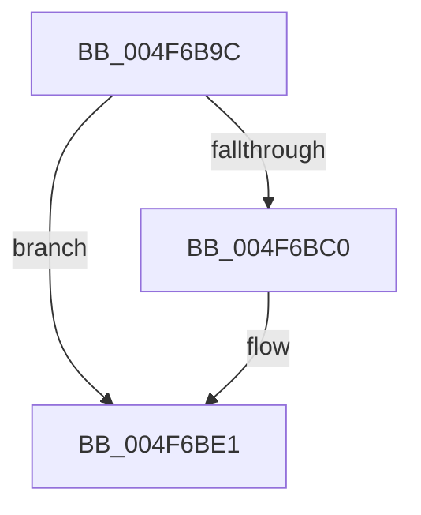

# MiIssueNoPtesBugcheck

- RVA: `0x004F6B9C`–`0x004F6BFD` (길이 `97` bytes)
- VA: `0x00000001404F6B9C`
- 실행 섹션: `.text`
- PDB 이름 있음: `예`; PDB Function 태그: `아니요`
- unwind 정보 RVA: `0x000BF360`
- 디코드: `26`개 명령, `97/97` bytes 표시
- 미해석 바이트: `0` (있으면 어셈블리에 `.byte`로 보존)

> 이 문서는 커널 이미지의 기계어와 PDB 기호를 분석해 생성했습니다. 4번과 5번은 함수 원형과 자료형을 바이너리 사용 방식에서 추정한 C 해석이며 원본 소스 복구 결과는 아닙니다.

## 1. Dependencies

- 직접 호출 지점: **5**; 고유 호출 대상: **3**
- 직접 호출자로 확인된 함수: **1**
- RIP 상대 이미지 참조: **0**

### Outgoing calls
- `0x004F6BB3` → [MiGetHighestPteConsumer](MiGetHighestPteConsumer_function_004F6C04.md) (function, `0x004F6C04`)
- `0x004F6BC0` → [MmGetNumberOfFreeSystemPtes](../46/MmGetNumberOfFreeSystemPtes_function_004640D0.md) (function, `0x004640D0`)
- `0x004F6BDB` → [KeBugCheckEx](KeBugCheckEx_function_004FD660.md) (function, `0x004FD660`)
- `0x004F6BE1` → [MmGetNumberOfFreeSystemPtes](../46/MmGetNumberOfFreeSystemPtes_function_004640D0.md) (function, `0x004640D0`)
- `0x004F6BF7` → [KeBugCheckEx](KeBugCheckEx_function_004FD660.md) (function, `0x004FD660`)

### Direct callers
- [MmMapLockedPagesSpecifyCache](../31/MmMapLockedPagesSpecifyCache_function_00318800.md) at `0x00318C28`
- [MmMapLockedPagesSpecifyCache](../31/MmMapLockedPagesSpecifyCache_function_00318800.md) at `0x00318CE9`

### Static image references
- 디코드된 RIP-relative 메모리 참조가 없습니다.

## 2. Other-region calls and transfers

- 다른 실행 섹션으로 향하는 call: **0**
- 별도 외부 분기/꼬리 이동을 확인하지 못했습니다.

## 3. Assembly (complete function range)

```asm
004F6B9C  48 89 5C 24 08                  mov qword ptr [rsp + 8], rbx
004F6BA1  57                              push rdi
004F6BA2  48 83 EC 30                     sub rsp, 0x30
004F6BA6  48 83 64 24 48 00               and qword ptr [rsp + 0x48], 0
004F6BAC  8B F9                           mov edi, ecx
004F6BAE  48 8D 4C 24 48                  lea rcx, [rsp + 0x48]
004F6BB3  E8 4C 00 00 00                  call 0x1404f6c04
004F6BB8  48 8B D8                        mov rbx, rax
004F6BBB  48 85 C0                        test rax, rax
004F6BBE  74 21                           je 0x1404f6be1
004F6BC0  E8 0B D5 F6 FF                  call 0x1404640d0
004F6BC5  4C 8B 44 24 48                  mov r8, qword ptr [rsp + 0x48]
004F6BCA  4C 8B C8                        mov r9, rax
004F6BCD  48 83 64 24 20 00               and qword ptr [rsp + 0x20], 0
004F6BD3  48 8B D3                        mov rdx, rbx
004F6BD6  B9 D8 00 00 00                  mov ecx, 0xd8
004F6BDB  E8 80 6A 00 00                  call 0x1404fd660
004F6BE0  CC                              int3
004F6BE1  E8 EA D4 F6 FF                  call 0x1404640d0
004F6BE6  48 83 64 24 20 00               and qword ptr [rsp + 0x20], 0
004F6BEC  33 D2                           xor edx, edx
004F6BEE  4C 8B C8                        mov r9, rax
004F6BF1  4C 8B C7                        mov r8, rdi
004F6BF4  8D 4A 3F                        lea ecx, [rdx + 0x3f]
004F6BF7  E8 64 6A 00 00                  call 0x1404fd660
004F6BFC  CC                              int3
```

## 4. C-style interpretation (structured pseudocode)

```c
__int64 __fastcall MiIssueNoPtesBugcheck(int a1)
{
    __int64 result;
    __int64 v_rsp;
    unsigned __int64 v_stack_m18;
    unsigned __int64 v_stack_p10;
    unsigned __int64 v_stack_p8;

    v_stack_p8 = v_rbx;
    v_rsp = (v_rsp) - (48);
    result = MiGetHighestPteConsumer(v_stack_p10, a2, a3, a4);
    if (result != 0) {
        result = MmGetNumberOfFreeSystemPtes(v_stack_p10, a2, a3, a4);
        a3 = v_stack_p10;
        a4 = result;
        a2 = result;
        a1 = 216;
        result = KeBugCheckEx(a1, a2, a3, a4);
    }
    result = MmGetNumberOfFreeSystemPtes(a1, a2, a3, a4);
    a2 = 0;
    result = KeBugCheckEx(a2 + 63, a2, (unsigned int)(a1), result);
    return result;
}
```

## 5. (Beta) C Style

```c
int64_t MiIssueNoPtesBugcheck(int32_t Arg1)
{
    int64_t result;
    int64_t local_rsp;
    uint64_t v_stack_m18;
    uint64_t v_stack_p10;
    uint64_t v_stack_p8;

    v_stack_p8 = local_rbx;
    local_rsp = (local_rsp) - (48);
    result = MiGetHighestPteConsumer(v_stack_p10, a2, a3, a4);
    if (result != 0) {
        result = MmGetNumberOfFreeSystemPtes(v_stack_p10, a2, a3, a4);
        a3 = v_stack_p10;
        a4 = result;
        a2 = result;
        Arg1 = 216;
        result = KeBugCheckEx(Arg1, a2, a3, a4);
    }
    result = MmGetNumberOfFreeSystemPtes(Arg1, a2, a3, a4);
    a2 = 0;
    result = KeBugCheckEx(a2 + 63, a2, (uint32_t)(Arg1), result);
    return result;
}
```

## 6. Execution-region graph

[열기: 2D/3D 그래프와 함수 탐색 컨트롤 패널](../../../control-panel.html?section=text&rva=0x004F6B9C&view=graph)

- 2D 그래프는 위에서 아래로 흐르고, 3D 그래프는 빈 공간을 드래그해 회전합니다. Shift+드래그는 이동, 휠은 확대·축소, 함수 노드 선택은 대상 보고서 이동입니다.

### Static fallback


