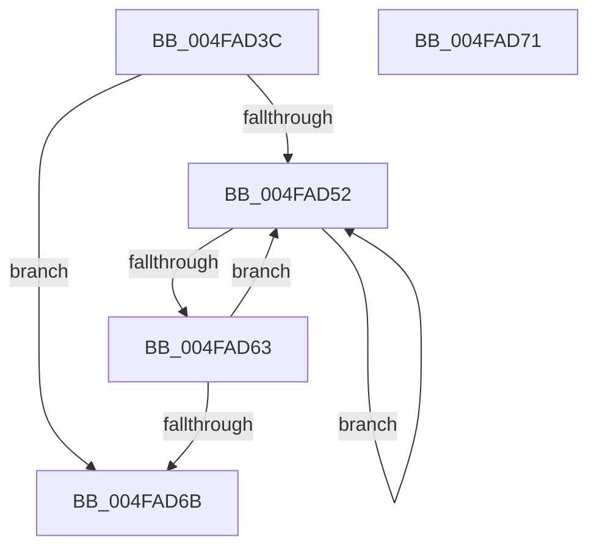

# MiLockColorHeadHugeAtDpc

- RVA: `0x004FAD3C`–`0x004FAD72` (길이 `54` bytes)
- VA: `0x00000001404FAD3C`
- 실행 섹션: `.text`
- PDB 이름 있음: `예`; PDB Function 태그: `아니요`
- unwind 정보 RVA: `0x0005CF00`
- 디코드: `17`개 명령, `54/54` bytes 표시
- 미해석 바이트: `0` (있으면 어셈블리에 `.byte`로 보존)

> 이 문서는 커널 이미지의 기계어와 PDB 기호를 분석해 생성했습니다. 4번과 5번은 함수 원형과 자료형을 바이너리 사용 방식에서 추정한 C 해석이며 원본 소스 복구 결과는 아닙니다.

## 1. Dependencies

- 직접 호출 지점: **1**; 고유 호출 대상: **1**
- 직접 호출자로 확인된 함수: **4**
- RIP 상대 이미지 참조: **0**

### Outgoing calls
- `0x004FAD57` → [KeYieldProcessorEx](../3F/KeYieldProcessorEx_function_003FBD00.md) (function, `0x003FBD00`)

### Direct callers
- [MiInsertHugeRangeInList](../43/MiInsertHugeRangeInList_function_004371E8.md) at `0x00437324`
- [MiLockHugeRangeColorHeadAtDpc](MiLockHugeRangeColorHeadAtDpc_function_004FAD14.md) at `0x004FAD25`
- [MiGetPerfectColorHeadHugeRange](../67/MiGetPerfectColorHeadHugeRange_function_00675C08.md) at `0x00675D01`
- [MiHugePurgeZeroList](../67/MiHugePurgeZeroList_function_00676124.md) at `0x00676251`

### Static image references
- 디코드된 RIP-relative 메모리 참조가 없습니다.

## 2. Other-region calls and transfers

- 다른 실행 섹션으로 향하는 call: **0**
- 별도 외부 분기/꼬리 이동을 확인하지 못했습니다.

## 3. Assembly (complete function range)

```asm
004FAD3C  40 53                           push rbx
004FAD3E  48 83 EC 20                     sub rsp, 0x20
004FAD42  83 64 24 30 00                  and dword ptr [rsp + 0x30], 0
004FAD47  48 8B D9                        mov rbx, rcx
004FAD4A  F0 48 0F BA 29 03               lock bts qword ptr [rcx], 3
004FAD50  73 19                           jae 0x1404fad6b
004FAD52  48 8D 4C 24 30                  lea rcx, [rsp + 0x30]
004FAD57  E8 A4 0F F0 FF                  call 0x1403fbd00
004FAD5C  48 8B 03                        mov rax, qword ptr [rbx]
004FAD5F  A8 08                           test al, 8
004FAD61  75 EF                           jne 0x1404fad52
004FAD63  F0 48 0F BA 2B 03               lock bts qword ptr [rbx], 3
004FAD69  72 E7                           jb 0x1404fad52
004FAD6B  48 83 C4 20                     add rsp, 0x20
004FAD6F  5B                              pop rbx
004FAD70  C3                              ret
004FAD71  CC                              int3
```

## 4. C-style interpretation (structured pseudocode)

```c
__int64 __fastcall MiLockColorHeadHugeAtDpc(__int64 a1)
{
    __int64 result;
    __int64 v_rsp;
    unsigned int v_stack_p8;

    v_rsp = (v_rsp) - (32);
    if (condition_is_above_or_equal) goto loc_004FAD6B;
loc_004FAD52:
    result = KeYieldProcessorEx(v_stack_p8, a2, a3, a4);
    if ((((unsigned __int8)(*(unsigned __int64 *)(a1))) & (8)) != 0) goto loc_004FAD52;
    if (condition_is_below) goto loc_004FAD52;
loc_004FAD6B:
    v_rsp = (v_rsp) + (32);
    return *(unsigned __int64 *)(a1);
}
```

## 5. (Beta) C Style

```c
int64_t MiLockColorHeadHugeAtDpc(void *Arg1)
{
    uint8_t *arg1 = (uint8_t *)Arg1;

    int64_t result;
    int64_t local_rsp;
    uint32_t v_stack_p8;

    local_rsp = (local_rsp) - (32);
    if (condition_is_above_or_equal) goto loc_004FAD6B;
loc_004FAD52:
    result = KeYieldProcessorEx(v_stack_p8, a2, a3, a4);
    if ((((uint8_t)(*(uint64_t *)(arg1))) & (8)) != 0) goto loc_004FAD52;
    if (condition_is_below) goto loc_004FAD52;
loc_004FAD6B:
    local_rsp = (local_rsp) + (32);
    return *(uint64_t *)(arg1);
}
```

### 관측된 메모리 오프셋

구조체 형식이 확인되지 않은 접근은 인자 기준의 오프셋으로만 기록했습니다.

| 기준 인자 | 오프셋 표현 | 폭 (bit) | 접근 |
|---|---:|---:|---|
| `Arg1` | `+ 0x0` | `64` | `R` |
| `Arg1` | `+ 0x0` | `64` | `R/W` |

## 6. Execution-region graph

[열기: 2D/3D 그래프와 함수 탐색 컨트롤 패널](../../../control-panel.html?section=text&rva=0x004FAD3C&view=graph)

- 2D 그래프는 위에서 아래로 흐르고, 3D 그래프는 빈 공간을 드래그해 회전합니다. Shift+드래그는 이동, 휠은 확대·축소, 함수 노드 선택은 대상 보고서 이동입니다.

### Static fallback


